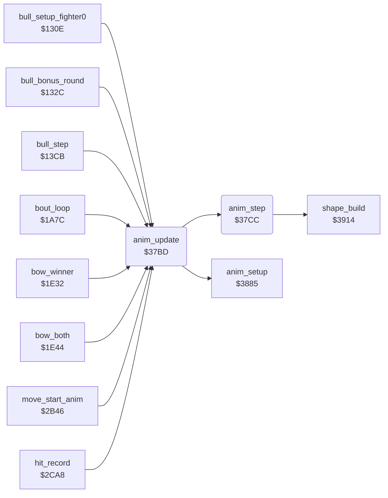

<!-- Generated by c64-docs from knowledge revision 20261022T104543.905-o1bqdy and .c64-re-tools/local/generated/src/source-map.json. Do not edit: change the knowledge, generate the source again, then run docs.ts generate. -->
# fighter/anim_step.asm: Animation stepper: 4-byte script steps (delay, frame, dx, dy), movement and X limits by facing

Range `$37BD-$37D6`. Source: [fighter/anim_step.asm](../../../../src/fighter/anim_step.asm). Index: [the reference](../../index.md).

## Call graph

A solid arrow is a call, a thick arrow a table entry, a dotted arrow a jump. Rounded nodes are in this file.

## Names

### [`anim_update`](../../../../src/fighter/anim_step.asm#L6) `$37BD`

*routine*

Plays one frame of the animation of fighter X. Does nothing when anim_number is 0. Calls anim_setup when anim_started is 0, then anim_step. Callers: bull round $1328/$135e/$13d5, bout loop $1a85/$1a8a, bows $1e35/$1e50/$1e55, move start $2b6d, trap $2cb8.

- **Called from:** [`bull_setup_fighter0`](../game/bull_round_12f8.md#bull_setup_fighter0) [`$1328`](../../../../src/game/bull_round_12f8.asm#L33), [`bull_bonus_round`](../game/bull_round_12f8.md#bull_bonus_round) [`$135E`](../../../../src/game/bull_round_12f8.asm#L61), [`bull_step`](../game/bull_round_12f8.md#bull_step) [`$13D5`](../../../../src/game/bull_round_12f8.asm#L127), [`bull_step`](../game/bull_round_12f8.md#bull_step) [`$1427`](../../../../src/game/bull_round_12f8.asm#L180), [`bout_loop`](../game/bout_loop.md#bout_loop) [`$1A85`](../../../../src/game/bout_loop.asm#L59), [`bout_loop`](../game/bout_loop.md#bout_loop) [`$1A8A`](../../../../src/game/bout_loop.asm#L61), [`bow_winner`](../game/game_modes.md#bow_winner) [`$1E35`](../../../../src/game/game_modes.asm#L429), [`bow_both`](../game/game_modes.md#bow_both) [`$1E50`](../../../../src/game/game_modes.asm#L445), [`bow_both`](../game/game_modes.md#bow_both) [`$1E55`](../../../../src/game/game_modes.asm#L447), [`move_start_anim`](fighter_moves.md#move_start_anim) [`$2B6D`](../../../../src/fighter/fighter_moves.asm#L289), [`hit_record`](hit_test.md#hit_record) [`$2CB8`](../../../../src/fighter/hit_test.asm#L200)
- **Calls:** [`anim_setup`](anim_step_37d8.md#anim_setup), [`anim_step`](anim_step.md#anim_step)

### [`anim_update_step`](../../../../src/fighter/anim_step.asm#L12) `$37C8`

*label*

- **Jumped to from:** [`anim_update`](anim_step.md#anim_update) [`$37C3`](../../../../src/fighter/anim_step.asm#L10)

### [`anim_update_done`](../../../../src/fighter/anim_step.asm#L14) `$37CB`

*label*

- **Jumped to from:** [`anim_update`](anim_step.md#anim_update) [`$37BF`](../../../../src/fighter/anim_step.asm#L8)

### [`anim_step`](../../../../src/fighter/anim_step.asm#L17) `$37CC`

*routine*

Counts down anim_frame_delay of fighter X. At 0 it loads the next 4-byte step (forward, or backward when anim_reverse is 1) and builds the shape. On every frame it adds anim_step_dx/dy to the position. After the last step it clears anim_number and sets anim_finished.

- **Called from:** [`anim_update`](anim_step.md#anim_update) [`$37C8`](../../../../src/fighter/anim_step.asm#L13)
- **Calls:** [`shape_build`](../shapes/shape_build_390c.md#shape_build)
- **Reads:** [`anim_script_ptr`](../../memory-map.md#anim_script_ptr)
- **Writes:** [`anim_script_ptr`](../../memory-map.md#anim_script_ptr), [`anim_script_ptr+1`](../../memory-map.md#anim_script_ptr)
- **Refers to:** [`anim_script_table`](anim_scripts.md#anim_script_table), [`anim_script_table+1`](anim_scripts.md#anim_script_table), [`anim_script_ptr`](../../memory-map.md#anim_script_ptr), [`fighter_x_min`](../game/entry_and_tables_1299.md#fighter_x_min), [`fighter_x_max`](../game/entry_and_tables_1299.md#fighter_x_max)
