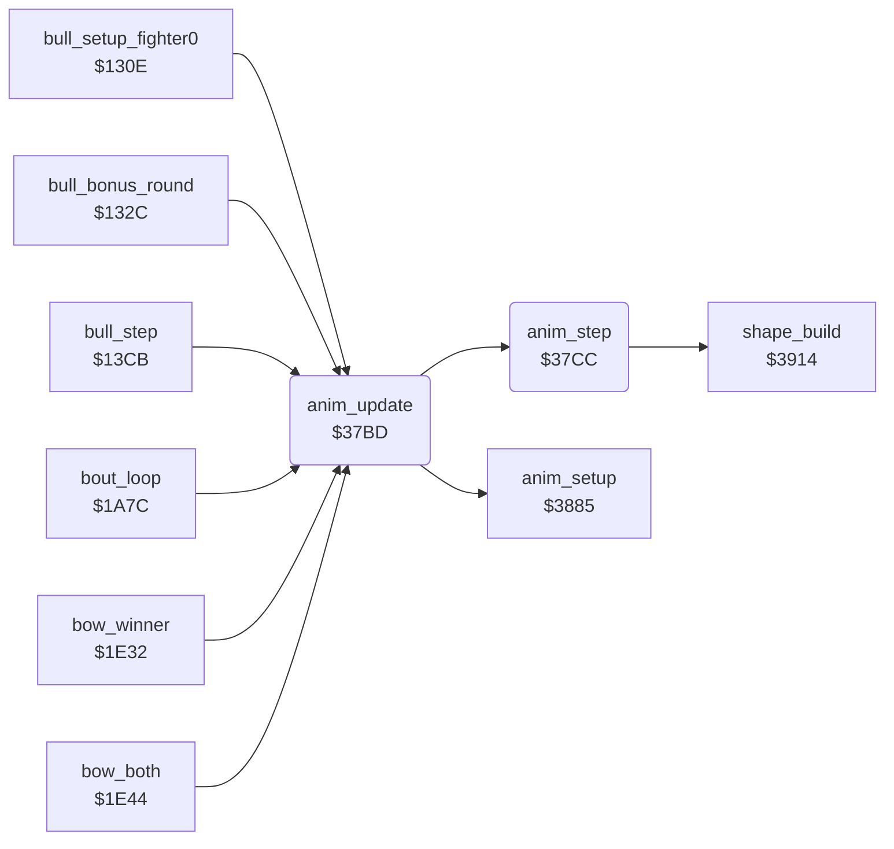

<!-- Generated by c64-docs from knowledge revision 20261025T214835.634-4kntaa and .c64-re-tools/local/generated/src/source-map.json. Do not edit: change the knowledge, generate the source again, then run docs.ts generate. -->
# fighter/anim_step.asm: Animation stepper: 4-byte script steps (delay, frame, dx, dy), movement and X limits by facing

Range `$37BD-$37D6`. Source: [fighter/anim_step.asm](../../../../src/fighter/anim_step.asm). Index: [the reference](../../index.md).

## Routines

| Routine | Address | Reached from | Summary |
|---|---|---|---|
| [`anim_update`](anim_step.md#anim_update) | `$37BD` | [`bull_setup_fighter0`](../game/bull_round_12f8.md#bull_setup_fighter0), [`bull_bonus_round`](../game/bull_round_12f8.md#bull_bonus_round), [`bull_step`](../game/bull_round_12f8.md#bull_step), [`bout_loop`](../game/bout_loop.md#bout_loop), [`bow_winner`](../game/game_modes.md#bow_winner), [`bow_both`](../game/game_modes.md#bow_both), [`move_start_anim`](fighter_moves.md#move_start_anim), [`hit_test`](hit_test.md#hit_test) | Plays one frame of the animation of fighter X. |
| [`anim_step`](anim_step.md#anim_step) | `$37CC` | [`anim_update`](anim_step.md#anim_update) | Counts down anim_frame_delay of fighter X. |

## Call graph

A solid arrow is a call, a thick arrow a table entry. Rounded nodes are in this file.

## Details

### [`anim_update`](../../../../src/fighter/anim_step.asm#L6) `$37BD`

*routine*

Plays one frame of the animation of fighter X. Does nothing when anim_number is 0. Calls anim_setup when anim_started is 0, then anim_step. Callers: bull round $1328/$135e/$13d5, bout loop $1a85/$1a8a, bows $1e35/$1e50/$1e55, move start $2b6d, trap $2cb8.

- **Called from:** [`bull_setup_fighter0`](../game/bull_round_12f8.md#bull_setup_fighter0), [`bull_bonus_round`](../game/bull_round_12f8.md#bull_bonus_round), [`bull_step`](../game/bull_round_12f8.md#bull_step), [`bout_loop`](../game/bout_loop.md#bout_loop), [`bow_winner`](../game/game_modes.md#bow_winner), [`bow_both`](../game/game_modes.md#bow_both)
- **Jumped to from:** [`move_start_anim`](fighter_moves.md#move_start_anim), [`hit_test`](hit_test.md#hit_test)
- **Calls:** [`anim_setup`](anim_step_37d8.md#anim_setup), [`anim_step`](anim_step.md#anim_step)
- **Reads:** [`anim_number`](../../memory-map.md#anim_number), [`anim_started`](../../memory-map.md#anim_started)

| Label | Address | Comment |
|---|---|---|
| [`anim_update_step`](../../../../src/fighter/anim_step.asm#L12) | `$37C8` |  |
| [`anim_update_done`](../../../../src/fighter/anim_step.asm#L14) | `$37CB` |  |

### [`anim_step`](../../../../src/fighter/anim_step.asm#L17) `$37CC`

*routine*

Counts down anim_frame_delay of fighter X. At 0 it loads the next 4-byte step (forward, or backward when anim_reverse is 1) and builds the shape. On every frame it adds anim_step_dx/dy to the position. After the last step it clears anim_number and sets anim_finished.

- **Called from:** [`anim_update`](anim_step.md#anim_update)
- **Calls:** [`shape_build`](../shapes/shape_build_390c.md#shape_build)
- **Reads:** [`anim_frame_delay`](../../memory-map.md#anim_frame_delay), [`anim_reverse`](../../memory-map.md#anim_reverse), [`anim_step_offset`](../../memory-map.md#anim_step_offset), [`anim_script_length`](../../memory-map.md#anim_script_length), [`anim_number`](../../memory-map.md#anim_number), [`anim_script_table`](anim_scripts.md#anim_script_table), [`anim_script_ptr`](../../memory-map.md#anim_script_ptr), [`fighter_y`](../../memory-map.md#fighter_y), [`anim_step_dy`](../../memory-map.md#anim_step_dy), [`fighter_facing`](../../memory-map.md#fighter_facing), [`fighter_x`](../../memory-map.md#fighter_x), [`anim_step_dx`](../../memory-map.md#anim_step_dx) and 3 more
- **Writes:** [`anim_frame_delay`](../../memory-map.md#anim_frame_delay), [`anim_frame_tick`](../../memory-map.md#anim_frame_tick), [`anim_number`](../../memory-map.md#anim_number), [`anim_finished`](../../memory-map.md#anim_finished), [`anim_step_offset`](../../memory-map.md#anim_step_offset), [`anim_script_ptr`](../../memory-map.md#anim_script_ptr), [`fighter_frame`](../../memory-map.md#fighter_frame), [`anim_step_dx`](../../memory-map.md#anim_step_dx), [`anim_step_dy`](../../memory-map.md#anim_step_dy), [`fighter_y`](../../memory-map.md#fighter_y), [`sprite_y`](../../memory-map.md#sprite_y), [`fighter_x`](../../memory-map.md#fighter_x) and 2 more
- **Refers to:** [`anim_script_table`](anim_scripts.md#anim_script_table), [`anim_script_ptr`](../../memory-map.md#anim_script_ptr)
