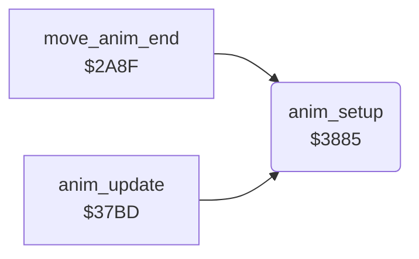

<!-- Generated by c64-docs from knowledge revision 20261022T104543.905-o1bqdy and .c64-re-tools/local/generated/src/source-map.json. Do not edit: change the knowledge, generate the source again, then run docs.ts generate. -->
# fighter/anim_step_37d8.asm

Range `$37D8-$38AF`. Source: [fighter/anim_step_37d8.asm](../../../../src/fighter/anim_step_37d8.asm). Index: [the reference](../../index.md).

## Call graph

A solid arrow is a call, a thick arrow a table entry, a dotted arrow a jump. Rounded nodes are in this file.

## Names

### [`anim_next_step`](../../../../src/fighter/anim_step_37d8.asm#L5) `$37D8`

*label*

- **Jumped to from:** [`anim_step`](anim_step.md#anim_step) [`$37CE`](../../../../src/fighter/anim_step.asm#L19)

### [`anim_step_back`](../../../../src/fighter/anim_step_37d8.asm#L19) `$37F1`

*label*

- **Jumped to from:** [`anim_step`](anim_step.md#anim_step) [`$37E2`](../../../../src/fighter/anim_step_37d8.asm#L11)

### [`anim_step_forward`](../../../../src/fighter/anim_step_37d8.asm#L23) `$37F7`

*label*

- **Jumped to from:** [`anim_step`](anim_step.md#anim_step) [`$37DE`](../../../../src/fighter/anim_step_37d8.asm#L9)

### [`anim_load_step`](../../../../src/fighter/anim_step_37d8.asm#L38) `$380F`

*label*

Reads the step at anim_step_offset of script anim_script_table[anim_number]. Byte 0 is the delay in frames, byte 1 the shape frame, bytes 2/3 dx and dy (signed, per frame).

- **Jumped to from:** [`anim_step`](anim_step.md#anim_step) [`$37F4`](../../../../src/fighter/anim_step_37d8.asm#L22), [`anim_step`](anim_step.md#anim_step) [`$37FE`](../../../../src/fighter/anim_step_37d8.asm#L28)

### [`anim_apply_move`](../../../../src/fighter/anim_step_37d8.asm#L61) `$3837`

*label*

Adds anim_step_dy to fighter_y and anim_step_dx to fighter_x on every frame of the step. Facing 1 or reverse play subtracts dx; dy is never negated. Then it clamps fighter_x to the limits of the facing.

- **Jumped to from:** [`anim_step`](anim_step.md#anim_step) [`$37D4`](../../../../src/fighter/anim_step.asm#L22)

### [`anim_check_x_limits`](../../../../src/fighter/anim_step_37d8.asm#L74) `$384C`

*label*

- **Jumped to from:** [`anim_step`](anim_step.md#anim_step) [`$3882`](../../../../src/fighter/anim_step_37d8.asm#L107)

### [`anim_clamp_x_min`](../../../../src/fighter/anim_step_37d8.asm#L83) `$385D`

*label*

- **Jumped to from:** [`anim_step`](anim_step.md#anim_step) [`$3856`](../../../../src/fighter/anim_step_37d8.asm#L80)

### [`anim_check_x_max`](../../../../src/fighter/anim_step_37d8.asm#L86) `$3862`

*label*

fighter_x_max: $95 facing 0, $89 facing 1

- **Jumped to from:** [`anim_step`](anim_step.md#anim_step) [`$385B`](../../../../src/fighter/anim_step_37d8.asm#L82)

### [`anim_store_x`](../../../../src/fighter/anim_step_37d8.asm#L90) `$386A`

*label*

- **Jumped to from:** [`anim_step`](anim_step.md#anim_step) [`$3850`](../../../../src/fighter/anim_step_37d8.asm#L77), [`anim_step`](anim_step.md#anim_step) [`$3860`](../../../../src/fighter/anim_step_37d8.asm#L85), [`anim_step`](anim_step.md#anim_step) [`$3865`](../../../../src/fighter/anim_step_37d8.asm#L88)

### [`anim_x_msb_clear`](../../../../src/fighter/anim_step_37d8.asm#L99) `$3878`

*label*

- **Jumped to from:** [`anim_step`](anim_step.md#anim_step) [`$3871`](../../../../src/fighter/anim_step_37d8.asm#L95)

### [`anim_move_left`](../../../../src/fighter/anim_step_37d8.asm#L103) `$387D`

*label*

- **Jumped to from:** [`anim_step`](anim_step.md#anim_step) [`$3845`](../../../../src/fighter/anim_step_37d8.asm#L70)

### [`anim_setup`](../../../../src/fighter/anim_step_37d8.asm#L109) `$3885`

*routine*

Prepares animation anim_number of fighter X: clears anim_finished, dx and dy, sets the delay to 1 and anim_started. The length is the low byte of the next script pointer minus this one. Callers: anim_update $37c5 and move_anim_end $2aea.

- **Called from:** [`move_anim_end`](fighter_moves.md#move_anim_end) [`$2AEA`](../../../../src/fighter/fighter_moves.asm#L209), [`anim_update`](anim_step.md#anim_update) [`$37C5`](../../../../src/fighter/anim_step.asm#L11)
- **Refers to:** [`anim_script_table`](anim_scripts.md#anim_script_table), [`anim_script_ptrs`](anim_scripts.md#anim_script_ptrs)

### [`anim_setup_reverse`](../../../../src/fighter/anim_step_37d8.asm#L130) `$38AB`

*label*

Reverse: the first step subtracts 4 and gives the last step

- **Jumped to from:** [`anim_setup`](anim_step_37d8.md#anim_setup) [`$38A4`](../../../../src/fighter/anim_step_37d8.asm#L126)
