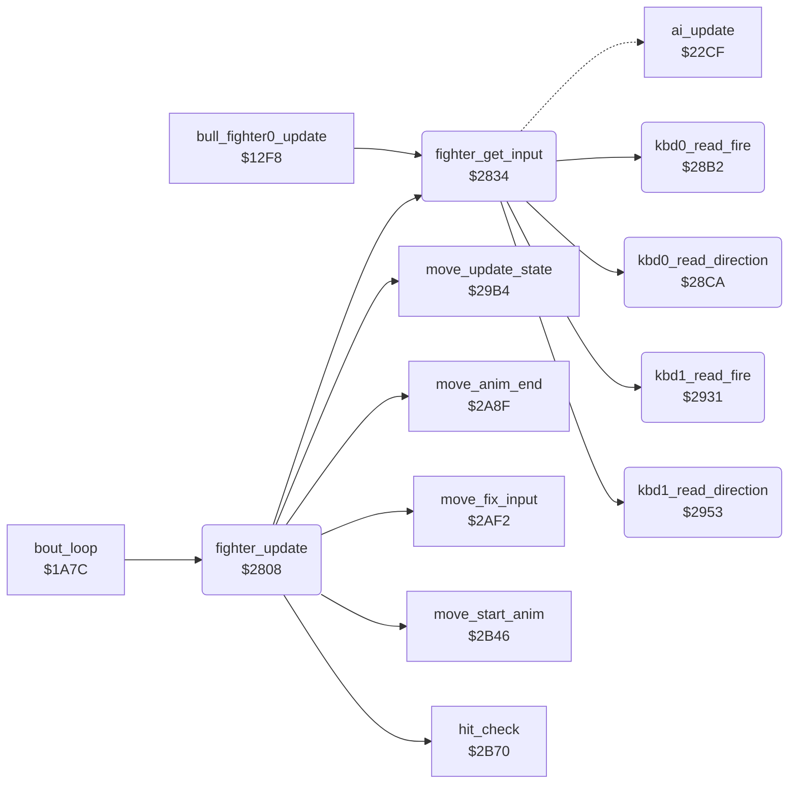

<!-- Generated by c64-docs from knowledge revision 20261022T104543.905-o1bqdy and .c64-re-tools/local/generated/src/source-map.json. Do not edit: change the knowledge, generate the source again, then run docs.ts generate. -->
# fighter/fighter_input.asm: Fighter update, input from the AI, the joystick or the keyboard, joystick move table

Range `$2808-$29B3`. Source: [fighter/fighter_input.asm](../../../../src/fighter/fighter_input.asm). Index: [the reference](../../index.md).

## Call graph

A solid arrow is a call, a thick arrow a table entry, a dotted arrow a jump. Rounded nodes are in this file.

## Data

| Range | Type | Name | Read by | Written by |
|---|---|---|---|---|
| [`$286C`](../../../../src/fighter/fighter_input.asm#L70)-`$288B` | bytes of 8 | [`joystick_move_table`](../../../../src/fighter/fighter_input.asm#L69) |  |  |

## Names

### [`fighter_update`](../../../../src/fighter/fighter_input.asm#L6) `$2808`

*routine*

Updates fighter X for one frame: hit test, input, input fix-ups, move state, animation, end of animation, sprite priority. Called from the bout loop at $1aa3 and $1aaa.

- **Called from:** [`bout_loop`](../game/bout_loop.md#bout_loop) [`$1AA3`](../../../../src/game/bout_loop.asm#L73), [`bout_loop`](../game/bout_loop.md#bout_loop) [`$1AAA`](../../../../src/game/bout_loop.asm#L76)
- **Calls:** [`hit_check`](hit_test.md#hit_check), [`fighter_get_input`](fighter_input.md#fighter_get_input), [`move_fix_input`](fighter_moves.md#move_fix_input), [`move_update_state`](fighter_moves.md#move_update_state), [`move_start_anim`](fighter_moves.md#move_start_anim), [`move_anim_end`](fighter_moves.md#move_anim_end)
- **Reads:** [`SPSPCL`](../../memory-map.md#SPSPCL), [`opponent_index`](../../memory-map.md#opponent_index)
- **Writes:** [`front_fighter`](../../memory-map.md#front_fighter)
- **Refers to:** [`move_attack_flags`](../game/entry_and_tables.md#move_attack_flags)

### [`fighter_set_priority`](../../../../src/fighter/fighter_input.asm#L16) `$2821`

*label*

### [`fighter_update_done`](../../../../src/fighter/fighter_input.asm#L23) `$282E`

*label*

- **Jumped to from:** [`fighter_update`](fighter_input.md#fighter_update) [`$281F`](../../../../src/fighter/fighter_input.asm#L15), [`fighter_update`](fighter_input.md#fighter_update) [`$282A`](../../../../src/fighter/fighter_input.asm#L21)

### [`fighter_opponent_in_front`](../../../../src/fighter/fighter_input.asm#L25) `$282F`

*label*

- **Jumped to from:** [`fighter_update`](fighter_input.md#fighter_update) [`$2825`](../../../../src/fighter/fighter_input.asm#L19)

### [`fighter_get_input`](../../../../src/fighter/fighter_input.asm#L30) `$2834`

*routine*

Sets fighter_input,x: the hit reaction when the fighter is hit, else the AI ($22cf) for a CPU fighter. A human fighter uses the keyboard ($288c) when keyboard_control is not 0, else the joystick ($284c). Called from fighter_update and the bull round at $12fc.
Hit: the reaction move is the input

- **Called from:** [`bull_fighter0_update`](../game/bull_round_12f8.md#bull_fighter0_update) [`$12FC`](../../../../src/game/bull_round_12f8.asm#L11), [`fighter_update`](fighter_input.md#fighter_update) [`$280B`](../../../../src/fighter/fighter_input.asm#L8)
- **Calls:** [`kbd0_read_fire`](fighter_input.md#kbd0_read_fire), [`kbd0_read_direction`](fighter_input.md#kbd0_read_direction), [`kbd1_read_fire`](fighter_input.md#kbd1_read_fire), [`kbd1_read_direction`](fighter_input.md#kbd1_read_direction)
- **Jumps to:** [`ai_update`](../ai/ai_opponent.md#ai_update)
- **Reads:** [`keyboard_control`](../../memory-map.md#keyboard_control), [`kbd_fire_bit`](../../memory-map.md#kbd_fire_bit)
- **Writes:** [`CIADDRA`](../../memory-map.md#CIADDRA), [`CIADDRB`](../../memory-map.md#CIADDRB)
- **Refers to:** [`CIAPRA`](../../memory-map.md#CIAPRA)

### [`input_check_cpu`](../../../../src/fighter/fighter_input.asm#L35) `$283B`

*label*

- **Jumped to from:** [`fighter_get_input`](fighter_input.md#fighter_get_input) [`$2836`](../../../../src/fighter/fighter_input.asm#L32)

### [`input_use_joystick`](../../../../src/fighter/fighter_input.asm#L41) `$2846`

*label*

- **Jumped to from:** [`fighter_get_input`](fighter_input.md#fighter_get_input) [`$2841`](../../../../src/fighter/fighter_input.asm#L39)

### [`input_from_ai`](../../../../src/fighter/fighter_input.asm#L43) `$2849`

*label*

- **Jumped to from:** [`fighter_get_input`](fighter_input.md#fighter_get_input) [`$283D`](../../../../src/fighter/fighter_input.asm#L37)

### [`joystick_read_move`](../../../../src/fighter/fighter_input.asm#L46) `$284C`

*label*

Reads the joystick of fighter X: port 2 ($dc00) for fighter 0, port 1 ($dc01) for fighter 1. Port A stays an input ($dc02 = 0); v1 set $ff again after the read.

- **Jumped to from:** [`fighter_get_input`](fighter_input.md#fighter_get_input) [`$2846`](../../../../src/fighter/fighter_input.asm#L42)

### [`joystick_apply_value`](../../../../src/fighter/fighter_input.asm#L52) `$2856`

*label*

Joystick value (bits 0-4, low = pressed) to a move in fighter_input,x. Facing 1 swaps left and right, except when both bits are 1 (neither left nor right pressed). The keyboard code jumps here too.

- **Jumped to from:** [`fighter_get_input`](fighter_input.md#fighter_get_input) [`$28A3`](../../../../src/fighter/fighter_input.asm#L86), [`fighter_get_input`](fighter_input.md#fighter_get_input) [`$28AF`](../../../../src/fighter/fighter_input.asm#L93)

### [`joystick_swap_sides`](../../../../src/fighter/fighter_input.asm#L60) `$2862`

*label*

### [`joystick_table_lookup`](../../../../src/fighter/fighter_input.asm#L64) `$2866`

*label*

- **Jumped to from:** [`fighter_get_input`](fighter_input.md#fighter_get_input) [`$2859`](../../../../src/fighter/fighter_input.asm#L55), [`fighter_get_input`](fighter_input.md#fighter_get_input) [`$2860`](../../../../src/fighter/fighter_input.asm#L59)

### [`joystick_move_table`](../../../../src/fighter/fighter_input.asm#L69) `$286C-$288B`

*data*

Move for each joystick value AND $1f (bits low = pressed: 0 up, 1 down, 2 left, 3 right, 4 fire), written for facing right. Entries $00-$0f have fire down. Same bytes as v1 $2297.

- **Referred to by:** [`fighter_get_input`](fighter_input.md#fighter_get_input) [`$2866`](../../../../src/fighter/fighter_input.asm#L65)

### [`kbd_read_move`](../../../../src/fighter/fighter_input.asm#L75) `$288C`

*label*

New in v2: keyboard control of fighter X. Sets $dc02 = $ff and $dc03 = 0, reads the fire and direction keys of the fighter, and adds kbd_fire_bit. The joystick value goes to joystick_apply_value.

- **Jumped to from:** [`fighter_get_input`](fighter_input.md#fighter_get_input) [`$2843`](../../../../src/fighter/fighter_input.asm#L40)

### [`kbd_read_move_fighter1`](../../../../src/fighter/fighter_input.asm#L87) `$28A6`

*label*

No run executed the fighter 1 keys

- **Jumped to from:** [`fighter_get_input`](fighter_input.md#fighter_get_input) [`$2898`](../../../../src/fighter/fighter_input.asm#L81)

### [`kbd0_read_fire`](../../../../src/fighter/fighter_input.asm#L95) `$28B2`

*routine*

Fire keys of fighter 0: S or LEFT SHIFT (column 1, rows 5 and 7). kbd_fire_bit = 0 when one is down, else $10. Called from kbd_read_move.
Column 1: 3 W A 4 Z S E LSHIFT

- **Called from:** [`fighter_get_input`](fighter_input.md#fighter_get_input) [`$289A`](../../../../src/fighter/fighter_input.asm#L82)
- **Reads:** [`CIAPRB`](../../memory-map.md#CIAPRB)
- **Writes:** [`CIAPRA`](../../memory-map.md#CIAPRA), [`kbd_fire_bit`](../../memory-map.md#kbd_fire_bit)

### [`kbd0_fire_down`](../../../../src/fighter/fighter_input.asm#L105) `$28C5`

*label*

- **Jumped to from:** [`kbd0_read_fire`](fighter_input.md#kbd0_read_fire) [`$28BE`](../../../../src/fighter/fighter_input.asm#L101)

### [`kbd0_read_direction`](../../../../src/fighter/fighter_input.asm#L110) `$28CA`

*routine*

Direction keys of fighter 0, returned in A as a joystick value. Q up-left, E up-right, Z down-left, W up, C down-right, X down, D right, A left. The first key down in this order wins; none gives $0f.
Column 7: Q is row 6

- **Called from:** [`fighter_get_input`](fighter_input.md#fighter_get_input) [`$289D`](../../../../src/fighter/fighter_input.asm#L83)
- **Reads:** [`CIAPRB`](../../memory-map.md#CIAPRB), [`key_temp`](../../memory-map.md#key_temp)
- **Writes:** [`CIAPRA`](../../memory-map.md#CIAPRA), [`key_temp`](../../memory-map.md#key_temp)

### [`kbd0_test_e`](../../../../src/fighter/fighter_input.asm#L118) `$28D9`

*label*

Column 1: W row 1, A row 2, Z row 4, E row 6

- **Jumped to from:** [`kbd0_read_direction`](fighter_input.md#kbd0_read_direction) [`$28D4`](../../../../src/fighter/fighter_input.asm#L115)

### [`kbd0_test_z`](../../../../src/fighter/fighter_input.asm#L127) `$28EA`

*label*

- **Jumped to from:** [`kbd0_read_direction`](fighter_input.md#kbd0_read_direction) [`$28E5`](../../../../src/fighter/fighter_input.asm#L124)

### [`kbd0_test_w`](../../../../src/fighter/fighter_input.asm#L133) `$28F3`

*label*

- **Jumped to from:** [`kbd0_read_direction`](fighter_input.md#kbd0_read_direction) [`$28EE`](../../../../src/fighter/fighter_input.asm#L130)

### [`kbd0_test_c`](../../../../src/fighter/fighter_input.asm#L139) `$28FC`

*label*

Column 2: D row 2, C row 4, X row 7

- **Jumped to from:** [`kbd0_read_direction`](fighter_input.md#kbd0_read_direction) [`$28F7`](../../../../src/fighter/fighter_input.asm#L136)

### [`kbd0_test_x`](../../../../src/fighter/fighter_input.asm#L148) `$290D`

*label*

- **Jumped to from:** [`kbd0_read_direction`](fighter_input.md#kbd0_read_direction) [`$2908`](../../../../src/fighter/fighter_input.asm#L145)

### [`kbd0_test_d`](../../../../src/fighter/fighter_input.asm#L154) `$2916`

*label*

- **Jumped to from:** [`kbd0_read_direction`](fighter_input.md#kbd0_read_direction) [`$2911`](../../../../src/fighter/fighter_input.asm#L151)

### [`kbd0_test_a`](../../../../src/fighter/fighter_input.asm#L160) `$291F`

*label*

Column 1 again for A

- **Jumped to from:** [`kbd0_read_direction`](fighter_input.md#kbd0_read_direction) [`$291A`](../../../../src/fighter/fighter_input.asm#L157)

### [`kbd0_no_direction`](../../../../src/fighter/fighter_input.asm#L168) `$292E`

*label*

No direction key

- **Jumped to from:** [`kbd0_read_direction`](fighter_input.md#kbd0_read_direction) [`$2929`](../../../../src/fighter/fighter_input.asm#L165)

### [`kbd1_read_fire`](../../../../src/fighter/fighter_input.asm#L172) `$2931`

*routine*

Fire keys of fighter 1: RIGHT SHIFT (column 6, row 4) or colon (column 5, row 5). kbd_fire_bit = 0 when one is down, else $10. No run executed it.
Column 6: * row 1, ; row 2, RSHIFT row 4, / row 7

- **Called from:** [`fighter_get_input`](fighter_input.md#fighter_get_input) [`$28A6`](../../../../src/fighter/fighter_input.asm#L89)
- **Reads:** [`CIAPRB`](../../memory-map.md#CIAPRB)
- **Writes:** [`CIAPRA`](../../memory-map.md#CIAPRA), [`kbd_fire_bit`](../../memory-map.md#kbd_fire_bit)

### [`kbd1_fire_down`](../../../../src/fighter/fighter_input.asm#L179) `$293D`

*label*

- **Jumped to from:** [`kbd1_read_fire`](fighter_input.md#kbd1_read_fire) [`$294C`](../../../../src/fighter/fighter_input.asm#L188)

### [`kbd1_test_colon`](../../../../src/fighter/fighter_input.asm#L183) `$2942`

*label*

Column 5: P row 1, L row 2, . row 4, : row 5, @ row 6, , row 7

- **Jumped to from:** [`kbd1_read_fire`](fighter_input.md#kbd1_read_fire) [`$293B`](../../../../src/fighter/fighter_input.asm#L178)

### [`kbd1_read_direction`](../../../../src/fighter/fighter_input.asm#L193) `$2953`

*routine*

Direction keys of fighter 1, returned in A as a joystick value. / down-right, * up-right, P up-left, @ up, comma down-left, period down, L left, ; right. The first key down wins; none gives $0f.

- **Called from:** [`fighter_get_input`](fighter_input.md#fighter_get_input) [`$28A9`](../../../../src/fighter/fighter_input.asm#L90)
- **Reads:** [`CIAPRB`](../../memory-map.md#CIAPRB), [`key_temp`](../../memory-map.md#key_temp)
- **Writes:** [`CIAPRA`](../../memory-map.md#CIAPRA), [`key_temp`](../../memory-map.md#key_temp)

### [`kbd1_test_star`](../../../../src/fighter/fighter_input.asm#L202) `$2964`

*label*

- **Jumped to from:** [`kbd1_read_direction`](fighter_input.md#kbd1_read_direction) [`$295F`](../../../../src/fighter/fighter_input.asm#L199)

### [`kbd1_test_p`](../../../../src/fighter/fighter_input.asm#L208) `$296D`

*label*

- **Jumped to from:** [`kbd1_read_direction`](fighter_input.md#kbd1_read_direction) [`$2968`](../../../../src/fighter/fighter_input.asm#L205)

### [`kbd1_test_at`](../../../../src/fighter/fighter_input.asm#L217) `$297E`

*label*

- **Jumped to from:** [`kbd1_read_direction`](fighter_input.md#kbd1_read_direction) [`$2979`](../../../../src/fighter/fighter_input.asm#L214)

### [`kbd1_test_comma`](../../../../src/fighter/fighter_input.asm#L223) `$2987`

*label*

- **Jumped to from:** [`kbd1_read_direction`](fighter_input.md#kbd1_read_direction) [`$2982`](../../../../src/fighter/fighter_input.asm#L220)

### [`kbd1_test_period`](../../../../src/fighter/fighter_input.asm#L229) `$2990`

*label*

- **Jumped to from:** [`kbd1_read_direction`](fighter_input.md#kbd1_read_direction) [`$298B`](../../../../src/fighter/fighter_input.asm#L226)

### [`kbd1_test_l`](../../../../src/fighter/fighter_input.asm#L235) `$2999`

*label*

- **Jumped to from:** [`kbd1_read_direction`](fighter_input.md#kbd1_read_direction) [`$2994`](../../../../src/fighter/fighter_input.asm#L232)

### [`kbd1_test_semicolon`](../../../../src/fighter/fighter_input.asm#L241) `$29A2`

*label*

Column 6 again for ;

- **Jumped to from:** [`kbd1_read_direction`](fighter_input.md#kbd1_read_direction) [`$299D`](../../../../src/fighter/fighter_input.asm#L238)

### [`kbd1_no_direction`](../../../../src/fighter/fighter_input.asm#L249) `$29B1`

*label*

No direction key

- **Jumped to from:** [`kbd1_read_direction`](fighter_input.md#kbd1_read_direction) [`$29AC`](../../../../src/fighter/fighter_input.asm#L246)
