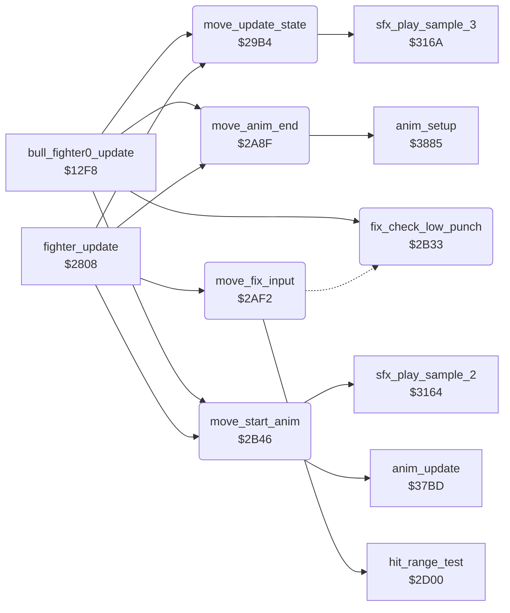

<!-- Generated by c64-docs from knowledge revision 20261022T104543.905-o1bqdy and .c64-re-tools/local/generated/src/source-map.json. Do not edit: change the knowledge, generate the source again, then run docs.ts generate. -->
# fighter/fighter_moves.asm: Move state machine, end of animation, input fix-ups, animation start

Range `$29B4-$2B6F`. Source: [fighter/fighter_moves.asm](../../../../src/fighter/fighter_moves.asm). Index: [the reference](../../index.md).

## Call graph

A solid arrow is a call, a thick arrow a table entry, a dotted arrow a jump. Rounded nodes are in this file.

## Names

### [`move_update_state`](../../../../src/fighter/fighter_moves.asm#L6) `$29B4`

*routine*

Move state machine: changes fighter_move,x from fighter_input,x. Handles hit reactions, the crouch before low moves, the about turn and the back kick, and the retract of held moves. Called from fighter_update and the bull round at $1304.

- **Called from:** [`bull_fighter0_update`](../game/bull_round_12f8.md#bull_fighter0_update) [`$1304`](../../../../src/game/bull_round_12f8.asm#L14), [`fighter_update`](fighter_input.md#fighter_update) [`$2811`](../../../../src/fighter/fighter_input.asm#L10)
- **Calls:** [`sfx_play_sample_3`](../sfx/sfx_sample_player.md#sfx_play_sample_3)
- **Refers to:** [`move_return_flags`](../game/entry_and_tables.md#move_return_flags)

### [`move_hit_delay`](../../../../src/fighter/fighter_moves.asm#L14) `$29C2`

*label*

- **Jumped to from:** [`move_update_state`](fighter_moves.md#move_update_state) [`$29B8`](../../../../src/fighter/fighter_moves.asm#L9), [`move_update_state`](fighter_moves.md#move_update_state) [`$29BC`](../../../../src/fighter/fighter_moves.asm#L11)

### [`move_start_hit_reaction`](../../../../src/fighter/fighter_moves.asm#L21) `$29CD`

*label*

- **Jumped to from:** [`move_update_state`](fighter_moves.md#move_update_state) [`$29C4`](../../../../src/fighter/fighter_moves.asm#L16)

### [`move_hit_fall_sample`](../../../../src/fighter/fighter_moves.asm#L36) `$29E9`

*label*

Sample 3

- **Jumped to from:** [`move_update_state`](fighter_moves.md#move_update_state) [`$29E3`](../../../../src/fighter/fighter_moves.asm#L33)

### [`move_hit_reaction_done`](../../../../src/fighter/fighter_moves.asm#L38) `$29EC`

*label*

- **Jumped to from:** [`move_update_state`](fighter_moves.md#move_update_state) [`$29DD`](../../../../src/fighter/fighter_moves.asm#L30), [`move_update_state`](fighter_moves.md#move_update_state) [`$29E7`](../../../../src/fighter/fighter_moves.asm#L35)

### [`move_check_change`](../../../../src/fighter/fighter_moves.asm#L40) `$29ED`

*label*

- **Jumped to from:** [`move_update_state`](fighter_moves.md#move_update_state) [`$29C0`](../../../../src/fighter/fighter_moves.asm#L13)

### [`move_check_stand`](../../../../src/fighter/fighter_moves.asm#L43) `$29F1`

*label*

### [`move_from_stand`](../../../../src/fighter/fighter_moves.asm#L47) `$29F7`

*label*

### [`move_start_turn`](../../../../src/fighter/fighter_moves.asm#L51) `$29FD`

*label*

### [`move_no_change`](../../../../src/fighter/fighter_moves.asm#L54) `$2A01`

*label*

- **Jumped to from:** [`move_update_state`](fighter_moves.md#move_update_state) [`$29EF`](../../../../src/fighter/fighter_moves.asm#L42)

### [`move_check_low_input`](../../../../src/fighter/fighter_moves.asm#L56) `$2A02`

*label*

Moves $07, $10, $0a start from a crouch

- **Jumped to from:** [`move_update_state`](fighter_moves.md#move_update_state) [`$29FB`](../../../../src/fighter/fighter_moves.asm#L50)

### [`move_crouch_first`](../../../../src/fighter/fighter_moves.asm#L63) `$2A0E`

*label*

- **Jumped to from:** [`move_update_state`](fighter_moves.md#move_update_state) [`$2A04`](../../../../src/fighter/fighter_moves.asm#L58), [`move_update_state`](fighter_moves.md#move_update_state) [`$2A08`](../../../../src/fighter/fighter_moves.asm#L60)

### [`move_take_input`](../../../../src/fighter/fighter_moves.asm#L67) `$2A13`

*label*

- **Jumped to from:** [`move_update_state`](fighter_moves.md#move_update_state) [`$2A0C`](../../../../src/fighter/fighter_moves.asm#L62)

### [`move_check_crouch_input`](../../../../src/fighter/fighter_moves.asm#L71) `$2A18`

*label*

- **Jumped to from:** [`move_update_state`](fighter_moves.md#move_update_state) [`$29F5`](../../../../src/fighter/fighter_moves.asm#L46)

### [`move_crouch_attack`](../../../../src/fighter/fighter_moves.asm#L79) `$2A26`

*label*

- **Jumped to from:** [`move_update_state`](fighter_moves.md#move_update_state) [`$2A1C`](../../../../src/fighter/fighter_moves.asm#L74), [`move_update_state`](fighter_moves.md#move_update_state) [`$2A20`](../../../../src/fighter/fighter_moves.asm#L76)

### [`move_state_done`](../../../../src/fighter/fighter_moves.asm#L87) `$2A34`

*label*

- **Jumped to from:** [`move_update_state`](fighter_moves.md#move_update_state) [`$2A2E`](../../../../src/fighter/fighter_moves.asm#L84), [`move_update_state`](fighter_moves.md#move_update_state) [`$2A39`](../../../../src/fighter/fighter_moves.asm#L92)

### [`move_cancel_turn`](../../../../src/fighter/fighter_moves.asm#L89) `$2A35`

*label*

- **Jumped to from:** [`move_update_state`](fighter_moves.md#move_update_state) [`$2A2A`](../../../../src/fighter/fighter_moves.asm#L82)

### [`move_check_turn`](../../../../src/fighter/fighter_moves.asm#L97) `$2A40`

*label*

- **Jumped to from:** [`move_update_state`](fighter_moves.md#move_update_state) [`$2A24`](../../../../src/fighter/fighter_moves.asm#L78)

### [`move_turn_done`](../../../../src/fighter/fighter_moves.asm#L108) `$2A54`

*label*

- **Jumped to from:** [`move_update_state`](fighter_moves.md#move_update_state) [`$2A4E`](../../../../src/fighter/fighter_moves.asm#L105)

### [`move_check_back_kick`](../../../../src/fighter/fighter_moves.asm#L110) `$2A55`

*label*

- **Jumped to from:** [`move_update_state`](fighter_moves.md#move_update_state) [`$2A44`](../../../../src/fighter/fighter_moves.asm#L100)

### [`move_input_changed`](../../../../src/fighter/fighter_moves.asm#L124) `$2A6E`

*label*

- **Jumped to from:** [`move_update_state`](fighter_moves.md#move_update_state) [`$2A4A`](../../../../src/fighter/fighter_moves.asm#L103), [`move_update_state`](fighter_moves.md#move_update_state) [`$2A57`](../../../../src/fighter/fighter_moves.asm#L112), [`move_update_state`](fighter_moves.md#move_update_state) [`$2A5B`](../../../../src/fighter/fighter_moves.asm#L114)

### [`move_check_return_type`](../../../../src/fighter/fighter_moves.asm#L128) `$2A75`

*label*

### [`move_retract`](../../../../src/fighter/fighter_moves.asm#L130) `$2A77`

*label*

### [`move_clear_hold`](../../../../src/fighter/fighter_moves.asm#L133) `$2A7B`

*label*

- **Jumped to from:** [`move_update_state`](fighter_moves.md#move_update_state) [`$2A75`](../../../../src/fighter/fighter_moves.asm#L129)

### [`move_switch_walk`](../../../../src/fighter/fighter_moves.asm#L137) `$2A80`

*label*

- **Jumped to from:** [`move_update_state`](fighter_moves.md#move_update_state) [`$2A73`](../../../../src/fighter/fighter_moves.asm#L127)

### [`move_walk_to_turn`](../../../../src/fighter/fighter_moves.asm#L143) `$2A8A`

*label*

### [`move_store_walk`](../../../../src/fighter/fighter_moves.asm#L146) `$2A8C`

*label*

- **Jumped to from:** [`move_update_state`](fighter_moves.md#move_update_state) [`$2A88`](../../../../src/fighter/fighter_moves.asm#L142)

### [`move_anim_end`](../../../../src/fighter/fighter_moves.asm#L150) `$2A8F`

*routine*

Acts when the animation of fighter X ended. A hit reaction ends the bout, a retract returns to the stand, and a retracted low move returns to the crouch. A hold move keeps its end pose. Called from fighter_update and the bull round at $130a.

- **Called from:** [`bull_fighter0_update`](../game/bull_round_12f8.md#bull_fighter0_update) [`$130A`](../../../../src/game/bull_round_12f8.asm#L16), [`fighter_update`](fighter_input.md#fighter_update) [`$2817`](../../../../src/fighter/fighter_input.asm#L12)
- **Calls:** [`anim_setup`](anim_step_37d8.md#anim_setup)
- **Writes:** [`bout_knockdown`](../../memory-map.md#bout_knockdown)
- **Refers to:** [`move_return_flags`](../game/entry_and_tables.md#move_return_flags)

### [`anim_end_clear`](../../../../src/fighter/fighter_moves.asm#L153) `$2A93`

*label*

### [`anim_end_done`](../../../../src/fighter/fighter_moves.asm#L159) `$2A9D`

*label*

- **Jumped to from:** [`move_anim_end`](fighter_moves.md#move_anim_end) [`$2A91`](../../../../src/fighter/fighter_moves.asm#L152)

### [`anim_end_check_reverse`](../../../../src/fighter/fighter_moves.asm#L161) `$2A9E`

*label*

- **Jumped to from:** [`move_anim_end`](fighter_moves.md#move_anim_end) [`$2A99`](../../../../src/fighter/fighter_moves.asm#L157)

### [`anim_end_after_retract`](../../../../src/fighter/fighter_moves.asm#L164) `$2AA2`

*label*

### [`anim_end_reverse_done`](../../../../src/fighter/fighter_moves.asm#L171) `$2AAE`

*label*

- **Jumped to from:** [`move_anim_end`](fighter_moves.md#move_anim_end) [`$2AA6`](../../../../src/fighter/fighter_moves.asm#L167)

### [`anim_end_stand`](../../../../src/fighter/fighter_moves.asm#L184) `$2AC6`

*label*

### [`anim_end_forward`](../../../../src/fighter/fighter_moves.asm#L188) `$2ACB`

*label*

- **Jumped to from:** [`move_anim_end`](fighter_moves.md#move_anim_end) [`$2AA0`](../../../../src/fighter/fighter_moves.asm#L163)

### [`anim_end_hold`](../../../../src/fighter/fighter_moves.asm#L192) `$2AD2`

*label*

### [`anim_end_to_stand`](../../../../src/fighter/fighter_moves.asm#L196) `$2AD7`

*label*

- **Jumped to from:** [`move_anim_end`](fighter_moves.md#move_anim_end) [`$2AD0`](../../../../src/fighter/fighter_moves.asm#L191)

### [`anim_end_back_to_crouch`](../../../../src/fighter/fighter_moves.asm#L205) `$2AE4`

*label*

A low move retracted: the crouch $04 starts forwards at its last step (frame $0c, 7 frames) and then holds. v1 played the crouch backwards and stood up.

- **Jumped to from:** [`move_anim_end`](fighter_moves.md#move_anim_end) [`$2ABC`](../../../../src/fighter/fighter_moves.asm#L179), [`move_anim_end`](fighter_moves.md#move_anim_end) [`$2AC0`](../../../../src/fighter/fighter_moves.asm#L181), [`move_anim_end`](fighter_moves.md#move_anim_end) [`$2AC4`](../../../../src/fighter/fighter_moves.asm#L183)

### [`move_fix_input`](../../../../src/fighter/fighter_moves.asm#L214) `$2AF2`

*routine*

Changes fighter_input,x before the state machine. Back during an opponent attack in range becomes the matching block; down-forward from a stand becomes move $18. Called from fighter_update.

- **Called from:** [`fighter_update`](fighter_input.md#fighter_update) [`$280E`](../../../../src/fighter/fighter_input.asm#L9)
- **Calls:** [`hit_range_test`](hit_test.md#hit_range_test)
- **Jumps to:** [`fix_check_low_punch`](fighter_moves.md#fix_check_low_punch)
- **Reads:** [`opponent_index`](../../memory-map.md#opponent_index)
- **Refers to:** [`move_attack_flags`](../game/entry_and_tables.md#move_attack_flags), [`move_counter_moves`](../game/entry_and_tables.md#move_counter_moves)

### [`fix_keep_block`](../../../../src/fighter/fighter_moves.asm#L223) `$2B02`

*label*

- **Jumped to from:** [`move_fix_input`](fighter_moves.md#move_fix_input) [`$2AFC`](../../../../src/fighter/fighter_moves.asm#L220)

### [`fix_check_block`](../../../../src/fighter/fighter_moves.asm#L226) `$2B05`

*label*

- **Jumped to from:** [`move_fix_input`](fighter_moves.md#move_fix_input) [`$2B00`](../../../../src/fighter/fighter_moves.asm#L222)

### [`fix_input_done`](../../../../src/fighter/fighter_moves.asm#L247) `$2B32`

*label*

- **Jumped to from:** [`move_fix_input`](fighter_moves.md#move_fix_input) [`$2B0A`](../../../../src/fighter/fighter_moves.asm#L229), [`move_fix_input`](fighter_moves.md#move_fix_input) [`$2B0F`](../../../../src/fighter/fighter_moves.asm#L231), [`move_fix_input`](fighter_moves.md#move_fix_input) [`$2B17`](../../../../src/fighter/fighter_moves.asm#L235), [`move_fix_input`](fighter_moves.md#move_fix_input) [`$2B1B`](../../../../src/fighter/fighter_moves.asm#L237), [`move_fix_input`](fighter_moves.md#move_fix_input) [`$2B20`](../../../../src/fighter/fighter_moves.asm#L239), [`move_fix_input`](fighter_moves.md#move_fix_input) [`$2B25`](../../../../src/fighter/fighter_moves.asm#L241)

### [`fix_check_low_punch`](../../../../src/fighter/fighter_moves.asm#L250) `$2B33`

*routine*

Second entry with A = fighter_input,x: down-forward outside a crouch becomes move $18. The bull round calls it at $1301 and skips the block test.

- **Called from:** [`bull_fighter0_update`](../game/bull_round_12f8.md#bull_fighter0_update) [`$1301`](../../../../src/game/bull_round_12f8.asm#L13)
- **Jumped to from:** [`move_fix_input`](fighter_moves.md#move_fix_input) [`$2AF6`](../../../../src/fighter/fighter_moves.asm#L217)

### [`fix_low_punch_done`](../../../../src/fighter/fighter_moves.asm#L260) `$2B45`

*label*

- **Jumped to from:** [`fix_check_low_punch`](fighter_moves.md#fix_check_low_punch) [`$2B35`](../../../../src/fighter/fighter_moves.asm#L252), [`fix_check_low_punch`](fighter_moves.md#fix_check_low_punch) [`$2B3B`](../../../../src/fighter/fighter_moves.asm#L255), [`fix_check_low_punch`](fighter_moves.md#fix_check_low_punch) [`$2B3F`](../../../../src/fighter/fighter_moves.asm#L257)

### [`move_start_anim`](../../../../src/fighter/fighter_moves.asm#L263) `$2B46`

*routine*

Selects anim_number,x from fighter_move,x: a new move starts its animation, a held pose stops it, else it runs on. Then jumps to anim_update ($37bd). Called from fighter_update and the bull round at $1307.

- **Called from:** [`bull_fighter0_update`](../game/bull_round_12f8.md#bull_fighter0_update) [`$1307`](../../../../src/game/bull_round_12f8.asm#L15), [`fighter_update`](fighter_input.md#fighter_update) [`$2814`](../../../../src/fighter/fighter_input.asm#L11)
- **Calls:** [`sfx_play_sample_2`](../sfx/sfx_sample_player.md#sfx_play_sample_2), [`anim_update`](anim_step.md#anim_update)
- **Refers to:** [`move_attack_flags`](../game/entry_and_tables.md#move_attack_flags)

### [`anim_start_new_move`](../../../../src/fighter/fighter_moves.asm#L267) `$2B4C`

*label*

### [`anim_start_reset`](../../../../src/fighter/fighter_moves.asm#L273) `$2B57`

*label*

- **Jumped to from:** [`move_start_anim`](fighter_moves.md#move_start_anim) [`$2B52`](../../../../src/fighter/fighter_moves.asm#L271)

### [`anim_start_same_move`](../../../../src/fighter/fighter_moves.asm#L278) `$2B5F`

*label*

- **Jumped to from:** [`move_start_anim`](fighter_moves.md#move_start_anim) [`$2B4A`](../../../../src/fighter/fighter_moves.asm#L266)

### [`anim_start_freeze`](../../../../src/fighter/fighter_moves.asm#L281) `$2B63`

*label*

### [`anim_start_continue`](../../../../src/fighter/fighter_moves.asm#L285) `$2B69`

*label*

- **Jumped to from:** [`move_start_anim`](fighter_moves.md#move_start_anim) [`$2B61`](../../../../src/fighter/fighter_moves.asm#L280)

### [`anim_start_step`](../../../../src/fighter/fighter_moves.asm#L288) `$2B6D`

*label*

- **Jumped to from:** [`move_start_anim`](fighter_moves.md#move_start_anim) [`$2B5D`](../../../../src/fighter/fighter_moves.asm#L277), [`move_start_anim`](fighter_moves.md#move_start_anim) [`$2B67`](../../../../src/fighter/fighter_moves.asm#L284)
