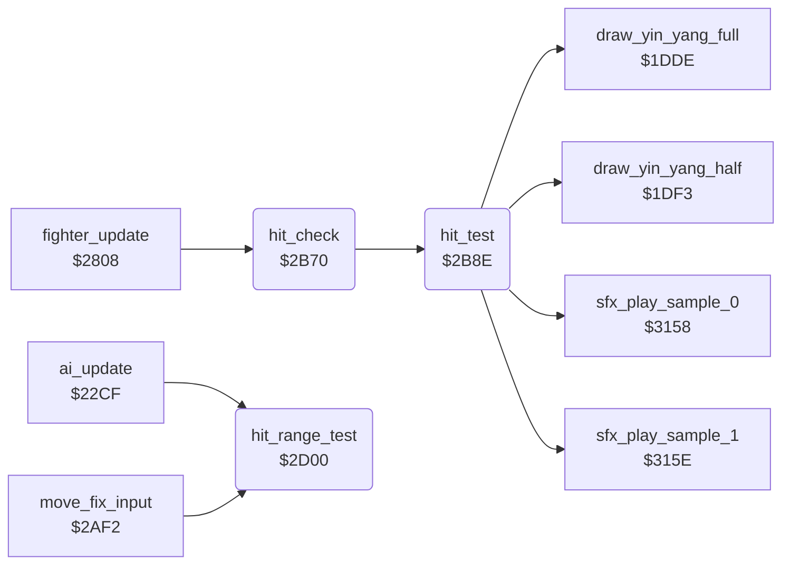

<!-- Generated by c64-docs from knowledge revision 20261025T191824.573-5s4oe2 and .c64-re-tools/local/generated/src/source-map.json. Do not edit: change the knowledge, generate the source again, then run docs.ts generate. -->
# fighter/hit_test.asm: Hit test at the hit frame, points, CIA2 protection check, hit reaction, range test

Range `$2B70-$2D61`. Source: [fighter/hit_test.asm](../../../../src/fighter/hit_test.asm). Index: [the reference](../../index.md).

## Routines

| Routine | Address | Reached from | Summary |
|---|---|---|---|
| [`hit_check`](hit_test.md#hit_check) | `$2B70` | [`fighter_update`](fighter_input.md#fighter_update) | Starts the hit test for fighter X when its attack move shows the hit frame. |
| [`hit_test`](hit_test.md#hit_test) | `$2B8E` | [`hit_check`](hit_test.md#hit_check) | Tests if the attack of fighter X hits the opponent (opponent_index). |
| [`hit_range_test`](hit_test.md#hit_range_test) | `$2D00` | [`ai_update`](../ai/ai_opponent.md#ai_update), [`move_fix_input`](fighter_moves.md#move_fix_input) | Tests the distance to the opponent against the reach type of the opponent's move. |

## Call graph

A solid arrow is a call, a thick arrow a table entry. Rounded nodes are in this file.

## Details

### [`hit_check`](../../../../src/fighter/hit_test.asm#L6) `$2B70`

*routine*

Starts the hit test for fighter X when its attack move shows the hit frame. The move needs the attack flag ($1176), a new forward animation step and pose_held = 0. Called from fighter_update; the bull round does not call it.

- **Called from:** [`fighter_update`](fighter_input.md#fighter_update)
- **Calls:** [`hit_test`](hit_test.md#hit_test)
- **Reads:** [`fighter_move`](../../memory-map.md#fighter_move), [`move_attack_flags`](../game/entry_and_tables.md#move_attack_flags), [`anim_frame_tick`](../../memory-map.md#anim_frame_tick), [`anim_reverse`](../../memory-map.md#anim_reverse), [`pose_held`](../../memory-map.md#pose_held), [`move_hit_frames`](../game/entry_and_tables_1204.md#move_hit_frames), [`fighter_frame`](../../memory-map.md#fighter_frame)

| Label | Address | Comment |
|---|---|---|
| [`hit_check_done`](../../../../src/fighter/hit_test.asm#L20) | `$2B8D` |  |

### [`hit_test`](../../../../src/fighter/hit_test.asm#L23) `$2B8E`

*routine*

Tests if the attack of fighter X hits the opponent (opponent_index). The hit-zone table of the move gives a target extent for the opponent frame; fighter_distance must lie in the reach window ($11bd full, $11d6 half). A hit sets hit_points,x to 2 or 1 and goes to hit_record. A miss changes nothing. Called from hit_check.

- **Called from:** [`hit_check`](hit_test.md#hit_check)
- **Calls:** [`draw_yin_yang_full`](../game/game_modes.md#draw_yin_yang_full), [`draw_yin_yang_half`](../game/game_modes.md#draw_yin_yang_half), [`sfx_play_sample_1`](../sfx/sfx_sample_player.md#sfx_play_sample_1), [`sfx_play_sample_0`](../sfx/sfx_sample_player.md#sfx_play_sample_0)
- **Jumps to:** [`anim_update`](anim_step.md#anim_update)
- **Reads:** [`opponent_index`](../../memory-map.md#opponent_index), [`fighter_facing`](../../memory-map.md#fighter_facing), [`fighter_move`](../../memory-map.md#fighter_move), [`move_hit_zone_facing`](../game/entry_and_tables_1204.md#move_hit_zone_facing), [`move_hit_zone_same_facing`](../game/entry_and_tables_1204.md#move_hit_zone_same_facing), [`fighter_frame`](../../memory-map.md#fighter_frame), [`hit_zone_ptr`](../../memory-map.md#hit_zone_ptr), [`fighter_x`](../../memory-map.md#fighter_x), [`move_reach_types`](../game/entry_and_tables.md#move_reach_types), [`fighter_distance`](../../memory-map.md#fighter_distance), [`hit_target_extent`](../../memory-map.md#hit_target_extent), [`move_full_reach`](../game/entry_and_tables.md#move_full_reach) and 4 more
- **Writes:** [`hit_zone_ptr`](../../memory-map.md#hit_zone_ptr), [`hit_target_extent`](../../memory-map.md#hit_target_extent), [`fighter_distance`](../../memory-map.md#fighter_distance), [`hit_points`](../../memory-map.md#hit_points), [`scoring_move`](../../memory-map.md#scoring_move), [`hit_reaction`](../../memory-map.md#hit_reaction)
- **Refers to:** [`move_hit_zone_facing`](../game/entry_and_tables_1204.md#move_hit_zone_facing), [`hit_zone_ptr`](../../memory-map.md#hit_zone_ptr), [`move_hit_zone_same_facing`](../game/entry_and_tables_1204.md#move_hit_zone_same_facing)

| Label | Address | Comment |
|---|---|---|
| [`hit_test_same_facing`](../../../../src/fighter/hit_test.asm#L36) | `$2BA8` | Same facing: the attacker faces the back of the opponent |
| [`hit_test_facing`](../../../../src/fighter/hit_test.asm#L45) | `$2BB9` |  |
| [`hit_dist_facing_left`](../../../../src/fighter/hit_test.asm#L62) | `$2BD9` |  |
| [`hit_dist_store`](../../../../src/fighter/hit_test.asm#L66) | `$2BDF` |  |
| [`hit_miss`](../../../../src/fighter/hit_test.asm#L77) | `$2BF3` |  |
| [`hit_try_full_reach`](../../../../src/fighter/hit_test.asm#L79) | `$2BF4` |  |
| [`hit_reach_type_set`](../../../../src/fighter/hit_test.asm#L88) | `$2C05` | Reach type not 0: hit when extent <= distance < extent + reach |
| [`hit_full_point`](../../../../src/fighter/hit_test.asm#L101) | `$2C1E` |  |
| [`hit_full_record`](../../../../src/fighter/hit_test.asm#L109) | `$2C2E` |  |
| [`hit_half_point`](../../../../src/fighter/hit_test.asm#L111) | `$2C31` |  |
| [`hit_same_facing_zone`](../../../../src/fighter/hit_test.asm#L120) | `$2C44` | Mirror of hit_test_facing: opposite distance sign and reach-type rules |
| [`hit_sf_dist_facing_right`](../../../../src/fighter/hit_test.asm#L137) | `$2C64` |  |
| [`hit_sf_dist_store`](../../../../src/fighter/hit_test.asm#L141) | `$2C6A` |  |
| [`hit_sf_miss`](../../../../src/fighter/hit_test.asm#L159) | `$2C8E` |  |
| [`hit_sf_reach_type_set`](../../../../src/fighter/hit_test.asm#L161) | `$2C8F` |  |
| [`hit_record`](../../../../src/fighter/hit_test.asm#L175) | `$2CA8` | Records a hit of fighter X: scoring_move, the CIA2 protection check, then the hit reaction of the opponent. Reaction $16 starts sample 0, $1a and $1b sample 1. |
| [`protect_cia2_check`](../../../../src/fighter/hit_test.asm#L180) | `$2CAE` | New in v2, copy protection: CIA2 control A ($dd0e) must read 0. A KERNAL reset leaves $08. The SCC boot code writes 0 at $0360 before JMP $115a. CIA2 control A; the game never writes it |
| [`protect_cia2_trap`](../../../../src/fighter/hit_test.asm#L194) | `$2CB3` | Trap: pushes the $dd0e value and opponent_index and jumps into anim_update with X = $4e. Its RTS then goes to $dd0e*256 + opponent_index + 1, for example $0802. The normal runs never execute it; tests/protection_trap_original.json does, with $dd0e = $08. X = $4e: anim_update works on the zero page $4e above the fighter pairs |
| [`hit_record_reaction`](../../../../src/fighter/hit_test.asm#L201) | `$2CBB` |  |
| [`hit_reaction_1b`](../../../../src/fighter/hit_test.asm#L214) | `$2CD5` |  |
| [`hit_reaction_16`](../../../../src/fighter/hit_test.asm#L220) | `$2CE0` |  |
| [`hit_reaction_1a`](../../../../src/fighter/hit_test.asm#L226) | `$2CEB` |  |
| [`hit_reaction_same_facing`](../../../../src/fighter/hit_test.asm#L232) | `$2CF6` | Reach type 0 gives $1a, else $16 |

### [`hit_range_test`](../../../../src/fighter/hit_test.asm#L238) `$2D00`

*routine*

Tests the distance to the opponent against the reach type of the opponent's move. Facing each other: in range when the reach type is 0 and the distance is -17 to 19. Facing the same way: reach type not 0 and distance 3 to 31. Returns A = 1 (Z clear) in range, else A = 0. Called from the AI at $235e and move_fix_input at $2b22.

- **Called from:** [`ai_update`](../ai/ai_opponent.md#ai_update), [`move_fix_input`](fighter_moves.md#move_fix_input)
- **Reads:** [`fighter_facing`](../../memory-map.md#fighter_facing), [`opponent_index`](../../memory-map.md#opponent_index), [`fighter_x`](../../memory-map.md#fighter_x), [`fighter_move`](../../memory-map.md#fighter_move), [`move_reach_types`](../game/entry_and_tables.md#move_reach_types), [`fighter_distance`](../../memory-map.md#fighter_distance)
- **Writes:** [`fighter_distance`](../../memory-map.md#fighter_distance)

| Label | Address | Comment |
|---|---|---|
| [`range_dist_facing_left`](../../../../src/fighter/hit_test.asm#L249) | `$2D16` |  |
| [`range_dist_store`](../../../../src/fighter/hit_test.asm#L253) | `$2D1C` |  |
| [`range_out`](../../../../src/fighter/hit_test.asm#L264) | `$2D31` |  |
| [`range_in`](../../../../src/fighter/hit_test.asm#L267) | `$2D34` |  |
| [`range_same_facing`](../../../../src/fighter/hit_test.asm#L270) | `$2D37` |  |
| [`range_sf_dist_facing_right`](../../../../src/fighter/hit_test.asm#L277) | `$2D44` |  |
| [`range_sf_dist_store`](../../../../src/fighter/hit_test.asm#L281) | `$2D4A` |  |
