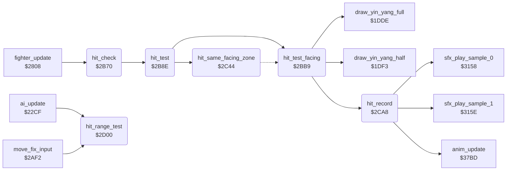

<!-- Generated by c64-docs from knowledge revision 20261022T104543.905-o1bqdy and .c64-re-tools/local/generated/src/source-map.json. Do not edit: change the knowledge, generate the source again, then run docs.ts generate. -->
# fighter/hit_test.asm: Hit test at the hit frame, points, CIA2 protection check, hit reaction, range test

Range `$2B70-$2D61`. Source: [fighter/hit_test.asm](../../../../src/fighter/hit_test.asm). Index: [the reference](../../index.md).

## Call graph

A solid arrow is a call, a thick arrow a table entry, a dotted arrow a jump. Rounded nodes are in this file.

## Names

### [`hit_check`](../../../../src/fighter/hit_test.asm#L6) `$2B70`

*routine*

Starts the hit test for fighter X when its attack move shows the hit frame. The move needs the attack flag ($1176), a new forward animation step and pose_held = 0. Called from fighter_update; the bull round does not call it.

- **Called from:** [`fighter_update`](fighter_input.md#fighter_update) [`$2808`](../../../../src/fighter/fighter_input.asm#L7)
- **Calls:** [`hit_test`](hit_test.md#hit_test)
- **Refers to:** [`move_attack_flags`](../game/entry_and_tables.md#move_attack_flags), [`move_hit_frames`](../game/entry_and_tables_1204.md#move_hit_frames)

### [`hit_check_done`](../../../../src/fighter/hit_test.asm#L20) `$2B8D`

*label*

- **Jumped to from:** [`hit_check`](hit_test.md#hit_check) [`$2B75`](../../../../src/fighter/hit_test.asm#L9), [`hit_check`](hit_test.md#hit_check) [`$2B79`](../../../../src/fighter/hit_test.asm#L11), [`hit_check`](hit_test.md#hit_check) [`$2B7D`](../../../../src/fighter/hit_test.asm#L13), [`hit_check`](hit_test.md#hit_check) [`$2B81`](../../../../src/fighter/hit_test.asm#L15), [`hit_check`](hit_test.md#hit_check) [`$2B88`](../../../../src/fighter/hit_test.asm#L18)

### [`hit_test`](../../../../src/fighter/hit_test.asm#L23) `$2B8E`

*routine*

Tests if the attack of fighter X hits the opponent (opponent_index). The hit-zone table of the move gives a target extent for the opponent frame; fighter_distance must lie in the reach window ($11bd full, $11d6 half). A hit sets hit_points,x to 2 or 1 and goes to hit_record. A miss changes nothing. Called from hit_check.

- **Called from:** [`hit_check`](hit_test.md#hit_check) [`$2B8A`](../../../../src/fighter/hit_test.asm#L19)
- **Calls:** [`hit_test_facing`](hit_test.md#hit_test_facing), [`hit_same_facing_zone`](hit_test.md#hit_same_facing_zone)
- **Jumps to:** [`hit_test_facing`](hit_test.md#hit_test_facing), [`hit_same_facing_zone`](hit_test.md#hit_same_facing_zone)
- **Reads:** [`opponent_index`](../../memory-map.md#opponent_index)
- **Writes:** [`hit_zone_ptr`](../../memory-map.md#hit_zone_ptr), [`hit_zone_ptr+1`](../../memory-map.md#hit_zone_ptr)
- **Refers to:** [`move_hit_zone_facing`](../game/entry_and_tables_1204.md#move_hit_zone_facing), [`move_hit_zone_facing+1`](../game/entry_and_tables_1204.md#move_hit_zone_facing), [`hit_zone_ptr`](../../memory-map.md#hit_zone_ptr), [`move_hit_zone_same_facing`](../game/entry_and_tables_1204.md#move_hit_zone_same_facing), [`move_hit_zone_same_facing+1`](../game/entry_and_tables_1204.md#move_hit_zone_same_facing)

### [`hit_test_same_facing`](../../../../src/fighter/hit_test.asm#L36) `$2BA8`

*label*

Same facing: the attacker faces the back of the opponent

- **Jumped to from:** [`hit_test`](hit_test.md#hit_test) [`$2B95`](../../../../src/fighter/hit_test.asm#L27)

### [`hit_test_facing`](../../../../src/fighter/hit_test.asm#L45) `$2BB9`

*label*

- **Called from:** [`hit_test`](hit_test.md#hit_test) [`$2BA5`](../../../../src/fighter/hit_test.asm#L35)
- **Jumped to from:** [`hit_test`](hit_test.md#hit_test) [`$2BA5`](../../../../src/fighter/hit_test.asm#L35)
- **Calls:** [`draw_yin_yang_full`](../game/game_modes.md#draw_yin_yang_full), [`hit_record`](hit_test.md#hit_record), [`draw_yin_yang_half`](../game/game_modes.md#draw_yin_yang_half)
- **Jumps to:** [`hit_record`](hit_test.md#hit_record)
- **Reads:** [`opponent_index`](../../memory-map.md#opponent_index), [`hit_zone_ptr`](../../memory-map.md#hit_zone_ptr), [`fighter_distance`](../../memory-map.md#fighter_distance), [`hit_target_extent`](../../memory-map.md#hit_target_extent), [`two_player_mode`](../../memory-map.md#two_player_mode)
- **Writes:** [`hit_target_extent`](../../memory-map.md#hit_target_extent), [`fighter_distance`](../../memory-map.md#fighter_distance)
- **Refers to:** [`move_reach_types`](../game/entry_and_tables.md#move_reach_types), [`move_full_reach`](../game/entry_and_tables.md#move_full_reach), [`move_half_reach`](../game/entry_and_tables.md#move_half_reach), [`yin_yang_fighter_offsets`](../game/entry_and_tables_1299.md#yin_yang_fighter_offsets)

### [`hit_dist_facing_left`](../../../../src/fighter/hit_test.asm#L62) `$2BD9`

*label*

- **Jumped to from:** [`hit_test_facing`](hit_test.md#hit_test_facing) [`$2BCE`](../../../../src/fighter/hit_test.asm#L57)

### [`hit_dist_store`](../../../../src/fighter/hit_test.asm#L66) `$2BDF`

*label*

- **Jumped to from:** [`hit_test_facing`](hit_test.md#hit_test_facing) [`$2BD6`](../../../../src/fighter/hit_test.asm#L61)

### [`hit_miss`](../../../../src/fighter/hit_test.asm#L77) `$2BF3`

*label*

- **Jumped to from:** [`hit_test_facing`](hit_test.md#hit_test_facing) [`$2BC3`](../../../../src/fighter/hit_test.asm#L51), [`hit_test_facing`](hit_test.md#hit_test_facing) [`$2C0B`](../../../../src/fighter/hit_test.asm#L92)

### [`hit_try_full_reach`](../../../../src/fighter/hit_test.asm#L79) `$2BF4`

*label*

- **Jumped to from:** [`hit_test_facing`](hit_test.md#hit_test_facing) [`$2BEF`](../../../../src/fighter/hit_test.asm#L75)

### [`hit_reach_type_set`](../../../../src/fighter/hit_test.asm#L88) `$2C05`

*label*

Reach type not 0: hit when extent <= distance < extent + reach

- **Jumped to from:** [`hit_test_facing`](hit_test.md#hit_test_facing) [`$2BE9`](../../../../src/fighter/hit_test.asm#L72)

### [`hit_full_point`](../../../../src/fighter/hit_test.asm#L101) `$2C1E`

*label*

- **Jumped to from:** [`hit_test_facing`](hit_test.md#hit_test_facing) [`$2BF1`](../../../../src/fighter/hit_test.asm#L76), [`hit_test_facing`](hit_test.md#hit_test_facing) [`$2BF9`](../../../../src/fighter/hit_test.asm#L82), [`hit_test_facing`](hit_test.md#hit_test_facing) [`$2C09`](../../../../src/fighter/hit_test.asm#L91), [`hit_test_facing`](hit_test.md#hit_test_facing) [`$2C12`](../../../../src/fighter/hit_test.asm#L95), [`hit_same_facing_zone`](hit_test.md#hit_same_facing_zone) [`$2C7A`](../../../../src/fighter/hit_test.asm#L150), [`hit_same_facing_zone`](hit_test.md#hit_same_facing_zone) [`$2C83`](../../../../src/fighter/hit_test.asm#L154), [`hit_same_facing_zone`](hit_test.md#hit_same_facing_zone) [`$2C93`](../../../../src/fighter/hit_test.asm#L164), [`hit_same_facing_zone`](hit_test.md#hit_same_facing_zone) [`$2C9C`](../../../../src/fighter/hit_test.asm#L168)

### [`hit_full_record`](../../../../src/fighter/hit_test.asm#L109) `$2C2E`

*label*

- **Jumped to from:** [`hit_test_facing`](hit_test.md#hit_test_facing) [`$2C26`](../../../../src/fighter/hit_test.asm#L106)

### [`hit_half_point`](../../../../src/fighter/hit_test.asm#L111) `$2C31`

*label*

- **Jumped to from:** [`hit_test_facing`](hit_test.md#hit_test_facing) [`$2C02`](../../../../src/fighter/hit_test.asm#L86), [`hit_test_facing`](hit_test.md#hit_test_facing) [`$2C1B`](../../../../src/fighter/hit_test.asm#L99), [`hit_same_facing_zone`](hit_test.md#hit_same_facing_zone) [`$2C8C`](../../../../src/fighter/hit_test.asm#L158), [`hit_same_facing_zone`](hit_test.md#hit_same_facing_zone) [`$2CA5`](../../../../src/fighter/hit_test.asm#L172)

### [`hit_same_facing_zone`](../../../../src/fighter/hit_test.asm#L120) `$2C44`

*label*

Mirror of hit_test_facing: opposite distance sign and reach-type rules

- **Called from:** [`hit_test`](hit_test.md#hit_test) [`$2BB6`](../../../../src/fighter/hit_test.asm#L44)
- **Jumped to from:** [`hit_test`](hit_test.md#hit_test) [`$2BB6`](../../../../src/fighter/hit_test.asm#L44)
- **Jumps to:** [`hit_full_point`](hit_test.md#hit_full_point), [`hit_half_point`](hit_test.md#hit_half_point)
- **Reads:** [`opponent_index`](../../memory-map.md#opponent_index), [`hit_zone_ptr`](../../memory-map.md#hit_zone_ptr), [`fighter_distance`](../../memory-map.md#fighter_distance), [`hit_target_extent`](../../memory-map.md#hit_target_extent)
- **Writes:** [`hit_target_extent`](../../memory-map.md#hit_target_extent), [`fighter_distance`](../../memory-map.md#fighter_distance)
- **Refers to:** [`move_reach_types`](../game/entry_and_tables.md#move_reach_types), [`move_full_reach`](../game/entry_and_tables.md#move_full_reach), [`move_half_reach`](../game/entry_and_tables.md#move_half_reach)

### [`hit_sf_dist_facing_right`](../../../../src/fighter/hit_test.asm#L137) `$2C64`

*label*

- **Jumped to from:** [`hit_same_facing_zone`](hit_test.md#hit_same_facing_zone) [`$2C59`](../../../../src/fighter/hit_test.asm#L132)

### [`hit_sf_dist_store`](../../../../src/fighter/hit_test.asm#L141) `$2C6A`

*label*

- **Jumped to from:** [`hit_same_facing_zone`](hit_test.md#hit_same_facing_zone) [`$2C61`](../../../../src/fighter/hit_test.asm#L136)

### [`hit_sf_miss`](../../../../src/fighter/hit_test.asm#L159) `$2C8E`

*label*

- **Jumped to from:** [`hit_same_facing_zone`](hit_test.md#hit_same_facing_zone) [`$2C4E`](../../../../src/fighter/hit_test.asm#L126), [`hit_same_facing_zone`](hit_test.md#hit_same_facing_zone) [`$2C7C`](../../../../src/fighter/hit_test.asm#L151), [`hit_same_facing_zone`](hit_test.md#hit_same_facing_zone) [`$2C95`](../../../../src/fighter/hit_test.asm#L165)

### [`hit_sf_reach_type_set`](../../../../src/fighter/hit_test.asm#L161) `$2C8F`

*label*

- **Jumped to from:** [`hit_same_facing_zone`](hit_test.md#hit_same_facing_zone) [`$2C74`](../../../../src/fighter/hit_test.asm#L147)

### [`hit_record`](../../../../src/fighter/hit_test.asm#L175) `$2CA8`

*label*

Records a hit of fighter X: scoring_move, the CIA2 protection check, then the hit reaction of the opponent. Reaction $16 starts sample 0, $1a and $1b sample 1.

- **Called from:** [`hit_test_facing`](hit_test.md#hit_test_facing) [`$2C2E`](../../../../src/fighter/hit_test.asm#L110), [`hit_test_facing`](hit_test.md#hit_test_facing) [`$2C41`](../../../../src/fighter/hit_test.asm#L119)
- **Jumped to from:** [`hit_test_facing`](hit_test.md#hit_test_facing) [`$2C39`](../../../../src/fighter/hit_test.asm#L116)
- **Calls:** [`anim_update`](anim_step.md#anim_update), [`sfx_play_sample_1`](../sfx/sfx_sample_player.md#sfx_play_sample_1), [`sfx_play_sample_0`](../sfx/sfx_sample_player.md#sfx_play_sample_0)
- **Reads:** [`opponent_index`](../../memory-map.md#opponent_index), [`CI2CRA`](../../memory-map.md#CI2CRA)
- **Writes:** [`scoring_move`](../../memory-map.md#scoring_move)
- **Refers to:** [`move_reach_types`](../game/entry_and_tables.md#move_reach_types)

### [`protect_cia2_check`](../../../../src/fighter/hit_test.asm#L180) `$2CAE`

*label*

New in v2, copy protection: CIA2 control A ($dd0e) must read 0. A KERNAL reset leaves $08. The SCC boot code writes 0 at $0360 before JMP $115a.
CIA2 control A; the game never writes it

### [`protect_cia2_trap`](../../../../src/fighter/hit_test.asm#L194) `$2CB3`

*label*

Trap: pushes the $dd0e value and opponent_index and jumps into anim_update with X = $4e. Its RTS then goes to $dd0e*256 + opponent_index + 1, for example $0802. The normal runs never execute it; tests/protection_trap_original.json does, with $dd0e = $08.
X = $4e: anim_update works on the zero page $4e above the fighter pairs

### [`hit_record_reaction`](../../../../src/fighter/hit_test.asm#L201) `$2CBB`

*label*

- **Jumped to from:** [`hit_record`](hit_test.md#hit_record) [`$2CB1`](../../../../src/fighter/hit_test.asm#L192)

### [`hit_reaction_1b`](../../../../src/fighter/hit_test.asm#L214) `$2CD5`

*label*

- **Jumped to from:** [`hit_record`](hit_test.md#hit_record) [`$2CCB`](../../../../src/fighter/hit_test.asm#L209), [`hit_record`](hit_test.md#hit_record) [`$2CCF`](../../../../src/fighter/hit_test.asm#L211)

### [`hit_reaction_16`](../../../../src/fighter/hit_test.asm#L220) `$2CE0`

*label*

- **Jumped to from:** [`hit_record`](hit_test.md#hit_record) [`$2CD3`](../../../../src/fighter/hit_test.asm#L213), [`hit_record`](hit_test.md#hit_record) [`$2CFD`](../../../../src/fighter/hit_test.asm#L236)

### [`hit_reaction_1a`](../../../../src/fighter/hit_test.asm#L226) `$2CEB`

*label*

- **Jumped to from:** [`hit_record`](hit_test.md#hit_record) [`$2CC7`](../../../../src/fighter/hit_test.asm#L207), [`hit_record`](hit_test.md#hit_record) [`$2CFB`](../../../../src/fighter/hit_test.asm#L235)

### [`hit_reaction_same_facing`](../../../../src/fighter/hit_test.asm#L232) `$2CF6`

*label*

Reach type 0 gives $1a, else $16

- **Jumped to from:** [`hit_record`](hit_test.md#hit_record) [`$2CC0`](../../../../src/fighter/hit_test.asm#L204)

### [`hit_range_test`](../../../../src/fighter/hit_test.asm#L238) `$2D00`

*routine*

Tests the distance to the opponent against the reach type of the opponent's move. Facing each other: in range when the reach type is 0 and the distance is -17 to 19. Facing the same way: reach type not 0 and distance 3 to 31. Returns A = 1 (Z clear) in range, else A = 0. Called from the AI at $235e and move_fix_input at $2b22.

- **Called from:** [`ai_update`](../ai/ai_opponent.md#ai_update) [`$235E`](../../../../src/ai/ai_opponent.asm#L89), [`move_fix_input`](fighter_moves.md#move_fix_input) [`$2B22`](../../../../src/fighter/fighter_moves.asm#L240)
- **Reads:** [`opponent_index`](../../memory-map.md#opponent_index), [`fighter_distance`](../../memory-map.md#fighter_distance)
- **Writes:** [`fighter_distance`](../../memory-map.md#fighter_distance)
- **Refers to:** [`move_reach_types`](../game/entry_and_tables.md#move_reach_types)

### [`range_dist_facing_left`](../../../../src/fighter/hit_test.asm#L249) `$2D16`

*label*

- **Jumped to from:** [`hit_range_test`](hit_test.md#hit_range_test) [`$2D0B`](../../../../src/fighter/hit_test.asm#L244)

### [`range_dist_store`](../../../../src/fighter/hit_test.asm#L253) `$2D1C`

*label*

- **Jumped to from:** [`hit_range_test`](hit_test.md#hit_range_test) [`$2D13`](../../../../src/fighter/hit_test.asm#L248)

### [`range_out`](../../../../src/fighter/hit_test.asm#L264) `$2D31`

*label*

- **Jumped to from:** [`hit_range_test`](hit_test.md#hit_range_test) [`$2D25`](../../../../src/fighter/hit_test.asm#L258), [`hit_range_test`](hit_test.md#hit_range_test) [`$2D53`](../../../../src/fighter/hit_test.asm#L286), [`hit_range_test`](hit_test.md#hit_range_test) [`$2D59`](../../../../src/fighter/hit_test.asm#L289), [`hit_range_test`](hit_test.md#hit_range_test) [`$2D5D`](../../../../src/fighter/hit_test.asm#L291)

### [`range_in`](../../../../src/fighter/hit_test.asm#L267) `$2D34`

*label*

- **Jumped to from:** [`hit_range_test`](hit_test.md#hit_range_test) [`$2D2B`](../../../../src/fighter/hit_test.asm#L261), [`hit_range_test`](hit_test.md#hit_range_test) [`$2D2F`](../../../../src/fighter/hit_test.asm#L263)

### [`range_same_facing`](../../../../src/fighter/hit_test.asm#L270) `$2D37`

*label*

- **Jumped to from:** [`hit_range_test`](hit_test.md#hit_range_test) [`$2D07`](../../../../src/fighter/hit_test.asm#L242)

### [`range_sf_dist_facing_right`](../../../../src/fighter/hit_test.asm#L277) `$2D44`

*label*

- **Jumped to from:** [`hit_range_test`](hit_test.md#hit_range_test) [`$2D39`](../../../../src/fighter/hit_test.asm#L272)

### [`range_sf_dist_store`](../../../../src/fighter/hit_test.asm#L281) `$2D4A`

*label*

- **Jumped to from:** [`hit_range_test`](hit_test.md#hit_range_test) [`$2D41`](../../../../src/fighter/hit_test.asm#L276)
