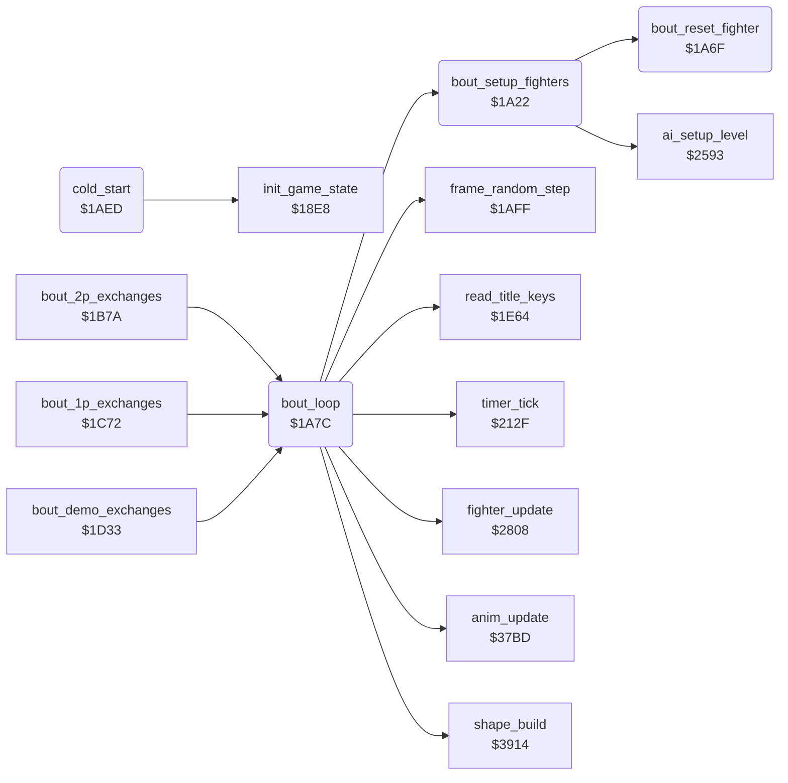

<!-- Generated by c64-docs from knowledge revision 20261025T191824.573-5s4oe2 and .c64-re-tools/local/generated/src/source-map.json. Do not edit: change the knowledge, generate the source again, then run docs.ts generate. -->
# game/bout_loop.asm: Bout set-up, bout loop, cold start, blank sprite and frame random

Range `$1A22-$1AF2`. Source: [game/bout_loop.asm](../../../../src/game/bout_loop.asm). Index: [the reference](../../index.md).

## Routines

| Routine | Address | Reached from | Summary |
|---|---|---|---|
| [`bout_setup_fighters`](bout_loop.md#bout_setup_fighters) | `$1A22` | [`bout_loop`](bout_loop.md#bout_loop) | Puts both fighters at the start: x $3e and $5a, on the ground, facing each other, move and animation $17. |
| [`bout_reset_fighter`](bout_loop.md#bout_reset_fighter) | `$1A6F` | [`bout_setup_fighters`](bout_loop.md#bout_setup_fighters) | Clears hit_reaction, fighter_unused_flag and pose_held of fighter X and sets fighter_move $17. |
| [`bout_loop`](bout_loop.md#bout_loop) | `$1A7C` | [`bout_2p_exchanges`](game_modes.md#bout_2p_exchanges), [`bout_1p_exchanges`](game_modes.md#bout_1p_exchanges), [`bout_demo_exchanges`](game_modes.md#bout_demo_exchanges) | Plays one exchange from the start positions until a fighter falls, the time ends or a start key comes. |
| [`cold_start`](bout_loop.md#cold_start) | `$1AED` | [`$115A`](../../../../src/game/entry_and_tables.asm#L7) | Cold start from program_entry ($115a): init_game_state ($18e8), then the title loop. |

## Call graph

A solid arrow is a call, a thick arrow a table entry. Rounded nodes are in this file.

## Details

### [`bout_setup_fighters`](../../../../src/game/bout_loop.asm#L6) `$1A22`

*routine*

Puts both fighters at the start: x $3e and $5a, on the ground, facing each other, move and animation $17. It also sets fighter 1 red, knockdown_delay 8 and the AI level of both fighters. Called by bout_loop.

- **Called from:** [`bout_loop`](bout_loop.md#bout_loop)
- **Calls:** [`bout_reset_fighter`](bout_loop.md#bout_reset_fighter), [`ai_setup_level`](../ai/ai_opponent_2521.md#ai_setup_level)
- **Writes:** [`fighter_x`](../../memory-map.md#fighter_x), [`fighter_y`](../../memory-map.md#fighter_y), [`anim_reverse`](../../memory-map.md#anim_reverse), [`fighter_facing`](../../memory-map.md#fighter_facing), [`anim_number`](../../memory-map.md#anim_number), [`anim_started`](../../memory-map.md#anim_started), [`bout_knockdown`](../../memory-map.md#bout_knockdown), [`draw_buffer`](../../memory-map.md#draw_buffer), [`fighter_colour`](../../memory-map.md#fighter_colour), [`knockdown_delay`](../../memory-map.md#knockdown_delay)
- **Refers to:** [`fighter_x`](../../memory-map.md#fighter_x), [`fighter_y`](../../memory-map.md#fighter_y), [`anim_reverse`](../../memory-map.md#anim_reverse), [`fighter_facing`](../../memory-map.md#fighter_facing), [`anim_number`](../../memory-map.md#anim_number), [`anim_started`](../../memory-map.md#anim_started), [`draw_buffer`](../../memory-map.md#draw_buffer), [`fighter_colour`](../../memory-map.md#fighter_colour), [`knockdown_delay`](../../memory-map.md#knockdown_delay)

### [`bout_reset_fighter`](../../../../src/game/bout_loop.asm#L45) `$1A6F`

*routine*

Clears hit_reaction, fighter_unused_flag and pose_held of fighter X and sets fighter_move $17. Called by bout_setup_fighters.

- **Called from:** [`bout_setup_fighters`](bout_loop.md#bout_setup_fighters)
- **Writes:** [`hit_reaction`](../../memory-map.md#hit_reaction), [`fighter_unused_flag`](../../memory-map.md#fighter_unused_flag), [`pose_held`](../../memory-map.md#pose_held), [`fighter_move`](../../memory-map.md#fighter_move)

### [`bout_loop`](../../../../src/game/bout_loop.asm#L54) `$1A7C`

*routine*

Plays one exchange from the start positions until a fighter falls, the time ends or a start key comes. Returns A: $80 key, the reaction move, or 1 time up. Called by the three bout handlers.
The bull round sets the offset $40 at $1338; each bout sets 0 again.

- **Called from:** [`bout_2p_exchanges`](game_modes.md#bout_2p_exchanges), [`bout_1p_exchanges`](game_modes.md#bout_1p_exchanges), [`bout_demo_exchanges`](game_modes.md#bout_demo_exchanges)
- **Calls:** [`bout_setup_fighters`](bout_loop.md#bout_setup_fighters), [`anim_update`](../fighter/anim_step.md#anim_update), [`fighter_update`](../fighter/fighter_input.md#fighter_update), [`frame_random_step`](bout_loop_1af4.md#frame_random_step), [`read_title_keys`](title_and_scene.md#read_title_keys), [`timer_tick`](timer_and_texts.md#timer_tick), [`shape_build`](../shapes/shape_build_390c.md#shape_build)
- **Reads:** [`SPENA`](../../memory-map.md#SPENA), [`RASTER`](../../memory-map.md#RASTER), [`opponent_index`](../../memory-map.md#opponent_index), [`bout_knockdown`](../../memory-map.md#bout_knockdown), [`hit_reaction`](../../memory-map.md#hit_reaction), [`fighter_move`](../../memory-map.md#fighter_move), [`time_up`](../../memory-map.md#time_up)
- **Writes:** [`shape_page_offset`](../../memory-map.md#shape_page_offset), [`SPENA`](../../memory-map.md#SPENA), [`opponent_index`](../../memory-map.md#opponent_index), [`fighter_frame`](../../memory-map.md#fighter_frame), [`fighter_y`](../../memory-map.md#fighter_y), [`sprite_y`](../../memory-map.md#sprite_y)
- **Refers to:** [`hit_reaction`](../../memory-map.md#hit_reaction), [`fighter_frame`](../../memory-map.md#fighter_frame), [`fighter_y`](../../memory-map.md#fighter_y), [`sprite_y`](../../memory-map.md#sprite_y)

| Label | Address | Comment |
|---|---|---|
| [`bout_frame_loop`](../../../../src/game/bout_loop.asm#L66) | `$1A96` |  |
| [`bout_check_time_up`](../../../../src/game/bout_loop.asm#L90) | `$1ACA` |  |
| [`bout_loop_exit`](../../../../src/game/bout_loop.asm#L107) | `$1AEC` |  |

### [`cold_start`](../../../../src/game/bout_loop.asm#L110) `$1AED`

*routine*

Cold start from program_entry ($115a): init_game_state ($18e8), then the title loop. It never returns.

- **Jumped to from:** [`$115A`](../../../../src/game/entry_and_tables.asm#L7)
- **Calls:** [`init_game_state`](init_machine.md#init_game_state)
- **Jumps to:** [`title_main_loop`](title_and_scene.md#title_main_loop)
