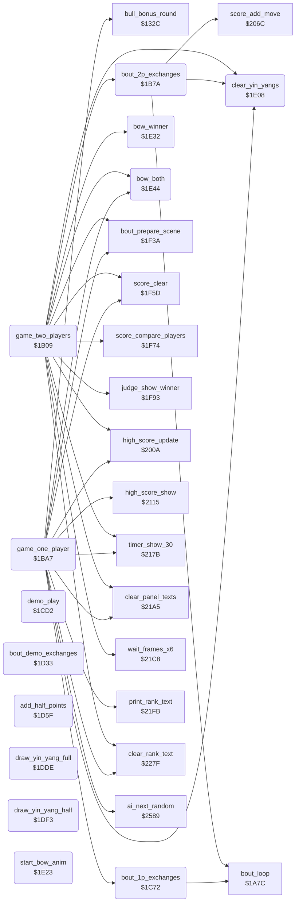

<!-- Generated by c64-docs from knowledge revision 20261025T214835.634-4kntaa and .c64-re-tools/local/generated/src/source-map.json. Do not edit: change the knowledge, generate the source again, then run docs.ts generate. -->
# game/game_modes.asm: Two-player game, one-player game with the bull round call, demo, half points, yin-yangs and bows

Range `$1B09-$1E63`. Source: [game/game_modes.asm](../../../../src/game/game_modes.asm). Index: [the reference](../../index.md).

## Routines

| Routine | Address | Reached from | Summary |
|---|---|---|---|
| [`game_two_players`](game_modes.md#game_two_players) | `$1B09` | [`title_main_loop`](title_and_scene.md#title_main_loop) | Two-player game: 4 bouts of 30 seconds with a 90-frame pause between them, points only as score. |
| [`bout_2p_exchanges`](game_modes.md#bout_2p_exchanges) | `$1B7A` | [`game_two_players`](game_modes.md#game_two_players) | One two-player bout: exchanges until the time ends. |
| [`game_one_player`](game_modes.md#game_one_player) | `$1BA7` | [`title_main_loop`](title_and_scene.md#title_main_loop) | One-player game against the computer from NOVICE up. |
| [`bout_1p_exchanges`](game_modes.md#bout_1p_exchanges) | `$1C72` | [`game_one_player`](game_modes.md#game_one_player) | One-player bout: exchanges until a fighter has 4 half points or the time ends. |
| [`demo_play`](game_modes.md#demo_play) | `$1CD2` | [`title_main_loop`](title_and_scene.md#title_main_loop) | Attract demo: two computer fighters with random levels 3-11 fight 4 bouts, one per scene. |
| [`bout_demo_exchanges`](game_modes.md#bout_demo_exchanges) | `$1D33` | [`demo_play`](game_modes.md#demo_play) | One demo bout: exchanges until a fighter has 4 half points or the time ends. |
| [`add_half_points`](game_modes.md#add_half_points) | `$1D5F` | [`bout_1p_exchanges`](game_modes.md#bout_1p_exchanges), [`bout_demo_exchanges`](game_modes.md#bout_demo_exchanges) | Adds hit_points of fighter X to half_points and draws the yin-yang symbols for 1-4 half points. |
| [`draw_yin_yang_full`](game_modes.md#draw_yin_yang_full) | `$1DDE` | [`add_half_points`](game_modes.md#add_half_points), [`hit_test`](../fighter/hit_test.md#hit_test) | Draws a whole yin-yang symbol (characters $21-$24, 2 x 2) at $cc03+Y. |
| [`draw_yin_yang_half`](game_modes.md#draw_yin_yang_half) | `$1DF3` | [`add_half_points`](game_modes.md#add_half_points), [`hit_test`](../fighter/hit_test.md#hit_test) | Draws a half yin-yang symbol (characters $25-$28, 2 x 2) at $cc03+Y. |
| [`clear_yin_yangs`](game_modes.md#clear_yin_yangs) | `$1E08` | [`game_two_players`](game_modes.md#game_two_players), [`bout_2p_exchanges`](game_modes.md#bout_2p_exchanges), [`game_one_player`](game_modes.md#game_one_player), [`demo_play`](game_modes.md#demo_play) | Clears both yin-yang symbols of a fighter, Y = 0 for fighter 0 or $1d for fighter 1. |
| [`start_bow_anim`](game_modes.md#start_bow_anim) | `$1E23` | [`bow_winner`](game_modes.md#bow_winner), [`bow_both`](game_modes.md#bow_both) | Starts animation $19 (the bow) for fighter X on the ground. |
| [`bow_winner`](game_modes.md#bow_winner) | `$1E32` | [`game_two_players`](game_modes.md#game_two_players), [`bout_1p_exchanges`](game_modes.md#bout_1p_exchanges), [`bout_demo_exchanges`](game_modes.md#bout_demo_exchanges) | Plays the bow of fighter X frame by frame until it ends. |
| [`bow_both`](game_modes.md#bow_both) | `$1E44` | [`game_two_players`](game_modes.md#game_two_players), [`game_one_player`](game_modes.md#game_one_player) | Both fighters bow; it waits for the end of the bow of fighter 1. |

## Call graph

A solid arrow is a call, a thick arrow a table entry. Rounded nodes are in this file.

The graph shows 30 of the 57 edges.

## Details

### [`game_two_players`](../../../../src/game/game_modes.asm#L6) `$1B09`

*routine*

Two-player game: 4 bouts of 30 seconds with a 90-frame pause between them, points only as score. The judge shows the winner, who can set high_score_2p. Returns N set on a start key. Called by the title loop.

- **Called from:** [`title_main_loop`](title_and_scene.md#title_main_loop)
- **Calls:** [`clear_panel_texts`](timer_and_texts.md#clear_panel_texts), [`clear_rank_text`](timer_and_texts.md#clear_rank_text), [`clear_yin_yangs`](game_modes.md#clear_yin_yangs), [`score_clear`](score_and_judge.md#score_clear), [`timer_show_30`](timer_and_texts.md#timer_show_30), [`bout_prepare_scene`](title_and_scene.md#bout_prepare_scene), [`bout_2p_exchanges`](game_modes.md#bout_2p_exchanges), [`wait_frames_x6`](timer_and_texts.md#wait_frames_x6), [`score_compare_players`](score_and_judge.md#score_compare_players), [`bow_both`](game_modes.md#bow_both), [`judge_show_winner`](score_and_judge.md#judge_show_winner), [`bow_winner`](game_modes.md#bow_winner) and 1 more
- **Reads:** [`stage_counter`](../../memory-map.md#stage_counter)
- **Writes:** [`stage_counter`](../../memory-map.md#stage_counter), [`cpu_controlled`](../../memory-map.md#cpu_controlled), [`in_game`](../../memory-map.md#in_game), [`game_mode`](../../memory-map.md#game_mode), [`timer_frames`](../../memory-map.md#timer_frames), [`timer_seconds`](../../memory-map.md#timer_seconds), [`time_up`](../../memory-map.md#time_up)
- **Refers to:** [`cpu_controlled`](../../memory-map.md#cpu_controlled)

| Label | Address | Comment |
|---|---|---|
| [`game_2p_bout_loop`](../../../../src/game/game_modes.asm#L25) | `$1B33` |  |
| [`game_2p_last_bout`](../../../../src/game/game_modes.asm#L43) | `$1B5A` | Back to 3 = the scene on the screen, so that the judge stands at the place of that scene. |
| [`game_2p_draw`](../../../../src/game/game_modes.asm#L47) | `$1B61` | Equal scores: both bow, no judge, and player 1's score goes to the high score test. |
| [`game_2p_winner`](../../../../src/game/game_modes.asm#L52) | `$1B69` | The judge sprites show the winner in X; v1 called a lone RTS here. |
| [`game_2p_high_score`](../../../../src/game/game_modes.asm#L55) | `$1B6F` |  |
| [`game_2p_exit`](../../../../src/game/game_modes.asm#L60) | `$1B79` |  |

### [`bout_2p_exchanges`](../../../../src/game/game_modes.asm#L63) `$1B7A`

*routine*

One two-player bout: exchanges until the time ends. Each hit gives score points to the other player and clears the yin-yang cells. Called by game_two_players.

- **Called from:** [`game_two_players`](game_modes.md#game_two_players)
- **Calls:** [`bout_loop`](bout_loop.md#bout_loop), [`score_add_move`](score_and_judge.md#score_add_move), [`clear_yin_yangs`](game_modes.md#clear_yin_yangs)
- **Reads:** [`hit_reaction`](../../memory-map.md#hit_reaction), [`time_up`](../../memory-map.md#time_up)
- **Refers to:** [`hit_reaction`](../../memory-map.md#hit_reaction)

| Label | Address | Comment |
|---|---|---|
| [`bout_2p_one_hit`](../../../../src/game/game_modes.asm#L70) | `$1B87` |  |
| [`bout_2p_score_p2`](../../../../src/game/game_modes.asm#L76) | `$1B93` |  |
| [`bout_2p_clear_symbols`](../../../../src/game/game_modes.asm#L79) | `$1B98` |  |
| [`bout_2p_exit`](../../../../src/game/game_modes.asm#L86) | `$1BA6` |  |

### [`game_one_player`](../../../../src/game/game_modes.asm#L89) `$1BA7`

*routine*

One-player game against the computer from NOVICE up. Two won bouts give the next rank; the bull round comes after each fourth scene. Returns A = 0 after the lost bout. Called by the title loop.

- **Called from:** [`title_main_loop`](title_and_scene.md#title_main_loop)
- **Calls:** [`clear_panel_texts`](timer_and_texts.md#clear_panel_texts), [`clear_rank_text`](timer_and_texts.md#clear_rank_text), [`score_clear`](score_and_judge.md#score_clear), [`print_rank_text`](timer_and_texts.md#print_rank_text), [`clear_yin_yangs`](game_modes.md#clear_yin_yangs), [`timer_show_30`](timer_and_texts.md#timer_show_30), [`bout_prepare_scene`](title_and_scene.md#bout_prepare_scene), [`bout_1p_exchanges`](game_modes.md#bout_1p_exchanges), [`bull_bonus_round`](bull_round_12f8.md#bull_bonus_round), [`bow_both`](game_modes.md#bow_both), [`high_score_update`](score_and_judge.md#high_score_update), [`high_score_show`](timer_and_texts.md#high_score_show) and 1 more
- **Reads:** [`frame_random`](../../memory-map.md#frame_random), [`wins_to_promotion`](../../memory-map.md#wins_to_promotion), [`stage_counter`](../../memory-map.md#stage_counter), [`cpu_skill`](../../memory-map.md#cpu_skill), [`rank_number_table`](timer_and_texts.md#rank_number_table)
- **Writes:** [`rank_text_offset`](../../memory-map.md#rank_text_offset), [`stage_counter`](../../memory-map.md#stage_counter), [`cpu_controlled`](../../memory-map.md#cpu_controlled), [`cpu_skill`](../../memory-map.md#cpu_skill), [`in_game`](../../memory-map.md#in_game), [`wins_to_promotion`](../../memory-map.md#wins_to_promotion), [`panel_row1`](../../memory-map.md#panel_row1), [`ai_random`](../../memory-map.md#ai_random), [`text_dest_ptr`](../../memory-map.md#text_dest_ptr), [`player_rank`](../../memory-map.md#player_rank), [`game_mode`](../../memory-map.md#game_mode), [`half_points`](../../memory-map.md#half_points) and 4 more
- **Refers to:** [`cpu_skill`](../../memory-map.md#cpu_skill), [`cpu_controlled`](../../memory-map.md#cpu_controlled), [`text_dest_ptr`](../../memory-map.md#text_dest_ptr), [`half_points`](../../memory-map.md#half_points), [`bout_hit_value`](../../memory-map.md#bout_hit_value)

| Label | Address | Comment |
|---|---|---|
| [`game_1p_bout_loop`](../../../../src/game/game_modes.asm#L116) | `$1BE7` |  |
| [`game_1p_rank_cap_test`](../../../../src/game/game_modes.asm#L146) | `$1C27` |  |
| [`game_1p_promote`](../../../../src/game/game_modes.asm#L150) | `$1C2D` | Rank index and AI level of fighter 1 go up together, at most to 10. |
| [`game_1p_check_draw`](../../../../src/game/game_modes.asm#L159) | `$1C46` |  |
| [`game_1p_over`](../../../../src/game/game_modes.asm#L164) | `$1C50` |  |
| [`game_1p_rank_wrap`](../../../../src/game/game_modes.asm#L170) | `$1C5B` | After 10TH DAN: the scenes go on, the rank text stays and the AI level is random. |

### [`bout_1p_exchanges`](../../../../src/game/game_modes.asm#L183) `$1C72`

*routine*

One-player bout: exchanges until a fighter has 4 half points or the time ends. A decision by time calls the judge. Returns A: 1 won, 0 lost, $81 draw, $80 key.

- **Called from:** [`game_one_player`](game_modes.md#game_one_player)
- **Calls:** [`bout_loop`](bout_loop.md#bout_loop), [`bout_hit_value_add`](timer_and_texts.md#bout_hit_value_add), [`add_half_points`](game_modes.md#add_half_points), [`score_add_move`](score_and_judge.md#score_add_move), [`judge_show_winner`](score_and_judge.md#judge_show_winner), [`bow_winner`](game_modes.md#bow_winner), [`time_bonus_count`](timer_and_texts.md#time_bonus_count)
- **Reads:** [`hit_reaction`](../../memory-map.md#hit_reaction), [`time_up`](../../memory-map.md#time_up), [`half_points`](../../memory-map.md#half_points), [`bout_hit_value`](../../memory-map.md#bout_hit_value)
- **Refers to:** [`hit_reaction`](../../memory-map.md#hit_reaction), [`half_points`](../../memory-map.md#half_points), [`bout_hit_value`](../../memory-map.md#bout_hit_value)

| Label | Address | Comment |
|---|---|---|
| [`bout_1p_one_hit`](../../../../src/game/game_modes.asm#L190) | `$1C7F` |  |
| [`bout_1p_p1_scores`](../../../../src/game/game_modes.asm#L198) | `$1C90` |  |
| [`bout_1p_check_time`](../../../../src/game/game_modes.asm#L205) | `$1C9F` |  |
| [`bout_1p_tie_break`](../../../../src/game/game_modes.asm#L214) | `$1CAE` |  |
| [`bout_1p_won_decision`](../../../../src/game/game_modes.asm#L219) | `$1CB6` |  |
| [`bout_1p_won`](../../../../src/game/game_modes.asm#L222) | `$1CBB` |  |
| [`bout_1p_exit`](../../../../src/game/game_modes.asm#L226) | `$1CC3` |  |
| [`bout_1p_lost_decision`](../../../../src/game/game_modes.asm#L228) | `$1CC4` |  |
| [`bout_1p_lost`](../../../../src/game/game_modes.asm#L231) | `$1CC9` |  |
| [`bout_1p_draw`](../../../../src/game/game_modes.asm#L235) | `$1CCF` |  |

### [`demo_play`](../../../../src/game/game_modes.asm#L239) `$1CD2`

*routine*

Attract demo: two computer fighters with random levels 3-11 fight 4 bouts, one per scene. Returns N set when a start key or fire ends it. Called by the title loop.

- **Called from:** [`title_main_loop`](title_and_scene.md#title_main_loop)
- **Calls:** [`ai_next_random`](../ai/ai_opponent_2521.md#ai_next_random), [`clear_rank_text`](timer_and_texts.md#clear_rank_text), [`show_demo_text`](timer_and_texts.md#show_demo_text), [`clear_yin_yangs`](game_modes.md#clear_yin_yangs), [`timer_show_30`](timer_and_texts.md#timer_show_30), [`bout_prepare_scene`](title_and_scene.md#bout_prepare_scene), [`bout_demo_exchanges`](game_modes.md#bout_demo_exchanges)
- **Reads:** [`frame_random`](../../memory-map.md#frame_random), [`stage_counter`](../../memory-map.md#stage_counter)
- **Writes:** [`stage_counter`](../../memory-map.md#stage_counter), [`ai_random`](../../memory-map.md#ai_random), [`cpu_skill`](../../memory-map.md#cpu_skill), [`cpu_controlled`](../../memory-map.md#cpu_controlled), [`game_mode`](../../memory-map.md#game_mode), [`music_t1_p4_end`](../music/music_patterns.md#music_t1_p4_end), [`half_points`](../../memory-map.md#half_points), [`bout_hit_value`](../../memory-map.md#bout_hit_value), [`timer_frames`](../../memory-map.md#timer_frames), [`timer_seconds`](../../memory-map.md#timer_seconds), [`time_up`](../../memory-map.md#time_up)
- **Refers to:** [`cpu_skill`](../../memory-map.md#cpu_skill), [`cpu_controlled`](../../memory-map.md#cpu_controlled), [`half_points`](../../memory-map.md#half_points), [`bout_hit_value`](../../memory-map.md#bout_hit_value)

| Label | Address | Comment |
|---|---|---|
| [`demo_bout_loop`](../../../../src/game/game_modes.asm#L260) | `$1CFF` |  |
| [`demo_exit`](../../../../src/game/game_modes.asm#L284) | `$1D32` |  |

### [`bout_demo_exchanges`](../../../../src/game/game_modes.asm#L287) `$1D33`

*routine*

One demo bout: exchanges until a fighter has 4 half points or the time ends. No score. Returns A = 0, or $80 with N set on a start key.

- **Called from:** [`demo_play`](game_modes.md#demo_play)
- **Calls:** [`bout_loop`](bout_loop.md#bout_loop), [`add_half_points`](game_modes.md#add_half_points), [`bow_winner`](game_modes.md#bow_winner)
- **Reads:** [`hit_reaction`](../../memory-map.md#hit_reaction), [`time_up`](../../memory-map.md#time_up)
- **Refers to:** [`hit_reaction`](../../memory-map.md#hit_reaction)

| Label | Address | Comment |
|---|---|---|
| [`bout_demo_one_hit`](../../../../src/game/game_modes.asm#L294) | `$1D40` |  |
| [`bout_demo_bow`](../../../../src/game/game_modes.asm#L300) | `$1D4B` |  |
| [`bout_demo_exit`](../../../../src/game/game_modes.asm#L303) | `$1D50` |  |
| [`bout_demo_p1_scores`](../../../../src/game/game_modes.asm#L305) | `$1D51` |  |
| [`bout_demo_check_time`](../../../../src/game/game_modes.asm#L309) | `$1D58` |  |

### [`add_half_points`](../../../../src/game/game_modes.asm#L315) `$1D5F`

*routine*

Adds hit_points of fighter X to half_points and draws the yin-yang symbols for 1-4 half points. Returns C set when the fighter has 4. Called by bout_1p_exchanges and bout_demo_exchanges.

- **Called from:** [`bout_1p_exchanges`](game_modes.md#bout_1p_exchanges), [`bout_demo_exchanges`](game_modes.md#bout_demo_exchanges)
- **Calls:** [`draw_yin_yang_half`](game_modes.md#draw_yin_yang_half), [`draw_yin_yang_full`](game_modes.md#draw_yin_yang_full)
- **Reads:** [`half_points`](../../memory-map.md#half_points), [`hit_points`](../../memory-map.md#hit_points)
- **Writes:** [`half_points`](../../memory-map.md#half_points)

| Label | Address | Comment |
|---|---|---|
| [`points_p1_test`](../../../../src/game/game_modes.asm#L322) | `$1D6A` |  |
| [`points_p1_one`](../../../../src/game/game_modes.asm#L330) | `$1D79` |  |
| [`points_p1_two`](../../../../src/game/game_modes.asm#L334) | `$1D81` |  |
| [`points_p1_three`](../../../../src/game/game_modes.asm#L338) | `$1D89` |  |
| [`points_p1_four`](../../../../src/game/game_modes.asm#L344) | `$1D96` |  |
| [`points_p2_test`](../../../../src/game/game_modes.asm#L350) | `$1DA3` |  |
| [`points_p2_one`](../../../../src/game/game_modes.asm#L358) | `$1DB2` |  |
| [`points_p2_two`](../../../../src/game/game_modes.asm#L362) | `$1DBA` |  |
| [`points_p2_three`](../../../../src/game/game_modes.asm#L366) | `$1DC2` |  |
| [`points_p2_four`](../../../../src/game/game_modes.asm#L372) | `$1DCF` |  |
| [`points_test_won`](../../../../src/game/game_modes.asm#L377) | `$1DD9` |  |

### [`draw_yin_yang_full`](../../../../src/game/game_modes.asm#L382) `$1DDE`

*routine*

Draws a whole yin-yang symbol (characters $21-$24, 2 x 2) at $cc03+Y. Called by add_half_points and the 2P hit code at $2c2b.

- **Called from:** [`add_half_points`](game_modes.md#add_half_points), [`hit_test`](../fighter/hit_test.md#hit_test)
- **Writes:** [`screen_ram`](../../memory-map.md#screen_ram), [`panel_row1`](../../memory-map.md#panel_row1)

### [`draw_yin_yang_half`](../../../../src/game/game_modes.asm#L393) `$1DF3`

*routine*

Draws a half yin-yang symbol (characters $25-$28, 2 x 2) at $cc03+Y. Called by add_half_points and the 2P hit code at $2c3e.

- **Called from:** [`add_half_points`](game_modes.md#add_half_points), [`hit_test`](../fighter/hit_test.md#hit_test)
- **Writes:** [`screen_ram`](../../memory-map.md#screen_ram), [`panel_row1`](../../memory-map.md#panel_row1)

### [`clear_yin_yangs`](../../../../src/game/game_modes.asm#L404) `$1E08`

*routine*

Clears both yin-yang symbols of a fighter, Y = 0 for fighter 0 or $1d for fighter 1. Called at the start of each bout and by bout_2p_exchanges.

- **Called from:** [`game_two_players`](game_modes.md#game_two_players), [`bout_2p_exchanges`](game_modes.md#bout_2p_exchanges), [`game_one_player`](game_modes.md#game_one_player), [`demo_play`](game_modes.md#demo_play)
- **Writes:** [`screen_ram`](../../memory-map.md#screen_ram), [`panel_row1`](../../memory-map.md#panel_row1)

### [`start_bow_anim`](../../../../src/game/game_modes.asm#L416) `$1E23`

*routine*

Starts animation $19 (the bow) for fighter X on the ground. Called by bow_winner and bow_both.

- **Called from:** [`bow_winner`](game_modes.md#bow_winner), [`bow_both`](game_modes.md#bow_both)
- **Writes:** [`anim_number`](../../memory-map.md#anim_number), [`fighter_y`](../../memory-map.md#fighter_y), [`anim_started`](../../memory-map.md#anim_started), [`anim_reverse`](../../memory-map.md#anim_reverse)

### [`bow_winner`](../../../../src/game/game_modes.asm#L426) `$1E32`

*routine*

Plays the bow of fighter X frame by frame until it ends. Called after a won bout in each mode and after the 2P result.

- **Called from:** [`game_two_players`](game_modes.md#game_two_players), [`bout_1p_exchanges`](game_modes.md#bout_1p_exchanges), [`bout_demo_exchanges`](game_modes.md#bout_demo_exchanges)
- **Calls:** [`start_bow_anim`](game_modes.md#start_bow_anim), [`anim_update`](../fighter/anim_step.md#anim_update)
- **Reads:** [`RASTER`](../../memory-map.md#RASTER), [`anim_finished`](../../memory-map.md#anim_finished)

| Label | Address | Comment |
|---|---|---|
| [`bow_winner_step`](../../../../src/game/game_modes.asm#L428) | `$1E35` |  |
| [`bow_winner_wait`](../../../../src/game/game_modes.asm#L430) | `$1E38` |  |

### [`bow_both`](../../../../src/game/game_modes.asm#L438) `$1E44`

*routine*

Both fighters bow; it waits for the end of the bow of fighter 1. Called after a 1P draw and after equal 2P scores.

- **Called from:** [`game_two_players`](game_modes.md#game_two_players), [`game_one_player`](game_modes.md#game_one_player)
- **Calls:** [`start_bow_anim`](game_modes.md#start_bow_anim), [`anim_update`](../fighter/anim_step.md#anim_update)
- **Reads:** [`RASTER`](../../memory-map.md#RASTER), [`anim_finished`](../../memory-map.md#anim_finished)

| Label | Address | Comment |
|---|---|---|
| [`bow_both_step`](../../../../src/game/game_modes.asm#L443) | `$1E4E` |  |
| [`bow_both_wait`](../../../../src/game/game_modes.asm#L448) | `$1E58` |  |
