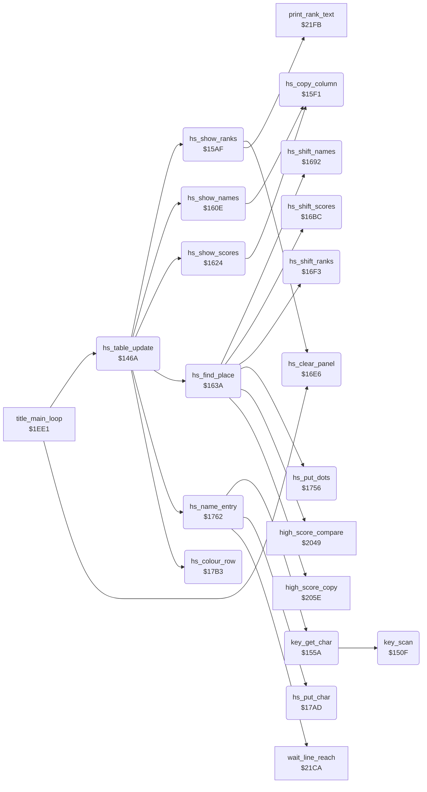

<!-- Generated by c64-docs from knowledge revision 20261025T191824.573-5s4oe2 and .c64-re-tools/local/generated/src/source-map.json. Do not edit: change the knowledge, generate the source again, then run docs.ts generate. -->
# game/high_score_table.asm: Top-5 high score table: entry flow, key scanner, display, place finder, shifts and name entry

Range `$146A-$17BA`. Source: [game/high_score_table.asm](../../../../src/game/high_score_table.asm). Index: [the reference](../../index.md).

## Routines

| Routine | Address | Reached from | Summary |
|---|---|---|---|
| [`hs_table_update`](high_score_table.md#hs_table_update) | `$146A` | [`title_main_loop`](title_and_scene.md#title_main_loop) | After a one-player game: puts the score in the top-5 table, shows the table and lets the player type a name. |
| [`key_scan`](high_score_table.md#key_scan) | `$150F` | [`key_get_char`](high_score_table.md#key_get_char) | Scans the 8 keyboard columns from 7 to 0. |
| [`key_get_char`](high_score_table.md#key_get_char) | `$155A` | [`hs_name_entry`](high_score_table.md#hs_name_entry) | Returns in A the PETSCII code of a new key, or $40 when no key is down or the key is still held. |
| [`hs_show_ranks`](high_score_table.md#hs_show_ranks) | `$15AF` | [`hs_table_update`](high_score_table.md#hs_table_update) | Clears the panel, writes the row numbers 1-5 in column 8 and the rank text of each used entry from column 10. |
| [`hs_copy_column`](high_score_table.md#hs_copy_column) | `$15F1` | [`hs_show_names`](high_score_table.md#hs_show_names), [`hs_show_scores`](high_score_table.md#hs_show_scores) | Copies 5 rows of 6 characters from the table at hs_copy_source_addr to the screen at text_dest_ptr, the last row first. |
| [`hs_show_names`](high_score_table.md#hs_show_names) | `$160E` | [`hs_table_update`](high_score_table.md#hs_table_update) | Shows the 5 names of hs_names from column 19. |
| [`hs_show_scores`](high_score_table.md#hs_show_scores) | `$1624` | [`hs_table_update`](high_score_table.md#hs_table_update) | Shows the 5 scores of hs_scores from column 26. |
| [`hs_find_place`](high_score_table.md#hs_find_place) | `$163A` | [`hs_table_update`](high_score_table.md#hs_table_update) | Finds the place (0-4) of the player 1 score in the table, or 5. |
| [`hs_shift_names`](high_score_table.md#hs_shift_names) | `$1692` | [`hs_find_place`](high_score_table.md#hs_find_place) | Moves the names of the entries from place Y to 3 down by one entry. |
| [`hs_shift_scores`](high_score_table.md#hs_shift_scores) | `$16BC` | [`hs_find_place`](high_score_table.md#hs_find_place) | Moves the scores of the entries from place Y to 3 down by one entry. |
| [`hs_clear_panel`](high_score_table.md#hs_clear_panel) | `$16E6` | [`hs_show_ranks`](high_score_table.md#hs_show_ranks), [`title_main_loop`](title_and_scene.md#title_main_loop) | Fills screen rows 0-4 ($cc00-$ccc7) with spaces, the same job as panel_clear_text. |
| [`hs_shift_ranks`](high_score_table.md#hs_shift_ranks) | `$16F3` | [`hs_find_place`](high_score_table.md#hs_find_place) | Moves the ranks of the entries from place Y to 3 down by one entry and writes player_rank at place Y. |
| [`hs_put_dots`](high_score_table.md#hs_put_dots) | `$1756` | [`hs_find_place`](high_score_table.md#hs_find_place) | Writes the name "......" at text_dest_ptr. |
| [`hs_name_entry`](high_score_table.md#hs_name_entry) | `$1762` | [`hs_table_update`](high_score_table.md#hs_table_update) | Name entry of up to 6 characters at column Y of the new row. |
| [`hs_put_char`](high_score_table.md#hs_put_char) | `$17AD` | [`hs_name_entry`](high_score_table.md#hs_name_entry) | Writes character A at place Y of the new name in the table and on the screen. |
| [`hs_colour_row`](high_score_table.md#hs_colour_row) | `$17B3` | [`hs_table_update`](high_score_table.md#hs_table_update) | Writes colour A into 24 cells of colour RAM at hs_colour_ptr, the row of the new entry. |

## Data

| Range | Type | Name | Read by | Written by |
|---|---|---|---|---|
| [`$1542`](../../../../src/game/high_score_table.asm#L126)-`$1549` | bytes | [`key_column_masks`](../../../../src/game/high_score_table.asm#L125) | [`key_scan`](high_score_table.md#key_scan) |  |
| [`$154A`](../../../../src/game/high_score_table.asm#L129)-`$1551` | bytes | [`key_column_codes`](../../../../src/game/high_score_table.asm#L128) | [`key_scan`](high_score_table.md#key_scan) |  |
| [`$1552`](../../../../src/game/high_score_table.asm#L132)-`$1559` | bytes | [`key_row_ignore`](../../../../src/game/high_score_table.asm#L131) | [`key_scan`](high_score_table.md#key_scan) |  |
| [`$156F`](../../../../src/game/high_score_table.asm#L150)-`$15AE` | bytes of 8 | [`key_chars`](../../../../src/game/high_score_table.asm#L149) | [`key_get_char`](high_score_table.md#key_get_char) |  |
| [`$1715`](../../../../src/game/high_score_table.asm#L356)-`$1732` | petscii of 6 | [`hs_names`](../../../../src/game/high_score_table.asm#L355) | [`hs_shift_names`](high_score_table.md#hs_shift_names) | [`hs_shift_names`](high_score_table.md#hs_shift_names) |
| [`$1733`](../../../../src/game/high_score_table.asm#L363)-`$1750` | petscii of 6 | [`hs_scores`](../../../../src/game/high_score_table.asm#L362) | [`hs_shift_scores`](high_score_table.md#hs_shift_scores) | [`hs_shift_scores`](high_score_table.md#hs_shift_scores) |
| [`$1751`](../../../../src/game/high_score_table.asm#L370)-`$1755` | bytes | [`hs_ranks`](../../../../src/game/high_score_table.asm#L369) | [`hs_show_ranks`](high_score_table.md#hs_show_ranks), [`hs_shift_ranks`](high_score_table.md#hs_shift_ranks) | [`hs_shift_ranks`](high_score_table.md#hs_shift_ranks) |

## Call graph

A solid arrow is a call, a thick arrow a table entry. Rounded nodes are in this file.

## Details

### [`hs_table_update`](../../../../src/game/high_score_table.asm#L6) `$146A`

*routine*

After a one-player game: puts the score in the top-5 table, shows the table and lets the player type a name. Fire held at the start skips the display and the entry. Called by the title loop at $1f0d.

- **Called from:** [`title_main_loop`](title_and_scene.md#title_main_loop)
- **Calls:** [`hs_find_place`](high_score_table.md#hs_find_place), [`hs_show_ranks`](high_score_table.md#hs_show_ranks), [`hs_show_names`](high_score_table.md#hs_show_names), [`hs_show_scores`](high_score_table.md#hs_show_scores), [`hs_colour_row`](high_score_table.md#hs_colour_row), [`hs_name_entry`](high_score_table.md#hs_name_entry)
- **Reads:** [`CIAPRA`](../../memory-map.md#CIAPRA), [`hs_new_position`](../../memory-map.md#hs_new_position), [`text_dest_ptr`](../../memory-map.md#text_dest_ptr), [`hs_name_screen_hi`](high_score_table.md#hs_name_screen_hi), [`hs_name_screen_addr`](high_score_table.md#hs_name_screen_addr), [`RASTER`](../../memory-map.md#RASTER), [`CIAPRB`](../../memory-map.md#CIAPRB)
- **Writes:** [`CIADDRA`](../../memory-map.md#CIADDRA), [`text_dest_ptr`](../../memory-map.md#text_dest_ptr), [`last_key_char`](../../memory-map.md#last_key_char), [`hs_name_screen_hi`](high_score_table.md#hs_name_screen_hi), [`hs_name_screen_addr`](high_score_table.md#hs_name_screen_addr), [`hs_colour_ptr`](../../memory-map.md#hs_colour_ptr), [`CIAPRA`](../../memory-map.md#CIAPRA)
- **Refers to:** [`text_dest_ptr`](../../memory-map.md#text_dest_ptr), [`hs_name_screen_addr`](high_score_table.md#hs_name_screen_addr), [`hs_colour_ptr`](../../memory-map.md#hs_colour_ptr)

| Label | Address | Comment |
|---|---|---|
| [`hs_row_addr_loop`](../../../../src/game/high_score_table.asm#L35) | `$14A5` |  |
| [`hs_row_addr_next`](../../../../src/game/high_score_table.asm#L41) | `$14AD` |  |
| [`hs_row_addr_set`](../../../../src/game/high_score_table.asm#L44) | `$14B0` |  |
| [`hs_table_exit`](../../../../src/game/high_score_table.asm#L61) | `$14D4` |  |
| [`hs_show_and_wait`](../../../../src/game/high_score_table.asm#L64) | `$14D5` | Shows the table and waits up to 250 frames, or until fire on port 2 or F1. Reached from hs_table_update when the score is not in the table. |
| [`hs_wait_frame`](../../../../src/game/high_score_table.asm#L69) | `$14E0` |  |
| [`hs_wait_line_fe`](../../../../src/game/high_score_table.asm#L73) | `$14E7` |  |
| [`hs_wait_exit`](../../../../src/game/high_score_table.asm#L91) | `$150E` |  |

### [`key_scan`](../../../../src/game/high_score_table.asm#L94) `$150F`

*routine*

Scans the 8 keyboard columns from 7 to 0. Returns A = column*8 + row bit of the first key down, or $40 for no key. key_row_ignore masks the keys that a name cannot use. Called by key_get_char.

- **Called from:** [`key_get_char`](high_score_table.md#key_get_char)
- **Reads:** [`CIAPRB`](../../memory-map.md#CIAPRB), [`key_temp`](../../memory-map.md#key_temp)
- **Writes:** [`CIADDRA`](../../memory-map.md#CIADDRA), [`CIADDRB`](../../memory-map.md#CIADDRB), [`CIAPRA`](../../memory-map.md#CIAPRA), [`key_temp`](../../memory-map.md#key_temp)

| Label | Address | Comment |
|---|---|---|
| [`key_scan_column`](../../../../src/game/high_score_table.asm#L100) | `$151B` |  |
| [`key_scan_bit`](../../../../src/game/high_score_table.asm#L108) | `$152D` |  |
| [`key_scan_next`](../../../../src/game/high_score_table.asm#L113) | `$1533` |  |
| [`key_scan_found`](../../../../src/game/high_score_table.asm#L118) | `$1539` |  |

### [`key_column_masks`](../../../../src/game/high_score_table.asm#L125) `$1542-$1549`

*data*

Value for $dc00 that selects keyboard column 0-7.

- **Read by:** [`key_scan`](high_score_table.md#key_scan)

### [`key_column_codes`](../../../../src/game/high_score_table.asm#L128) `$154A-$1551`

*data*

First key code of each keyboard column: column*8.

- **Read by:** [`key_scan`](high_score_table.md#key_scan)

### [`key_row_ignore`](../../../../src/game/high_score_table.asm#L131) `$1552-$1559`

*data*

Row bits that key_scan ignores in each column. The keys left are A-Z, 0-9, SPACE, RETURN and DEL; LEFT SHIFT, column 6 and most punctuation are masked.

- **Read by:** [`key_scan`](high_score_table.md#key_scan)

### [`key_get_char`](../../../../src/game/high_score_table.asm#L134) `$155A`

*routine*

Returns in A the PETSCII code of a new key, or $40 when no key is down or the key is still held. It keeps the last code in last_key_char. Called by hs_name_entry at $177b.

- **Called from:** [`hs_name_entry`](high_score_table.md#hs_name_entry)
- **Calls:** [`key_scan`](high_score_table.md#key_scan)
- **Reads:** [`last_key_char`](../../memory-map.md#last_key_char)
- **Writes:** [`last_key_char`](../../memory-map.md#last_key_char)

| Label | Address | Comment |
|---|---|---|
| [`key_get_store`](../../../../src/game/high_score_table.asm#L145) | `$156C` |  |

### [`key_chars`](../../../../src/game/high_score_table.asm#L149) `$156F-$15AE`

*data*

PETSCII code of each key code $00-$3f (8 per column). Codes of the masked keys, such as F1-F7 and the cursor keys, are in the table but key_scan never returns them.

- **Read by:** [`key_get_char`](high_score_table.md#key_get_char)

### [`hs_show_ranks`](../../../../src/game/high_score_table.asm#L159) `$15AF`

*routine*

Clears the panel, writes the row numbers 1-5 in column 8 and the rank text of each used entry from column 10. Called by hs_table_update and hs_show_and_wait.

- **Called from:** [`hs_table_update`](high_score_table.md#hs_table_update)
- **Calls:** [`hs_clear_panel`](high_score_table.md#hs_clear_panel), [`print_rank_text`](timer_and_texts.md#print_rank_text)
- **Reads:** [`hs_index`](../../memory-map.md#hs_index), [`hs_ranks`](high_score_table.md#hs_ranks), [`text_dest_ptr`](../../memory-map.md#text_dest_ptr)
- **Writes:** [`screen_ram`](../../memory-map.md#screen_ram), [`panel_row1`](../../memory-map.md#panel_row1), [`panel_timer_digits`](../../memory-map.md#panel_timer_digits), [`panel_row4`](../../memory-map.md#panel_row4), [`text_dest_ptr`](../../memory-map.md#text_dest_ptr), [`rank_text_offset`](../../memory-map.md#rank_text_offset), [`hs_index`](../../memory-map.md#hs_index)
- **Refers to:** [`text_dest_ptr`](../../memory-map.md#text_dest_ptr)

| Label | Address | Comment |
|---|---|---|
| [`hs_rank_loop`](../../../../src/game/high_score_table.asm#L176) | `$15D7` |  |
| [`hs_rank_row_up`](../../../../src/game/high_score_table.asm#L181) | `$15E1` |  |
| [`hs_rank_next`](../../../../src/game/high_score_table.asm#L188) | `$15EC` |  |

### [`hs_copy_column`](../../../../src/game/high_score_table.asm#L193) `$15F1`

*routine*

Copies 5 rows of 6 characters from the table at hs_copy_source_addr to the screen at text_dest_ptr, the last row first. Called by hs_show_names and hs_show_scores.

- **Called from:** [`hs_show_names`](high_score_table.md#hs_show_names), [`hs_show_scores`](high_score_table.md#hs_show_scores)
- **Reads:** [`shape_parts`](../graphics/fighter_shapes_8000.md#shape_parts), [`text_dest_ptr`](../../memory-map.md#text_dest_ptr)
- **Writes:** [`text_dest_ptr`](../../memory-map.md#text_dest_ptr)
- **Refers to:** [`text_dest_ptr`](../../memory-map.md#text_dest_ptr)

| Label | Address | Comment |
|---|---|---|
| [`hs_copy_row`](../../../../src/game/high_score_table.asm#L195) | `$15F3` |  |
| [`hs_copy_char`](../../../../src/game/high_score_table.asm#L197) | `$15F5` | The file holds $8000; hs_show_names and hs_show_scores write the table address. |
| [`hs_copy_row_next`](../../../../src/game/high_score_table.asm#L211) | `$1609` |  |

### [`hs_copy_source_addr`](../../../../src/game/high_score_table.asm#L198) `$15F6`

*variable*

- **Written by:** [`hs_show_names`](high_score_table.md#hs_show_names), [`hs_show_scores`](high_score_table.md#hs_show_scores)
- **Referred to by:** [`hs_show_names`](high_score_table.md#hs_show_names), [`hs_show_scores`](high_score_table.md#hs_show_scores)

### [`hs_copy_source_hi`](../../../../src/game/high_score_table.asm#L199) `$15F7-$1608`

*variable*

- **Written by:** [`hs_show_names`](high_score_table.md#hs_show_names), [`hs_show_scores`](high_score_table.md#hs_show_scores)

### [`hs_show_names`](../../../../src/game/high_score_table.asm#L216) `$160E`

*routine*

Shows the 5 names of hs_names from column 19. Called by hs_table_update and hs_show_and_wait.

- **Called from:** [`hs_table_update`](high_score_table.md#hs_table_update)
- **Calls:** [`hs_copy_column`](high_score_table.md#hs_copy_column)
- **Writes:** [`text_dest_ptr`](../../memory-map.md#text_dest_ptr), [`hs_copy_source_addr`](high_score_table.md#hs_copy_source_addr), [`hs_copy_source_hi`](high_score_table.md#hs_copy_source_hi)
- **Refers to:** [`text_dest_ptr`](../../memory-map.md#text_dest_ptr), [`hs_names`](high_score_table.md#hs_names), [`hs_copy_source_addr`](high_score_table.md#hs_copy_source_addr)

### [`hs_show_scores`](../../../../src/game/high_score_table.asm#L222) `$1624`

*routine*

Shows the 5 scores of hs_scores from column 26. Called by hs_table_update and hs_show_and_wait.

- **Called from:** [`hs_table_update`](high_score_table.md#hs_table_update)
- **Calls:** [`hs_copy_column`](high_score_table.md#hs_copy_column)
- **Writes:** [`text_dest_ptr`](../../memory-map.md#text_dest_ptr), [`hs_copy_source_addr`](high_score_table.md#hs_copy_source_addr), [`hs_copy_source_hi`](high_score_table.md#hs_copy_source_hi)
- **Refers to:** [`text_dest_ptr`](../../memory-map.md#text_dest_ptr), [`hs_scores`](high_score_table.md#hs_scores), [`hs_copy_source_addr`](high_score_table.md#hs_copy_source_addr)

### [`hs_find_place`](../../../../src/game/high_score_table.asm#L228) `$163A`

*routine*

Finds the place (0-4) of the player 1 score in the table, or 5. It moves the lower entries down and writes the score, player_rank and the name "......". Called by hs_table_update.

- **Called from:** [`hs_table_update`](high_score_table.md#hs_table_update)
- **Calls:** [`high_score_compare`](score_and_judge.md#high_score_compare), [`hs_shift_names`](high_score_table.md#hs_shift_names), [`hs_shift_scores`](high_score_table.md#hs_shift_scores), [`hs_shift_ranks`](high_score_table.md#hs_shift_ranks), [`high_score_copy`](score_and_judge.md#high_score_copy), [`hs_put_dots`](high_score_table.md#hs_put_dots)
- **Reads:** [`text_dest_ptr`](../../memory-map.md#text_dest_ptr), [`hs_index`](../../memory-map.md#hs_index)
- **Writes:** [`text_dest_ptr`](../../memory-map.md#text_dest_ptr), [`hs_index`](../../memory-map.md#hs_index), [`hs_new_position`](../../memory-map.md#hs_new_position)
- **Refers to:** [`hs_scores`](high_score_table.md#hs_scores), [`text_dest_ptr`](../../memory-map.md#text_dest_ptr)

| Label | Address | Comment |
|---|---|---|
| [`hs_find_loop`](../../../../src/game/high_score_table.asm#L232) | `$1646` |  |
| [`hs_find_next`](../../../../src/game/high_score_table.asm#L243) | `$1658` |  |
| [`hs_find_found`](../../../../src/game/high_score_table.asm#L246) | `$165C` |  |
| [`hs_find_place_set`](../../../../src/game/high_score_table.asm#L255) | `$1669` |  |
| [`hs_find_insert_rank`](../../../../src/game/high_score_table.asm#L264) | `$167B` |  |
| [`hs_find_name_dots`](../../../../src/game/high_score_table.asm#L275) | `$168E` |  |
| [`hs_find_exit`](../../../../src/game/high_score_table.asm#L277) | `$1691` |  |

### [`hs_shift_names`](../../../../src/game/high_score_table.asm#L280) `$1692`

*routine*

Moves the names of the entries from place Y to 3 down by one entry. Called by hs_find_place.

- **Called from:** [`hs_find_place`](high_score_table.md#hs_find_place)
- **Reads:** [`hs_names`](high_score_table.md#hs_names)
- **Writes:** [`hs_names`](high_score_table.md#hs_names)

| Label | Address | Comment |
|---|---|---|
| [`hs_shift_names_loop`](../../../../src/game/high_score_table.asm#L282) | `$1694` |  |
| [`hs_shift_names_next`](../../../../src/game/high_score_table.asm#L297) | `$16B8` |  |

### [`hs_shift_scores`](../../../../src/game/high_score_table.asm#L302) `$16BC`

*routine*

Moves the scores of the entries from place Y to 3 down by one entry. Called by hs_find_place.

- **Called from:** [`hs_find_place`](high_score_table.md#hs_find_place)
- **Reads:** [`hs_scores`](high_score_table.md#hs_scores)
- **Writes:** [`hs_scores`](high_score_table.md#hs_scores)

| Label | Address | Comment |
|---|---|---|
| [`hs_shift_scores_loop`](../../../../src/game/high_score_table.asm#L304) | `$16BE` |  |
| [`hs_shift_scores_next`](../../../../src/game/high_score_table.asm#L319) | `$16E2` |  |

### [`hs_clear_panel`](../../../../src/game/high_score_table.asm#L324) `$16E6`

*routine*

Fills screen rows 0-4 ($cc00-$ccc7) with spaces, the same job as panel_clear_text. Called by hs_show_ranks and by the title loop at $1f10.

- **Called from:** [`hs_show_ranks`](high_score_table.md#hs_show_ranks), [`title_main_loop`](title_and_scene.md#title_main_loop)
- **Writes:** [`screen_ram`](../../memory-map.md#screen_ram)

| Label | Address | Comment |
|---|---|---|
| [`hs_clear_panel_loop`](../../../../src/game/high_score_table.asm#L327) | `$16EA` |  |

### [`hs_shift_ranks`](../../../../src/game/high_score_table.asm#L334) `$16F3`

*routine*

Moves the ranks of the entries from place Y to 3 down by one entry and writes player_rank at place Y. Called by hs_find_place.

- **Called from:** [`hs_find_place`](high_score_table.md#hs_find_place)
- **Reads:** [`player_rank`](../../memory-map.md#player_rank), [`hs_index`](../../memory-map.md#hs_index)
- **Writes:** [`hs_index`](../../memory-map.md#hs_index)

| Label | Address | Comment |
|---|---|---|
| [`hs_shift_ranks_loop`](../../../../src/game/high_score_table.asm#L343) | `$1701` |  |
| [`hs_shift_ranks_put`](../../../../src/game/high_score_table.asm#L350) | `$170F` |  |

### [`hs_names`](../../../../src/game/high_score_table.asm#L355) `$1715-$1732`

*variable*

High score table, names: 5 entries of 6 characters, "......" at the start.

- **Read by:** [`hs_shift_names`](high_score_table.md#hs_shift_names)
- **Written by:** [`hs_shift_names`](high_score_table.md#hs_shift_names)
- **Referred to by:** [`hs_show_names`](high_score_table.md#hs_show_names)

### [`hs_scores`](../../../../src/game/high_score_table.asm#L362) `$1733-$1750`

*variable*

High score table, scores: 5 entries of 6 characters, "     0" at the start.

- **Read by:** [`hs_shift_scores`](high_score_table.md#hs_shift_scores)
- **Written by:** [`hs_shift_scores`](high_score_table.md#hs_shift_scores)
- **Referred to by:** [`hs_show_scores`](high_score_table.md#hs_show_scores), [`hs_find_place`](high_score_table.md#hs_find_place)

### [`hs_ranks`](../../../../src/game/high_score_table.asm#L369) `$1751-$1755`

*variable*

High score table, rank number of each entry: 0 NOVICE, 1-10 dan; $80 = empty.

- **Read by:** [`hs_show_ranks`](high_score_table.md#hs_show_ranks), [`hs_shift_ranks`](high_score_table.md#hs_shift_ranks)
- **Written by:** [`hs_shift_ranks`](high_score_table.md#hs_shift_ranks)

### [`hs_put_dots`](../../../../src/game/high_score_table.asm#L372) `$1756`

*routine*

Writes the name "......" at text_dest_ptr. Called by hs_find_place.

- **Called from:** [`hs_find_place`](high_score_table.md#hs_find_place)
- **Reads:** [`text_dest_ptr`](../../memory-map.md#text_dest_ptr)

| Label | Address | Comment |
|---|---|---|
| [`hs_put_dots_loop`](../../../../src/game/high_score_table.asm#L375) | `$175A` |  |

### [`hs_name_entry`](../../../../src/game/high_score_table.asm#L382) `$1762`

*routine*

Name entry of up to 6 characters at column Y of the new row. RETURN or fire fills the rest with spaces; DEL deletes. game_mode 4 plays tune 4. Called by hs_table_update at $14cc.

- **Called from:** [`hs_table_update`](high_score_table.md#hs_table_update)
- **Calls:** [`wait_line_reach`](timer_and_texts.md#wait_line_reach), [`key_get_char`](high_score_table.md#key_get_char), [`hs_put_char`](high_score_table.md#hs_put_char)
- **Reads:** [`CIAPRA`](../../memory-map.md#CIAPRA), [`fighter_distance`](../../memory-map.md#fighter_distance)
- **Writes:** [`game_mode`](../../memory-map.md#game_mode), [`CIADDRA`](../../memory-map.md#CIADDRA), [`fighter_distance`](../../memory-map.md#fighter_distance)

| Label | Address | Comment |
|---|---|---|
| [`hs_name_loop`](../../../../src/game/high_score_table.asm#L385) | `$1766` |  |
| [`hs_name_fill_spaces`](../../../../src/game/high_score_table.asm#L409) | `$1795` |  |
| [`hs_name_fill_loop`](../../../../src/game/high_score_table.asm#L411) | `$1797` |  |
| [`hs_name_delete`](../../../../src/game/high_score_table.asm#L417) | `$17A0` |  |

### [`hs_put_char`](../../../../src/game/high_score_table.asm#L426) `$17AD`

*routine*

Writes character A at place Y of the new name in the table and on the screen. Called by hs_name_entry.

- **Called from:** [`hs_name_entry`](high_score_table.md#hs_name_entry)
- **Reads:** [`text_dest_ptr`](../../memory-map.md#text_dest_ptr)
- **Writes:** [`screen_ram`](../../memory-map.md#screen_ram)

### [`hs_name_screen_addr`](../../../../src/game/high_score_table.asm#L428) `$17B0`

*variable*

- **Read by:** [`hs_table_update`](high_score_table.md#hs_table_update)
- **Written by:** [`hs_table_update`](high_score_table.md#hs_table_update)
- **Referred to by:** [`hs_table_update`](high_score_table.md#hs_table_update)

### [`hs_name_screen_hi`](../../../../src/game/high_score_table.asm#L429) `$17B1-$17B2`

*variable*

- **Read by:** [`hs_table_update`](high_score_table.md#hs_table_update)
- **Written by:** [`hs_table_update`](high_score_table.md#hs_table_update)

### [`hs_colour_row`](../../../../src/game/high_score_table.asm#L433) `$17B3`

*routine*

Writes colour A into 24 cells of colour RAM at hs_colour_ptr, the row of the new entry. Called by hs_table_update.

- **Called from:** [`hs_table_update`](high_score_table.md#hs_table_update)
- **Reads:** [`hs_colour_ptr`](../../memory-map.md#hs_colour_ptr)

| Label | Address | Comment |
|---|---|---|
| [`hs_colour_row_loop`](../../../../src/game/high_score_table.asm#L435) | `$17B5` |  |
