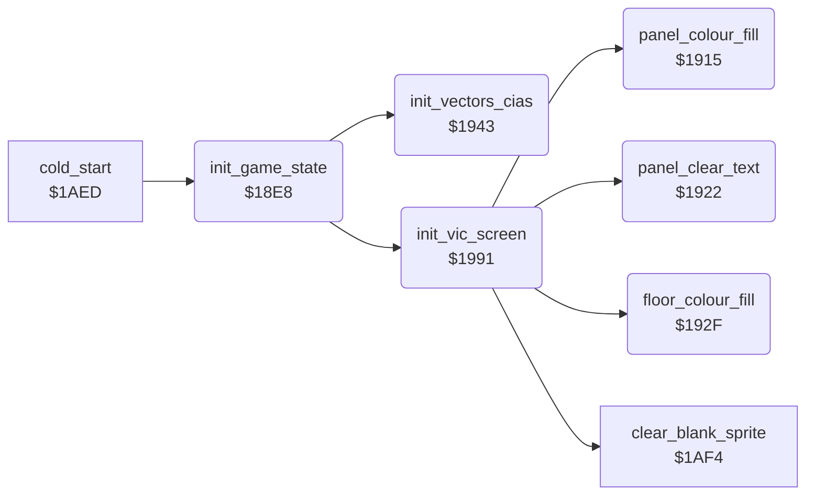

<!-- Generated by c64-docs from knowledge revision 20261025T191824.573-5s4oe2 and .c64-re-tools/local/generated/src/source-map.json. Do not edit: change the knowledge, generate the source again, then run docs.ts generate. -->
# game/init_machine.asm: Start-up: game state, sample period copy, vectors, CIAs, VIC and the panel fills

Range `$18E8-$1A21`. Source: [game/init_machine.asm](../../../../src/game/init_machine.asm). Index: [the reference](../../index.md).

## Routines

| Routine | Address | Reached from | Summary |
|---|---|---|---|
| [`init_game_state`](init_machine.md#init_game_state) | `$18E8` | [`cold_start`](bout_loop.md#cold_start) | Start-up: clears samples_off, game_mode, front_fighter, shape_page_offset and keyboard_control. |
| [`panel_colour_fill`](init_machine.md#panel_colour_fill) | `$1915` | [`init_vic_screen`](init_machine.md#init_vic_screen) | Fills colour RAM of the text rows 0-4 ($d800-$d8c7) with 6, blue. |
| [`panel_clear_text`](init_machine.md#panel_clear_text) | `$1922` | [`init_vic_screen`](init_machine.md#init_vic_screen) | Fills screen rows 0-4 ($cc00-$ccc7) with spaces. |
| [`floor_colour_fill`](init_machine.md#floor_colour_fill) | `$192F` | [`init_vic_screen`](init_machine.md#init_vic_screen) | Fills screen and colour RAM of rows 17-24 with $77, so the floor bitmap shows yellow only. |
| [`init_vectors_cias`](init_machine.md#init_vectors_cias) | `$1943` | [`init_game_state`](init_machine.md#init_game_state) | Switches the ROMs out ($01 = $05) and stops the CIA 1 interrupts. |
| [`reset_vector_rti`](init_machine.md#reset_vector_rti) | `$1990` |  | Lone RTI, the target of the RESET vector at $fffc. |
| [`init_vic_screen`](init_machine.md#init_vic_screen) | `$1991` | [`init_game_state`](init_machine.md#init_game_state) | Sets VIC bank 3, screen $cc00 with bitmap and characters at $e000, colours, multicolour sprites 0-5 on and the panel. |

## Call graph

A solid arrow is a call, a thick arrow a table entry. Rounded nodes are in this file.

## Details

### [`init_game_state`](../../../../src/game/init_machine.asm#L6) `$18E8`

*routine*

Start-up: clears samples_off, game_mode, front_fighter, shape_page_offset and keyboard_control. Sets vectors and CIAs, copies the sample period tables, sets the VIC. Called by cold_start at $1aed.

- **Called from:** [`cold_start`](bout_loop.md#cold_start)
- **Calls:** [`init_vectors_cias`](init_machine.md#init_vectors_cias), [`init_vic_screen`](init_machine.md#init_vic_screen)
- **Reads:** [`sfx_period_lo_init`](../sfx/sfx_period_tables.md#sfx_period_lo_init), [`sfx_period_hi_init`](../sfx/sfx_period_tables.md#sfx_period_hi_init)
- **Writes:** [`samples_off`](../../memory-map.md#samples_off), [`game_mode`](../../memory-map.md#game_mode), [`front_fighter`](../../memory-map.md#front_fighter), [`shape_page_offset`](../../memory-map.md#shape_page_offset), [`keyboard_control`](../../memory-map.md#keyboard_control), [`sfx_period_lo`](../../memory-map.md#sfx_period_lo), [`sfx_period_hi`](../../memory-map.md#sfx_period_hi), [`frame_random`](../../memory-map.md#frame_random), [`scene_shown`](../../memory-map.md#scene_shown)

| Label | Address | Comment |
|---|---|---|
| [`init_copy_periods`](../../../../src/game/init_machine.asm#L16) | `$18FA` |  |

### [`panel_colour_fill`](../../../../src/game/init_machine.asm#L30) `$1915`

*routine*

Fills colour RAM of the text rows 0-4 ($d800-$d8c7) with 6, blue. Called by init_vic_screen.

- **Called from:** [`init_vic_screen`](init_machine.md#init_vic_screen)
- **Writes:** [`shadow_facing0_b`](../graphics/shadow_sprites_d480.md#shadow_facing0_b)

| Label | Address | Comment |
|---|---|---|
| [`panel_colour_loop`](../../../../src/game/init_machine.asm#L33) | `$1919` |  |

### [`panel_clear_text`](../../../../src/game/init_machine.asm#L40) `$1922`

*routine*

Fills screen rows 0-4 ($cc00-$ccc7) with spaces. Called by init_vic_screen.

- **Called from:** [`init_vic_screen`](init_machine.md#init_vic_screen)
- **Writes:** [`screen_ram`](../../memory-map.md#screen_ram)

| Label | Address | Comment |
|---|---|---|
| [`panel_clear_loop`](../../../../src/game/init_machine.asm#L43) | `$1926` |  |

### [`floor_colour_fill`](../../../../src/game/init_machine.asm#L50) `$192F`

*routine*

Fills screen and colour RAM of rows 17-24 with $77, so the floor bitmap shows yellow only. Called by init_vic_screen.

- **Called from:** [`init_vic_screen`](init_machine.md#init_vic_screen)
- **Writes:** [`shadow_facing1`](../graphics/shadow_sprites_d480.md#shadow_facing1), [`screen_scene_rows`](../../memory-map.md#screen_scene_rows)

| Label | Address | Comment |
|---|---|---|
| [`floor_colour_loop`](../../../../src/game/init_machine.asm#L53) | `$1933` |  |

### [`init_vectors_cias`](../../../../src/game/init_machine.asm#L62) `$1943`

*routine*

Switches the ROMs out ($01 = $05) and stops the CIA 1 interrupts. Enables the raster IRQ, sets the IRQ, NMI and RESET vectors and the CIA 2 timer B NMI. Called by init_game_state.

- **Called from:** [`init_game_state`](init_machine.md#init_game_state)
- **Writes:** [`cpu_port`](../../memory-map.md#cpu_port), [`CIAICR`](../../memory-map.md#CIAICR), [`IRQMSK`](../../memory-map.md#IRQMSK), [`hw_irq_vector`](../../memory-map.md#hw_irq_vector), [`hw_reset_vector`](../../memory-map.md#hw_reset_vector), [`CI2ICR`](../../memory-map.md#CI2ICR), [`hw_nmi_vector`](../../memory-map.md#hw_nmi_vector), [`CI2TBLO`](../../memory-map.md#CI2TBLO), [`CI2TBHI`](../../memory-map.md#CI2TBHI), [`CIADDRA`](../../memory-map.md#CIADDRA)
- **Refers to:** [`irq_frame_start`](../irq/sprite_mux_plan.md#irq_frame_start), [`nmi_floor_colour`](../irq/irq_screen_split.md#nmi_floor_colour)

### [`reset_vector_rti`](../../../../src/game/init_machine.asm#L86) `$1990`

*label*

Lone RTI, the target of the RESET vector at $fffc. No run executes it.

- **Referred to by:** [`init_vectors_cias`](init_machine.md#init_vectors_cias)

### [`init_vic_screen`](../../../../src/game/init_machine.asm#L90) `$1991`

*routine*

Sets VIC bank 3, screen $cc00 with bitmap and characters at $e000, colours, multicolour sprites 0-5 on and the panel. Called by init_game_state.

- **Called from:** [`init_game_state`](init_machine.md#init_game_state)
- **Calls:** [`clear_blank_sprite`](bout_loop_1af4.md#clear_blank_sprite), [`floor_colour_fill`](init_machine.md#floor_colour_fill), [`panel_colour_fill`](init_machine.md#panel_colour_fill), [`panel_clear_text`](init_machine.md#panel_clear_text)
- **Writes:** [`CI2PRA`](../../memory-map.md#CI2PRA), [`VMCSB`](../../memory-map.md#VMCSB), [`BGCOL0`](../../memory-map.md#BGCOL0), [`EXTCOL`](../../memory-map.md#EXTCOL), [`panel_bg_colour`](../../memory-map.md#panel_bg_colour), [`SCROLY`](../../memory-map.md#SCROLY), [`RASTER`](../../memory-map.md#RASTER), [`SCROLX`](../../memory-map.md#SCROLX), [`SPMC0`](../../memory-map.md#SPMC0), [`SPMC1`](../../memory-map.md#SPMC1), [`fighter_colour`](../../memory-map.md#fighter_colour), [`SPMC`](../../memory-map.md#SPMC) and 5 more
- **Refers to:** [`fighter_colour`](../../memory-map.md#fighter_colour)
