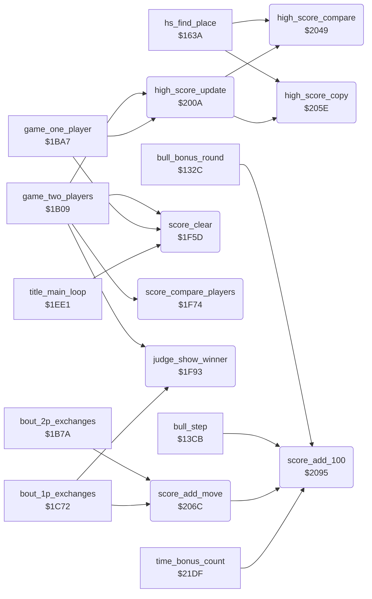

<!-- Generated by c64-docs from knowledge revision 20261022T104543.905-o1bqdy and .c64-re-tools/local/generated/src/source-map.json. Do not edit: change the knowledge, generate the source again, then run docs.ts generate. -->
# game/score_and_judge.asm: Score digits, score compare, judge sprites, high score update and the score adds

Range `$1F5D-$2114`. Source: [game/score_and_judge.asm](../../../../src/game/score_and_judge.asm). Index: [the reference](../../index.md).

## Call graph

A solid arrow is a call, a thick arrow a table entry, a dotted arrow a jump. Rounded nodes are in this file.

## Data

| Range | Type | Name | Read by | Written by |
|---|---|---|---|---|
| [`$1FFA`](../../../../src/game/score_and_judge.asm#L91)-`$1FFD` | bytes | [`judge_ptr_by_scene`](../../../../src/game/score_and_judge.asm#L90) | [`judge_show_winner`](score_and_judge.md#judge_show_winner) |  |
| [`$1FFE`](../../../../src/game/score_and_judge.asm#L94)-`$2001` | bytes | [`judge_x_by_scene`](../../../../src/game/score_and_judge.asm#L93) | [`judge_show_winner`](score_and_judge.md#judge_show_winner) |  |
| [`$2002`](../../../../src/game/score_and_judge.asm#L97)-`$2005` | bytes | [`judge_msb_by_scene`](../../../../src/game/score_and_judge.asm#L96) | [`judge_show_winner`](score_and_judge.md#judge_show_winner) |  |
| [`$2006`](../../../../src/game/score_and_judge.asm#L100)-`$2009` | bytes | [`judge_y_by_scene`](../../../../src/game/score_and_judge.asm#L99) | [`judge_show_winner`](score_and_judge.md#judge_show_winner) |  |

## Names

### [`score_clear`](../../../../src/game/score_and_judge.asm#L6) `$1F5D`

*routine*

Sets the score of the player at $cc28+X to five spaces and a 0. X = 9 for player 1, $19 for player 2.

- **Called from:** [`game_two_players`](game_modes.md#game_two_players) [`$1B27`](../../../../src/game/game_modes.asm#L20), [`game_two_players`](game_modes.md#game_two_players) [`$1B2C`](../../../../src/game/game_modes.asm#L22), [`game_one_player`](game_modes.md#game_one_player) [`$1BC3`](../../../../src/game/game_modes.asm#L103), [`game_one_player`](game_modes.md#game_one_player) [`$1BC8`](../../../../src/game/game_modes.asm#L105), [`title_main_loop`](title_and_scene.md#title_main_loop) [`$1EF4`](../../../../src/game/title_and_scene.asm#L92), [`title_main_loop`](title_and_scene.md#title_main_loop) [`$1EF9`](../../../../src/game/title_and_scene.asm#L94)
- **Refers to:** [`panel_row1`](../../memory-map.md#panel_row1), [`panel_row1+1`](../../memory-map.md#panel_row1), [`panel_row1+2`](../../memory-map.md#panel_row1), [`panel_row1+3`](../../memory-map.md#panel_row1), [`panel_row1+4`](../../memory-map.md#panel_row1), [`panel_row1+5`](../../memory-map.md#panel_row1)

### [`score_compare_players`](../../../../src/game/score_and_judge.asm#L17) `$1F74`

*routine*

Compares the six score digits of both players. Returns X = 0 when player 1 is higher, 1 when player 2 is higher, $80 when equal. Called by game_two_players.

- **Called from:** [`game_two_players`](game_modes.md#game_two_players) [`$1B5C`](../../../../src/game/game_modes.asm#L45)
- **Reads:** [`panel_row1+9`](../../memory-map.md#panel_row1), [`panel_row1+10`](../../memory-map.md#panel_row1), [`panel_timer_digits+6`](../../memory-map.md#panel_timer_digits), [`panel_timer_digits+7`](../../memory-map.md#panel_timer_digits)

### [`score_compare_loop`](../../../../src/game/score_and_judge.asm#L20) `$1F78`

*label*

- **Jumped to from:** [`score_compare_players`](score_and_judge.md#score_compare_players) [`$1F88`](../../../../src/game/score_and_judge.asm#L31)

### [`score_compare_differ`](../../../../src/game/score_and_judge.asm#L24) `$1F80`

*label*

### [`score_compare_next`](../../../../src/game/score_and_judge.asm#L27) `$1F84`

*label*

- **Jumped to from:** [`score_compare_players`](score_and_judge.md#score_compare_players) [`$1F7E`](../../../../src/game/score_and_judge.asm#L23)

### [`score_compare_equal`](../../../../src/game/score_and_judge.asm#L32) `$1F8A`

*label*

### [`score_p1_higher`](../../../../src/game/score_and_judge.asm#L36) `$1F8D`

*label*

- **Jumped to from:** [`score_compare_players`](score_and_judge.md#score_compare_players) [`$1F80`](../../../../src/game/score_and_judge.asm#L25)

### [`score_p2_higher`](../../../../src/game/score_and_judge.asm#L39) `$1F90`

*label*

- **Jumped to from:** [`score_compare_players`](score_and_judge.md#score_compare_players) [`$1F82`](../../../../src/game/score_and_judge.asm#L26)

### [`judge_show_winner`](../../../../src/game/score_and_judge.asm#L43) `$1F93`

*routine*

Shows the judge with sprite 6 and a sprite 7 in the colour of the winner X at the place of the scene. Called after a decision by time ($1cb8, $1cc6) and after the 2P score compare ($1b69). New in v2: v1 had a lone RTS (winner_stub) with the same three callers.
The judge sprite 6 is grey.

- **Called from:** [`game_two_players`](game_modes.md#game_two_players) [`$1B69`](../../../../src/game/game_modes.asm#L53), [`bout_1p_exchanges`](game_modes.md#bout_1p_exchanges) [`$1CB8`](../../../../src/game/game_modes.asm#L221), [`bout_1p_exchanges`](game_modes.md#bout_1p_exchanges) [`$1CC6`](../../../../src/game/game_modes.asm#L230)
- **Reads:** [`stage_counter`](../../memory-map.md#stage_counter), [`MSIGX`](../../memory-map.md#MSIGX), [`sprite_ptr_judge`](../../memory-map.md#sprite_ptr_judge), [`SP6X`](../../memory-map.md#SP6X), [`SP6Y`](../../memory-map.md#SP6Y), [`SPENA`](../../memory-map.md#SPENA)
- **Writes:** [`SP6COL`](../../memory-map.md#SP6COL), [`SP7COL`](../../memory-map.md#SP7COL), [`sprite_ptr_flag`](../../memory-map.md#sprite_ptr_flag), [`sprite_ptr_judge`](../../memory-map.md#sprite_ptr_judge), [`SP6X`](../../memory-map.md#SP6X), [`MSIGX`](../../memory-map.md#MSIGX), [`SP6Y`](../../memory-map.md#SP6Y), [`SP7X`](../../memory-map.md#SP7X), [`SP7Y`](../../memory-map.md#SP7Y), [`SPENA`](../../memory-map.md#SPENA)

### [`judge_sprite7_pose_50`](../../../../src/game/score_and_judge.asm#L77) `$1FE2`

*label*

- **Jumped to from:** [`judge_show_winner`](score_and_judge.md#judge_show_winner) [`$1FCB`](../../../../src/game/score_and_judge.asm#L67)

### [`judge_sprites_on`](../../../../src/game/score_and_judge.asm#L84) `$1FF1`

*label*

- **Jumped to from:** [`judge_show_winner`](score_and_judge.md#judge_show_winner) [`$1FDF`](../../../../src/game/score_and_judge.asm#L76)

### [`judge_ptr_by_scene`](../../../../src/game/score_and_judge.asm#L90) `$1FFA-$1FFD`

*data*

Judge sprite 6 pointer by scene: $5c, $5c, $50, $50.

- **Read by:** [`judge_show_winner`](score_and_judge.md#judge_show_winner) [`$1FA9`](../../../../src/game/score_and_judge.asm#L55) (+3)

### [`judge_x_by_scene`](../../../../src/game/score_and_judge.asm#L93) `$1FFE-$2001`

*data*

Judge sprite 6 X low byte by scene: $12, $20, $58, $46.

- **Read by:** [`judge_show_winner`](score_and_judge.md#judge_show_winner) [`$1FAF`](../../../../src/game/score_and_judge.asm#L57) (+3)

### [`judge_msb_by_scene`](../../../../src/game/score_and_judge.asm#L96) `$2002-$2005`

*data*

Judge X bit 8 of sprites 6 and 7 ($d010 bits 6-7) by scene: $c0, $c0, 0, 0.

- **Read by:** [`judge_show_winner`](score_and_judge.md#judge_show_winner) [`$1FBA`](../../../../src/game/score_and_judge.asm#L61) (+3)

### [`judge_y_by_scene`](../../../../src/game/score_and_judge.asm#L99) `$2006-$2009`

*data*

Judge sprite 6 Y by scene: $9e, $99, $94, $96.

- **Read by:** [`judge_show_winner`](score_and_judge.md#judge_show_winner) [`$1FC0`](../../../../src/game/score_and_judge.asm#L63) (+3)

### [`high_score_update`](../../../../src/game/score_and_judge.asm#L102) `$200A`

*routine*

Copies the score of the player in X to the single high score of the mode when it is higher. Called at the end of a 1P game ($1c52) and of a 2P game ($1b6f).

- **Called from:** [`game_two_players`](game_modes.md#game_two_players) [`$1B6F`](../../../../src/game/game_modes.asm#L56), [`game_one_player`](game_modes.md#game_one_player) [`$1C52`](../../../../src/game/game_modes.asm#L166)
- **Calls:** [`high_score_compare`](score_and_judge.md#high_score_compare), [`high_score_copy`](score_and_judge.md#high_score_copy)
- **Reads:** [`two_player_mode`](../../memory-map.md#two_player_mode)
- **Writes:** [`text_dest_ptr`](../../memory-map.md#text_dest_ptr), [`text_dest_ptr+1`](../../memory-map.md#text_dest_ptr)
- **Refers to:** [`high_score_1p`](entry_and_tables_1299.md#high_score_1p), [`text_dest_ptr`](../../memory-map.md#text_dest_ptr), [`high_score_2p`](entry_and_tables_1299.md#high_score_2p)

### [`high_score_set_1p`](../../../../src/game/score_and_judge.asm#L109) `$201D`

*label*

### [`high_score_exit`](../../../../src/game/score_and_judge.asm#L112) `$2022`

*label*

- **Jumped to from:** [`high_score_update`](score_and_judge.md#high_score_update) [`$201B`](../../../../src/game/score_and_judge.asm#L108), [`high_score_update`](score_and_judge.md#high_score_update) [`$2034`](../../../../src/game/score_and_judge.asm#L121), [`high_score_update`](score_and_judge.md#high_score_update) [`$2041`](../../../../src/game/score_and_judge.asm#L129)

### [`high_score_2p_mode`](../../../../src/game/score_and_judge.asm#L114) `$2023`

*label*

- **Jumped to from:** [`high_score_update`](score_and_judge.md#high_score_update) [`$200C`](../../../../src/game/score_and_judge.asm#L104)

### [`high_score_2p_p1`](../../../../src/game/score_and_judge.asm#L118) `$202F`

*label*

### [`high_score_set_2p_p1`](../../../../src/game/score_and_judge.asm#L122) `$2036`

*label*

### [`high_score_2p_p2`](../../../../src/game/score_and_judge.asm#L126) `$203C`

*label*

- **Jumped to from:** [`high_score_update`](score_and_judge.md#high_score_update) [`$202D`](../../../../src/game/score_and_judge.asm#L117)

### [`high_score_set_2p_p2`](../../../../src/game/score_and_judge.asm#L130) `$2043`

*label*

### [`high_score_compare`](../../../../src/game/score_and_judge.asm#L135) `$2049`

*routine*

Compares the high score at text_dest_ptr with the score at $cc28+X. Returns C clear when the score is higher. Called by high_score_update and the high score table finder at $1648.

- **Called from:** [`hs_find_place`](high_score_table.md#hs_find_place) [`$1648`](../../../../src/game/high_score_table.asm#L234), [`high_score_update`](score_and_judge.md#high_score_update) [`$2018`](../../../../src/game/score_and_judge.asm#L107), [`high_score_update`](score_and_judge.md#high_score_update) [`$2031`](../../../../src/game/score_and_judge.asm#L120), [`high_score_update`](score_and_judge.md#high_score_update) [`$203E`](../../../../src/game/score_and_judge.asm#L128)
- **Reads:** [`text_dest_ptr`](../../memory-map.md#text_dest_ptr)
- **Refers to:** [`panel_row1`](../../memory-map.md#panel_row1)

### [`high_score_cmp_loop`](../../../../src/game/score_and_judge.asm#L137) `$204B`

*label*

- **Jumped to from:** [`high_score_compare`](score_and_judge.md#high_score_compare) [`$205A`](../../../../src/game/score_and_judge.asm#L150)

### [`high_score_cmp_differ`](../../../../src/game/score_and_judge.asm#L141) `$2052`

*label*

### [`high_score_cmp_next`](../../../../src/game/score_and_judge.asm#L146) `$2056`

*label*

- **Jumped to from:** [`high_score_compare`](score_and_judge.md#high_score_compare) [`$2052`](../../../../src/game/score_and_judge.asm#L142)

### [`high_score_cmp_equal`](../../../../src/game/score_and_judge.asm#L151) `$205C`

*label*

### [`high_score_cmp_exit`](../../../../src/game/score_and_judge.asm#L153) `$205D`

*label*

- **Jumped to from:** [`high_score_compare`](score_and_judge.md#high_score_compare) [`$2050`](../../../../src/game/score_and_judge.asm#L140)

### [`high_score_copy`](../../../../src/game/score_and_judge.asm#L156) `$205E`

*routine*

Copies the six score digits at $cc28+X to text_dest_ptr. Called by high_score_update and the high score table at $1680.

- **Called from:** [`hs_find_place`](high_score_table.md#hs_find_place) [`$1680`](../../../../src/game/high_score_table.asm#L267), [`high_score_update`](score_and_judge.md#high_score_update) [`$201F`](../../../../src/game/score_and_judge.asm#L111), [`high_score_update`](score_and_judge.md#high_score_update) [`$2038`](../../../../src/game/score_and_judge.asm#L124), [`high_score_update`](score_and_judge.md#high_score_update) [`$2045`](../../../../src/game/score_and_judge.asm#L132)
- **Reads:** [`text_dest_ptr`](../../memory-map.md#text_dest_ptr)
- **Refers to:** [`panel_row1`](../../memory-map.md#panel_row1)

### [`high_score_copy_loop`](../../../../src/game/score_and_judge.asm#L158) `$2060`

*label*

- **Jumped to from:** [`high_score_copy`](score_and_judge.md#high_score_copy) [`$2069`](../../../../src/game/score_and_judge.asm#L164)

### [`score_add_move`](../../../../src/game/score_and_judge.asm#L167) `$206C`

*routine*

Adds move_score_values of scoring_move times 100 to the player at $cc28+X, half of it for a half point. X = 9 or $19. Called by bout_2p_exchanges and bout_1p_exchanges.

- **Called from:** [`bout_2p_exchanges`](game_modes.md#bout_2p_exchanges) [`$1B8D`](../../../../src/game/game_modes.asm#L74), [`bout_2p_exchanges`](game_modes.md#bout_2p_exchanges) [`$1B95`](../../../../src/game/game_modes.asm#L78), [`bout_1p_exchanges`](game_modes.md#bout_1p_exchanges) [`$1C92`](../../../../src/game/game_modes.asm#L200)
- **Calls:** [`score_add_100`](score_and_judge.md#score_add_100)
- **Reads:** [`scoring_move`](../../memory-map.md#scoring_move), [`hit_points`](../../memory-map.md#hit_points), [`hit_points+1`](../../memory-map.md#hit_points)
- **Refers to:** [`hit_points`](../../memory-map.md#hit_points), [`panel_row1+4`](../../memory-map.md#panel_row1)

### [`score_hits_p1`](../../../../src/game/score_and_judge.asm#L172) `$2075`

*label*

### [`score_hits_p2`](../../../../src/game/score_and_judge.asm#L175) `$207A`

*label*

- **Jumped to from:** [`score_add_move`](score_and_judge.md#score_add_move) [`$2073`](../../../../src/game/score_and_judge.asm#L171)

### [`score_test_full`](../../../../src/game/score_and_judge.asm#L177) `$207C`

*label*

- **Jumped to from:** [`score_add_move`](score_and_judge.md#score_add_move) [`$2077`](../../../../src/game/score_and_judge.asm#L174)

### [`score_halve`](../../../../src/game/score_and_judge.asm#L180) `$2080`

*label*

A half point gives half the value.

### [`score_add_value`](../../../../src/game/score_and_judge.asm#L182) `$2081`

*label*

- **Jumped to from:** [`score_add_move`](score_and_judge.md#score_add_move) [`$207E`](../../../../src/game/score_and_judge.asm#L179)

### [`score_set_tens`](../../../../src/game/score_and_judge.asm#L187) `$2089`

*label*

The first points change the tens digit from space to 0.

### [`score_add_loop`](../../../../src/game/score_and_judge.asm#L190) `$208E`

*label*

- **Jumped to from:** [`score_add_move`](score_and_judge.md#score_add_move) [`$2087`](../../../../src/game/score_and_judge.asm#L186), [`score_add_move`](score_and_judge.md#score_add_move) [`$2092`](../../../../src/game/score_and_judge.asm#L193)

### [`score_add_done`](../../../../src/game/score_and_judge.asm#L194) `$2094`

*label*

### [`score_add_100`](../../../../src/game/score_and_judge.asm#L197) `$2095`

*routine*

Adds 100 points to the score at $cc28+X: increments the hundreds digit with carry. A space digit becomes 1. Called by score_add_move, time_bonus_count and the bull round ($1387, $140a).

- **Called from:** [`bull_bonus_round`](bull_round_12f8.md#bull_bonus_round) [`$1387`](../../../../src/game/bull_round_12f8.asm#L84), [`bull_step`](bull_round_12f8.md#bull_step) [`$140A`](../../../../src/game/bull_round_12f8.asm#L158), [`score_add_move`](score_and_judge.md#score_add_move) [`$208E`](../../../../src/game/score_and_judge.asm#L191), [`time_bonus_count`](timer_and_texts.md#time_bonus_count) [`$21EE`](../../../../src/game/timer_and_texts.asm#L149)
- **Refers to:** [`panel_row1+3`](../../memory-map.md#panel_row1), [`panel_row1+2`](../../memory-map.md#panel_row1), [`panel_row1+1`](../../memory-map.md#panel_row1), [`panel_row1`](../../memory-map.md#panel_row1), [`panel_row1+4`](../../memory-map.md#panel_row1), [`panel_row1+5`](../../memory-map.md#panel_row1)

### [`score_new_100s`](../../../../src/game/score_and_judge.asm#L201) `$209C`

*label*

### [`score_inc_100s`](../../../../src/game/score_and_judge.asm#L205) `$20A2`

*label*

- **Jumped to from:** [`score_add_100`](score_and_judge.md#score_add_100) [`$209A`](../../../../src/game/score_and_judge.asm#L200)

### [`score_carry_1000s`](../../../../src/game/score_and_judge.asm#L210) `$20AC`

*label*

### [`score_new_1000s`](../../../../src/game/score_and_judge.asm#L216) `$20B8`

*label*

### [`score_inc_1000s`](../../../../src/game/score_and_judge.asm#L220) `$20BE`

*label*

- **Jumped to from:** [`score_add_100`](score_and_judge.md#score_add_100) [`$20B6`](../../../../src/game/score_and_judge.asm#L215)

### [`score_carry_10000s`](../../../../src/game/score_and_judge.asm#L225) `$20C8`

*label*

### [`score_new_10000s`](../../../../src/game/score_and_judge.asm#L231) `$20D4`

*label*

### [`score_inc_10000s`](../../../../src/game/score_and_judge.asm#L235) `$20DA`

*label*

- **Jumped to from:** [`score_add_100`](score_and_judge.md#score_add_100) [`$20D2`](../../../../src/game/score_and_judge.asm#L230)

### [`score_carry_100000s`](../../../../src/game/score_and_judge.asm#L240) `$20E4`

*label*

### [`score_new_100000s`](../../../../src/game/score_and_judge.asm#L246) `$20F0`

*label*

### [`score_inc_100000s`](../../../../src/game/score_and_judge.asm#L250) `$20F6`

*label*

- **Jumped to from:** [`score_add_100`](score_and_judge.md#score_add_100) [`$20EE`](../../../../src/game/score_and_judge.asm#L245)

### [`score_overflow`](../../../../src/game/score_and_judge.asm#L255) `$2100`

*label*

Above 999900 the score becomes 000000.

### [`score_add_exit`](../../../../src/game/score_and_judge.asm#L264) `$2114`

*label*

- **Jumped to from:** [`score_add_100`](score_and_judge.md#score_add_100) [`$20AA`](../../../../src/game/score_and_judge.asm#L209), [`score_add_100`](score_and_judge.md#score_add_100) [`$20C6`](../../../../src/game/score_and_judge.asm#L224), [`score_add_100`](score_and_judge.md#score_add_100) [`$20E2`](../../../../src/game/score_and_judge.asm#L239), [`score_add_100`](score_and_judge.md#score_add_100) [`$20FE`](../../../../src/game/score_and_judge.asm#L254)
