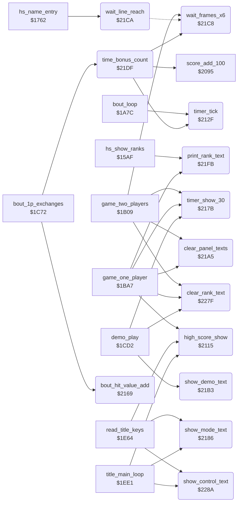

<!-- Generated by c64-docs from knowledge revision 20261022T104543.905-o1bqdy and .c64-re-tools/local/generated/src/source-map.json. Do not edit: change the knowledge, generate the source again, then run docs.ts generate. -->
# game/timer_and_texts.asm: High score show, bout timer, tie-break value, panel texts, rank texts and the control text

Range `$2115-$22CE`. Source: [game/timer_and_texts.asm](../../../../src/game/timer_and_texts.asm). Index: [the reference](../../index.md).

## Call graph

A solid arrow is a call, a thick arrow a table entry, a dotted arrow a jump. Rounded nodes are in this file.

## Data

| Range | Type | Name | Read by | Written by |
|---|---|---|---|---|
| [`$22A4`](../../../../src/game/timer_and_texts.asm#L273)-`$22AB` | petscii | [`text_joystick`](../../../../src/game/timer_and_texts.asm#L272) | [`show_control_text`](timer_and_texts.md#show_control_text) |  |
| [`$22AC`](../../../../src/game/timer_and_texts.asm#L275)-`$22B3` | petscii | [`text_keyboard`](../../../../src/game/timer_and_texts.asm#L274) | [`show_control_text`](timer_and_texts.md#show_control_text) |  |
| [`$22B4`](../../../../src/game/timer_and_texts.asm#L278)-`$22BA` | petscii | [`rank_text_novice`](../../../../src/game/timer_and_texts.asm#L277) | [`print_rank_text`](timer_and_texts.md#print_rank_text) |  |
| [`$22BB`](../../../../src/game/timer_and_texts.asm#L280)-`$22C2` | petscii | [`rank_text_10th_dan`](../../../../src/game/timer_and_texts.asm#L279) | [`print_rank_text`](timer_and_texts.md#print_rank_text) |  |
| [`$22C3`](../../../../src/game/timer_and_texts.asm#L283)-`$22CE` | bytes | [`rank_number_table`](../../../../src/game/timer_and_texts.asm#L282) | [`game_one_player`](game_modes.md#game_one_player) |  |

## Names

### [`high_score_show`](../../../../src/game/timer_and_texts.asm#L6) `$2115`

*routine*

Shows the single high score of the current mode at $ccb1. Called by the title loop, the F3 key and the end of the one-player game.

- **Called from:** [`game_one_player`](game_modes.md#game_one_player) [`$1C55`](../../../../src/game/game_modes.asm#L167), [`read_title_keys`](title_and_scene.md#read_title_keys) [`$1EBB`](../../../../src/game/title_and_scene.asm#L55), [`title_main_loop`](title_and_scene.md#title_main_loop) [`$1EE5`](../../../../src/game/title_and_scene.asm#L86)
- **Reads:** [`two_player_mode`](../../memory-map.md#two_player_mode), [`high_score_2p+4`](entry_and_tables_1299.md#high_score_2p), [`high_score_2p+5`](entry_and_tables_1299.md#high_score_2p), [`high_score_1p+4`](entry_and_tables_1299.md#high_score_1p), [`high_score_1p+5`](entry_and_tables_1299.md#high_score_1p)
- **Writes:** [`panel_hiscore_digits+4`](../../memory-map.md#panel_hiscore_digits), [`panel_hiscore_digits+5`](../../memory-map.md#panel_hiscore_digits)

### [`high_score_show_2p`](../../../../src/game/timer_and_texts.asm#L10) `$211B`

*label*

- **Jumped to from:** [`high_score_show`](timer_and_texts.md#high_score_show) [`$2122`](../../../../src/game/timer_and_texts.asm#L14)

### [`high_score_show_done`](../../../../src/game/timer_and_texts.asm#L15) `$2124`

*label*

### [`high_score_show_1p`](../../../../src/game/timer_and_texts.asm#L17) `$2125`

*label*

- **Jumped to from:** [`high_score_show`](timer_and_texts.md#high_score_show) [`$2119`](../../../../src/game/timer_and_texts.asm#L9), [`high_score_show`](timer_and_texts.md#high_score_show) [`$212C`](../../../../src/game/timer_and_texts.asm#L21)

### [`timer_tick`](../../../../src/game/timer_and_texts.asm#L24) `$212F`

*routine*

Counts one frame of the bout clock. Each 50 frames it decrements the digits at $cc3b and timer_seconds; at 0 it sets time_up. Called by bout_loop and time_bonus_count.

- **Called from:** [`bout_loop`](bout_loop.md#bout_loop) [`$1AC7`](../../../../src/game/bout_loop.asm#L89), [`time_bonus_count`](timer_and_texts.md#time_bonus_count) [`$21E3`](../../../../src/game/timer_and_texts.asm#L144)
- **Reads:** [`timer_frames`](../../memory-map.md#timer_frames), [`panel_timer_digits+1`](../../memory-map.md#panel_timer_digits), [`panel_timer_digits`](../../memory-map.md#panel_timer_digits), [`timer_seconds`](../../memory-map.md#timer_seconds)
- **Writes:** [`timer_frames`](../../memory-map.md#timer_frames), [`panel_timer_digits`](../../memory-map.md#panel_timer_digits), [`panel_timer_digits+1`](../../memory-map.md#panel_timer_digits), [`timer_seconds`](../../memory-map.md#timer_seconds), [`time_up`](../../memory-map.md#time_up)

### [`timer_next_second`](../../../../src/game/timer_and_texts.asm#L27) `$2133`

*label*

### [`timer_units_zero`](../../../../src/game/timer_and_texts.asm#L33) `$213E`

*label*

### [`timer_dec_tens`](../../../../src/game/timer_and_texts.asm#L37) `$2145`

*label*

### [`timer_tens_blank`](../../../../src/game/timer_and_texts.asm#L42) `$2150`

*label*

From 10 to 9: the tens digit becomes a space.

- **Jumped to from:** [`timer_tick`](timer_and_texts.md#timer_tick) [`$2143`](../../../../src/game/timer_and_texts.asm#L36)

### [`timer_dec_units`](../../../../src/game/timer_and_texts.asm#L48) `$215D`

*label*

- **Jumped to from:** [`timer_tick`](timer_and_texts.md#timer_tick) [`$213C`](../../../../src/game/timer_and_texts.asm#L32)

### [`timer_dec_seconds`](../../../../src/game/timer_and_texts.asm#L50) `$2160`

*label*

- **Jumped to from:** [`timer_tick`](timer_and_texts.md#timer_tick) [`$214D`](../../../../src/game/timer_and_texts.asm#L41), [`timer_tick`](timer_and_texts.md#timer_tick) [`$215A`](../../../../src/game/timer_and_texts.asm#L47)

### [`timer_set_time_up`](../../../../src/game/timer_and_texts.asm#L53) `$2164`

*label*

### [`timer_exit`](../../../../src/game/timer_and_texts.asm#L56) `$2168`

*label*

- **Jumped to from:** [`timer_tick`](timer_and_texts.md#timer_tick) [`$2131`](../../../../src/game/timer_and_texts.asm#L26), [`timer_tick`](timer_and_texts.md#timer_tick) [`$2162`](../../../../src/game/timer_and_texts.asm#L52)

### [`bout_hit_value_add`](../../../../src/game/timer_and_texts.asm#L59) `$2169`

*routine*

Adds the score value of scoring_move (half for a half point) to bout_hit_value of fighter X, the tie-break at time up. Called by bout_1p_exchanges.

- **Called from:** [`bout_1p_exchanges`](game_modes.md#bout_1p_exchanges) [`$1C85`](../../../../src/game/game_modes.asm#L194), [`bout_1p_exchanges`](game_modes.md#bout_1p_exchanges) [`$1C97`](../../../../src/game/game_modes.asm#L202)
- **Reads:** [`scoring_move`](../../memory-map.md#scoring_move), [`hit_points`](../../memory-map.md#hit_points)

### [`bout_hit_value_sum`](../../../../src/game/timer_and_texts.asm#L66) `$2175`

*label*

- **Jumped to from:** [`bout_hit_value_add`](timer_and_texts.md#bout_hit_value_add) [`$2172`](../../../../src/game/timer_and_texts.asm#L64)

### [`timer_show_30`](../../../../src/game/timer_and_texts.asm#L72) `$217B`

*routine*

Writes 30 into the clock digits at $cc3b. Called before each bout by the three modes.

- **Called from:** [`game_two_players`](game_modes.md#game_two_players) [`$1B3F`](../../../../src/game/game_modes.asm#L32), [`game_one_player`](game_modes.md#game_one_player) [`$1C07`](../../../../src/game/game_modes.asm#L132), [`demo_play`](game_modes.md#demo_play) [`$1D1F`](../../../../src/game/game_modes.asm#L276)
- **Writes:** [`panel_timer_digits`](../../memory-map.md#panel_timer_digits), [`panel_timer_digits+1`](../../memory-map.md#panel_timer_digits)

### [`show_mode_text`](../../../../src/game/timer_and_texts.asm#L79) `$2186`

*routine*

Writes 1 PLAYER or 2 PLAYER at $ccbf for two_player_mode. Called by the title loop and the F3 key.

- **Called from:** [`read_title_keys`](title_and_scene.md#read_title_keys) [`$1EB8`](../../../../src/game/title_and_scene.asm#L54), [`title_main_loop`](title_and_scene.md#title_main_loop) [`$1EE8`](../../../../src/game/title_and_scene.asm#L87)
- **Reads:** [`two_player_mode`](../../memory-map.md#two_player_mode), [`text_1_player+6`](entry_and_tables_1299.md#text_1_player), [`text_1_player+7`](entry_and_tables_1299.md#text_1_player), [`text_2_player+6`](entry_and_tables_1299.md#text_2_player), [`text_2_player+7`](entry_and_tables_1299.md#text_2_player)
- **Writes:** [`panel_mode_text+6`](../../memory-map.md#panel_mode_text), [`panel_mode_text+7`](../../memory-map.md#panel_mode_text)

### [`mode_text_test_2p`](../../../../src/game/timer_and_texts.asm#L83) `$218C`

*label*

### [`mode_text_bad_mode`](../../../../src/game/timer_and_texts.asm#L86) `$2190`

*label*

### [`mode_text_1p_loop`](../../../../src/game/timer_and_texts.asm#L89) `$2191`

*label*

- **Jumped to from:** [`show_mode_text`](timer_and_texts.md#show_mode_text) [`$218A`](../../../../src/game/timer_and_texts.asm#L82), [`show_mode_text`](timer_and_texts.md#show_mode_text) [`$2198`](../../../../src/game/timer_and_texts.asm#L93)

### [`mode_text_2p_loop`](../../../../src/game/timer_and_texts.asm#L95) `$219B`

*label*

- **Jumped to from:** [`show_mode_text`](timer_and_texts.md#show_mode_text) [`$218E`](../../../../src/game/timer_and_texts.asm#L85), [`show_mode_text`](timer_and_texts.md#show_mode_text) [`$21A2`](../../../../src/game/timer_and_texts.asm#L99)

### [`mode_text_done`](../../../../src/game/timer_and_texts.asm#L100) `$21A4`

*label*

### [`clear_panel_texts`](../../../../src/game/timer_and_texts.asm#L103) `$21A5`

*routine*

Fills the 8 cells of the rank text at $cca0 and of the control text at $cc97 with spaces. Called at the start of the 1P and 2P games. It stands at the place of the unused v1 routine clear_demo_text_old, which cleared 4 cells.

- **Called from:** [`game_two_players`](game_modes.md#game_two_players) [`$1B11`](../../../../src/game/game_modes.asm#L11), [`game_one_player`](game_modes.md#game_one_player) [`$1BB1`](../../../../src/game/game_modes.asm#L95)
- **Writes:** [`panel_row4+6`](../../memory-map.md#panel_row4), [`panel_row4+7`](../../memory-map.md#panel_row4), [`panel_control_text+6`](../../memory-map.md#panel_control_text), [`panel_control_text+7`](../../memory-map.md#panel_control_text)

### [`clear_panel_texts_loop`](../../../../src/game/timer_and_texts.asm#L106) `$21A9`

*label*

- **Jumped to from:** [`clear_panel_texts`](timer_and_texts.md#clear_panel_texts) [`$21B0`](../../../../src/game/timer_and_texts.asm#L110)

### [`show_demo_text`](../../../../src/game/timer_and_texts.asm#L113) `$21B3`

*routine*

Writes DEMO at $cca0, the place of the rank text. Called by demo_play.

- **Called from:** [`demo_play`](game_modes.md#demo_play) [`$1CEF`](../../../../src/game/game_modes.asm#L253)
- **Writes:** [`panel_row4`](../../memory-map.md#panel_row4), [`panel_row4+1`](../../memory-map.md#panel_row4), [`panel_row4+2`](../../memory-map.md#panel_row4), [`panel_row4+3`](../../memory-map.md#panel_row4)

### [`wait_frames_x6`](../../../../src/game/timer_and_texts.asm#L124) `$21C8`

*routine*

Waits X times 6 frames: it counts passes of raster line $fe. Called by time_bonus_count and by game_two_players.

- **Called from:** [`game_two_players`](game_modes.md#game_two_players) [`$1B54`](../../../../src/game/game_modes.asm#L41), [`game_two_players`](game_modes.md#game_two_players) [`$1B74`](../../../../src/game/game_modes.asm#L58), [`time_bonus_count`](timer_and_texts.md#time_bonus_count) [`$21F3`](../../../../src/game/timer_and_texts.asm#L151)
- **Jumped to from:** [`wait_line_reach`](timer_and_texts.md#wait_line_reach) [`$21DC`](../../../../src/game/timer_and_texts.asm#L137)

### [`wait_line_reach`](../../../../src/game/timer_and_texts.asm#L126) `$21CA`

*label*

- **Called from:** [`hs_name_entry`](high_score_table.md#hs_name_entry) [`$1778`](../../../../src/game/high_score_table.asm#L394)
- **Jumps to:** [`wait_frames_x6`](timer_and_texts.md#wait_frames_x6)
- **Reads:** [`RASTER`](../../memory-map.md#RASTER)

### [`wait_line_leave`](../../../../src/game/timer_and_texts.asm#L130) `$21D1`

*label*

- **Jumped to from:** [`wait_line_reach`](timer_and_texts.md#wait_line_reach) [`$21D6`](../../../../src/game/timer_and_texts.asm#L133)

### [`time_bonus_count`](../../../../src/game/timer_and_texts.asm#L140) `$21DF`

*routine*

After a one-player win: counts the clock down second by second and adds 100 points per second, with a 6-frame pause. Called by bout_1p_exchanges.

- **Called from:** [`bout_1p_exchanges`](game_modes.md#bout_1p_exchanges) [`$1CBE`](../../../../src/game/game_modes.asm#L224)
- **Calls:** [`timer_tick`](timer_and_texts.md#timer_tick), [`score_add_100`](score_and_judge.md#score_add_100), [`wait_frames_x6`](timer_and_texts.md#wait_frames_x6)
- **Reads:** [`time_up`](../../memory-map.md#time_up), [`timer_frames`](../../memory-map.md#timer_frames)

### [`time_bonus_loop`](../../../../src/game/timer_and_texts.asm#L143) `$21E3`

*label*

Runs the clock without a frame wait up to the next whole second.

- **Jumped to from:** [`time_bonus_count`](timer_and_texts.md#time_bonus_count) [`$21EA`](../../../../src/game/timer_and_texts.asm#L147), [`time_bonus_count`](timer_and_texts.md#time_bonus_count) [`$21F8`](../../../../src/game/timer_and_texts.asm#L153)

### [`time_bonus_exit`](../../../../src/game/timer_and_texts.asm#L154) `$21FA`

*label*

- **Jumped to from:** [`time_bonus_count`](timer_and_texts.md#time_bonus_count) [`$21E1`](../../../../src/game/timer_and_texts.asm#L142)

### [`print_rank_text`](../../../../src/game/timer_and_texts.asm#L157) `$21FB`

*routine*

Writes rank X at text_dest_ptr + rank_text_offset: 0 NOVICE, 1-9 the digit with ST, ND, RD or TH and DAN, 10 the text 10TH DAN. Called by game_one_player and the high score table ($15de). With rank_text_offset 1 the texts end in the same column: NOVICE moves 2 cells, nTH DAN 1 cell, 10TH DAN none.

- **Called from:** [`hs_show_ranks`](high_score_table.md#hs_show_ranks) [`$15DE`](../../../../src/game/high_score_table.asm#L180), [`game_one_player`](game_modes.md#game_one_player) [`$1BE0`](../../../../src/game/game_modes.asm#L113), [`game_one_player`](game_modes.md#game_one_player) [`$1C40`](../../../../src/game/game_modes.asm#L157)
- **Reads:** [`rank_text_offset`](../../memory-map.md#rank_text_offset), [`rank_text_novice+5`](timer_and_texts.md#rank_text_novice), [`rank_text_novice+6`](timer_and_texts.md#rank_text_novice), [`text_dest_ptr`](../../memory-map.md#text_dest_ptr), [`rank_text_10th_dan+6`](timer_and_texts.md#rank_text_10th_dan), [`rank_text_10th_dan+7`](timer_and_texts.md#rank_text_10th_dan)

### [`rank_novice_loop`](../../../../src/game/timer_and_texts.asm#L166) `$2208`

*label*

- **Jumped to from:** [`print_rank_text`](timer_and_texts.md#print_rank_text) [`$220F`](../../../../src/game/timer_and_texts.asm#L171)

### [`rank_number_text`](../../../../src/game/timer_and_texts.asm#L173) `$2212`

*label*

- **Jumped to from:** [`print_rank_text`](timer_and_texts.md#print_rank_text) [`$21FD`](../../../../src/game/timer_and_texts.asm#L159)

### [`rank_suffix_st`](../../../../src/game/timer_and_texts.asm#L186) `$2226`

*label*

### [`rank_test_2nd`](../../../../src/game/timer_and_texts.asm#L194) `$2233`

*label*

- **Jumped to from:** [`print_rank_text`](timer_and_texts.md#print_rank_text) [`$2224`](../../../../src/game/timer_and_texts.asm#L185)

### [`rank_suffix_nd`](../../../../src/game/timer_and_texts.asm#L197) `$2237`

*label*

### [`rank_test_3rd`](../../../../src/game/timer_and_texts.asm#L205) `$2244`

*label*

- **Jumped to from:** [`print_rank_text`](timer_and_texts.md#print_rank_text) [`$2235`](../../../../src/game/timer_and_texts.asm#L196)

### [`rank_suffix_rd`](../../../../src/game/timer_and_texts.asm#L208) `$2248`

*label*

### [`rank_suffix_th`](../../../../src/game/timer_and_texts.asm#L216) `$2255`

*label*

- **Jumped to from:** [`print_rank_text`](timer_and_texts.md#print_rank_text) [`$2246`](../../../../src/game/timer_and_texts.asm#L207)

### [`rank_suffix_dan`](../../../../src/game/timer_and_texts.asm#L223) `$225F`

*label*

- **Jumped to from:** [`print_rank_text`](timer_and_texts.md#print_rank_text) [`$2230`](../../../../src/game/timer_and_texts.asm#L193), [`print_rank_text`](timer_and_texts.md#print_rank_text) [`$2241`](../../../../src/game/timer_and_texts.asm#L204), [`print_rank_text`](timer_and_texts.md#print_rank_text) [`$2252`](../../../../src/game/timer_and_texts.asm#L215)

### [`rank_10th_dan`](../../../../src/game/timer_and_texts.asm#L237) `$2274`

*label*

No offset: 10TH DAN fills all 8 cells.

- **Jumped to from:** [`print_rank_text`](timer_and_texts.md#print_rank_text) [`$2214`](../../../../src/game/timer_and_texts.asm#L175)

### [`rank_10th_dan_loop`](../../../../src/game/timer_and_texts.asm#L239) `$2276`

*label*

- **Jumped to from:** [`print_rank_text`](timer_and_texts.md#print_rank_text) [`$227C`](../../../../src/game/timer_and_texts.asm#L243)

### [`clear_rank_text`](../../../../src/game/timer_and_texts.asm#L246) `$227F`

*routine*

Fills the 8 cells of the rank text at $cca0 with spaces. Called at the start of each mode, in the 1P and 2P games after clear_panel_texts.

- **Called from:** [`game_two_players`](game_modes.md#game_two_players) [`$1B14`](../../../../src/game/game_modes.asm#L12), [`game_one_player`](game_modes.md#game_one_player) [`$1BB4`](../../../../src/game/game_modes.asm#L96), [`demo_play`](game_modes.md#demo_play) [`$1CEC`](../../../../src/game/game_modes.asm#L252)
- **Writes:** [`panel_row4+6`](../../memory-map.md#panel_row4), [`panel_row4+7`](../../memory-map.md#panel_row4)

### [`clear_rank_text_loop`](../../../../src/game/timer_and_texts.asm#L249) `$2283`

*label*

- **Jumped to from:** [`clear_rank_text`](timer_and_texts.md#clear_rank_text) [`$2287`](../../../../src/game/timer_and_texts.asm#L252)

### [`show_control_text`](../../../../src/game/timer_and_texts.asm#L255) `$228A`

*routine*

Writes JOYSTICK or KEYBOARD at $cc97 for keyboard_control. Called by the title loop and the F7 key. New in v2.

- **Called from:** [`read_title_keys`](title_and_scene.md#read_title_keys) [`$1ECB`](../../../../src/game/title_and_scene.asm#L65), [`title_main_loop`](title_and_scene.md#title_main_loop) [`$1EEB`](../../../../src/game/title_and_scene.asm#L88)
- **Reads:** [`keyboard_control`](../../memory-map.md#keyboard_control)
- **Writes:** [`panel_control_text+6`](../../memory-map.md#panel_control_text), [`panel_control_text+7`](../../memory-map.md#panel_control_text)

### [`control_text_joy_loop`](../../../../src/game/timer_and_texts.asm#L259) `$2290`

*label*

- **Jumped to from:** [`show_control_text`](timer_and_texts.md#show_control_text) [`$2297`](../../../../src/game/timer_and_texts.asm#L263)

### [`control_text_key_loop`](../../../../src/game/timer_and_texts.asm#L265) `$229A`

*label*

- **Jumped to from:** [`show_control_text`](timer_and_texts.md#show_control_text) [`$228E`](../../../../src/game/timer_and_texts.asm#L258), [`show_control_text`](timer_and_texts.md#show_control_text) [`$22A1`](../../../../src/game/timer_and_texts.asm#L269)

### [`text_joystick`](../../../../src/game/timer_and_texts.asm#L272) `$22A4-$22AB`

*data*

Control texts in the ASCII order of the panel characters, 8 characters each: JOYSTICK, KEYBOARD.

- **Read by:** [`show_control_text`](timer_and_texts.md#show_control_text) [`$2290`](../../../../src/game/timer_and_texts.asm#L260) (+6), [`show_control_text`](timer_and_texts.md#show_control_text) [`$2290`](../../../../src/game/timer_and_texts.asm#L260) (+7)

### [`text_keyboard`](../../../../src/game/timer_and_texts.asm#L274) `$22AC-$22B3`

*data*

- **Read by:** [`show_control_text`](timer_and_texts.md#show_control_text) [`$229A`](../../../../src/game/timer_and_texts.asm#L266) (+6), [`show_control_text`](timer_and_texts.md#show_control_text) [`$229A`](../../../../src/game/timer_and_texts.asm#L266) (+7)

### [`rank_text_novice`](../../../../src/game/timer_and_texts.asm#L277) `$22B4-$22BA`

*data*

Rank texts in the ASCII order of the panel characters. NOVICE has 7 characters, with a space. Same bytes as in v1.

- **Read by:** [`print_rank_text`](timer_and_texts.md#print_rank_text) [`$2208`](../../../../src/game/timer_and_texts.asm#L167) (+5), [`print_rank_text`](timer_and_texts.md#print_rank_text) [`$2208`](../../../../src/game/timer_and_texts.asm#L167) (+6)

### [`rank_text_10th_dan`](../../../../src/game/timer_and_texts.asm#L279) `$22BB-$22C2`

*data*

- **Read by:** [`print_rank_text`](timer_and_texts.md#print_rank_text) [`$2276`](../../../../src/game/timer_and_texts.asm#L240) (+6), [`print_rank_text`](timer_and_texts.md#print_rank_text) [`$2276`](../../../../src/game/timer_and_texts.asm#L240) (+7)

### [`rank_number_table`](../../../../src/game/timer_and_texts.asm#L282) `$22C3-$22CE`

*data*

Rank number of each rank index: 0, 1-9, 10, 10 (12 entries, as in v1). The rank cap at $1c29 keeps the index at 10, so the last entry is not read.

- **Read by:** [`game_one_player`](game_modes.md#game_one_player) [`$1C3B`](../../../../src/game/game_modes.asm#L155) (+1)
