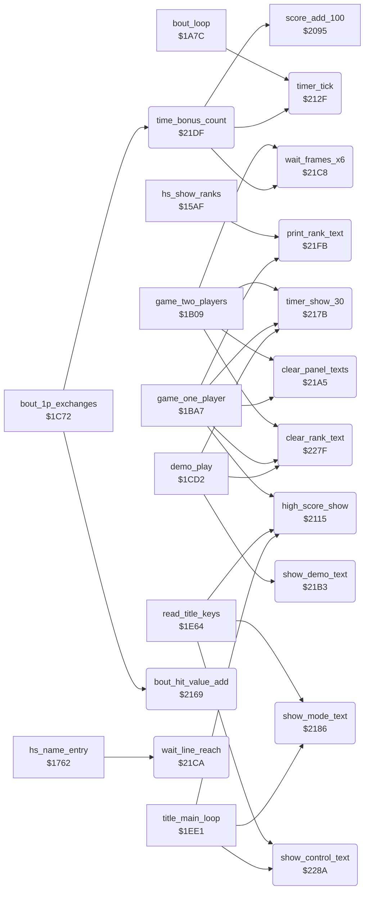

<!-- Generated by c64-docs from knowledge revision 20261025T191824.573-5s4oe2 and .c64-re-tools/local/generated/src/source-map.json. Do not edit: change the knowledge, generate the source again, then run docs.ts generate. -->
# game/timer_and_texts.asm: High score show, bout timer, tie-break value, panel texts, rank texts and the control text

Range `$2115-$22CE`. Source: [game/timer_and_texts.asm](../../../../src/game/timer_and_texts.asm). Index: [the reference](../../index.md).

## Routines

| Routine | Address | Reached from | Summary |
|---|---|---|---|
| [`high_score_show`](timer_and_texts.md#high_score_show) | `$2115` | [`game_one_player`](game_modes.md#game_one_player), [`read_title_keys`](title_and_scene.md#read_title_keys), [`title_main_loop`](title_and_scene.md#title_main_loop) | Shows the single high score of the current mode at $ccb1. |
| [`timer_tick`](timer_and_texts.md#timer_tick) | `$212F` | [`bout_loop`](bout_loop.md#bout_loop), [`time_bonus_count`](timer_and_texts.md#time_bonus_count) | Counts one frame of the bout clock. |
| [`bout_hit_value_add`](timer_and_texts.md#bout_hit_value_add) | `$2169` | [`bout_1p_exchanges`](game_modes.md#bout_1p_exchanges) | Adds the score value of scoring_move (half for a half point) to bout_hit_value of fighter X, the tie-break at time up. |
| [`timer_show_30`](timer_and_texts.md#timer_show_30) | `$217B` | [`game_two_players`](game_modes.md#game_two_players), [`game_one_player`](game_modes.md#game_one_player), [`demo_play`](game_modes.md#demo_play) | Writes 30 into the clock digits at $cc3b. |
| [`show_mode_text`](timer_and_texts.md#show_mode_text) | `$2186` | [`read_title_keys`](title_and_scene.md#read_title_keys), [`title_main_loop`](title_and_scene.md#title_main_loop) | Writes 1 PLAYER or 2 PLAYER at $ccbf for two_player_mode. |
| [`clear_panel_texts`](timer_and_texts.md#clear_panel_texts) | `$21A5` | [`game_two_players`](game_modes.md#game_two_players), [`game_one_player`](game_modes.md#game_one_player) | Fills the 8 cells of the rank text at $cca0 and of the control text at $cc97 with spaces. |
| [`show_demo_text`](timer_and_texts.md#show_demo_text) | `$21B3` | [`demo_play`](game_modes.md#demo_play) | Writes DEMO at $cca0, the place of the rank text. |
| [`wait_frames_x6`](timer_and_texts.md#wait_frames_x6) | `$21C8` | [`game_two_players`](game_modes.md#game_two_players), [`time_bonus_count`](timer_and_texts.md#time_bonus_count) | Waits X times 6 frames: it counts passes of raster line $fe. |
| [`wait_line_reach`](timer_and_texts.md#wait_line_reach) | `$21CA` | [`hs_name_entry`](high_score_table.md#hs_name_entry) |  |
| [`time_bonus_count`](timer_and_texts.md#time_bonus_count) | `$21DF` | [`bout_1p_exchanges`](game_modes.md#bout_1p_exchanges) | After a one-player win: counts the clock down second by second and adds 100 points per second, with a 6-frame pause. |
| [`print_rank_text`](timer_and_texts.md#print_rank_text) | `$21FB` | [`hs_show_ranks`](high_score_table.md#hs_show_ranks), [`game_one_player`](game_modes.md#game_one_player) | Writes rank X at text_dest_ptr + rank_text_offset: 0 NOVICE, 1-9 the digit with ST, ND, RD or TH and DAN, 10 the text 10TH DAN. |
| [`clear_rank_text`](timer_and_texts.md#clear_rank_text) | `$227F` | [`game_two_players`](game_modes.md#game_two_players), [`game_one_player`](game_modes.md#game_one_player), [`demo_play`](game_modes.md#demo_play) | Fills the 8 cells of the rank text at $cca0 with spaces. |
| [`show_control_text`](timer_and_texts.md#show_control_text) | `$228A` | [`read_title_keys`](title_and_scene.md#read_title_keys), [`title_main_loop`](title_and_scene.md#title_main_loop) | Writes JOYSTICK or KEYBOARD at $cc97 for keyboard_control. |

## Data

| Range | Type | Name | Read by | Written by |
|---|---|---|---|---|
| [`$22A4`](../../../../src/game/timer_and_texts.asm#L273)-`$22AB` | petscii | [`text_joystick`](../../../../src/game/timer_and_texts.asm#L272) | [`show_control_text`](timer_and_texts.md#show_control_text) |  |
| [`$22AC`](../../../../src/game/timer_and_texts.asm#L275)-`$22B3` | petscii | [`text_keyboard`](../../../../src/game/timer_and_texts.asm#L274) | [`show_control_text`](timer_and_texts.md#show_control_text) |  |
| [`$22B4`](../../../../src/game/timer_and_texts.asm#L278)-`$22BA` | petscii | [`rank_text_novice`](../../../../src/game/timer_and_texts.asm#L277) | [`print_rank_text`](timer_and_texts.md#print_rank_text) |  |
| [`$22BB`](../../../../src/game/timer_and_texts.asm#L280)-`$22C2` | petscii | [`rank_text_10th_dan`](../../../../src/game/timer_and_texts.asm#L279) | [`print_rank_text`](timer_and_texts.md#print_rank_text) |  |
| [`$22C3`](../../../../src/game/timer_and_texts.asm#L283)-`$22CE` | bytes | [`rank_number_table`](../../../../src/game/timer_and_texts.asm#L282) | [`game_one_player`](game_modes.md#game_one_player) |  |

## Call graph

A solid arrow is a call, a thick arrow a table entry. Rounded nodes are in this file.

## Details

### [`high_score_show`](../../../../src/game/timer_and_texts.asm#L6) `$2115`

*routine*

Shows the single high score of the current mode at $ccb1. Called by the title loop, the F3 key and the end of the one-player game.

- **Called from:** [`game_one_player`](game_modes.md#game_one_player), [`read_title_keys`](title_and_scene.md#read_title_keys), [`title_main_loop`](title_and_scene.md#title_main_loop)
- **Reads:** [`two_player_mode`](../../memory-map.md#two_player_mode), [`high_score_2p`](entry_and_tables_1299.md#high_score_2p), [`high_score_1p`](entry_and_tables_1299.md#high_score_1p)
- **Writes:** [`panel_hiscore_digits`](../../memory-map.md#panel_hiscore_digits)

| Label | Address | Comment |
|---|---|---|
| [`high_score_show_2p`](../../../../src/game/timer_and_texts.asm#L10) | `$211B` |  |
| [`high_score_show_done`](../../../../src/game/timer_and_texts.asm#L15) | `$2124` |  |
| [`high_score_show_1p`](../../../../src/game/timer_and_texts.asm#L17) | `$2125` |  |

### [`timer_tick`](../../../../src/game/timer_and_texts.asm#L24) `$212F`

*routine*

Counts one frame of the bout clock. Each 50 frames it decrements the digits at $cc3b and timer_seconds; at 0 it sets time_up. Called by bout_loop and time_bonus_count.

- **Called from:** [`bout_loop`](bout_loop.md#bout_loop), [`time_bonus_count`](timer_and_texts.md#time_bonus_count)
- **Reads:** [`timer_frames`](../../memory-map.md#timer_frames), [`panel_timer_digits`](../../memory-map.md#panel_timer_digits), [`timer_seconds`](../../memory-map.md#timer_seconds)
- **Writes:** [`timer_frames`](../../memory-map.md#timer_frames), [`panel_timer_digits`](../../memory-map.md#panel_timer_digits), [`timer_seconds`](../../memory-map.md#timer_seconds), [`time_up`](../../memory-map.md#time_up)

| Label | Address | Comment |
|---|---|---|
| [`timer_next_second`](../../../../src/game/timer_and_texts.asm#L27) | `$2133` |  |
| [`timer_units_zero`](../../../../src/game/timer_and_texts.asm#L33) | `$213E` |  |
| [`timer_dec_tens`](../../../../src/game/timer_and_texts.asm#L37) | `$2145` |  |
| [`timer_tens_blank`](../../../../src/game/timer_and_texts.asm#L42) | `$2150` | From 10 to 9: the tens digit becomes a space. |
| [`timer_dec_units`](../../../../src/game/timer_and_texts.asm#L48) | `$215D` |  |
| [`timer_dec_seconds`](../../../../src/game/timer_and_texts.asm#L50) | `$2160` |  |
| [`timer_set_time_up`](../../../../src/game/timer_and_texts.asm#L53) | `$2164` |  |
| [`timer_exit`](../../../../src/game/timer_and_texts.asm#L56) | `$2168` |  |

### [`bout_hit_value_add`](../../../../src/game/timer_and_texts.asm#L59) `$2169`

*routine*

Adds the score value of scoring_move (half for a half point) to bout_hit_value of fighter X, the tie-break at time up. Called by bout_1p_exchanges.

- **Called from:** [`bout_1p_exchanges`](game_modes.md#bout_1p_exchanges)
- **Reads:** [`scoring_move`](../../memory-map.md#scoring_move), [`move_score_values`](entry_and_tables_1299.md#move_score_values), [`hit_points`](../../memory-map.md#hit_points), [`bout_hit_value`](../../memory-map.md#bout_hit_value)
- **Writes:** [`bout_hit_value`](../../memory-map.md#bout_hit_value)

| Label | Address | Comment |
|---|---|---|
| [`bout_hit_value_sum`](../../../../src/game/timer_and_texts.asm#L66) | `$2175` |  |

### [`timer_show_30`](../../../../src/game/timer_and_texts.asm#L72) `$217B`

*routine*

Writes 30 into the clock digits at $cc3b. Called before each bout by the three modes.

- **Called from:** [`game_two_players`](game_modes.md#game_two_players), [`game_one_player`](game_modes.md#game_one_player), [`demo_play`](game_modes.md#demo_play)
- **Writes:** [`panel_timer_digits`](../../memory-map.md#panel_timer_digits)

### [`show_mode_text`](../../../../src/game/timer_and_texts.asm#L79) `$2186`

*routine*

Writes 1 PLAYER or 2 PLAYER at $ccbf for two_player_mode. Called by the title loop and the F3 key.

- **Called from:** [`read_title_keys`](title_and_scene.md#read_title_keys), [`title_main_loop`](title_and_scene.md#title_main_loop)
- **Reads:** [`two_player_mode`](../../memory-map.md#two_player_mode), [`text_1_player`](entry_and_tables_1299.md#text_1_player), [`text_2_player`](entry_and_tables_1299.md#text_2_player)
- **Writes:** [`panel_mode_text`](../../memory-map.md#panel_mode_text)

| Label | Address | Comment |
|---|---|---|
| [`mode_text_test_2p`](../../../../src/game/timer_and_texts.asm#L83) | `$218C` |  |
| [`mode_text_bad_mode`](../../../../src/game/timer_and_texts.asm#L86) | `$2190` |  |
| [`mode_text_1p_loop`](../../../../src/game/timer_and_texts.asm#L89) | `$2191` |  |
| [`mode_text_2p_loop`](../../../../src/game/timer_and_texts.asm#L95) | `$219B` |  |
| [`mode_text_done`](../../../../src/game/timer_and_texts.asm#L100) | `$21A4` |  |

### [`clear_panel_texts`](../../../../src/game/timer_and_texts.asm#L103) `$21A5`

*routine*

Fills the 8 cells of the rank text at $cca0 and of the control text at $cc97 with spaces. Called at the start of the 1P and 2P games. It stands at the place of the unused v1 routine clear_demo_text_old, which cleared 4 cells.

- **Called from:** [`game_two_players`](game_modes.md#game_two_players), [`game_one_player`](game_modes.md#game_one_player)
- **Writes:** [`panel_row4`](../../memory-map.md#panel_row4), [`panel_control_text`](../../memory-map.md#panel_control_text)

| Label | Address | Comment |
|---|---|---|
| [`clear_panel_texts_loop`](../../../../src/game/timer_and_texts.asm#L106) | `$21A9` |  |

### [`show_demo_text`](../../../../src/game/timer_and_texts.asm#L113) `$21B3`

*routine*

Writes DEMO at $cca0, the place of the rank text. Called by demo_play.

- **Called from:** [`demo_play`](game_modes.md#demo_play)
- **Writes:** [`panel_row4`](../../memory-map.md#panel_row4)

### [`wait_frames_x6`](../../../../src/game/timer_and_texts.asm#L124) `$21C8`

*routine*

Waits X times 6 frames: it counts passes of raster line $fe. Called by time_bonus_count and by game_two_players.

- **Called from:** [`game_two_players`](game_modes.md#game_two_players), [`time_bonus_count`](timer_and_texts.md#time_bonus_count)
- **Jumped to from:** [`wait_line_reach`](timer_and_texts.md#wait_line_reach)

### [`wait_line_reach`](../../../../src/game/timer_and_texts.asm#L126) `$21CA`

*label*

- **Called from:** [`hs_name_entry`](high_score_table.md#hs_name_entry)
- **Jumps to:** [`wait_frames_x6`](timer_and_texts.md#wait_frames_x6)
- **Reads:** [`RASTER`](../../memory-map.md#RASTER)

| Label | Address | Comment |
|---|---|---|
| [`wait_line_leave`](../../../../src/game/timer_and_texts.asm#L130) | `$21D1` |  |

### [`time_bonus_count`](../../../../src/game/timer_and_texts.asm#L140) `$21DF`

*routine*

After a one-player win: counts the clock down second by second and adds 100 points per second, with a 6-frame pause. Called by bout_1p_exchanges.

- **Called from:** [`bout_1p_exchanges`](game_modes.md#bout_1p_exchanges)
- **Calls:** [`timer_tick`](timer_and_texts.md#timer_tick), [`score_add_100`](score_and_judge.md#score_add_100), [`wait_frames_x6`](timer_and_texts.md#wait_frames_x6)
- **Reads:** [`time_up`](../../memory-map.md#time_up), [`timer_frames`](../../memory-map.md#timer_frames)

| Label | Address | Comment |
|---|---|---|
| [`time_bonus_loop`](../../../../src/game/timer_and_texts.asm#L143) | `$21E3` | Runs the clock without a frame wait up to the next whole second. |
| [`time_bonus_exit`](../../../../src/game/timer_and_texts.asm#L154) | `$21FA` |  |

### [`print_rank_text`](../../../../src/game/timer_and_texts.asm#L157) `$21FB`

*routine*

Writes rank X at text_dest_ptr + rank_text_offset: 0 NOVICE, 1-9 the digit with ST, ND, RD or TH and DAN, 10 the text 10TH DAN. Called by game_one_player and the high score table ($15de). With rank_text_offset 1 the texts end in the same column: NOVICE moves 2 cells, nTH DAN 1 cell, 10TH DAN none.

- **Called from:** [`hs_show_ranks`](high_score_table.md#hs_show_ranks), [`game_one_player`](game_modes.md#game_one_player)
- **Reads:** [`rank_text_offset`](../../memory-map.md#rank_text_offset), [`rank_text_novice`](timer_and_texts.md#rank_text_novice), [`text_dest_ptr`](../../memory-map.md#text_dest_ptr), [`rank_text_10th_dan`](timer_and_texts.md#rank_text_10th_dan)

| Label | Address | Comment |
|---|---|---|
| [`rank_novice_loop`](../../../../src/game/timer_and_texts.asm#L166) | `$2208` |  |
| [`rank_number_text`](../../../../src/game/timer_and_texts.asm#L173) | `$2212` |  |
| [`rank_suffix_st`](../../../../src/game/timer_and_texts.asm#L186) | `$2226` |  |
| [`rank_test_2nd`](../../../../src/game/timer_and_texts.asm#L194) | `$2233` |  |
| [`rank_suffix_nd`](../../../../src/game/timer_and_texts.asm#L197) | `$2237` |  |
| [`rank_test_3rd`](../../../../src/game/timer_and_texts.asm#L205) | `$2244` |  |
| [`rank_suffix_rd`](../../../../src/game/timer_and_texts.asm#L208) | `$2248` |  |
| [`rank_suffix_th`](../../../../src/game/timer_and_texts.asm#L216) | `$2255` |  |
| [`rank_suffix_dan`](../../../../src/game/timer_and_texts.asm#L223) | `$225F` |  |
| [`rank_10th_dan`](../../../../src/game/timer_and_texts.asm#L237) | `$2274` | No offset: 10TH DAN fills all 8 cells. |
| [`rank_10th_dan_loop`](../../../../src/game/timer_and_texts.asm#L239) | `$2276` |  |

### [`clear_rank_text`](../../../../src/game/timer_and_texts.asm#L246) `$227F`

*routine*

Fills the 8 cells of the rank text at $cca0 with spaces. Called at the start of each mode, in the 1P and 2P games after clear_panel_texts.

- **Called from:** [`game_two_players`](game_modes.md#game_two_players), [`game_one_player`](game_modes.md#game_one_player), [`demo_play`](game_modes.md#demo_play)
- **Writes:** [`panel_row4`](../../memory-map.md#panel_row4)

| Label | Address | Comment |
|---|---|---|
| [`clear_rank_text_loop`](../../../../src/game/timer_and_texts.asm#L249) | `$2283` |  |

### [`show_control_text`](../../../../src/game/timer_and_texts.asm#L255) `$228A`

*routine*

Writes JOYSTICK or KEYBOARD at $cc97 for keyboard_control. Called by the title loop and the F7 key. New in v2.

- **Called from:** [`read_title_keys`](title_and_scene.md#read_title_keys), [`title_main_loop`](title_and_scene.md#title_main_loop)
- **Reads:** [`keyboard_control`](../../memory-map.md#keyboard_control)
- **Writes:** [`panel_control_text`](../../memory-map.md#panel_control_text)

| Label | Address | Comment |
|---|---|---|
| [`control_text_joy_loop`](../../../../src/game/timer_and_texts.asm#L259) | `$2290` |  |
| [`control_text_key_loop`](../../../../src/game/timer_and_texts.asm#L265) | `$229A` |  |

### [`text_joystick`](../../../../src/game/timer_and_texts.asm#L272) `$22A4-$22AB`

*data*

Control texts in the ASCII order of the panel characters, 8 characters each: JOYSTICK, KEYBOARD.

- **Read by:** [`show_control_text`](timer_and_texts.md#show_control_text)

### [`text_keyboard`](../../../../src/game/timer_and_texts.asm#L274) `$22AC-$22B3`

*data*

- **Read by:** [`show_control_text`](timer_and_texts.md#show_control_text)

### [`rank_text_novice`](../../../../src/game/timer_and_texts.asm#L277) `$22B4-$22BA`

*data*

Rank texts in the ASCII order of the panel characters. NOVICE has 7 characters, with a space. Same bytes as in v1.

- **Read by:** [`print_rank_text`](timer_and_texts.md#print_rank_text)

### [`rank_text_10th_dan`](../../../../src/game/timer_and_texts.asm#L279) `$22BB-$22C2`

*data*

- **Read by:** [`print_rank_text`](timer_and_texts.md#print_rank_text)

### [`rank_number_table`](../../../../src/game/timer_and_texts.asm#L282) `$22C3-$22CE`

*data*

Rank number of each rank index: 0, 1-9, 10, 10 (12 entries, as in v1). The rank cap at $1c29 keeps the index at 10, so the last entry is not read.

- **Read by:** [`game_one_player`](game_modes.md#game_one_player)
