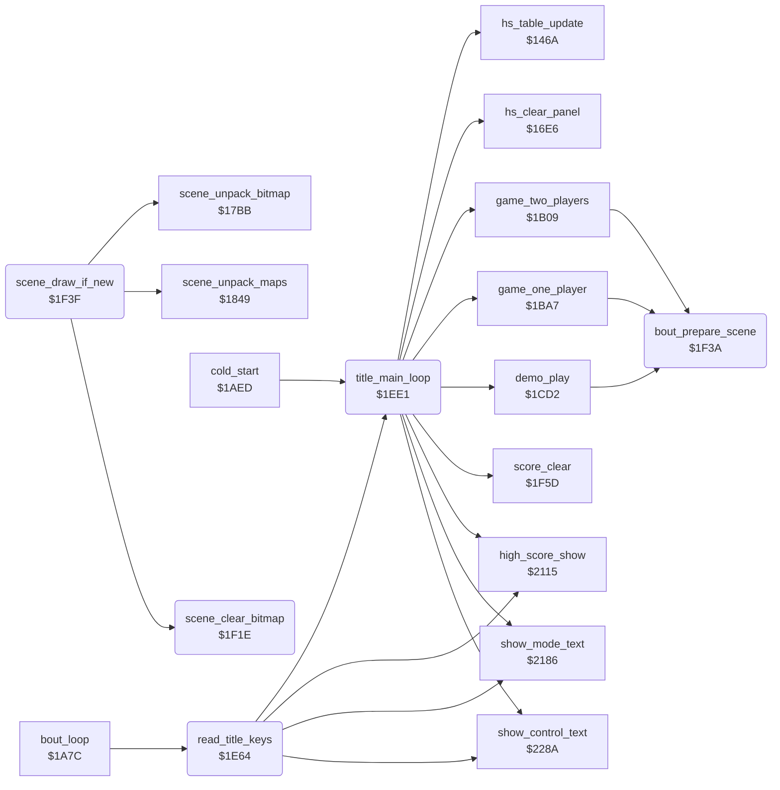

<!-- Generated by c64-docs from knowledge revision 20261022T104543.905-o1bqdy and .c64-re-tools/local/generated/src/source-map.json. Do not edit: change the knowledge, generate the source again, then run docs.ts generate. -->
# game/title_and_scene.asm: Title keys F1/F3/F5/F7/DEL, title loop, bitmap clear and the scene draw

Range `$1E64-$1F5C`. Source: [game/title_and_scene.asm](../../../../src/game/title_and_scene.asm). Index: [the reference](../../index.md).

## Call graph

A solid arrow is a call, a thick arrow a table entry, a dotted arrow a jump. Rounded nodes are in this file.

## Names

### [`read_title_keys`](../../../../src/game/title_and_scene.asm#L6) `$1E64`

*routine*

Reads keyboard column 0 and fire on port 2. F1 or fire starts a game, F3 changes 1/2 players, F5 goes to the title, F7 toggles JOYSTICK/KEYBOARD, DEL toggles the samples. Returns A = $80 to start. Called each frame by bout_loop.

- **Called from:** [`bout_loop`](bout_loop.md#bout_loop) [`$1AB0`](../../../../src/game/bout_loop.asm#L78)
- **Calls:** [`show_mode_text`](timer_and_texts.md#show_mode_text), [`high_score_show`](timer_and_texts.md#high_score_show), [`show_control_text`](timer_and_texts.md#show_control_text), [`title_main_loop`](title_and_scene.md#title_main_loop)
- **Reads:** [`CIAPRB`](../../memory-map.md#CIAPRB), [`last_key_row`](../../memory-map.md#last_key_row), [`in_game`](../../memory-map.md#in_game), [`CIAPRA`](../../memory-map.md#CIAPRA), [`two_player_mode`](../../memory-map.md#two_player_mode), [`keyboard_control`](../../memory-map.md#keyboard_control), [`samples_off`](../../memory-map.md#samples_off)
- **Writes:** [`CIADDRA`](../../memory-map.md#CIADDRA), [`CIADDRB`](../../memory-map.md#CIADDRB), [`CIAPRA`](../../memory-map.md#CIAPRA), [`last_key_row`](../../memory-map.md#last_key_row), [`two_player_mode`](../../memory-map.md#two_player_mode), [`keyboard_control`](../../memory-map.md#keyboard_control), [`samples_off`](../../memory-map.md#samples_off)

### [`title_keys_fire`](../../../../src/game/title_and_scene.asm#L27) `$1E90`

*label*

- **Jumped to from:** [`read_title_keys`](title_and_scene.md#read_title_keys) [`$1E78`](../../../../src/game/title_and_scene.asm#L15), [`read_title_keys`](title_and_scene.md#read_title_keys) [`$1EA3`](../../../../src/game/title_and_scene.asm#L41)

### [`title_keys_none`](../../../../src/game/title_and_scene.asm#L35) `$1E9E`

*label*

- **Jumped to from:** [`read_title_keys`](title_and_scene.md#read_title_keys) [`$1E92`](../../../../src/game/title_and_scene.asm#L29), [`read_title_keys`](title_and_scene.md#read_title_keys) [`$1E99`](../../../../src/game/title_and_scene.asm#L32)

### [`title_key_f1`](../../../../src/game/title_and_scene.asm#L38) `$1EA1`

*label*

- **Jumped to from:** [`read_title_keys`](title_and_scene.md#read_title_keys) [`$1E7E`](../../../../src/game/title_and_scene.asm#L18)

### [`title_key_f3`](../../../../src/game/title_and_scene.asm#L44) `$1EA8`

*label*

- **Jumped to from:** [`read_title_keys`](title_and_scene.md#read_title_keys) [`$1E82`](../../../../src/game/title_and_scene.asm#L20)

### [`title_f3_show`](../../../../src/game/title_and_scene.asm#L53) `$1EB8`

*label*

- **Jumped to from:** [`read_title_keys`](title_and_scene.md#read_title_keys) [`$1EB2`](../../../../src/game/title_and_scene.asm#L50)

### [`title_f3_done`](../../../../src/game/title_and_scene.asm#L56) `$1EBE`

*label*

- **Jumped to from:** [`read_title_keys`](title_and_scene.md#read_title_keys) [`$1EAA`](../../../../src/game/title_and_scene.asm#L46)

### [`title_key_f7`](../../../../src/game/title_and_scene.asm#L59) `$1EC1`

*label*

- **Jumped to from:** [`read_title_keys`](title_and_scene.md#read_title_keys) [`$1E8A`](../../../../src/game/title_and_scene.asm#L24)

### [`title_f7_done`](../../../../src/game/title_and_scene.asm#L66) `$1ECE`

*label*

The v1 F7 code: LDA #0, RTS.

- **Jumped to from:** [`read_title_keys`](title_and_scene.md#read_title_keys) [`$1EC3`](../../../../src/game/title_and_scene.asm#L61)

### [`title_key_f5`](../../../../src/game/title_and_scene.asm#L69) `$1ED1`

*label*

F5 works also during a game; the stack is not reset.

- **Jumped to from:** [`read_title_keys`](title_and_scene.md#read_title_keys) [`$1E86`](../../../../src/game/title_and_scene.asm#L22)

### [`title_key_del`](../../../../src/game/title_and_scene.asm#L72) `$1ED4`

*label*

- **Jumped to from:** [`read_title_keys`](title_and_scene.md#read_title_keys) [`$1E8E`](../../../../src/game/title_and_scene.asm#L26)

### [`title_del_done`](../../../../src/game/title_and_scene.asm#L78) `$1EDE`

*label*

- **Jumped to from:** [`read_title_keys`](title_and_scene.md#read_title_keys) [`$1ED6`](../../../../src/game/title_and_scene.asm#L74)

### [`title_main_loop`](../../../../src/game/title_and_scene.asm#L82) `$1EE1`

*routine*

Title loop: high score, mode text, control text and the demo again and again. A start key starts the game of two_player_mode; after a 1P game the high score table follows. Entered from cold_start and F5.

- **Called from:** [`cold_start`](bout_loop.md#cold_start) [`$1AF0`](../../../../src/game/bout_loop.asm#L112), [`read_title_keys`](title_and_scene.md#read_title_keys) [`$1ED1`](../../../../src/game/title_and_scene.asm#L71)
- **Calls:** [`high_score_show`](timer_and_texts.md#high_score_show), [`show_mode_text`](timer_and_texts.md#show_mode_text), [`show_control_text`](timer_and_texts.md#show_control_text), [`score_clear`](score_and_judge.md#score_clear), [`demo_play`](game_modes.md#demo_play), [`game_one_player`](game_modes.md#game_one_player), [`hs_table_update`](high_score_table.md#hs_table_update), [`hs_clear_panel`](high_score_table.md#hs_clear_panel), [`game_two_players`](game_modes.md#game_two_players)
- **Reads:** [`two_player_mode`](../../memory-map.md#two_player_mode)
- **Writes:** [`two_player_mode`](../../memory-map.md#two_player_mode), [`in_game`](../../memory-map.md#in_game)

### [`title_demo_loop`](../../../../src/game/title_and_scene.asm#L85) `$1EE5`

*label*

- **Jumped to from:** [`title_main_loop`](title_and_scene.md#title_main_loop) [`$1EFF`](../../../../src/game/title_and_scene.asm#L96), [`title_main_loop`](title_and_scene.md#title_main_loop) [`$1F13`](../../../../src/game/title_and_scene.asm#L109), [`title_main_loop`](title_and_scene.md#title_main_loop) [`$1F1B`](../../../../src/game/title_and_scene.asm#L113)

### [`title_test_2p`](../../../../src/game/title_and_scene.asm#L99) `$1F05`

*label*

### [`title_bad_mode`](../../../../src/game/title_and_scene.asm#L102) `$1F09`

*label*

No mode 2 or more exists, as in v1.

### [`title_start_1p`](../../../../src/game/title_and_scene.asm#L105) `$1F0A`

*label*

- **Jumped to from:** [`title_main_loop`](title_and_scene.md#title_main_loop) [`$1F03`](../../../../src/game/title_and_scene.asm#L98)

### [`title_start_2p`](../../../../src/game/title_and_scene.asm#L110) `$1F16`

*label*

- **Jumped to from:** [`title_main_loop`](title_and_scene.md#title_main_loop) [`$1F07`](../../../../src/game/title_and_scene.asm#L101), [`title_main_loop`](title_and_scene.md#title_main_loop) [`$1F19`](../../../../src/game/title_and_scene.asm#L112)

### [`scene_clear_bitmap`](../../../../src/game/title_and_scene.asm#L115) `$1F1E`

*routine*

Clears the scene bitmap $e640-$f53f (15 pages) with 0 through a self-modified STA. Called by scene_draw_if_new. v1 filled the colour RAM and screen of rows 5-16 with $33 here.

- **Called from:** [`scene_draw_if_new`](title_and_scene.md#scene_draw_if_new) [`$1F4E`](../../../../src/game/title_and_scene.asm#L143)
- **Writes:** [`move_hit_zone_facing+23`](entry_and_tables_1204.md#move_hit_zone_facing), [`move_hit_zone_facing+24`](entry_and_tables_1204.md#move_hit_zone_facing), [`move_hit_zone_facing+25`](entry_and_tables_1204.md#move_hit_zone_facing)

### [`scene_clear_loop`](../../../../src/game/title_and_scene.asm#L120) `$1F2D`

*label*

The file holds $1234, a placeholder; $1f20 and $1f25 set $e640.

- **Jumped to from:** [`scene_clear_bitmap`](title_and_scene.md#scene_clear_bitmap) [`$1F31`](../../../../src/game/title_and_scene.asm#L125), [`scene_clear_bitmap`](title_and_scene.md#scene_clear_bitmap) [`$1F37`](../../../../src/game/title_and_scene.asm#L128)

### [`scene_clear_dest`](../../../../src/game/title_and_scene.asm#L121) `$1F2E`

*variable*

- **Written by:** [`scene_clear_bitmap`](title_and_scene.md#scene_clear_bitmap) [`$1F20`](../../../../src/game/title_and_scene.asm#L116)
- **Referred to by:** [`scene_clear_bitmap`](title_and_scene.md#scene_clear_bitmap) [`$1F25`](../../../../src/game/title_and_scene.asm#L116), [`scene_clear_bitmap`](title_and_scene.md#scene_clear_bitmap) [`$1F33`](../../../../src/game/title_and_scene.asm#L126)

### [`scene_clear_dest_hi`](../../../../src/game/title_and_scene.asm#L122) `$1F2F-$1F39`

*variable*

- **Read by:** [`scene_clear_bitmap`](title_and_scene.md#scene_clear_bitmap) [`$1F33`](../../../../src/game/title_and_scene.asm#L126)
- **Written by:** [`scene_clear_bitmap`](title_and_scene.md#scene_clear_bitmap) [`$1F25`](../../../../src/game/title_and_scene.asm#L116), [`scene_clear_bitmap`](title_and_scene.md#scene_clear_bitmap) [`$1F33`](../../../../src/game/title_and_scene.asm#L126)

### [`bout_prepare_scene`](../../../../src/game/title_and_scene.asm#L131) `$1F3A`

*routine*

Switches sprites 6 and 7 (the judge) off and leaves sprites 0-5 on, then falls into scene_draw_if_new. Called before each bout by the three modes.

- **Called from:** [`game_two_players`](game_modes.md#game_two_players) [`$1B42`](../../../../src/game/game_modes.asm#L33), [`game_one_player`](game_modes.md#game_one_player) [`$1C0A`](../../../../src/game/game_modes.asm#L133), [`demo_play`](game_modes.md#demo_play) [`$1D22`](../../../../src/game/game_modes.asm#L277)
- **Writes:** [`SPENA`](../../memory-map.md#SPENA)

### [`scene_draw_if_new`](../../../../src/game/title_and_scene.asm#L135) `$1F3F`

*routine*

Draws scene stage_counter AND 3 when it is not on the screen: clear the bitmap, unpack the maps ($1849), unpack the bitmap. Reached from bout_prepare_scene.

- **Calls:** [`scene_clear_bitmap`](title_and_scene.md#scene_clear_bitmap), [`scene_unpack_maps`](../scenes/scene_unpack.md#scene_unpack_maps), [`scene_unpack_bitmap`](../scenes/scene_unpack.md#scene_unpack_bitmap)
- **Reads:** [`stage_counter`](../../memory-map.md#stage_counter), [`scene_shown`](../../memory-map.md#scene_shown)
- **Writes:** [`scene_shown`](../../memory-map.md#scene_shown), [`irq_bitmap_on_bg_colour`](../irq/irq_screen_split.md#irq_bitmap_on_bg_colour)

### [`scene_draw_exit`](../../../../src/game/title_and_scene.asm#L148) `$1F5C`

*label*

- **Jumped to from:** [`scene_draw_if_new`](title_and_scene.md#scene_draw_if_new) [`$1F45`](../../../../src/game/title_and_scene.asm#L139)
