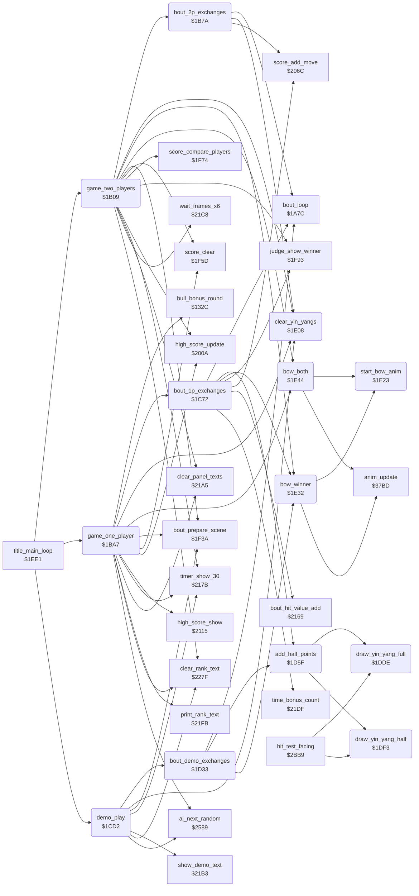

<!-- Generated by c64-docs from knowledge revision 20261021T021734.812-ub0xzr and src/source-map.json. Do not edit: change the knowledge, generate the source again, then run docs.ts generate. -->
# game_modes.asm: Two-player game, one-player game with the bull round call, demo, half points, yin-yangs and bows

Range `$1B09-$1E63`. Source: [game_modes.asm](../../../src/game_modes.asm). Index: [the reference](../index.md).

## Call graph

A solid arrow is a call, a thick arrow a table entry, a dotted arrow a jump. Rounded nodes are in this file.

## Names

### [`game_two_players`](../../../src/game_modes.asm#L6) `$1B09`

*routine*

Two-player game: 4 bouts of 30 seconds with a 90-frame pause between them, points only as score. The judge shows the winner, who can set high_score_2p. Returns N set on a start key. Called by the title loop.

- **Called from:** [`title_main_loop`](title_and_scene.md#title_main_loop) [`$1F16`](../../../src/title_and_scene.asm#L111)
- **Calls:** [`clear_panel_texts`](timer_and_texts.md#clear_panel_texts), [`clear_rank_text`](timer_and_texts.md#clear_rank_text), [`clear_yin_yangs`](game_modes.md#clear_yin_yangs), [`score_clear`](score_and_judge.md#score_clear), [`timer_show_30`](timer_and_texts.md#timer_show_30), [`bout_prepare_scene`](title_and_scene.md#bout_prepare_scene), [`bout_2p_exchanges`](game_modes.md#bout_2p_exchanges), [`wait_frames_x6`](timer_and_texts.md#wait_frames_x6), [`score_compare_players`](score_and_judge.md#score_compare_players), [`bow_both`](game_modes.md#bow_both), [`judge_show_winner`](score_and_judge.md#judge_show_winner), [`bow_winner`](game_modes.md#bow_winner), [`high_score_update`](score_and_judge.md#high_score_update)
- **Reads:** [`stage_counter`](../memory-map.md#stage_counter)
- **Writes:** [`stage_counter`](../memory-map.md#stage_counter), [`cpu_controlled`](../memory-map.md#cpu_controlled), [`cpu_controlled+1`](../memory-map.md#cpu_controlled), [`in_game`](../memory-map.md#in_game), [`game_mode`](../memory-map.md#game_mode), [`timer_frames`](../memory-map.md#timer_frames), [`timer_seconds`](../memory-map.md#timer_seconds), [`time_up`](../memory-map.md#time_up)
- **Refers to:** [`cpu_controlled`](../memory-map.md#cpu_controlled)

### [`game_2p_bout_loop`](../../../src/game_modes.asm#L25) `$1B33`

*label*

- **Jumped to from:** [`game_two_players`](game_modes.md#game_two_players) [`$1B57`](../../../src/game_modes.asm#L42)

### [`game_2p_last_bout`](../../../src/game_modes.asm#L43) `$1B5A`

*label*

Back to 3 = the scene on the screen, so that the judge stands at the place of that scene.

- **Jumped to from:** [`game_two_players`](game_modes.md#game_two_players) [`$1B50`](../../../src/game_modes.asm#L39)

### [`game_2p_draw`](../../../src/game_modes.asm#L47) `$1B61`

*label*

Equal scores: both bow, no judge, and player 1's score goes to the high score test.

### [`game_2p_winner`](../../../src/game_modes.asm#L52) `$1B69`

*label*

The judge sprites show the winner in X; v1 called a lone RTS here.

- **Jumped to from:** [`game_two_players`](game_modes.md#game_two_players) [`$1B5F`](../../../src/game_modes.asm#L46)

### [`game_2p_high_score`](../../../src/game_modes.asm#L55) `$1B6F`

*label*

- **Jumped to from:** [`game_two_players`](game_modes.md#game_two_players) [`$1B66`](../../../src/game_modes.asm#L51)

### [`game_2p_exit`](../../../src/game_modes.asm#L60) `$1B79`

*label*

- **Jumped to from:** [`game_two_players`](game_modes.md#game_two_players) [`$1B48`](../../../src/game_modes.asm#L35)

### [`bout_2p_exchanges`](../../../src/game_modes.asm#L63) `$1B7A`

*routine*

One two-player bout: exchanges until the time ends. Each hit gives score points to the other player and clears the yin-yang cells. Called by game_two_players.

- **Called from:** [`game_two_players`](game_modes.md#game_two_players) [`$1B45`](../../../src/game_modes.asm#L34)
- **Calls:** [`bout_loop`](bout_loop.md#bout_loop), [`score_add_move`](score_and_judge.md#score_add_move), [`clear_yin_yangs`](game_modes.md#clear_yin_yangs)
- **Reads:** [`hit_reaction`](../memory-map.md#hit_reaction), [`hit_reaction+1`](../memory-map.md#hit_reaction), [`time_up`](../memory-map.md#time_up)
- **Refers to:** [`hit_reaction`](../memory-map.md#hit_reaction)

### [`bout_2p_one_hit`](../../../src/game_modes.asm#L70) `$1B87`

*label*

### [`bout_2p_score_p2`](../../../src/game_modes.asm#L76) `$1B93`

*label*

- **Jumped to from:** [`bout_2p_exchanges`](game_modes.md#bout_2p_exchanges) [`$1B89`](../../../src/game_modes.asm#L72)

### [`bout_2p_clear_symbols`](../../../src/game_modes.asm#L79) `$1B98`

*label*

- **Jumped to from:** [`bout_2p_exchanges`](game_modes.md#bout_2p_exchanges) [`$1B85`](../../../src/game_modes.asm#L69), [`bout_2p_exchanges`](game_modes.md#bout_2p_exchanges) [`$1B90`](../../../src/game_modes.asm#L75)

### [`bout_2p_exit`](../../../src/game_modes.asm#L86) `$1BA6`

*label*

- **Jumped to from:** [`bout_2p_exchanges`](game_modes.md#bout_2p_exchanges) [`$1B7D`](../../../src/game_modes.asm#L65)

### [`game_one_player`](../../../src/game_modes.asm#L89) `$1BA7`

*routine*

One-player game against the computer from NOVICE up. Two won bouts give the next rank; the bull round comes after each fourth scene. Returns A = 0 after the lost bout. Called by the title loop.

- **Called from:** [`title_main_loop`](title_and_scene.md#title_main_loop) [`$1F0A`](../../../src/title_and_scene.asm#L106)
- **Calls:** [`clear_panel_texts`](timer_and_texts.md#clear_panel_texts), [`clear_rank_text`](timer_and_texts.md#clear_rank_text), [`score_clear`](score_and_judge.md#score_clear), [`print_rank_text`](timer_and_texts.md#print_rank_text), [`clear_yin_yangs`](game_modes.md#clear_yin_yangs), [`timer_show_30`](timer_and_texts.md#timer_show_30), [`bout_prepare_scene`](title_and_scene.md#bout_prepare_scene), [`bout_1p_exchanges`](game_modes.md#bout_1p_exchanges), [`bull_bonus_round`](bull_round.md#bull_bonus_round), [`bow_both`](game_modes.md#bow_both), [`high_score_update`](score_and_judge.md#high_score_update), [`high_score_show`](timer_and_texts.md#high_score_show), [`ai_next_random`](ai_opponent.md#ai_next_random)
- **Reads:** [`frame_random`](../memory-map.md#frame_random), [`wins_to_promotion`](../memory-map.md#wins_to_promotion), [`stage_counter`](../memory-map.md#stage_counter), [`cpu_skill+1`](../memory-map.md#cpu_skill), [`rank_number_table+1`](timer_and_texts.md#rank_number_table)
- **Writes:** [`rank_text_offset`](../memory-map.md#rank_text_offset), [`stage_counter`](../memory-map.md#stage_counter), [`cpu_controlled`](../memory-map.md#cpu_controlled), [`cpu_skill+1`](../memory-map.md#cpu_skill), [`cpu_controlled+1`](../memory-map.md#cpu_controlled), [`in_game`](../memory-map.md#in_game), [`wins_to_promotion`](../memory-map.md#wins_to_promotion), [`panel_timer_digits+11`](../memory-map.md#panel_timer_digits), [`ai_random`](../memory-map.md#ai_random), [`text_dest_ptr`](../memory-map.md#text_dest_ptr), [`text_dest_ptr+1`](../memory-map.md#text_dest_ptr), [`player_rank`](../memory-map.md#player_rank), [`game_mode`](../memory-map.md#game_mode), [`half_points`](../memory-map.md#half_points), [`half_points+1`](../memory-map.md#half_points), [`bout_hit_value`](../memory-map.md#bout_hit_value), [`bout_hit_value+1`](../memory-map.md#bout_hit_value), [`timer_frames`](../memory-map.md#timer_frames), [`timer_seconds`](../memory-map.md#timer_seconds), [`time_up`](../memory-map.md#time_up)
- **Refers to:** [`cpu_skill`](../memory-map.md#cpu_skill), [`cpu_controlled`](../memory-map.md#cpu_controlled), [`text_dest_ptr`](../memory-map.md#text_dest_ptr), [`half_points`](../memory-map.md#half_points), [`bout_hit_value`](../memory-map.md#bout_hit_value)

### [`game_1p_bout_loop`](../../../src/game_modes.asm#L119) `$1BE7`

*label*

- **Jumped to from:** [`game_one_player`](game_modes.md#game_one_player) [`$1C16`](../../../src/game_modes.asm#L141), [`game_one_player`](game_modes.md#game_one_player) [`$1C43`](../../../src/game_modes.asm#L164), [`game_one_player`](game_modes.md#game_one_player) [`$1C4D`](../../../src/game_modes.asm#L169), [`game_one_player`](game_modes.md#game_one_player) [`$1C6F`](../../../src/game_modes.asm#L187)

### [`game_1p_rank_cap_test`](../../../src/game_modes.asm#L149) `$1C27`

*label*

- **Jumped to from:** [`game_one_player`](game_modes.md#game_one_player) [`$1C22`](../../../src/game_modes.asm#L147)

### [`game_1p_promote`](../../../src/game_modes.asm#L153) `$1C2D`

*label*

Rank index and AI level of fighter 1 go up together, at most to 10.

### [`game_1p_check_draw`](../../../src/game_modes.asm#L165) `$1C46`

*label*

- **Jumped to from:** [`game_one_player`](game_modes.md#game_one_player) [`$1C10`](../../../src/game_modes.asm#L138)

### [`game_1p_over`](../../../src/game_modes.asm#L170) `$1C50`

*label*

- **Jumped to from:** [`game_one_player`](game_modes.md#game_one_player) [`$1C12`](../../../src/game_modes.asm#L139), [`game_one_player`](game_modes.md#game_one_player) [`$1C48`](../../../src/game_modes.asm#L167)

### [`game_1p_rank_wrap`](../../../src/game_modes.asm#L176) `$1C5B`

*label*

After 10TH DAN: the scenes go on, the rank text stays and the AI level is random.

- **Jumped to from:** [`game_one_player`](game_modes.md#game_one_player) [`$1C2B`](../../../src/game_modes.asm#L152)

### [`bout_1p_exchanges`](../../../src/game_modes.asm#L189) `$1C72`

*routine*

One-player bout: exchanges until a fighter has 4 half points or the time ends. A decision by time calls the judge. Returns A: 1 won, 0 lost, $81 draw, $80 key.

- **Called from:** [`game_one_player`](game_modes.md#game_one_player) [`$1C0D`](../../../src/game_modes.asm#L137)
- **Calls:** [`bout_loop`](bout_loop.md#bout_loop), [`bout_hit_value_add`](timer_and_texts.md#bout_hit_value_add), [`add_half_points`](game_modes.md#add_half_points), [`score_add_move`](score_and_judge.md#score_add_move), [`judge_show_winner`](score_and_judge.md#judge_show_winner), [`bow_winner`](game_modes.md#bow_winner), [`time_bonus_count`](timer_and_texts.md#time_bonus_count)
- **Reads:** [`hit_reaction`](../memory-map.md#hit_reaction), [`hit_reaction+1`](../memory-map.md#hit_reaction), [`time_up`](../memory-map.md#time_up), [`half_points`](../memory-map.md#half_points), [`half_points+1`](../memory-map.md#half_points), [`bout_hit_value`](../memory-map.md#bout_hit_value), [`bout_hit_value+1`](../memory-map.md#bout_hit_value)
- **Refers to:** [`hit_reaction`](../memory-map.md#hit_reaction), [`half_points`](../memory-map.md#half_points), [`bout_hit_value`](../memory-map.md#bout_hit_value)

### [`bout_1p_one_hit`](../../../src/game_modes.asm#L196) `$1C7F`

*label*

### [`bout_1p_p1_scores`](../../../src/game_modes.asm#L204) `$1C90`

*label*

- **Jumped to from:** [`bout_1p_exchanges`](game_modes.md#bout_1p_exchanges) [`$1C81`](../../../src/game_modes.asm#L198)

### [`bout_1p_check_time`](../../../src/game_modes.asm#L211) `$1C9F`

*label*

- **Jumped to from:** [`bout_1p_exchanges`](game_modes.md#bout_1p_exchanges) [`$1C7D`](../../../src/game_modes.asm#L195), [`bout_1p_exchanges`](game_modes.md#bout_1p_exchanges) [`$1C8D`](../../../src/game_modes.asm#L203)

### [`bout_1p_tie_break`](../../../src/game_modes.asm#L220) `$1CAE`

*label*

- **Jumped to from:** [`bout_1p_exchanges`](game_modes.md#bout_1p_exchanges) [`$1CA9`](../../../src/game_modes.asm#L217)

### [`bout_1p_won_decision`](../../../src/game_modes.asm#L225) `$1CB6`

*label*

- **Jumped to from:** [`bout_1p_exchanges`](game_modes.md#bout_1p_exchanges) [`$1CAB`](../../../src/game_modes.asm#L219)

### [`bout_1p_won`](../../../src/game_modes.asm#L228) `$1CBB`

*label*

- **Jumped to from:** [`bout_1p_exchanges`](game_modes.md#bout_1p_exchanges) [`$1C9D`](../../../src/game_modes.asm#L210)

### [`bout_1p_exit`](../../../src/game_modes.asm#L232) `$1CC3`

*label*

- **Jumped to from:** [`bout_1p_exchanges`](game_modes.md#bout_1p_exchanges) [`$1C75`](../../../src/game_modes.asm#L191)

### [`bout_1p_lost_decision`](../../../src/game_modes.asm#L234) `$1CC4`

*label*

- **Jumped to from:** [`bout_1p_exchanges`](game_modes.md#bout_1p_exchanges) [`$1CA7`](../../../src/game_modes.asm#L216), [`bout_1p_exchanges`](game_modes.md#bout_1p_exchanges) [`$1CB2`](../../../src/game_modes.asm#L223)

### [`bout_1p_lost`](../../../src/game_modes.asm#L237) `$1CC9`

*label*

- **Jumped to from:** [`bout_1p_exchanges`](game_modes.md#bout_1p_exchanges) [`$1C8B`](../../../src/game_modes.asm#L202)

### [`bout_1p_draw`](../../../src/game_modes.asm#L241) `$1CCF`

*label*

- **Jumped to from:** [`bout_1p_exchanges`](game_modes.md#bout_1p_exchanges) [`$1CB4`](../../../src/game_modes.asm#L224)

### [`demo_play`](../../../src/game_modes.asm#L245) `$1CD2`

*routine*

Attract demo: two computer fighters with random levels 3-11 fight 4 bouts, one per scene. Returns N set when a start key or fire ends it. Called by the title loop.

- **Called from:** [`title_main_loop`](title_and_scene.md#title_main_loop) [`$1EFC`](../../../src/title_and_scene.asm#L95)
- **Calls:** [`ai_next_random`](ai_opponent.md#ai_next_random), [`clear_rank_text`](timer_and_texts.md#clear_rank_text), [`show_demo_text`](timer_and_texts.md#show_demo_text), [`clear_yin_yangs`](game_modes.md#clear_yin_yangs), [`timer_show_30`](timer_and_texts.md#timer_show_30), [`bout_prepare_scene`](title_and_scene.md#bout_prepare_scene), [`bout_demo_exchanges`](game_modes.md#bout_demo_exchanges)
- **Reads:** [`frame_random`](../memory-map.md#frame_random), [`stage_counter`](../memory-map.md#stage_counter)
- **Writes:** [`stage_counter`](../memory-map.md#stage_counter), [`ai_random`](../memory-map.md#ai_random), [`cpu_skill`](../memory-map.md#cpu_skill), [`cpu_skill+1`](../memory-map.md#cpu_skill), [`cpu_controlled`](../memory-map.md#cpu_controlled), [`cpu_controlled+1`](../memory-map.md#cpu_controlled), [`game_mode`](../memory-map.md#game_mode), [`music_t1_p4_end`](music_patterns.md#music_t1_p4_end), [`half_points`](../memory-map.md#half_points), [`half_points+1`](../memory-map.md#half_points), [`bout_hit_value`](../memory-map.md#bout_hit_value), [`bout_hit_value+1`](../memory-map.md#bout_hit_value), [`timer_frames`](../memory-map.md#timer_frames), [`timer_seconds`](../memory-map.md#timer_seconds), [`time_up`](../memory-map.md#time_up)
- **Refers to:** [`cpu_skill`](../memory-map.md#cpu_skill), [`cpu_controlled`](../memory-map.md#cpu_controlled), [`half_points`](../memory-map.md#half_points), [`bout_hit_value`](../memory-map.md#bout_hit_value)

### [`demo_bout_loop`](../../../src/game_modes.asm#L266) `$1CFF`

*label*

- **Jumped to from:** [`demo_play`](game_modes.md#demo_play) [`$1D30`](../../../src/game_modes.asm#L289)

### [`demo_exit`](../../../src/game_modes.asm#L290) `$1D32`

*label*

- **Jumped to from:** [`demo_play`](game_modes.md#demo_play) [`$1D28`](../../../src/game_modes.asm#L285)

### [`bout_demo_exchanges`](../../../src/game_modes.asm#L293) `$1D33`

*routine*

One demo bout: exchanges until a fighter has 4 half points or the time ends. No score. Returns A = 0, or $80 with N set on a start key.

- **Called from:** [`demo_play`](game_modes.md#demo_play) [`$1D25`](../../../src/game_modes.asm#L284)
- **Calls:** [`bout_loop`](bout_loop.md#bout_loop), [`add_half_points`](game_modes.md#add_half_points), [`bow_winner`](game_modes.md#bow_winner)
- **Reads:** [`hit_reaction`](../memory-map.md#hit_reaction), [`hit_reaction+1`](../memory-map.md#hit_reaction), [`time_up`](../memory-map.md#time_up)
- **Refers to:** [`hit_reaction`](../memory-map.md#hit_reaction)

### [`bout_demo_one_hit`](../../../src/game_modes.asm#L300) `$1D40`

*label*

### [`bout_demo_bow`](../../../src/game_modes.asm#L306) `$1D4B`

*label*

- **Jumped to from:** [`bout_demo_exchanges`](game_modes.md#bout_demo_exchanges) [`$1D56`](../../../src/game_modes.asm#L314)

### [`bout_demo_exit`](../../../src/game_modes.asm#L309) `$1D50`

*label*

- **Jumped to from:** [`bout_demo_exchanges`](game_modes.md#bout_demo_exchanges) [`$1D36`](../../../src/game_modes.asm#L295)

### [`bout_demo_p1_scores`](../../../src/game_modes.asm#L311) `$1D51`

*label*

- **Jumped to from:** [`bout_demo_exchanges`](game_modes.md#bout_demo_exchanges) [`$1D42`](../../../src/game_modes.asm#L302)

### [`bout_demo_check_time`](../../../src/game_modes.asm#L315) `$1D58`

*label*

- **Jumped to from:** [`bout_demo_exchanges`](game_modes.md#bout_demo_exchanges) [`$1D3E`](../../../src/game_modes.asm#L299), [`bout_demo_exchanges`](game_modes.md#bout_demo_exchanges) [`$1D49`](../../../src/game_modes.asm#L305)

### [`add_half_points`](../../../src/game_modes.asm#L321) `$1D5F`

*routine*

Adds hit_points of fighter X to half_points and draws the yin-yang symbols for 1-4 half points. Returns C set when the fighter has 4. Called by bout_1p_exchanges and bout_demo_exchanges.

- **Called from:** [`bout_1p_exchanges`](game_modes.md#bout_1p_exchanges) [`$1C88`](../../../src/game_modes.asm#L201), [`bout_1p_exchanges`](game_modes.md#bout_1p_exchanges) [`$1C9A`](../../../src/game_modes.asm#L209), [`bout_demo_exchanges`](game_modes.md#bout_demo_exchanges) [`$1D46`](../../../src/game_modes.asm#L304), [`bout_demo_exchanges`](game_modes.md#bout_demo_exchanges) [`$1D53`](../../../src/game_modes.asm#L313)
- **Calls:** [`draw_yin_yang_half`](game_modes.md#draw_yin_yang_half), [`draw_yin_yang_full`](game_modes.md#draw_yin_yang_full)

### [`points_p1_test`](../../../src/game_modes.asm#L328) `$1D6A`

*label*

### [`points_p1_one`](../../../src/game_modes.asm#L336) `$1D79`

*label*

- **Jumped to from:** [`add_half_points`](game_modes.md#add_half_points) [`$1D6C`](../../../src/game_modes.asm#L330)

### [`points_p1_two`](../../../src/game_modes.asm#L340) `$1D81`

*label*

- **Jumped to from:** [`add_half_points`](game_modes.md#add_half_points) [`$1D70`](../../../src/game_modes.asm#L332)

### [`points_p1_three`](../../../src/game_modes.asm#L344) `$1D89`

*label*

- **Jumped to from:** [`add_half_points`](game_modes.md#add_half_points) [`$1D74`](../../../src/game_modes.asm#L334)

### [`points_p1_four`](../../../src/game_modes.asm#L350) `$1D96`

*label*

- **Jumped to from:** [`add_half_points`](game_modes.md#add_half_points) [`$1D76`](../../../src/game_modes.asm#L335)

### [`points_p2_test`](../../../src/game_modes.asm#L356) `$1DA3`

*label*

- **Jumped to from:** [`add_half_points`](game_modes.md#add_half_points) [`$1D68`](../../../src/game_modes.asm#L327)

### [`points_p2_one`](../../../src/game_modes.asm#L364) `$1DB2`

*label*

- **Jumped to from:** [`add_half_points`](game_modes.md#add_half_points) [`$1DA5`](../../../src/game_modes.asm#L358)

### [`points_p2_two`](../../../src/game_modes.asm#L368) `$1DBA`

*label*

- **Jumped to from:** [`add_half_points`](game_modes.md#add_half_points) [`$1DA9`](../../../src/game_modes.asm#L360)

### [`points_p2_three`](../../../src/game_modes.asm#L372) `$1DC2`

*label*

- **Jumped to from:** [`add_half_points`](game_modes.md#add_half_points) [`$1DAD`](../../../src/game_modes.asm#L362)

### [`points_p2_four`](../../../src/game_modes.asm#L378) `$1DCF`

*label*

- **Jumped to from:** [`add_half_points`](game_modes.md#add_half_points) [`$1DAF`](../../../src/game_modes.asm#L363)

### [`points_test_won`](../../../src/game_modes.asm#L383) `$1DD9`

*label*

- **Jumped to from:** [`add_half_points`](game_modes.md#add_half_points) [`$1D7E`](../../../src/game_modes.asm#L339), [`add_half_points`](game_modes.md#add_half_points) [`$1D86`](../../../src/game_modes.asm#L343), [`add_half_points`](game_modes.md#add_half_points) [`$1D93`](../../../src/game_modes.asm#L349), [`add_half_points`](game_modes.md#add_half_points) [`$1DA0`](../../../src/game_modes.asm#L355), [`add_half_points`](game_modes.md#add_half_points) [`$1DB7`](../../../src/game_modes.asm#L367), [`add_half_points`](game_modes.md#add_half_points) [`$1DBF`](../../../src/game_modes.asm#L371), [`add_half_points`](game_modes.md#add_half_points) [`$1DCC`](../../../src/game_modes.asm#L377)

### [`draw_yin_yang_full`](../../../src/game_modes.asm#L388) `$1DDE`

*routine*

Draws a whole yin-yang symbol (characters $21-$24, 2 x 2) at $cc03+Y. Called by add_half_points and the 2P hit code at $2c2b.

- **Called from:** [`add_half_points`](game_modes.md#add_half_points) [`$1D83`](../../../src/game_modes.asm#L342), [`add_half_points`](game_modes.md#add_half_points) [`$1D8B`](../../../src/game_modes.asm#L346), [`add_half_points`](game_modes.md#add_half_points) [`$1D98`](../../../src/game_modes.asm#L352), [`add_half_points`](game_modes.md#add_half_points) [`$1D9D`](../../../src/game_modes.asm#L354), [`add_half_points`](game_modes.md#add_half_points) [`$1DBC`](../../../src/game_modes.asm#L370), [`add_half_points`](game_modes.md#add_half_points) [`$1DC4`](../../../src/game_modes.asm#L374), [`add_half_points`](game_modes.md#add_half_points) [`$1DD1`](../../../src/game_modes.asm#L380), [`add_half_points`](game_modes.md#add_half_points) [`$1DD6`](../../../src/game_modes.asm#L382), [`hit_test_facing`](hit_test.md#hit_test_facing) [`$2C2B`](../../../src/hit_test.asm#L108)
- **Refers to:** [`screen_ram+3`](../memory-map.md#screen_ram), [`screen_ram+4`](../memory-map.md#screen_ram), [`panel_row1+3`](../memory-map.md#panel_row1), [`panel_row1+4`](../memory-map.md#panel_row1)

### [`draw_yin_yang_half`](../../../src/game_modes.asm#L399) `$1DF3`

*routine*

Draws a half yin-yang symbol (characters $25-$28, 2 x 2) at $cc03+Y. Called by add_half_points and the 2P hit code at $2c3e.

- **Called from:** [`add_half_points`](game_modes.md#add_half_points) [`$1D7B`](../../../src/game_modes.asm#L338), [`add_half_points`](game_modes.md#add_half_points) [`$1D90`](../../../src/game_modes.asm#L348), [`add_half_points`](game_modes.md#add_half_points) [`$1DB4`](../../../src/game_modes.asm#L366), [`add_half_points`](game_modes.md#add_half_points) [`$1DC9`](../../../src/game_modes.asm#L376), [`hit_test_facing`](hit_test.md#hit_test_facing) [`$2C3E`](../../../src/hit_test.asm#L118)
- **Refers to:** [`screen_ram+3`](../memory-map.md#screen_ram), [`screen_ram+4`](../memory-map.md#screen_ram), [`panel_row1+3`](../memory-map.md#panel_row1), [`panel_row1+4`](../memory-map.md#panel_row1)

### [`clear_yin_yangs`](../../../src/game_modes.asm#L410) `$1E08`

*routine*

Clears both yin-yang symbols of a fighter, Y = 0 for fighter 0 or $1d for fighter 1. Called at the start of each bout and by bout_2p_exchanges.

- **Called from:** [`game_two_players`](game_modes.md#game_two_players) [`$1B19`](../../../src/game_modes.asm#L14), [`game_two_players`](game_modes.md#game_two_players) [`$1B1E`](../../../src/game_modes.asm#L16), [`bout_2p_exchanges`](game_modes.md#bout_2p_exchanges) [`$1B9A`](../../../src/game_modes.asm#L81), [`bout_2p_exchanges`](game_modes.md#bout_2p_exchanges) [`$1B9F`](../../../src/game_modes.asm#L83), [`game_one_player`](game_modes.md#game_one_player) [`$1BF3`](../../../src/game_modes.asm#L126), [`game_one_player`](game_modes.md#game_one_player) [`$1BF8`](../../../src/game_modes.asm#L128), [`demo_play`](game_modes.md#demo_play) [`$1D0B`](../../../src/game_modes.asm#L273), [`demo_play`](game_modes.md#demo_play) [`$1D10`](../../../src/game_modes.asm#L275)
- **Refers to:** [`screen_ram+3`](../memory-map.md#screen_ram), [`panel_row1+3`](../memory-map.md#panel_row1), [`screen_ram+4`](../memory-map.md#screen_ram), [`panel_row1+4`](../memory-map.md#panel_row1), [`screen_ram+6`](../memory-map.md#screen_ram), [`screen_ram+7`](../memory-map.md#screen_ram), [`panel_row1+6`](../memory-map.md#panel_row1), [`panel_row1+7`](../memory-map.md#panel_row1)

### [`start_bow_anim`](../../../src/game_modes.asm#L422) `$1E23`

*routine*

Starts animation $19 (the bow) for fighter X on the ground. Called by bow_winner and bow_both.

- **Called from:** [`bow_winner`](game_modes.md#bow_winner) [`$1E32`](../../../src/game_modes.asm#L433), [`bow_both`](game_modes.md#bow_both) [`$1E46`](../../../src/game_modes.asm#L446), [`bow_both`](game_modes.md#bow_both) [`$1E4B`](../../../src/game_modes.asm#L448)

### [`bow_winner`](../../../src/game_modes.asm#L432) `$1E32`

*routine*

Plays the bow of fighter X frame by frame until it ends. Called after a won bout in each mode and after the 2P result.

- **Called from:** [`game_two_players`](game_modes.md#game_two_players) [`$1B6C`](../../../src/game_modes.asm#L54), [`bout_1p_exchanges`](game_modes.md#bout_1p_exchanges) [`$1CBB`](../../../src/game_modes.asm#L229), [`bout_1p_exchanges`](game_modes.md#bout_1p_exchanges) [`$1CC9`](../../../src/game_modes.asm#L238), [`bout_demo_exchanges`](game_modes.md#bout_demo_exchanges) [`$1D4B`](../../../src/game_modes.asm#L307)
- **Calls:** [`start_bow_anim`](game_modes.md#start_bow_anim), [`anim_update`](anim_step.md#anim_update)
- **Reads:** [`RASTER`](../memory-map.md#RASTER)

### [`bow_winner_step`](../../../src/game_modes.asm#L434) `$1E35`

*label*

- **Jumped to from:** [`bow_winner`](game_modes.md#bow_winner) [`$1E41`](../../../src/game_modes.asm#L441)

### [`bow_winner_wait`](../../../src/game_modes.asm#L436) `$1E38`

*label*

- **Jumped to from:** [`bow_winner`](game_modes.md#bow_winner) [`$1E3D`](../../../src/game_modes.asm#L439)

### [`bow_both`](../../../src/game_modes.asm#L444) `$1E44`

*routine*

Both fighters bow; it waits for the end of the bow of fighter 1. Called after a 1P draw and after equal 2P scores.

- **Called from:** [`game_two_players`](game_modes.md#game_two_players) [`$1B61`](../../../src/game_modes.asm#L49), [`game_one_player`](game_modes.md#game_one_player) [`$1C4A`](../../../src/game_modes.asm#L168)
- **Calls:** [`start_bow_anim`](game_modes.md#start_bow_anim), [`anim_update`](anim_step.md#anim_update)
- **Reads:** [`RASTER`](../memory-map.md#RASTER), [`anim_finished+1`](../memory-map.md#anim_finished)

### [`bow_both_step`](../../../src/game_modes.asm#L449) `$1E4E`

*label*

- **Jumped to from:** [`bow_both`](game_modes.md#bow_both) [`$1E61`](../../../src/game_modes.asm#L459)

### [`bow_both_wait`](../../../src/game_modes.asm#L454) `$1E58`

*label*

- **Jumped to from:** [`bow_both`](game_modes.md#bow_both) [`$1E5D`](../../../src/game_modes.asm#L457)
