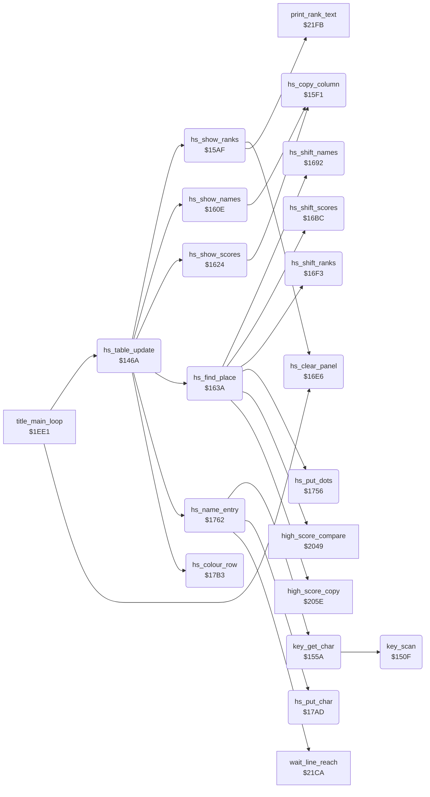

<!-- Generated by c64-docs from knowledge revision 20261021T021734.812-ub0xzr and src/source-map.json. Do not edit: change the knowledge, generate the source again, then run docs.ts generate. -->
# high_score_table.asm: Top-5 high score table: entry flow, key scanner, display, place finder, shifts and name entry

Range `$146A-$17BA`. Source: [high_score_table.asm](../../../src/high_score_table.asm). Index: [the reference](../index.md).

## Call graph

A solid arrow is a call, a thick arrow a table entry, a dotted arrow a jump. Rounded nodes are in this file.

## Data

| Range | Type | Name | Read by | Written by |
|---|---|---|---|---|
| [`$1542`](../../../src/high_score_table.asm#L126)-`$1549` | bytes | [`key_column_masks`](../../../src/high_score_table.asm#L125) | [`key_scan`](high_score_table.md#key_scan) |  |
| [`$154A`](../../../src/high_score_table.asm#L129)-`$1551` | bytes | [`key_column_codes`](../../../src/high_score_table.asm#L128) | [`key_scan`](high_score_table.md#key_scan) |  |
| [`$1552`](../../../src/high_score_table.asm#L132)-`$1559` | bytes | [`key_row_ignore`](../../../src/high_score_table.asm#L131) | [`key_scan`](high_score_table.md#key_scan) |  |
| [`$156F`](../../../src/high_score_table.asm#L150)-`$15AE` | bytes of 8 | [`key_chars`](../../../src/high_score_table.asm#L149) |  |  |
| [`$1715`](../../../src/high_score_table.asm#L374)-`$1732` | petscii of 6 | [`hs_names`](../../../src/high_score_table.asm#L373) | [`hs_shift_names`](high_score_table.md#hs_shift_names) | [`hs_shift_names`](high_score_table.md#hs_shift_names) |
| [`$1733`](../../../src/high_score_table.asm#L381)-`$1750` | petscii of 6 | [`hs_scores`](../../../src/high_score_table.asm#L380) | [`hs_shift_scores`](high_score_table.md#hs_shift_scores) | [`hs_shift_scores`](high_score_table.md#hs_shift_scores) |
| [`$1751`](../../../src/high_score_table.asm#L388)-`$1755` | bytes | [`hs_ranks`](../../../src/high_score_table.asm#L387) | [`hs_show_ranks`](high_score_table.md#hs_show_ranks), [`hs_shift_ranks`](high_score_table.md#hs_shift_ranks) | [`hs_shift_ranks`](high_score_table.md#hs_shift_ranks) |

## Names

### [`hs_table_update`](../../../src/high_score_table.asm#L6) `$146A`

*routine*

After a one-player game: puts the score in the top-5 table, shows the table and lets the player type a name. Fire held at the start skips the display and the entry. Called by the title loop at $1f0d.

- **Called from:** [`title_main_loop`](title_and_scene.md#title_main_loop) [`$1F0D`](../../../src/title_and_scene.asm#L107)
- **Calls:** [`hs_find_place`](high_score_table.md#hs_find_place), [`hs_show_ranks`](high_score_table.md#hs_show_ranks), [`hs_show_names`](high_score_table.md#hs_show_names), [`hs_show_scores`](high_score_table.md#hs_show_scores), [`hs_colour_row`](high_score_table.md#hs_colour_row), [`hs_name_entry`](high_score_table.md#hs_name_entry)
- **Reads:** [`CIAPRA`](../memory-map.md#CIAPRA), [`hs_new_position`](../memory-map.md#hs_new_position), [`text_dest_ptr`](../memory-map.md#text_dest_ptr), [`text_dest_ptr+1`](../memory-map.md#text_dest_ptr), [`hs_name_screen_hi`](high_score_table.md#hs_name_screen_hi), [`hs_name_screen_addr`](high_score_table.md#hs_name_screen_addr), [`RASTER`](../memory-map.md#RASTER), [`CIAPRB`](../memory-map.md#CIAPRB)
- **Writes:** [`CIADDRA`](../memory-map.md#CIADDRA), [`text_dest_ptr+1`](../memory-map.md#text_dest_ptr), [`text_dest_ptr`](../memory-map.md#text_dest_ptr), [`last_key_char`](../memory-map.md#last_key_char), [`hs_name_screen_hi`](high_score_table.md#hs_name_screen_hi), [`hs_name_screen_addr`](high_score_table.md#hs_name_screen_addr), [`hs_colour_ptr`](../memory-map.md#hs_colour_ptr), [`hs_colour_ptr+1`](../memory-map.md#hs_colour_ptr), [`CIAPRA`](../memory-map.md#CIAPRA)
- **Refers to:** [`text_dest_ptr`](../memory-map.md#text_dest_ptr), [`hs_name_screen_addr`](high_score_table.md#hs_name_screen_addr), [`hs_colour_ptr`](../memory-map.md#hs_colour_ptr)

### [`hs_row_addr_loop`](../../../src/high_score_table.asm#L35) `$14A5`

*label*

- **Jumped to from:** [`hs_table_update`](high_score_table.md#hs_table_update) [`$14AE`](../../../src/high_score_table.asm#L43)

### [`hs_row_addr_next`](../../../src/high_score_table.asm#L41) `$14AD`

*label*

- **Jumped to from:** [`hs_table_update`](high_score_table.md#hs_table_update) [`$14A8`](../../../src/high_score_table.asm#L39)

### [`hs_row_addr_set`](../../../src/high_score_table.asm#L44) `$14B0`

*label*

- **Jumped to from:** [`hs_table_update`](high_score_table.md#hs_table_update) [`$14A3`](../../../src/high_score_table.asm#L34)

### [`hs_table_exit`](../../../src/high_score_table.asm#L61) `$14D4`

*label*

- **Jumped to from:** [`hs_table_update`](high_score_table.md#hs_table_update) [`$1477`](../../../src/high_score_table.asm#L12)

### [`hs_show_and_wait`](../../../src/high_score_table.asm#L64) `$14D5`

*label*

Shows the table and waits up to 250 frames, or until fire on port 2 or F1. Reached from hs_table_update when the score is not in the table.

- **Jumped to from:** [`hs_table_update`](high_score_table.md#hs_table_update) [`$147D`](../../../src/high_score_table.asm#L15)

### [`hs_wait_frame`](../../../src/high_score_table.asm#L69) `$14E0`

*label*

- **Jumped to from:** [`hs_table_update`](high_score_table.md#hs_table_update) [`$14E5`](../../../src/high_score_table.asm#L72), [`hs_table_update`](high_score_table.md#hs_table_update) [`$150C`](../../../src/high_score_table.asm#L90)

### [`hs_wait_line_fe`](../../../src/high_score_table.asm#L73) `$14E7`

*label*

- **Jumped to from:** [`hs_table_update`](high_score_table.md#hs_table_update) [`$14EC`](../../../src/high_score_table.asm#L76)

### [`hs_wait_exit`](../../../src/high_score_table.asm#L91) `$150E`

*label*

- **Jumped to from:** [`hs_table_update`](high_score_table.md#hs_table_update) [`$14F8`](../../../src/high_score_table.asm#L81), [`hs_table_update`](high_score_table.md#hs_table_update) [`$1509`](../../../src/high_score_table.asm#L88)

### [`key_scan`](../../../src/high_score_table.asm#L94) `$150F`

*routine*

Scans the 8 keyboard columns from 7 to 0. Returns A = column*8 + row bit of the first key down, or $40 for no key. key_row_ignore masks the keys that a name cannot use. Called by key_get_char.

- **Called from:** [`key_get_char`](high_score_table.md#key_get_char) [`$155A`](../../../src/high_score_table.asm#L135)
- **Reads:** [`CIAPRB`](../memory-map.md#CIAPRB), [`key_temp`](../memory-map.md#key_temp)
- **Writes:** [`CIADDRA`](../memory-map.md#CIADDRA), [`CIADDRB`](../memory-map.md#CIADDRB), [`CIAPRA`](../memory-map.md#CIAPRA), [`key_temp`](../memory-map.md#key_temp)

### [`key_scan_column`](../../../src/high_score_table.asm#L100) `$151B`

*label*

- **Jumped to from:** [`key_scan`](high_score_table.md#key_scan) [`$1534`](../../../src/high_score_table.asm#L115)

### [`key_scan_bit`](../../../src/high_score_table.asm#L108) `$152D`

*label*

- **Jumped to from:** [`key_scan`](high_score_table.md#key_scan) [`$1531`](../../../src/high_score_table.asm#L112)

### [`key_scan_next`](../../../src/high_score_table.asm#L113) `$1533`

*label*

- **Jumped to from:** [`key_scan`](high_score_table.md#key_scan) [`$1529`](../../../src/high_score_table.asm#L106)

### [`key_scan_found`](../../../src/high_score_table.asm#L118) `$1539`

*label*

- **Jumped to from:** [`key_scan`](high_score_table.md#key_scan) [`$152E`](../../../src/high_score_table.asm#L110)

### [`key_column_masks`](../../../src/high_score_table.asm#L125) `$1542-$1549`

*data*

Value for $dc00 that selects keyboard column 0-7.

- **Read by:** [`key_scan`](high_score_table.md#key_scan) [`$151B`](../../../src/high_score_table.asm#L101) (+6), [`key_scan`](high_score_table.md#key_scan) [`$151B`](../../../src/high_score_table.asm#L101) (+7)

### [`key_column_codes`](../../../src/high_score_table.asm#L128) `$154A-$1551`

*data*

First key code of each keyboard column: column*8.

- **Read by:** [`key_scan`](high_score_table.md#key_scan) [`$1539`](../../../src/high_score_table.asm#L119) (+6)

### [`key_row_ignore`](../../../src/high_score_table.asm#L131) `$1552-$1559`

*data*

Row bits that key_scan ignores in each column. The keys left are A-Z, 0-9, SPACE, RETURN and DEL; LEFT SHIFT, column 6 and most punctuation are masked.

- **Read by:** [`key_scan`](high_score_table.md#key_scan) [`$1524`](../../../src/high_score_table.asm#L104) (+6), [`key_scan`](high_score_table.md#key_scan) [`$1524`](../../../src/high_score_table.asm#L104) (+7)

### [`key_get_char`](../../../src/high_score_table.asm#L134) `$155A`

*routine*

Returns in A the PETSCII code of a new key, or $40 when no key is down or the key is still held. It keeps the last code in last_key_char. Called by hs_name_entry at $177b.

- **Called from:** [`hs_name_entry`](high_score_table.md#hs_name_entry) [`$177B`](../../../src/high_score_table.asm#L413)
- **Calls:** [`key_scan`](high_score_table.md#key_scan)
- **Reads:** [`last_key_char`](../memory-map.md#last_key_char)
- **Writes:** [`last_key_char`](../memory-map.md#last_key_char)

### [`key_get_store`](../../../src/high_score_table.asm#L145) `$156C`

*label*

- **Jumped to from:** [`key_get_char`](high_score_table.md#key_get_char) [`$155F`](../../../src/high_score_table.asm#L137), [`key_get_char`](high_score_table.md#key_get_char) [`$1567`](../../../src/high_score_table.asm#L141)

### [`key_chars`](../../../src/high_score_table.asm#L149) `$156F-$15AE`

*data*

PETSCII code of each key code $00-$3f (8 per column). Codes of the masked keys, such as F1-F7 and the cursor keys, are in the table but key_scan never returns them.

- **Referred to by:** [`key_get_char`](high_score_table.md#key_get_char) [`$1562`](../../../src/high_score_table.asm#L139)

### [`hs_show_ranks`](../../../src/high_score_table.asm#L159) `$15AF`

*routine*

Clears the panel, writes the row numbers 1-5 in column 8 and the rank text of each used entry from column 10. Called by hs_table_update and hs_show_and_wait.

- **Called from:** [`hs_table_update`](high_score_table.md#hs_table_update) [`$1485`](../../../src/high_score_table.asm#L20), [`hs_table_update`](high_score_table.md#hs_table_update) [`$14D5`](../../../src/high_score_table.asm#L65)
- **Calls:** [`hs_clear_panel`](high_score_table.md#hs_clear_panel), [`print_rank_text`](timer_and_texts.md#print_rank_text)
- **Reads:** [`hs_index`](../memory-map.md#hs_index), [`hs_ranks+3`](high_score_table.md#hs_ranks), [`hs_ranks+4`](high_score_table.md#hs_ranks), [`text_dest_ptr`](../memory-map.md#text_dest_ptr), [`text_dest_ptr+1`](../memory-map.md#text_dest_ptr)
- **Writes:** [`screen_ram+8`](../memory-map.md#screen_ram), [`panel_row1+8`](../memory-map.md#panel_row1), [`panel_timer_digits+29`](../memory-map.md#panel_timer_digits), [`panel_timer_digits+69`](../memory-map.md#panel_timer_digits), [`panel_row4+8`](../memory-map.md#panel_row4), [`text_dest_ptr`](../memory-map.md#text_dest_ptr), [`text_dest_ptr+1`](../memory-map.md#text_dest_ptr), [`rank_text_offset`](../memory-map.md#rank_text_offset), [`hs_index`](../memory-map.md#hs_index)
- **Refers to:** [`text_dest_ptr`](../memory-map.md#text_dest_ptr)

### [`hs_rank_loop`](../../../src/high_score_table.asm#L179) `$15D7`

*label*

- **Jumped to from:** [`hs_show_ranks`](high_score_table.md#hs_show_ranks) [`$15EE`](../../../src/high_score_table.asm#L193)

### [`hs_rank_row_up`](../../../src/high_score_table.asm#L184) `$15E1`

*label*

- **Jumped to from:** [`hs_show_ranks`](high_score_table.md#hs_show_ranks) [`$15DC`](../../../src/high_score_table.asm#L182)

### [`hs_rank_next`](../../../src/high_score_table.asm#L191) `$15EC`

*label*

- **Jumped to from:** [`hs_show_ranks`](high_score_table.md#hs_show_ranks) [`$15E8`](../../../src/high_score_table.asm#L189)

### [`hs_copy_column`](../../../src/high_score_table.asm#L196) `$15F1`

*routine*

Copies 5 rows of 6 characters from the table at hs_copy_source_addr to the screen at text_dest_ptr, the last row first. Called by hs_show_names and hs_show_scores.

- **Called from:** [`hs_show_names`](high_score_table.md#hs_show_names) [`$1620`](../../../src/high_score_table.asm#L228), [`hs_show_scores`](high_score_table.md#hs_show_scores) [`$1636`](../../../src/high_score_table.asm#L240)
- **Reads:** [`shape_parts+27`](fighter_shapes_8000.md#shape_parts), [`shape_parts+28`](fighter_shapes_8000.md#shape_parts), [`shape_parts+29`](fighter_shapes_8000.md#shape_parts), [`text_dest_ptr`](../memory-map.md#text_dest_ptr), [`text_dest_ptr+1`](../memory-map.md#text_dest_ptr)
- **Writes:** [`text_dest_ptr`](../memory-map.md#text_dest_ptr), [`text_dest_ptr+1`](../memory-map.md#text_dest_ptr)
- **Refers to:** [`text_dest_ptr`](../memory-map.md#text_dest_ptr)

### [`hs_copy_row`](../../../src/high_score_table.asm#L198) `$15F3`

*label*

- **Jumped to from:** [`hs_copy_column`](high_score_table.md#hs_copy_column) [`$160B`](../../../src/high_score_table.asm#L216)

### [`hs_copy_char`](../../../src/high_score_table.asm#L200) `$15F5`

*label*

The file holds $8000; hs_show_names and hs_show_scores write the table address.

- **Jumped to from:** [`hs_copy_column`](high_score_table.md#hs_copy_column) [`$15FC`](../../../src/high_score_table.asm#L207)

### [`hs_copy_source_addr`](../../../src/high_score_table.asm#L201) `$15F6`

*variable*

- **Written by:** [`hs_show_names`](high_score_table.md#hs_show_names) [`$1618`](../../../src/high_score_table.asm#L225), [`hs_show_scores`](high_score_table.md#hs_show_scores) [`$162E`](../../../src/high_score_table.asm#L237)
- **Referred to by:** [`hs_show_names`](high_score_table.md#hs_show_names) [`$161D`](../../../src/high_score_table.asm#L227), [`hs_show_scores`](high_score_table.md#hs_show_scores) [`$1633`](../../../src/high_score_table.asm#L239)

### [`hs_copy_source_hi`](../../../src/high_score_table.asm#L202) `$15F7-$1608`

*variable*

- **Written by:** [`hs_show_names`](high_score_table.md#hs_show_names) [`$161D`](../../../src/high_score_table.asm#L227), [`hs_show_scores`](high_score_table.md#hs_show_scores) [`$1633`](../../../src/high_score_table.asm#L239)

### [`hs_copy_row_next`](../../../src/high_score_table.asm#L214) `$1609`

*label*

- **Jumped to from:** [`hs_copy_column`](high_score_table.md#hs_copy_column) [`$1605`](../../../src/high_score_table.asm#L212)

### [`hs_show_names`](../../../src/high_score_table.asm#L219) `$160E`

*routine*

Shows the 5 names of hs_names from column 19. Called by hs_table_update and hs_show_and_wait.

- **Called from:** [`hs_table_update`](high_score_table.md#hs_table_update) [`$1488`](../../../src/high_score_table.asm#L21), [`hs_table_update`](high_score_table.md#hs_table_update) [`$14D8`](../../../src/high_score_table.asm#L66)
- **Calls:** [`hs_copy_column`](high_score_table.md#hs_copy_column)
- **Writes:** [`text_dest_ptr`](../memory-map.md#text_dest_ptr), [`text_dest_ptr+1`](../memory-map.md#text_dest_ptr), [`hs_copy_source_addr`](high_score_table.md#hs_copy_source_addr), [`hs_copy_source_hi`](high_score_table.md#hs_copy_source_hi)
- **Refers to:** [`text_dest_ptr`](../memory-map.md#text_dest_ptr), [`hs_names`](high_score_table.md#hs_names), [`hs_copy_source_addr`](high_score_table.md#hs_copy_source_addr)

### [`hs_show_scores`](../../../src/high_score_table.asm#L231) `$1624`

*routine*

Shows the 5 scores of hs_scores from column 26. Called by hs_table_update and hs_show_and_wait.

- **Called from:** [`hs_table_update`](high_score_table.md#hs_table_update) [`$148B`](../../../src/high_score_table.asm#L22), [`hs_table_update`](high_score_table.md#hs_table_update) [`$14DB`](../../../src/high_score_table.asm#L67)
- **Calls:** [`hs_copy_column`](high_score_table.md#hs_copy_column)
- **Writes:** [`text_dest_ptr`](../memory-map.md#text_dest_ptr), [`text_dest_ptr+1`](../memory-map.md#text_dest_ptr), [`hs_copy_source_addr`](high_score_table.md#hs_copy_source_addr), [`hs_copy_source_hi`](high_score_table.md#hs_copy_source_hi)
- **Refers to:** [`text_dest_ptr`](../memory-map.md#text_dest_ptr), [`hs_scores`](high_score_table.md#hs_scores), [`hs_copy_source_addr`](high_score_table.md#hs_copy_source_addr)

### [`hs_find_place`](../../../src/high_score_table.asm#L243) `$163A`

*routine*

Finds the place (0-4) of the player 1 score in the table, or 5. It moves the lower entries down and writes the score, player_rank and the name "......". Called by hs_table_update.

- **Called from:** [`hs_table_update`](high_score_table.md#hs_table_update) [`$146A`](../../../src/high_score_table.asm#L7)
- **Calls:** [`high_score_compare`](score_and_judge.md#high_score_compare), [`hs_shift_names`](high_score_table.md#hs_shift_names), [`hs_shift_scores`](high_score_table.md#hs_shift_scores), [`hs_shift_ranks`](high_score_table.md#hs_shift_ranks), [`high_score_copy`](score_and_judge.md#high_score_copy), [`hs_put_dots`](high_score_table.md#hs_put_dots)
- **Reads:** [`text_dest_ptr`](../memory-map.md#text_dest_ptr), [`text_dest_ptr+1`](../memory-map.md#text_dest_ptr), [`hs_index`](../memory-map.md#hs_index)
- **Writes:** [`text_dest_ptr`](../memory-map.md#text_dest_ptr), [`text_dest_ptr+1`](../memory-map.md#text_dest_ptr), [`hs_index`](../memory-map.md#hs_index), [`hs_new_position`](../memory-map.md#hs_new_position)
- **Refers to:** [`hs_scores`](high_score_table.md#hs_scores), [`text_dest_ptr`](../memory-map.md#text_dest_ptr)

### [`hs_find_loop`](../../../src/high_score_table.asm#L250) `$1646`

*label*

- **Jumped to from:** [`hs_find_place`](high_score_table.md#hs_find_place) [`$165A`](../../../src/high_score_table.asm#L263)

### [`hs_find_next`](../../../src/high_score_table.asm#L261) `$1658`

*label*

- **Jumped to from:** [`hs_find_place`](high_score_table.md#hs_find_place) [`$1654`](../../../src/high_score_table.asm#L258)

### [`hs_find_found`](../../../src/high_score_table.asm#L264) `$165C`

*label*

- **Jumped to from:** [`hs_find_place`](high_score_table.md#hs_find_place) [`$164B`](../../../src/high_score_table.asm#L253)

### [`hs_find_place_set`](../../../src/high_score_table.asm#L273) `$1669`

*label*

- **Jumped to from:** [`hs_find_place`](high_score_table.md#hs_find_place) [`$1665`](../../../src/high_score_table.asm#L270)

### [`hs_find_insert_rank`](../../../src/high_score_table.asm#L282) `$167B`

*label*

- **Jumped to from:** [`hs_find_place`](high_score_table.md#hs_find_place) [`$1673`](../../../src/high_score_table.asm#L279)

### [`hs_find_name_dots`](../../../src/high_score_table.asm#L293) `$168E`

*label*

- **Jumped to from:** [`hs_find_place`](high_score_table.md#hs_find_place) [`$168A`](../../../src/high_score_table.asm#L290)

### [`hs_find_exit`](../../../src/high_score_table.asm#L295) `$1691`

*label*

- **Jumped to from:** [`hs_find_place`](high_score_table.md#hs_find_place) [`$166F`](../../../src/high_score_table.asm#L277)

### [`hs_shift_names`](../../../src/high_score_table.asm#L298) `$1692`

*routine*

Moves the names of the entries from place Y to 3 down by one entry. Called by hs_find_place.

- **Called from:** [`hs_find_place`](high_score_table.md#hs_find_place) [`$1675`](../../../src/high_score_table.asm#L280)
- **Reads:** [`hs_names+22`](high_score_table.md#hs_names), [`hs_names+23`](high_score_table.md#hs_names), [`hs_names+16`](high_score_table.md#hs_names), [`hs_names+17`](high_score_table.md#hs_names), [`hs_names+10`](high_score_table.md#hs_names), [`hs_names+11`](high_score_table.md#hs_names), [`hs_names+4`](high_score_table.md#hs_names), [`hs_names+5`](high_score_table.md#hs_names)
- **Writes:** [`hs_names+28`](high_score_table.md#hs_names), [`hs_names+29`](high_score_table.md#hs_names), [`hs_names+22`](high_score_table.md#hs_names), [`hs_names+23`](high_score_table.md#hs_names), [`hs_names+16`](high_score_table.md#hs_names), [`hs_names+17`](high_score_table.md#hs_names), [`hs_names+10`](high_score_table.md#hs_names), [`hs_names+11`](high_score_table.md#hs_names)

### [`hs_shift_names_loop`](../../../src/high_score_table.asm#L300) `$1694`

*label*

- **Jumped to from:** [`hs_shift_names`](high_score_table.md#hs_shift_names) [`$16B9`](../../../src/high_score_table.asm#L317)

### [`hs_shift_names_next`](../../../src/high_score_table.asm#L315) `$16B8`

*label*

- **Jumped to from:** [`hs_shift_names`](high_score_table.md#hs_shift_names) [`$169C`](../../../src/high_score_table.asm#L304), [`hs_shift_names`](high_score_table.md#hs_shift_names) [`$16A6`](../../../src/high_score_table.asm#L308), [`hs_shift_names`](high_score_table.md#hs_shift_names) [`$16B0`](../../../src/high_score_table.asm#L312)

### [`hs_shift_scores`](../../../src/high_score_table.asm#L320) `$16BC`

*routine*

Moves the scores of the entries from place Y to 3 down by one entry. Called by hs_find_place.

- **Called from:** [`hs_find_place`](high_score_table.md#hs_find_place) [`$1678`](../../../src/high_score_table.asm#L281)
- **Reads:** [`hs_scores+22`](high_score_table.md#hs_scores), [`hs_scores+23`](high_score_table.md#hs_scores), [`hs_scores+16`](high_score_table.md#hs_scores), [`hs_scores+17`](high_score_table.md#hs_scores), [`hs_scores+10`](high_score_table.md#hs_scores), [`hs_scores+11`](high_score_table.md#hs_scores), [`hs_scores+4`](high_score_table.md#hs_scores), [`hs_scores+5`](high_score_table.md#hs_scores)
- **Writes:** [`hs_scores+28`](high_score_table.md#hs_scores), [`hs_scores+29`](high_score_table.md#hs_scores), [`hs_scores+22`](high_score_table.md#hs_scores), [`hs_scores+23`](high_score_table.md#hs_scores), [`hs_scores+16`](high_score_table.md#hs_scores), [`hs_scores+17`](high_score_table.md#hs_scores), [`hs_scores+10`](high_score_table.md#hs_scores), [`hs_scores+11`](high_score_table.md#hs_scores)

### [`hs_shift_scores_loop`](../../../src/high_score_table.asm#L322) `$16BE`

*label*

- **Jumped to from:** [`hs_shift_scores`](high_score_table.md#hs_shift_scores) [`$16E3`](../../../src/high_score_table.asm#L339)

### [`hs_shift_scores_next`](../../../src/high_score_table.asm#L337) `$16E2`

*label*

- **Jumped to from:** [`hs_shift_scores`](high_score_table.md#hs_shift_scores) [`$16C6`](../../../src/high_score_table.asm#L326), [`hs_shift_scores`](high_score_table.md#hs_shift_scores) [`$16D0`](../../../src/high_score_table.asm#L330), [`hs_shift_scores`](high_score_table.md#hs_shift_scores) [`$16DA`](../../../src/high_score_table.asm#L334)

### [`hs_clear_panel`](../../../src/high_score_table.asm#L342) `$16E6`

*routine*

Fills screen rows 0-4 ($cc00-$ccc7) with spaces, the same job as panel_clear_text. Called by hs_show_ranks and by the title loop at $1f10.

- **Called from:** [`hs_show_ranks`](high_score_table.md#hs_show_ranks) [`$15AF`](../../../src/high_score_table.asm#L160), [`title_main_loop`](title_and_scene.md#title_main_loop) [`$1F10`](../../../src/title_and_scene.asm#L108)
- **Writes:** [`panel_mode_text+7`](../memory-map.md#panel_mode_text), [`panel_mode_text+8`](../memory-map.md#panel_mode_text)

### [`hs_clear_panel_loop`](../../../src/high_score_table.asm#L345) `$16EA`

*label*

- **Jumped to from:** [`hs_clear_panel`](high_score_table.md#hs_clear_panel) [`$16F0`](../../../src/high_score_table.asm#L349)

### [`hs_shift_ranks`](../../../src/high_score_table.asm#L352) `$16F3`

*routine*

Moves the ranks of the entries from place Y to 3 down by one entry and writes player_rank at place Y. Called by hs_find_place.

- **Called from:** [`hs_find_place`](high_score_table.md#hs_find_place) [`$167B`](../../../src/high_score_table.asm#L283)
- **Reads:** [`player_rank`](../memory-map.md#player_rank), [`hs_index`](../memory-map.md#hs_index)
- **Writes:** [`hs_index`](../memory-map.md#hs_index)

### [`hs_shift_ranks_loop`](../../../src/high_score_table.asm#L361) `$1701`

*label*

- **Jumped to from:** [`hs_shift_ranks`](high_score_table.md#hs_shift_ranks) [`$16F9`](../../../src/high_score_table.asm#L356), [`hs_shift_ranks`](high_score_table.md#hs_shift_ranks) [`$170C`](../../../src/high_score_table.asm#L367)

### [`hs_shift_ranks_put`](../../../src/high_score_table.asm#L368) `$170F`

*label*

- **Jumped to from:** [`hs_shift_ranks`](high_score_table.md#hs_shift_ranks) [`$1709`](../../../src/high_score_table.asm#L365)

### [`hs_names`](../../../src/high_score_table.asm#L373) `$1715-$1732`

*variable*

High score table, names: 5 entries of 6 characters, "......" at the start.

- **Read by:** [`hs_shift_names`](high_score_table.md#hs_shift_names) [`$1694`](../../../src/high_score_table.asm#L301) (+22), [`hs_shift_names`](high_score_table.md#hs_shift_names) [`$1694`](../../../src/high_score_table.asm#L301) (+23), [`hs_shift_names`](high_score_table.md#hs_shift_names) [`$169E`](../../../src/high_score_table.asm#L305) (+16), [`hs_shift_names`](high_score_table.md#hs_shift_names) [`$169E`](../../../src/high_score_table.asm#L305) (+17), [`hs_shift_names`](high_score_table.md#hs_shift_names) [`$16A8`](../../../src/high_score_table.asm#L309) (+10), [`hs_shift_names`](high_score_table.md#hs_shift_names) [`$16A8`](../../../src/high_score_table.asm#L309) (+11), [`hs_shift_names`](high_score_table.md#hs_shift_names) [`$16B2`](../../../src/high_score_table.asm#L313) (+4), [`hs_shift_names`](high_score_table.md#hs_shift_names) [`$16B2`](../../../src/high_score_table.asm#L313) (+5)
- **Written by:** [`hs_shift_names`](high_score_table.md#hs_shift_names) [`$1697`](../../../src/high_score_table.asm#L302) (+28), [`hs_shift_names`](high_score_table.md#hs_shift_names) [`$1697`](../../../src/high_score_table.asm#L302) (+29), [`hs_shift_names`](high_score_table.md#hs_shift_names) [`$16A1`](../../../src/high_score_table.asm#L306) (+22), [`hs_shift_names`](high_score_table.md#hs_shift_names) [`$16A1`](../../../src/high_score_table.asm#L306) (+23), [`hs_shift_names`](high_score_table.md#hs_shift_names) [`$16AB`](../../../src/high_score_table.asm#L310) (+16), [`hs_shift_names`](high_score_table.md#hs_shift_names) [`$16AB`](../../../src/high_score_table.asm#L310) (+17), [`hs_shift_names`](high_score_table.md#hs_shift_names) [`$16B5`](../../../src/high_score_table.asm#L314) (+10), [`hs_shift_names`](high_score_table.md#hs_shift_names) [`$16B5`](../../../src/high_score_table.asm#L314) (+11)
- **Referred to by:** [`hs_show_names`](high_score_table.md#hs_show_names) [`$1616`](../../../src/high_score_table.asm#L224), [`hs_show_names`](high_score_table.md#hs_show_names) [`$161B`](../../../src/high_score_table.asm#L226)

### [`hs_scores`](../../../src/high_score_table.asm#L380) `$1733-$1750`

*variable*

High score table, scores: 5 entries of 6 characters, "     0" at the start.

- **Read by:** [`hs_shift_scores`](high_score_table.md#hs_shift_scores) [`$16BE`](../../../src/high_score_table.asm#L323) (+22), [`hs_shift_scores`](high_score_table.md#hs_shift_scores) [`$16BE`](../../../src/high_score_table.asm#L323) (+23), [`hs_shift_scores`](high_score_table.md#hs_shift_scores) [`$16C8`](../../../src/high_score_table.asm#L327) (+16), [`hs_shift_scores`](high_score_table.md#hs_shift_scores) [`$16C8`](../../../src/high_score_table.asm#L327) (+17), [`hs_shift_scores`](high_score_table.md#hs_shift_scores) [`$16D2`](../../../src/high_score_table.asm#L331) (+10), [`hs_shift_scores`](high_score_table.md#hs_shift_scores) [`$16D2`](../../../src/high_score_table.asm#L331) (+11), [`hs_shift_scores`](high_score_table.md#hs_shift_scores) [`$16DC`](../../../src/high_score_table.asm#L335) (+4), [`hs_shift_scores`](high_score_table.md#hs_shift_scores) [`$16DC`](../../../src/high_score_table.asm#L335) (+5)
- **Written by:** [`hs_shift_scores`](high_score_table.md#hs_shift_scores) [`$16C1`](../../../src/high_score_table.asm#L324) (+28), [`hs_shift_scores`](high_score_table.md#hs_shift_scores) [`$16C1`](../../../src/high_score_table.asm#L324) (+29), [`hs_shift_scores`](high_score_table.md#hs_shift_scores) [`$16CB`](../../../src/high_score_table.asm#L328) (+22), [`hs_shift_scores`](high_score_table.md#hs_shift_scores) [`$16CB`](../../../src/high_score_table.asm#L328) (+23), [`hs_shift_scores`](high_score_table.md#hs_shift_scores) [`$16D5`](../../../src/high_score_table.asm#L332) (+16), [`hs_shift_scores`](high_score_table.md#hs_shift_scores) [`$16D5`](../../../src/high_score_table.asm#L332) (+17), [`hs_shift_scores`](high_score_table.md#hs_shift_scores) [`$16DF`](../../../src/high_score_table.asm#L336) (+10), [`hs_shift_scores`](high_score_table.md#hs_shift_scores) [`$16DF`](../../../src/high_score_table.asm#L336) (+11)
- **Referred to by:** [`hs_show_scores`](high_score_table.md#hs_show_scores) [`$162C`](../../../src/high_score_table.asm#L236), [`hs_show_scores`](high_score_table.md#hs_show_scores) [`$1631`](../../../src/high_score_table.asm#L238), [`hs_find_place`](high_score_table.md#hs_find_place) [`$163A`](../../../src/high_score_table.asm#L244), [`hs_find_place`](high_score_table.md#hs_find_place) [`$163E`](../../../src/high_score_table.asm#L246)

### [`hs_ranks`](../../../src/high_score_table.asm#L387) `$1751-$1755`

*variable*

High score table, rank number of each entry: 0 NOVICE, 1-10 dan; $80 = empty.

- **Read by:** [`hs_show_ranks`](high_score_table.md#hs_show_ranks) [`$15D9`](../../../src/high_score_table.asm#L181) (+3), [`hs_show_ranks`](high_score_table.md#hs_show_ranks) [`$15D9`](../../../src/high_score_table.asm#L181) (+4), [`hs_shift_ranks`](high_score_table.md#hs_shift_ranks) [`$1701`](../../../src/high_score_table.asm#L362) (+2), [`hs_shift_ranks`](high_score_table.md#hs_shift_ranks) [`$1701`](../../../src/high_score_table.asm#L362) (+3)
- **Written by:** [`hs_shift_ranks`](high_score_table.md#hs_shift_ranks) [`$1704`](../../../src/high_score_table.asm#L363) (+3), [`hs_shift_ranks`](high_score_table.md#hs_shift_ranks) [`$1704`](../../../src/high_score_table.asm#L363) (+4)
- **Referred to by:** [`hs_shift_ranks`](high_score_table.md#hs_shift_ranks) [`$16FD`](../../../src/high_score_table.asm#L359), [`hs_shift_ranks`](high_score_table.md#hs_shift_ranks) [`$1711`](../../../src/high_score_table.asm#L370)

### [`hs_put_dots`](../../../src/high_score_table.asm#L390) `$1756`

*routine*

Writes the name "......" at text_dest_ptr. Called by hs_find_place.

- **Called from:** [`hs_find_place`](high_score_table.md#hs_find_place) [`$168E`](../../../src/high_score_table.asm#L294)
- **Reads:** [`text_dest_ptr`](../memory-map.md#text_dest_ptr)

### [`hs_put_dots_loop`](../../../src/high_score_table.asm#L393) `$175A`

*label*

- **Jumped to from:** [`hs_put_dots`](high_score_table.md#hs_put_dots) [`$175F`](../../../src/high_score_table.asm#L397)

### [`hs_name_entry`](../../../src/high_score_table.asm#L400) `$1762`

*routine*

Name entry of up to 6 characters at column Y of the new row. RETURN or fire fills the rest with spaces; DEL deletes. game_mode 4 plays tune 4. Called by hs_table_update at $14cc.

- **Called from:** [`hs_table_update`](high_score_table.md#hs_table_update) [`$14CC`](../../../src/high_score_table.asm#L58)
- **Calls:** [`wait_line_reach`](timer_and_texts.md#wait_line_reach), [`key_get_char`](high_score_table.md#key_get_char), [`hs_put_char`](high_score_table.md#hs_put_char)
- **Reads:** [`CIAPRA`](../memory-map.md#CIAPRA), [`fighter_distance`](../memory-map.md#fighter_distance)
- **Writes:** [`game_mode`](../memory-map.md#game_mode), [`CIADDRA`](../memory-map.md#CIADDRA), [`fighter_distance`](../memory-map.md#fighter_distance)

### [`hs_name_loop`](../../../src/high_score_table.asm#L403) `$1766`

*label*

- **Jumped to from:** [`hs_name_entry`](high_score_table.md#hs_name_entry) [`$1782`](../../../src/high_score_table.asm#L416), [`hs_name_entry`](high_score_table.md#hs_name_entry) [`$1792`](../../../src/high_score_table.asm#L424), [`hs_name_entry`](high_score_table.md#hs_name_entry) [`$17A2`](../../../src/high_score_table.asm#L438), [`hs_name_entry`](high_score_table.md#hs_name_entry) [`$17AA`](../../../src/high_score_table.asm#L442)

### [`hs_name_fill_spaces`](../../../src/high_score_table.asm#L427) `$1795`

*label*

- **Jumped to from:** [`hs_name_entry`](high_score_table.md#hs_name_entry) [`$1770`](../../../src/high_score_table.asm#L408), [`hs_name_entry`](high_score_table.md#hs_name_entry) [`$1786`](../../../src/high_score_table.asm#L418)

### [`hs_name_fill_loop`](../../../src/high_score_table.asm#L429) `$1797`

*label*

- **Jumped to from:** [`hs_name_entry`](high_score_table.md#hs_name_entry) [`$179D`](../../../src/high_score_table.asm#L433)

### [`hs_name_delete`](../../../src/high_score_table.asm#L435) `$17A0`

*label*

- **Jumped to from:** [`hs_name_entry`](high_score_table.md#hs_name_entry) [`$178A`](../../../src/high_score_table.asm#L420)

### [`hs_put_char`](../../../src/high_score_table.asm#L444) `$17AD`

*routine*

Writes character A at place Y of the new name in the table and on the screen. Called by hs_name_entry.

- **Called from:** [`hs_name_entry`](high_score_table.md#hs_name_entry) [`$178C`](../../../src/high_score_table.asm#L421), [`hs_name_entry`](high_score_table.md#hs_name_entry) [`$1797`](../../../src/high_score_table.asm#L430), [`hs_name_entry`](high_score_table.md#hs_name_entry) [`$17A7`](../../../src/high_score_table.asm#L441)
- **Reads:** [`text_dest_ptr`](../memory-map.md#text_dest_ptr)
- **Refers to:** [`screen_ram`](../memory-map.md#screen_ram)

### [`hs_name_screen_addr`](../../../src/high_score_table.asm#L446) `$17B0`

*variable*

- **Read by:** [`hs_table_update`](high_score_table.md#hs_table_update) [`$14B3`](../../../src/high_score_table.asm#L46)
- **Written by:** [`hs_table_update`](high_score_table.md#hs_table_update) [`$14B0`](../../../src/high_score_table.asm#L45)
- **Referred to by:** [`hs_table_update`](high_score_table.md#hs_table_update) [`$149C`](../../../src/high_score_table.asm#L31), [`hs_table_update`](high_score_table.md#hs_table_update) [`$14AA`](../../../src/high_score_table.asm#L40), [`hs_table_update`](high_score_table.md#hs_table_update) [`$14BB`](../../../src/high_score_table.asm#L50)

### [`hs_name_screen_hi`](../../../src/high_score_table.asm#L447) `$17B1-$17B2`

*variable*

- **Read by:** [`hs_table_update`](high_score_table.md#hs_table_update) [`$14AA`](../../../src/high_score_table.asm#L40), [`hs_table_update`](high_score_table.md#hs_table_update) [`$14BB`](../../../src/high_score_table.asm#L50)
- **Written by:** [`hs_table_update`](high_score_table.md#hs_table_update) [`$149C`](../../../src/high_score_table.asm#L31), [`hs_table_update`](high_score_table.md#hs_table_update) [`$14AA`](../../../src/high_score_table.asm#L40)

### [`hs_colour_row`](../../../src/high_score_table.asm#L451) `$17B3`

*routine*

Writes colour A into 24 cells of colour RAM at hs_colour_ptr, the row of the new entry. Called by hs_table_update.

- **Called from:** [`hs_table_update`](high_score_table.md#hs_table_update) [`$14C7`](../../../src/high_score_table.asm#L56), [`hs_table_update`](high_score_table.md#hs_table_update) [`$14D1`](../../../src/high_score_table.asm#L60)
- **Reads:** [`hs_colour_ptr`](../memory-map.md#hs_colour_ptr)

### [`hs_colour_row_loop`](../../../src/high_score_table.asm#L453) `$17B5`

*label*

- **Jumped to from:** [`hs_colour_row`](high_score_table.md#hs_colour_row) [`$17B8`](../../../src/high_score_table.asm#L456)
