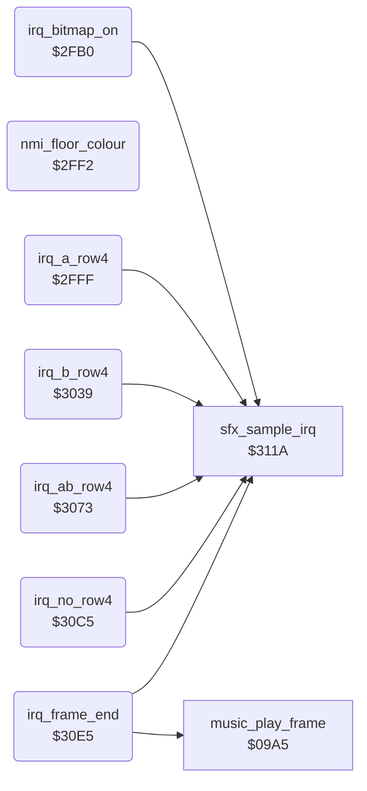

<!-- Generated by c64-docs from knowledge revision 20261022T104543.905-o1bqdy and .c64-re-tools/local/generated/src/source-map.json. Do not edit: change the knowledge, generate the source again, then run docs.ts generate. -->
# irq/irq_screen_split.asm: Bitmap-on IRQ, floor colour NMI, sprite row 4 IRQs and the frame-end IRQ with the music call

Range `$2FB0-$3119`. Source: [irq/irq_screen_split.asm](../../../../src/irq/irq_screen_split.asm). Index: [the reference](../../index.md).

## Call graph

A solid arrow is a call, a thick arrow a table entry, a dotted arrow a jump. Rounded nodes are in this file.

## Names

### [`irq_bitmap_on`](../../../../src/irq/irq_screen_split.asm#L6) `$2FB0`

*routine*

Raster IRQ at line $59, under the score panel text rows. It waits for line $5a and sets the first sprite row handler (patched). It starts CIA2 timer B for the floor NMI, switches to bitmap mode ($d011 = $3b) and sets the scene background colour.
Reads and clears the CIA1 interrupt flags; bit 7 set means a CIA1 timer B IRQ

- **Referred to by:** [`irq_frame_start`](sprite_mux_plan.md#irq_frame_start) [`$3201`](../../../../src/irq/sprite_mux_plan.asm#L15), [`irq_frame_start`](sprite_mux_plan.md#irq_frame_start) [`$3206`](../../../../src/irq/sprite_mux_plan.asm#L15)
- **Calls:** [`sfx_sample_irq`](../sfx/sfx_sample_player.md#sfx_sample_irq)
- **Reads:** [`CIAICR`](../../memory-map.md#CIAICR), [`RASTER`](../../memory-map.md#RASTER)
- **Writes:** [`VICIRQ`](../../memory-map.md#VICIRQ), [`RASTER`](../../memory-map.md#RASTER), [`hw_irq_vector`](../../memory-map.md#hw_irq_vector), [`hw_irq_vector+1`](../../memory-map.md#hw_irq_vector), [`CI2TBHI`](../../memory-map.md#CI2TBHI), [`CI2TBLO`](../../memory-map.md#CI2TBLO), [`CI2CRB`](../../memory-map.md#CI2CRB), [`SCROLY`](../../memory-map.md#SCROLY), [`BGCOL0`](../../memory-map.md#BGCOL0)

### [`irq_bitmap_on_vic`](../../../../src/irq/irq_screen_split.asm#L11) `$2FB9`

*label*

- **Jumped to from:** [`irq_bitmap_on`](irq_screen_split.md#irq_bitmap_on) [`$2FB3`](../../../../src/irq/irq_screen_split.asm#L8)

### [`irq_bitmap_on_wait`](../../../../src/irq/irq_screen_split.asm#L14) `$2FBC`

*label*

- **Jumped to from:** [`irq_bitmap_on`](irq_screen_split.md#irq_bitmap_on) [`$2FBF`](../../../../src/irq/irq_screen_split.asm#L16)

### [`irq_bitmap_on_next_line`](../../../../src/irq/irq_screen_split.asm#L19) `$2FC7-$2FCB`

*variable*

- **Written by:** [`irq_frame_start`](sprite_mux_plan.md#irq_frame_start) [`$3330`](../../../../src/irq/sprite_mux_plan.asm#L159), [`irq_frame_start`](sprite_mux_plan.md#irq_frame_start) [`$3398`](../../../../src/irq/sprite_mux_plan.asm#L207), [`irq_frame_start`](sprite_mux_plan.md#irq_frame_start) [`$340E`](../../../../src/irq/sprite_mux_plan.asm#L262), [`irq_frame_start`](sprite_mux_plan.md#irq_frame_start) [`$3477`](../../../../src/irq/sprite_mux_plan.asm#L312), [`irq_frame_start`](sprite_mux_plan.md#irq_frame_start) [`$34D9`](../../../../src/irq/sprite_mux_plan.asm#L358), [`irq_frame_start`](sprite_mux_plan.md#irq_frame_start) [`$3548`](../../../../src/irq/sprite_mux_plan.asm#L409), [`irq_frame_start`](sprite_mux_plan.md#irq_frame_start) [`$35BE`](../../../../src/irq/sprite_mux_plan.asm#L464)

### [`irq_bitmap_on_next_lo`](../../../../src/irq/irq_screen_split.asm#L22) `$2FCC-$2FD0`

*variable*

- **Written by:** [`irq_frame_start`](sprite_mux_plan.md#irq_frame_start) [`$330F`](../../../../src/irq/sprite_mux_plan.asm#L145), [`irq_frame_start`](sprite_mux_plan.md#irq_frame_start) [`$3363`](../../../../src/irq/sprite_mux_plan.asm#L185), [`irq_frame_start`](sprite_mux_plan.md#irq_frame_start) [`$33D9`](../../../../src/irq/sprite_mux_plan.asm#L240), [`irq_frame_start`](sprite_mux_plan.md#irq_frame_start) [`$344C`](../../../../src/irq/sprite_mux_plan.asm#L294), [`irq_frame_start`](sprite_mux_plan.md#irq_frame_start) [`$34AE`](../../../../src/irq/sprite_mux_plan.asm#L340), [`irq_frame_start`](sprite_mux_plan.md#irq_frame_start) [`$3513`](../../../../src/irq/sprite_mux_plan.asm#L387), [`irq_frame_start`](sprite_mux_plan.md#irq_frame_start) [`$3589`](../../../../src/irq/sprite_mux_plan.asm#L442)

### [`irq_bitmap_on_next_hi`](../../../../src/irq/irq_screen_split.asm#L25) `$2FD1-$2FEB`

*variable*

- **Written by:** [`irq_frame_start`](sprite_mux_plan.md#irq_frame_start) [`$3314`](../../../../src/irq/sprite_mux_plan.asm#L147), [`irq_frame_start`](sprite_mux_plan.md#irq_frame_start) [`$3368`](../../../../src/irq/sprite_mux_plan.asm#L187), [`irq_frame_start`](sprite_mux_plan.md#irq_frame_start) [`$33DE`](../../../../src/irq/sprite_mux_plan.asm#L242), [`irq_frame_start`](sprite_mux_plan.md#irq_frame_start) [`$3451`](../../../../src/irq/sprite_mux_plan.asm#L296), [`irq_frame_start`](sprite_mux_plan.md#irq_frame_start) [`$34B3`](../../../../src/irq/sprite_mux_plan.asm#L342), [`irq_frame_start`](sprite_mux_plan.md#irq_frame_start) [`$3518`](../../../../src/irq/sprite_mux_plan.asm#L389), [`irq_frame_start`](sprite_mux_plan.md#irq_frame_start) [`$358E`](../../../../src/irq/sprite_mux_plan.asm#L444)

### [`irq_bitmap_on_bg_colour`](../../../../src/irq/irq_screen_split.asm#L38) `$2FEC-$2FF1`

*variable*

- **Written by:** [`scene_draw_if_new`](../game/title_and_scene.md#scene_draw_if_new) [`$1F4B`](../../../../src/game/title_and_scene.asm#L142), [`scene_draw_if_new`](../game/title_and_scene.md#scene_draw_if_new) [`$1F59`](../../../../src/game/title_and_scene.asm#L147)

### [`nmi_floor_colour`](../../../../src/irq/irq_screen_split.asm#L44) `$2FF2`

*routine*

NMI of CIA2 timer B, about 92 PAL lines after irq_bitmap_on starts the timer (5820 cycles). It sets the background colour to 7 (yellow) for the floor. An NMI from another source (RESTORE) only returns.
Bit 7 set: the CIA2 timer B NMI

- **Referred to by:** [`init_vectors_cias`](../game/init_machine.md#init_vectors_cias) [`$1971`](../../../../src/game/init_machine.asm#L78), [`init_vectors_cias`](../game/init_machine.md#init_vectors_cias) [`$1976`](../../../../src/game/init_machine.asm#L78)
- **Reads:** [`CI2ICR`](../../memory-map.md#CI2ICR)
- **Writes:** [`BGCOL0`](../../memory-map.md#BGCOL0)

### [`nmi_done`](../../../../src/irq/irq_screen_split.asm#L51) `$2FFE`

*label*

- **Jumped to from:** [`nmi_floor_colour`](irq_screen_split.md#nmi_floor_colour) [`$2FF5`](../../../../src/irq/irq_screen_split.asm#L46)

### [`irq_a_row4`](../../../../src/irq/irq_screen_split.asm#L54) `$2FFF`

*routine*

Raster IRQ at line $d9 that shows a 4th sprite row for group A at Y $da. row4_irq_vector selects it when only group A is not at Y $a0. The planner at $328d patches the pointers from row4_ptr_*. It sets irq_frame_end at line $ff.
Reads and clears the CIA1 interrupt flags; bit 7 set means a CIA1 timer B IRQ

- **Referred to by:** [`irq_frame_start`](sprite_mux_plan.md#irq_frame_start) [`$3277`](../../../../src/irq/sprite_mux_plan.asm#L70), [`irq_frame_start`](sprite_mux_plan.md#irq_frame_start) [`$327B`](../../../../src/irq/sprite_mux_plan.asm#L70)
- **Calls:** [`sfx_sample_irq`](../sfx/sfx_sample_player.md#sfx_sample_irq)
- **Reads:** [`CIAICR`](../../memory-map.md#CIAICR)
- **Writes:** [`SP0Y`](../../memory-map.md#SP0Y), [`SP1Y`](../../memory-map.md#SP1Y), [`SP2Y`](../../memory-map.md#SP2Y), [`sprite_pointers`](../../memory-map.md#sprite_pointers), [`sprite_pointers+1`](../../memory-map.md#sprite_pointers), [`sprite_pointers+2`](../../memory-map.md#sprite_pointers), [`VICIRQ`](../../memory-map.md#VICIRQ), [`RASTER`](../../memory-map.md#RASTER), [`hw_irq_vector`](../../memory-map.md#hw_irq_vector), [`hw_irq_vector+1`](../../memory-map.md#hw_irq_vector)
- **Refers to:** [`irq_frame_end`](irq_screen_split.md#irq_frame_end)

### [`irq_a_row4_vic`](../../../../src/irq/irq_screen_split.asm#L59) `$3008`

*label*

- **Jumped to from:** [`irq_a_row4`](irq_screen_split.md#irq_a_row4) [`$3002`](../../../../src/irq/irq_screen_split.asm#L56)

### [`irq_a_row4_ptr_left`](../../../../src/irq/irq_screen_split.asm#L65) `$3015-$3019`

*variable*

- **Written by:** [`irq_frame_start`](sprite_mux_plan.md#irq_frame_start) [`$3291`](../../../../src/irq/sprite_mux_plan.asm#L79)

### [`irq_a_row4_ptr_mid`](../../../../src/irq/irq_screen_split.asm#L68) `$301A-$301E`

*variable*

- **Written by:** [`irq_frame_start`](sprite_mux_plan.md#irq_frame_start) [`$3296`](../../../../src/irq/sprite_mux_plan.asm#L81)

### [`irq_a_row4_ptr_right`](../../../../src/irq/irq_screen_split.asm#L71) `$301F-$3038`

*variable*

- **Written by:** [`irq_frame_start`](sprite_mux_plan.md#irq_frame_start) [`$329B`](../../../../src/irq/sprite_mux_plan.asm#L83)

### [`irq_b_row4`](../../../../src/irq/irq_screen_split.asm#L82) `$3039`

*routine*

Raster IRQ at line $d9 that shows a 4th sprite row for group B at Y $da. row4_irq_vector selects it when only group B is not at Y $a0. The planner at $328d patches the pointers from row4_ptr_*. It sets irq_frame_end at line $ff.
Reads and clears the CIA1 interrupt flags; bit 7 set means a CIA1 timer B IRQ

- **Referred to by:** [`irq_frame_start`](sprite_mux_plan.md#irq_frame_start) [`$325D`](../../../../src/irq/sprite_mux_plan.asm#L62), [`irq_frame_start`](sprite_mux_plan.md#irq_frame_start) [`$3261`](../../../../src/irq/sprite_mux_plan.asm#L62)
- **Calls:** [`sfx_sample_irq`](../sfx/sfx_sample_player.md#sfx_sample_irq)
- **Reads:** [`CIAICR`](../../memory-map.md#CIAICR)
- **Writes:** [`SP3Y`](../../memory-map.md#SP3Y), [`SP4Y`](../../memory-map.md#SP4Y), [`SP5Y`](../../memory-map.md#SP5Y), [`sprite_pointers+3`](../../memory-map.md#sprite_pointers), [`sprite_pointers+4`](../../memory-map.md#sprite_pointers), [`sprite_pointers+5`](../../memory-map.md#sprite_pointers), [`VICIRQ`](../../memory-map.md#VICIRQ), [`RASTER`](../../memory-map.md#RASTER), [`hw_irq_vector`](../../memory-map.md#hw_irq_vector), [`hw_irq_vector+1`](../../memory-map.md#hw_irq_vector)
- **Refers to:** [`irq_frame_end`](irq_screen_split.md#irq_frame_end)

### [`irq_b_row4_vic`](../../../../src/irq/irq_screen_split.asm#L87) `$3042`

*label*

- **Jumped to from:** [`irq_b_row4`](irq_screen_split.md#irq_b_row4) [`$303C`](../../../../src/irq/irq_screen_split.asm#L84)

### [`irq_b_row4_ptr_left`](../../../../src/irq/irq_screen_split.asm#L93) `$304F-$3053`

*variable*

- **Written by:** [`irq_frame_start`](sprite_mux_plan.md#irq_frame_start) [`$32C0`](../../../../src/irq/sprite_mux_plan.asm#L98)

### [`irq_b_row4_ptr_mid`](../../../../src/irq/irq_screen_split.asm#L96) `$3054-$3058`

*variable*

- **Written by:** [`irq_frame_start`](sprite_mux_plan.md#irq_frame_start) [`$32C5`](../../../../src/irq/sprite_mux_plan.asm#L100)

### [`irq_b_row4_ptr_right`](../../../../src/irq/irq_screen_split.asm#L99) `$3059-$3072`

*variable*

- **Written by:** [`irq_frame_start`](sprite_mux_plan.md#irq_frame_start) [`$32CA`](../../../../src/irq/sprite_mux_plan.asm#L102)

### [`irq_ab_row4`](../../../../src/irq/irq_screen_split.asm#L110) `$3073`

*routine*

Raster IRQ at line $d9 that shows a 4th sprite row for both groups at Y $da. row4_irq_vector selects it when neither group is at Y $a0. The planner at $328d patches the pointers from row4_ptr_*. It sets irq_frame_end at line $ff.
Reads and clears the CIA1 interrupt flags; bit 7 set means a CIA1 timer B IRQ

- **Referred to by:** [`irq_frame_start`](sprite_mux_plan.md#irq_frame_start) [`$326C`](../../../../src/irq/sprite_mux_plan.asm#L67), [`irq_frame_start`](sprite_mux_plan.md#irq_frame_start) [`$3270`](../../../../src/irq/sprite_mux_plan.asm#L67)
- **Calls:** [`sfx_sample_irq`](../sfx/sfx_sample_player.md#sfx_sample_irq)
- **Reads:** [`CIAICR`](../../memory-map.md#CIAICR)
- **Writes:** [`SP0Y`](../../memory-map.md#SP0Y), [`SP1Y`](../../memory-map.md#SP1Y), [`SP2Y`](../../memory-map.md#SP2Y), [`SP3Y`](../../memory-map.md#SP3Y), [`SP4Y`](../../memory-map.md#SP4Y), [`SP5Y`](../../memory-map.md#SP5Y), [`sprite_pointers`](../../memory-map.md#sprite_pointers), [`sprite_pointers+1`](../../memory-map.md#sprite_pointers), [`sprite_pointers+2`](../../memory-map.md#sprite_pointers), [`sprite_pointers+3`](../../memory-map.md#sprite_pointers), [`sprite_pointers+4`](../../memory-map.md#sprite_pointers), [`sprite_pointers+5`](../../memory-map.md#sprite_pointers), [`VICIRQ`](../../memory-map.md#VICIRQ), [`RASTER`](../../memory-map.md#RASTER), [`hw_irq_vector`](../../memory-map.md#hw_irq_vector), [`hw_irq_vector+1`](../../memory-map.md#hw_irq_vector)
- **Refers to:** [`irq_frame_end`](irq_screen_split.md#irq_frame_end)

### [`irq_ab_row4_vic`](../../../../src/irq/irq_screen_split.asm#L115) `$307C`

*label*

- **Jumped to from:** [`irq_ab_row4`](irq_screen_split.md#irq_ab_row4) [`$3076`](../../../../src/irq/irq_screen_split.asm#L112)

### [`irq_ab_row4_a_ptr_left`](../../../../src/irq/irq_screen_split.asm#L124) `$3092-$3096`

*variable*

- **Written by:** [`irq_frame_start`](sprite_mux_plan.md#irq_frame_start) [`$32A0`](../../../../src/irq/sprite_mux_plan.asm#L85)

### [`irq_ab_row4_a_ptr_mid`](../../../../src/irq/irq_screen_split.asm#L127) `$3097-$309B`

*variable*

- **Written by:** [`irq_frame_start`](sprite_mux_plan.md#irq_frame_start) [`$32A5`](../../../../src/irq/sprite_mux_plan.asm#L87)

### [`irq_ab_row4_a_ptr_right`](../../../../src/irq/irq_screen_split.asm#L130) `$309C-$30A0`

*variable*

- **Written by:** [`irq_frame_start`](sprite_mux_plan.md#irq_frame_start) [`$32AA`](../../../../src/irq/sprite_mux_plan.asm#L89)

### [`irq_ab_row4_b_ptr_left`](../../../../src/irq/irq_screen_split.asm#L133) `$30A1-$30A5`

*variable*

- **Written by:** [`irq_frame_start`](sprite_mux_plan.md#irq_frame_start) [`$32B1`](../../../../src/irq/sprite_mux_plan.asm#L92)

### [`irq_ab_row4_b_ptr_mid`](../../../../src/irq/irq_screen_split.asm#L136) `$30A6-$30AA`

*variable*

- **Written by:** [`irq_frame_start`](sprite_mux_plan.md#irq_frame_start) [`$32B6`](../../../../src/irq/sprite_mux_plan.asm#L94)

### [`irq_ab_row4_b_ptr_right`](../../../../src/irq/irq_screen_split.asm#L139) `$30AB-$30C4`

*variable*

- **Written by:** [`irq_frame_start`](sprite_mux_plan.md#irq_frame_start) [`$32BB`](../../../../src/irq/sprite_mux_plan.asm#L96)

### [`irq_no_row4`](../../../../src/irq/irq_screen_split.asm#L150) `$30C5`

*routine*

Raster IRQ at line $d9 when both groups are at Y $a0 and no 4th sprite row is shown. It only sets irq_frame_end at line $ff.
Reads and clears the CIA1 interrupt flags; bit 7 set means a CIA1 timer B IRQ

- **Referred to by:** [`irq_frame_start`](sprite_mux_plan.md#irq_frame_start) [`$3282`](../../../../src/irq/sprite_mux_plan.asm#L73), [`irq_frame_start`](sprite_mux_plan.md#irq_frame_start) [`$3286`](../../../../src/irq/sprite_mux_plan.asm#L73)
- **Calls:** [`sfx_sample_irq`](../sfx/sfx_sample_player.md#sfx_sample_irq)
- **Reads:** [`CIAICR`](../../memory-map.md#CIAICR)
- **Writes:** [`VICIRQ`](../../memory-map.md#VICIRQ), [`RASTER`](../../memory-map.md#RASTER), [`hw_irq_vector`](../../memory-map.md#hw_irq_vector), [`hw_irq_vector+1`](../../memory-map.md#hw_irq_vector)
- **Refers to:** [`irq_frame_end`](irq_screen_split.md#irq_frame_end)

### [`irq_no_row4_vic`](../../../../src/irq/irq_screen_split.asm#L155) `$30CE`

*label*

- **Jumped to from:** [`irq_no_row4`](irq_screen_split.md#irq_no_row4) [`$30C8`](../../../../src/irq/irq_screen_split.asm#L152)

### [`irq_frame_end`](../../../../src/irq/irq_screen_split.asm#L165) `$30E5`

*routine*

Raster IRQ at line $ff, under the playfield. It sets irq_frame_start at line 0 and text mode ($d011 = $1b) for the score panel. Then it sets panel_bg_colour and calls the music driver music_play_frame once per frame.
Reads and clears the CIA1 interrupt flags; bit 7 set means a CIA1 timer B IRQ

- **Referred to by:** [`irq_a_row4`](irq_screen_split.md#irq_a_row4) [`$302D`](../../../../src/irq/irq_screen_split.asm#L78), [`irq_a_row4`](irq_screen_split.md#irq_a_row4) [`$3032`](../../../../src/irq/irq_screen_split.asm#L78), [`irq_b_row4`](irq_screen_split.md#irq_b_row4) [`$3067`](../../../../src/irq/irq_screen_split.asm#L106), [`irq_b_row4`](irq_screen_split.md#irq_b_row4) [`$306C`](../../../../src/irq/irq_screen_split.asm#L106), [`irq_ab_row4`](irq_screen_split.md#irq_ab_row4) [`$30B9`](../../../../src/irq/irq_screen_split.asm#L146), [`irq_ab_row4`](irq_screen_split.md#irq_ab_row4) [`$30BE`](../../../../src/irq/irq_screen_split.asm#L146), [`irq_no_row4`](irq_screen_split.md#irq_no_row4) [`$30D9`](../../../../src/irq/irq_screen_split.asm#L161), [`irq_no_row4`](irq_screen_split.md#irq_no_row4) [`$30DE`](../../../../src/irq/irq_screen_split.asm#L161)
- **Calls:** [`sfx_sample_irq`](../sfx/sfx_sample_player.md#sfx_sample_irq), [`music_play_frame`](../music/music_driver.md#music_play_frame)
- **Reads:** [`CIAICR`](../../memory-map.md#CIAICR), [`panel_bg_colour`](../../memory-map.md#panel_bg_colour)
- **Writes:** [`VICIRQ`](../../memory-map.md#VICIRQ), [`RASTER`](../../memory-map.md#RASTER), [`hw_irq_vector`](../../memory-map.md#hw_irq_vector), [`hw_irq_vector+1`](../../memory-map.md#hw_irq_vector), [`SCROLY`](../../memory-map.md#SCROLY), [`BGCOL0`](../../memory-map.md#BGCOL0)
- **Refers to:** [`irq_frame_start`](sprite_mux_plan.md#irq_frame_start)

### [`irq_frame_end_vic`](../../../../src/irq/irq_screen_split.asm#L170) `$30EE`

*label*

- **Jumped to from:** [`irq_frame_end`](irq_screen_split.md#irq_frame_end) [`$30E8`](../../../../src/irq/irq_screen_split.asm#L167)
