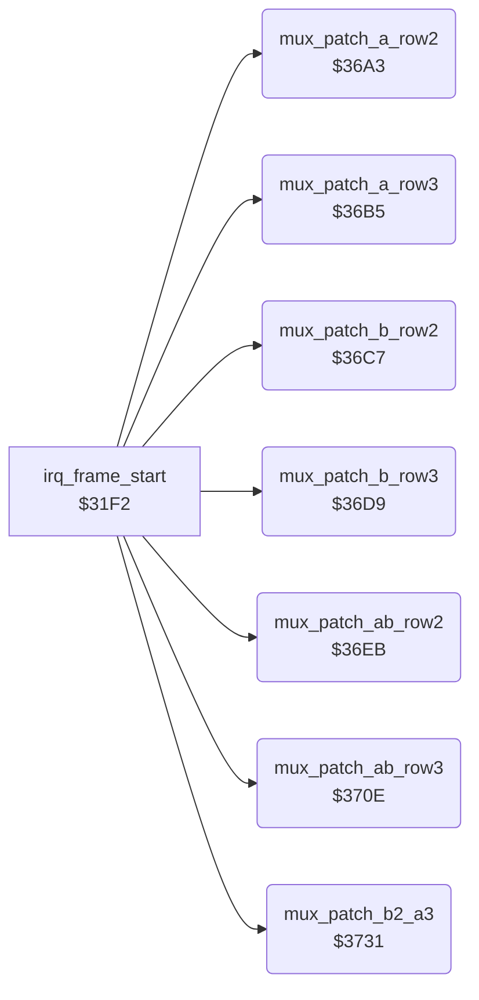

<!-- Generated by c64-docs from knowledge revision 20261025T214835.634-4kntaa and .c64-re-tools/local/generated/src/source-map.json. Do not edit: change the knowledge, generate the source again, then run docs.ts generate. -->
# irq/sprite_mux_patch.asm: Sprite multiplexer: copy the row 2/3 pointers of the fighters into the raster handler operands

Range `$36A3-$3753`. Source: [irq/sprite_mux_patch.asm](../../../../src/irq/sprite_mux_patch.asm). Index: [the reference](../../index.md).

## Routines

| Routine | Address | Reached from | Summary |
|---|---|---|---|
| [`mux_patch_a_row2`](sprite_mux_patch.md#mux_patch_a_row2) | `$36A3` | [`irq_frame_start`](sprite_mux_plan.md#irq_frame_start) | Copies the pointers of parts 3-5 (row 2) of the group A fighter into handler $2d62 (sprites 0-2). |
| [`mux_patch_a_row3`](sprite_mux_patch.md#mux_patch_a_row3) | `$36B5` | [`irq_frame_start`](sprite_mux_plan.md#irq_frame_start) | Copies the pointers of parts 6-8 (row 3) of the group A fighter into handler $2d9c (sprites 0-2). |
| [`mux_patch_b_row2`](sprite_mux_patch.md#mux_patch_b_row2) | `$36C7` | [`irq_frame_start`](sprite_mux_plan.md#irq_frame_start) | Copies the pointers of parts 3-5 (row 2) of the group B fighter into handler $2dd6 (sprites 3-5). |
| [`mux_patch_b_row3`](sprite_mux_patch.md#mux_patch_b_row3) | `$36D9` | [`irq_frame_start`](sprite_mux_plan.md#irq_frame_start) | Copies the pointers of parts 6-8 (row 3) of the group B fighter into handler $2e11 (sprites 3-5). |
| [`mux_patch_ab_row2`](sprite_mux_patch.md#mux_patch_ab_row2) | `$36EB` | [`irq_frame_start`](sprite_mux_plan.md#irq_frame_start) | Copies the row 2 pointers (parts 3-5) of both group fighters into the combined handler $2e4c. |
| [`mux_patch_ab_row3`](sprite_mux_patch.md#mux_patch_ab_row3) | `$370E` | [`irq_frame_start`](sprite_mux_plan.md#irq_frame_start) | Copies the row 3 pointers (parts 6-8) of both group fighters into the combined handler $2ea7. |
| [`mux_patch_b2_a3`](sprite_mux_patch.md#mux_patch_b2_a3) | `$3731` | [`irq_frame_start`](sprite_mux_plan.md#irq_frame_start) | Copies row 2 of the group B fighter and row 3 of the group A fighter into the combined handler $2f02. |

## Call graph

A solid arrow is a call, a thick arrow a table entry. Rounded nodes are in this file.

## Details

### [`mux_patch_a_row2`](../../../../src/irq/sprite_mux_patch.asm#L6) `$36A3`

*routine*

Copies the pointers of parts 3-5 (row 2) of the group A fighter into handler $2d62 (sprites 0-2). Called from the layout code of irq_frame_start.

- **Called from:** [`irq_frame_start`](sprite_mux_plan.md#irq_frame_start)
- **Reads:** [`group_a_fighter`](../../memory-map.md#group_a_fighter), [`fighter_part_ptrs`](../../memory-map.md#fighter_part_ptrs)
- **Writes:** [`irq_a_row2_ptr_left`](irq_sprite_rows.md#irq_a_row2_ptr_left), [`irq_a_row2_ptr_mid`](irq_sprite_rows.md#irq_a_row2_ptr_mid), [`irq_a_row2_ptr_right`](irq_sprite_rows.md#irq_a_row2_ptr_right)
- **Refers to:** [`fighter_part_ptrs`](../../memory-map.md#fighter_part_ptrs)

### [`mux_patch_a_row3`](../../../../src/irq/sprite_mux_patch.asm#L16) `$36B5`

*routine*

Copies the pointers of parts 6-8 (row 3) of the group A fighter into handler $2d9c (sprites 0-2). Called from the layout code of irq_frame_start.

- **Called from:** [`irq_frame_start`](sprite_mux_plan.md#irq_frame_start)
- **Reads:** [`group_a_fighter`](../../memory-map.md#group_a_fighter), [`fighter_part_ptrs`](../../memory-map.md#fighter_part_ptrs)
- **Writes:** [`irq_a_row3_ptr_left`](irq_sprite_rows.md#irq_a_row3_ptr_left), [`irq_a_row3_ptr_mid`](irq_sprite_rows.md#irq_a_row3_ptr_mid), [`irq_a_row3_ptr_right`](irq_sprite_rows.md#irq_a_row3_ptr_right)
- **Refers to:** [`fighter_part_ptrs`](../../memory-map.md#fighter_part_ptrs)

### [`mux_patch_b_row2`](../../../../src/irq/sprite_mux_patch.asm#L26) `$36C7`

*routine*

Copies the pointers of parts 3-5 (row 2) of the group B fighter into handler $2dd6 (sprites 3-5). Called from the layout code of irq_frame_start.

- **Called from:** [`irq_frame_start`](sprite_mux_plan.md#irq_frame_start)
- **Reads:** [`group_b_fighter`](../../memory-map.md#group_b_fighter), [`fighter_part_ptrs`](../../memory-map.md#fighter_part_ptrs)
- **Writes:** [`irq_b_row2_ptr_left`](irq_sprite_rows.md#irq_b_row2_ptr_left), [`irq_b_row2_ptr_mid`](irq_sprite_rows.md#irq_b_row2_ptr_mid), [`irq_b_row2_ptr_right`](irq_sprite_rows.md#irq_b_row2_ptr_right)
- **Refers to:** [`fighter_part_ptrs`](../../memory-map.md#fighter_part_ptrs)

### [`mux_patch_b_row3`](../../../../src/irq/sprite_mux_patch.asm#L36) `$36D9`

*routine*

Copies the pointers of parts 6-8 (row 3) of the group B fighter into handler $2e11 (sprites 3-5). Called from the layout code of irq_frame_start.

- **Called from:** [`irq_frame_start`](sprite_mux_plan.md#irq_frame_start)
- **Reads:** [`group_b_fighter`](../../memory-map.md#group_b_fighter), [`fighter_part_ptrs`](../../memory-map.md#fighter_part_ptrs)
- **Writes:** [`irq_b_row3_ptr_left`](irq_sprite_rows.md#irq_b_row3_ptr_left), [`irq_b_row3_ptr_mid`](irq_sprite_rows.md#irq_b_row3_ptr_mid), [`irq_b_row3_ptr_right`](irq_sprite_rows.md#irq_b_row3_ptr_right)
- **Refers to:** [`fighter_part_ptrs`](../../memory-map.md#fighter_part_ptrs)

### [`mux_patch_ab_row2`](../../../../src/irq/sprite_mux_patch.asm#L46) `$36EB`

*routine*

Copies the row 2 pointers (parts 3-5) of both group fighters into the combined handler $2e4c. Layout 1 only ($3307).

- **Called from:** [`irq_frame_start`](sprite_mux_plan.md#irq_frame_start)
- **Reads:** [`group_a_fighter`](../../memory-map.md#group_a_fighter), [`fighter_part_ptrs`](../../memory-map.md#fighter_part_ptrs), [`group_b_fighter`](../../memory-map.md#group_b_fighter)
- **Writes:** [`irq_ab_row2_a_ptr_left`](irq_sprite_rows.md#irq_ab_row2_a_ptr_left), [`irq_ab_row2_a_ptr_mid`](irq_sprite_rows.md#irq_ab_row2_a_ptr_mid), [`irq_ab_row2_a_ptr_right`](irq_sprite_rows.md#irq_ab_row2_a_ptr_right), [`irq_ab_row2_b_ptr_left`](irq_sprite_rows.md#irq_ab_row2_b_ptr_left), [`irq_ab_row2_b_ptr_mid`](irq_sprite_rows.md#irq_ab_row2_b_ptr_mid), [`irq_ab_row2_b_ptr_right`](irq_sprite_rows.md#irq_ab_row2_b_ptr_right)
- **Refers to:** [`fighter_part_ptrs`](../../memory-map.md#fighter_part_ptrs)

### [`mux_patch_ab_row3`](../../../../src/irq/sprite_mux_patch.asm#L63) `$370E`

*routine*

Copies the row 3 pointers (parts 6-8) of both group fighters into the combined handler $2ea7. Layout 1 only ($330a).

- **Called from:** [`irq_frame_start`](sprite_mux_plan.md#irq_frame_start)
- **Reads:** [`group_a_fighter`](../../memory-map.md#group_a_fighter), [`fighter_part_ptrs`](../../memory-map.md#fighter_part_ptrs), [`group_b_fighter`](../../memory-map.md#group_b_fighter)
- **Writes:** [`irq_ab_row3_a_ptr_left`](irq_sprite_rows.md#irq_ab_row3_a_ptr_left), [`irq_ab_row3_a_ptr_mid`](irq_sprite_rows.md#irq_ab_row3_a_ptr_mid), [`irq_ab_row3_a_ptr_right`](irq_sprite_rows.md#irq_ab_row3_a_ptr_right), [`irq_ab_row3_b_ptr_left`](irq_sprite_rows.md#irq_ab_row3_b_ptr_left), [`irq_ab_row3_b_ptr_mid`](irq_sprite_rows.md#irq_ab_row3_b_ptr_mid), [`irq_ab_row3_b_ptr_right`](irq_sprite_rows.md#irq_ab_row3_b_ptr_right)
- **Refers to:** [`fighter_part_ptrs`](../../memory-map.md#fighter_part_ptrs)

### [`mux_patch_b2_a3`](../../../../src/irq/sprite_mux_patch.asm#L80) `$3731`

*routine*

Copies row 2 of the group B fighter and row 3 of the group A fighter into the combined handler $2f02. Layout 4 only ($3444).

- **Called from:** [`irq_frame_start`](sprite_mux_plan.md#irq_frame_start)
- **Reads:** [`group_a_fighter`](../../memory-map.md#group_a_fighter), [`fighter_part_ptrs`](../../memory-map.md#fighter_part_ptrs), [`group_b_fighter`](../../memory-map.md#group_b_fighter)
- **Writes:** [`irq_b2_a3_a_ptr_left`](irq_sprite_rows.md#irq_b2_a3_a_ptr_left), [`irq_b2_a3_a_ptr_mid`](irq_sprite_rows.md#irq_b2_a3_a_ptr_mid), [`irq_b2_a3_a_ptr_right`](irq_sprite_rows.md#irq_b2_a3_a_ptr_right), [`irq_b2_a3_b_ptr_left`](irq_sprite_rows.md#irq_b2_a3_b_ptr_left), [`irq_b2_a3_b_ptr_mid`](irq_sprite_rows.md#irq_b2_a3_b_ptr_mid), [`irq_b2_a3_b_ptr_right`](irq_sprite_rows.md#irq_b2_a3_b_ptr_right)
- **Refers to:** [`fighter_part_ptrs`](../../memory-map.md#fighter_part_ptrs)
