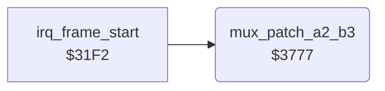

<!-- Generated by c64-docs from knowledge revision 20261022T104543.905-o1bqdy and .c64-re-tools/local/generated/src/source-map.json. Do not edit: change the knowledge, generate the source again, then run docs.ts generate. -->
# irq/sprite_mux_patch_3777.asm

Range `$3777-$3799`. Source: [irq/sprite_mux_patch_3777.asm](../../../../src/irq/sprite_mux_patch_3777.asm). Index: [the reference](../../index.md).

## Call graph

A solid arrow is a call, a thick arrow a table entry, a dotted arrow a jump. Rounded nodes are in this file.

## Names

### [`mux_patch_a2_b3`](../../../../src/irq/sprite_mux_patch_3777.asm#L6) `$3777`

*routine*

Copies row 2 of the group A fighter and row 3 of the group B fighter into the combined handler $2f59. Layout 5 only ($34a6).

- **Called from:** [`irq_frame_start`](sprite_mux_plan.md#irq_frame_start) [`$34A6`](../../../../src/irq/sprite_mux_plan.asm#L337)
- **Reads:** [`group_a_fighter`](../../memory-map.md#group_a_fighter), [`group_b_fighter`](../../memory-map.md#group_b_fighter)
- **Writes:** [`irq_a2_b3_a_ptr_left`](irq_sprite_rows.md#irq_a2_b3_a_ptr_left), [`irq_a2_b3_a_ptr_mid`](irq_sprite_rows.md#irq_a2_b3_a_ptr_mid), [`irq_a2_b3_a_ptr_right`](irq_sprite_rows.md#irq_a2_b3_a_ptr_right), [`irq_a2_b3_b_ptr_left`](irq_sprite_rows.md#irq_a2_b3_b_ptr_left), [`irq_a2_b3_b_ptr_mid`](irq_sprite_rows.md#irq_a2_b3_b_ptr_mid), [`irq_a2_b3_b_ptr_right`](irq_sprite_rows.md#irq_a2_b3_b_ptr_right)
- **Refers to:** [`fighter_part_ptrs`](../../memory-map.md#fighter_part_ptrs)
