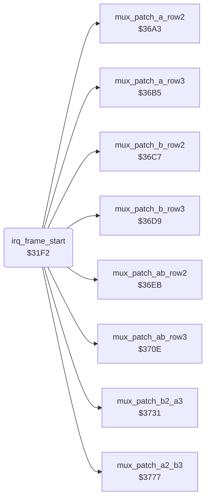

<!-- Generated by c64-docs from knowledge revision 20261025T191824.573-5s4oe2 and .c64-re-tools/local/generated/src/source-map.json. Do not edit: change the knowledge, generate the source again, then run docs.ts generate. -->
# irq/sprite_mux_plan.asm: Frame-start raster IRQ: sprite groups, row-4 handler, 7 multiplexer layouts, sprite row 1

Range `$31F2-$36A2`. Source: [irq/sprite_mux_plan.asm](../../../../src/irq/sprite_mux_plan.asm). Index: [the reference](../../index.md).

## Routines

| Routine | Address | Reached from | Summary |
|---|---|---|---|
| [`irq_frame_start`](sprite_mux_plan.md#irq_frame_start) | `$31F2` |  | Raster IRQ at line 0, the start of the sprite multiplexer; init $1958 and irq_frame_end $30f9 set the vector. |

## Data

| Range | Type | Name | Read by | Written by |
|---|---|---|---|---|
| [`$369B`](../../../../src/irq/sprite_mux_plan.asm#L577)-`$369E` | bytes | [`mux_msb_bits_a`](../../../../src/irq/sprite_mux_plan.asm#L576) | [`irq_frame_start`](sprite_mux_plan.md#irq_frame_start) |  |
| [`$369F`](../../../../src/irq/sprite_mux_plan.asm#L580)-`$36A2` | bytes | [`mux_msb_bits_b`](../../../../src/irq/sprite_mux_plan.asm#L579) | [`irq_frame_start`](sprite_mux_plan.md#irq_frame_start) |  |

## Call graph

A solid arrow is a call, a thick arrow a table entry. Rounded nodes are in this file.

## Details

### [`irq_frame_start`](../../../../src/irq/sprite_mux_plan.asm#L6) `$31F2`

*routine*

Raster IRQ at line 0, the start of the sprite multiplexer; init $1958 and irq_frame_end $30f9 set the vector. A CIA1 IRQ goes to the sample player $311a. Else it sets the next IRQ, irq_bitmap_on $2fb0 at line $59, and the sprite multicolours. It puts front_fighter in group A, selects the row-4 handler, patches the row handlers for one of 7 layouts and sets sprite row 1.

- **Referred to by:** [`init_vectors_cias`](../game/init_machine.md#init_vectors_cias), [`irq_frame_end`](irq_screen_split.md#irq_frame_end)
- **Calls:** [`mux_patch_ab_row2`](sprite_mux_patch.md#mux_patch_ab_row2), [`mux_patch_ab_row3`](sprite_mux_patch.md#mux_patch_ab_row3), [`mux_patch_a_row2`](sprite_mux_patch.md#mux_patch_a_row2), [`mux_patch_b_row2`](sprite_mux_patch.md#mux_patch_b_row2), [`mux_patch_a_row3`](sprite_mux_patch.md#mux_patch_a_row3), [`mux_patch_b_row3`](sprite_mux_patch.md#mux_patch_b_row3), [`mux_patch_b2_a3`](sprite_mux_patch.md#mux_patch_b2_a3), [`mux_patch_a2_b3`](sprite_mux_patch_3777.md#mux_patch_a2_b3)
- **Jumps to:** [`sfx_sample_irq`](../sfx/sfx_sample_player.md#sfx_sample_irq)
- **Reads:** [`CIAICR`](../../memory-map.md#CIAICR), [`front_fighter`](../../memory-map.md#front_fighter), [`group_a_fighter`](../../memory-map.md#group_a_fighter), [`sprite_y`](../../memory-map.md#sprite_y), [`sprite_x_lo`](../../memory-map.md#sprite_x_lo), [`sprite_x_msb`](../../memory-map.md#sprite_x_msb), [`group_b_fighter`](../../memory-map.md#group_b_fighter), [`group_y`](../../memory-map.md#group_y), [`row4_ptr_left`](../../memory-map.md#row4_ptr_left), [`row4_ptr_mid`](../../memory-map.md#row4_ptr_mid), [`row4_ptr_right`](../../memory-map.md#row4_ptr_right), [`row4_irq_vector`](../../memory-map.md#row4_irq_vector) and 5 more
- **Writes:** [`VICIRQ`](../../memory-map.md#VICIRQ), [`hw_irq_vector`](../../memory-map.md#hw_irq_vector), [`RASTER`](../../memory-map.md#RASTER), [`SPMC0`](../../memory-map.md#SPMC0), [`SPMC1`](../../memory-map.md#SPMC1), [`group_a_fighter`](../../memory-map.md#group_a_fighter), [`group_b_fighter`](../../memory-map.md#group_b_fighter), [`group_y`](../../memory-map.md#group_y), [`group_x_lo`](../../memory-map.md#group_x_lo), [`group_x_msb`](../../memory-map.md#group_x_msb), [`row4_irq_vector`](../../memory-map.md#row4_irq_vector), [`irq_a_row4_ptr_left`](irq_screen_split.md#irq_a_row4_ptr_left) and 70 more
- **Refers to:** [`irq_bitmap_on`](irq_screen_split.md#irq_bitmap_on), [`group_y`](../../memory-map.md#group_y), [`group_x_lo`](../../memory-map.md#group_x_lo), [`group_x_msb`](../../memory-map.md#group_x_msb), [`irq_b_row4`](irq_screen_split.md#irq_b_row4), [`row4_irq_vector`](../../memory-map.md#row4_irq_vector), [`irq_ab_row4`](irq_screen_split.md#irq_ab_row4), [`irq_a_row4`](irq_screen_split.md#irq_a_row4), [`irq_no_row4`](irq_screen_split.md#irq_no_row4), [`irq_ab_row2`](irq_sprite_rows.md#irq_ab_row2), [`irq_ab_row3`](irq_sprite_rows.md#irq_ab_row3), [`irq_a_row2`](irq_sprite_rows.md#irq_a_row2) and 6 more

| Label | Address | Comment |
|---|---|---|
| [`irq_frame_start_vic`](../../../../src/irq/sprite_mux_plan.asm#L11) | `$31FB` |  |
| [`mux_front_is_fighter1`](../../../../src/irq/sprite_mux_plan.asm#L35) | `$322F` |  |
| [`mux_copy_group_pos`](../../../../src/irq/sprite_mux_plan.asm#L41) | `$3237` | Copies sprite_y, sprite_x_lo and sprite_x_msb of the group A fighter to $1c/$1a/$1e and of the group B fighter to $1d/$1b/$1f. |
| [`mux_a_off_ground`](../../../../src/irq/sprite_mux_plan.asm#L64) | `$3268` |  |
| [`mux_row4_a_only`](../../../../src/irq/sprite_mux_plan.asm#L69) | `$3277` |  |
| [`mux_no_row4`](../../../../src/irq/sprite_mux_plan.asm#L72) | `$3282` |  |
| [`mux_patch_row4_ptrs`](../../../../src/irq/sprite_mux_plan.asm#L76) | `$328D` | Copies the row 4 (floor shadow) pointers row4_ptr_left/mid/right of group A into handlers $2fff and $3073, and of group B into $3073 and $3039. |
| [`mux_choose_layout`](../../../../src/irq/sprite_mux_plan.asm#L104) | `$32CD` | Selects one of 7 layouts from the Y gap between group A ($1c) and group B ($1d). Sprite Y is fighter_y*2 and all script dy values are even, thus the gap is a multiple of 4. Of these gaps, only $14 puts two row IRQs one raster line apart; it gets a combined handler. |
| [`mux_y_differ`](../../../../src/irq/sprite_mux_plan.asm#L110) | `$32D7` |  |
| [`mux_a_above_b`](../../../../src/irq/sprite_mux_plan.asm#L113) | `$32DC` |  |
| [`mux_a_above_gap_test`](../../../../src/irq/sprite_mux_plan.asm#L119) | `$32E5` |  |
| [`mux_a_above_near`](../../../../src/irq/sprite_mux_plan.asm#L122) | `$32EA` |  |
| [`mux_a_above_interleave`](../../../../src/irq/sprite_mux_plan.asm#L126) | `$32F1` |  |
| [`mux_b_above_a`](../../../../src/irq/sprite_mux_plan.asm#L128) | `$32F4` |  |
| [`mux_b_above_gap_test`](../../../../src/irq/sprite_mux_plan.asm#L131) | `$32F8` |  |
| [`mux_b_above_near`](../../../../src/irq/sprite_mux_plan.asm#L134) | `$32FD` |  |
| [`mux_b_above_interleave`](../../../../src/irq/sprite_mux_plan.asm#L138) | `$3304` |  |
| [`mux_layout_same_y`](../../../../src/irq/sprite_mux_plan.asm#L141) | `$3307` | Layout 1, both groups at the same Y. Handler $2e4c gets the IRQ at line Y+$12, waits for line Y+$14 and starts row 2 of both groups. Handler $2ea7 gets the IRQ at Y+$27, waits for Y+$29 and starts row 3. The row-4 handler follows at line $d9. |
| [`mux_layout_a_interleave`](../../../../src/irq/sprite_mux_plan.asm#L179) | `$3355` | Layout 2, group A above group B by 4 to $10 (any gap below $16 except $14). IRQ chain: A row 2 ($2d62), B row 2 ($2dd6), A row 3 ($2d9c), B row 3 ($2e11), row-4 handler at line $d9. |
| [`mux_layout_b_interleave`](../../../../src/irq/sprite_mux_plan.asm#L234) | `$33CB` | Layout 3, group B above group A by 4 to $10. IRQ chain: B row 2 ($2dd6), A row 2 ($2d62), B row 3 ($2e11), A row 3 ($2d9c), row-4 handler at line $d9. |
| [`mux_layout_a_gap14`](../../../../src/irq/sprite_mux_plan.asm#L289) | `$3441` | Layout 4, group A above group B by exactly $14: B row 2 starts one line before A row 3. IRQ chain: A row 2 ($2d62), $2f02 at line A+$28 for B row 2 and A row 3, B row 3 ($2e11), row-4 handler. |
| [`mux_layout_b_gap14`](../../../../src/irq/sprite_mux_plan.asm#L335) | `$34A3` | Layout 5, group B above group A by exactly $14. IRQ chain: B row 2 ($2dd6), $2f59 at line B+$28 for A row 2 and B row 3, A row 3 ($2d9c), row-4 handler. |
| [`mux_layout_a_apart`](../../../../src/irq/sprite_mux_plan.asm#L381) | `$3505` | Layout 6, group A above group B by $16 or more: the rows of B start after row 3 of A. IRQ chain: A row 2, A row 3, B row 2, B row 3, row-4 handler. |
| [`mux_layout_b_apart`](../../../../src/irq/sprite_mux_plan.asm#L436) | `$357B` | Layout 7, group B above group A by $16 or more. IRQ chain: B row 2, B row 3, A row 2, A row 3, row-4 handler. |
| [`mux_set_row1`](../../../../src/irq/sprite_mux_plan.asm#L491) | `$35F1` | Sets sprite row 1 of both groups: pointers $cff8-$cffd from parts 0-2, Y and colours. X is group X +0, +$18 and +$30, with X bit 8 from mux_msb_bits_a/b. Then it restores X, Y and A and returns from the IRQ. |
| [`mux_a_col2_x`](../../../../src/irq/sprite_mux_plan.asm#L539) | `$365B` |  |
| [`mux_a_set_msb`](../../../../src/irq/sprite_mux_plan.asm#L544) | `$3664` |  |
| [`mux_b_col2_x`](../../../../src/irq/sprite_mux_plan.asm#L560) | `$3683` |  |
| [`mux_b_set_msb`](../../../../src/irq/sprite_mux_plan.asm#L565) | `$368C` |  |

### [`mux_msb_bits_a`](../../../../src/irq/sprite_mux_plan.asm#L576) `$369B-$369E`

*data*

X bit 8 masks of sprites 0-2: index 0 none, 1 all three (group X >= 256), 2 sprites 1-2, 3 sprite 2.

- **Read by:** [`irq_frame_start`](sprite_mux_plan.md#irq_frame_start)

### [`mux_msb_bits_b`](../../../../src/irq/sprite_mux_plan.asm#L579) `$369F-$36A2`

*data*

X bit 8 masks of sprites 3-5, the same order as mux_msb_bits_a.

- **Read by:** [`irq_frame_start`](sprite_mux_plan.md#irq_frame_start)
