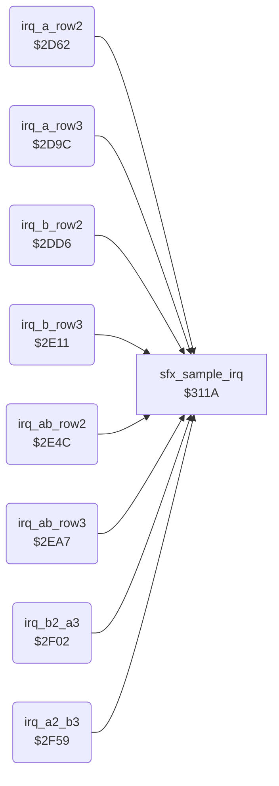

<!-- Generated by c64-docs from knowledge revision 20261021T021734.812-ub0xzr and src/source-map.json. Do not edit: change the knowledge, generate the source again, then run docs.ts generate. -->
# irq_sprite_rows.asm: Raster IRQ handlers for sprite rows 2 and 3 of the two fighters, patched each frame by the planner

Range `$2D62-$2FAF`. Source: [irq_sprite_rows.asm](../../../src/irq_sprite_rows.asm). Index: [the reference](../index.md).

## Call graph

A solid arrow is a call, a thick arrow a table entry, a dotted arrow a jump. Rounded nodes are in this file.

## Names

### [`irq_a_row2`](../../../src/irq_sprite_rows.asm#L6) `$2D62`

*routine*

Raster IRQ one line above sprite row 2 of group A (sprites 0-2). It moves the sprites down to row 2 and sets their row 2 pointers (parts 3-5). The frame-start planner ($3355-$35f1) patches the operands each frame. A CIA1 IRQ goes to sfx_sample_irq.
Reads and clears the CIA1 interrupt flags; bit 7 set means a CIA1 timer B IRQ

- **Referred to by:** [`irq_frame_start`](sprite_mux_plan.md#irq_frame_start) [`$3361`](../../../src/sprite_mux_plan.asm#L199), [`irq_frame_start`](sprite_mux_plan.md#irq_frame_start) [`$3366`](../../../src/sprite_mux_plan.asm#L201), [`irq_frame_start`](sprite_mux_plan.md#irq_frame_start) [`$33E1`](../../../src/sprite_mux_plan.asm#L258), [`irq_frame_start`](sprite_mux_plan.md#irq_frame_start) [`$33E6`](../../../src/sprite_mux_plan.asm#L260), [`irq_frame_start`](sprite_mux_plan.md#irq_frame_start) [`$344A`](../../../src/sprite_mux_plan.asm#L308), [`irq_frame_start`](sprite_mux_plan.md#irq_frame_start) [`$344F`](../../../src/sprite_mux_plan.asm#L310), [`irq_frame_start`](sprite_mux_plan.md#irq_frame_start) [`$3511`](../../../src/sprite_mux_plan.asm#L401), [`irq_frame_start`](sprite_mux_plan.md#irq_frame_start) [`$3516`](../../../src/sprite_mux_plan.asm#L403), [`irq_frame_start`](sprite_mux_plan.md#irq_frame_start) [`$359B`](../../../src/sprite_mux_plan.asm#L464), [`irq_frame_start`](sprite_mux_plan.md#irq_frame_start) [`$35A0`](../../../src/sprite_mux_plan.asm#L466)
- **Calls:** [`sfx_sample_irq`](sfx_sample_player.md#sfx_sample_irq)
- **Reads:** [`CIAICR`](../memory-map.md#CIAICR)
- **Writes:** [`SP0Y`](../memory-map.md#SP0Y), [`SP1Y`](../memory-map.md#SP1Y), [`SP2Y`](../memory-map.md#SP2Y), [`VICIRQ`](../memory-map.md#VICIRQ), [`RASTER`](../memory-map.md#RASTER), [`hw_irq_vector`](../memory-map.md#hw_irq_vector), [`sprite_pointers`](../memory-map.md#sprite_pointers), [`sprite_pointers+1`](../memory-map.md#sprite_pointers), [`sprite_pointers+2`](../memory-map.md#sprite_pointers), [`hw_irq_vector+1`](../memory-map.md#hw_irq_vector)

### [`irq_a_row2_vic`](../../../src/irq_sprite_rows.asm#L11) `$2D6B`

*label*

- **Jumped to from:** [`irq_a_row2`](irq_sprite_rows.md#irq_a_row2) [`$2D65`](../../../src/irq_sprite_rows.asm#L8)

### [`irq_a_row2_y`](../../../src/irq_sprite_rows.asm#L13) `$2D6D-$2D7C`

*variable*

- **Written by:** [`irq_frame_start`](sprite_mux_plan.md#irq_frame_start) [`$339D`](../../../src/sprite_mux_plan.asm#L225), [`irq_frame_start`](sprite_mux_plan.md#irq_frame_start) [`$342B`](../../../src/sprite_mux_plan.asm#L293), [`irq_frame_start`](sprite_mux_plan.md#irq_frame_start) [`$347C`](../../../src/sprite_mux_plan.asm#L330), [`irq_frame_start`](sprite_mux_plan.md#irq_frame_start) [`$354D`](../../../src/sprite_mux_plan.asm#L427), [`irq_frame_start`](sprite_mux_plan.md#irq_frame_start) [`$35DB`](../../../src/sprite_mux_plan.asm#L495)

### [`irq_a_row2_next_line`](../../../src/irq_sprite_rows.asm#L20) `$2D7D-$2D81`

*variable*

- **Written by:** [`irq_frame_start`](sprite_mux_plan.md#irq_frame_start) [`$33B0`](../../../src/sprite_mux_plan.asm#L235), [`irq_frame_start`](sprite_mux_plan.md#irq_frame_start) [`$3419`](../../../src/sprite_mux_plan.asm#L283), [`irq_frame_start`](sprite_mux_plan.md#irq_frame_start) [`$3482`](../../../src/sprite_mux_plan.asm#L333), [`irq_frame_start`](sprite_mux_plan.md#irq_frame_start) [`$3553`](../../../src/sprite_mux_plan.asm#L430), [`irq_frame_start`](sprite_mux_plan.md#irq_frame_start) [`$35E1`](../../../src/sprite_mux_plan.asm#L498)

### [`irq_a_row2_next_lo`](../../../src/irq_sprite_rows.asm#L23) `$2D82-$2D86`

*variable*

- **Written by:** [`irq_frame_start`](sprite_mux_plan.md#irq_frame_start) [`$336D`](../../../src/sprite_mux_plan.asm#L204), [`irq_frame_start`](sprite_mux_plan.md#irq_frame_start) [`$33ED`](../../../src/sprite_mux_plan.asm#L263), [`irq_frame_start`](sprite_mux_plan.md#irq_frame_start) [`$3456`](../../../src/sprite_mux_plan.asm#L313), [`irq_frame_start`](sprite_mux_plan.md#irq_frame_start) [`$351D`](../../../src/sprite_mux_plan.asm#L406), [`irq_frame_start`](sprite_mux_plan.md#irq_frame_start) [`$35A7`](../../../src/sprite_mux_plan.asm#L469)

### [`irq_a_row2_ptr_left`](../../../src/irq_sprite_rows.asm#L26) `$2D87-$2D8B`

*variable*

- **Written by:** [`mux_patch_a_row2`](sprite_mux_patch.md#mux_patch_a_row2) [`$36A7`](../../../src/sprite_mux_patch.asm#L9)

### [`irq_a_row2_ptr_mid`](../../../src/irq_sprite_rows.asm#L29) `$2D8C-$2D90`

*variable*

- **Written by:** [`mux_patch_a_row2`](sprite_mux_patch.md#mux_patch_a_row2) [`$36AC`](../../../src/sprite_mux_patch.asm#L11)

### [`irq_a_row2_ptr_right`](../../../src/irq_sprite_rows.asm#L32) `$2D91-$2D95`

*variable*

- **Written by:** [`mux_patch_a_row2`](sprite_mux_patch.md#mux_patch_a_row2) [`$36B1`](../../../src/sprite_mux_patch.asm#L13)

### [`irq_a_row2_next_hi`](../../../src/irq_sprite_rows.asm#L35) `$2D96-$2D9B`

*variable*

- **Written by:** [`irq_frame_start`](sprite_mux_plan.md#irq_frame_start) [`$3372`](../../../src/sprite_mux_plan.asm#L206), [`irq_frame_start`](sprite_mux_plan.md#irq_frame_start) [`$33F2`](../../../src/sprite_mux_plan.asm#L265), [`irq_frame_start`](sprite_mux_plan.md#irq_frame_start) [`$345B`](../../../src/sprite_mux_plan.asm#L315), [`irq_frame_start`](sprite_mux_plan.md#irq_frame_start) [`$3522`](../../../src/sprite_mux_plan.asm#L408), [`irq_frame_start`](sprite_mux_plan.md#irq_frame_start) [`$35AC`](../../../src/sprite_mux_plan.asm#L471)

### [`irq_a_row3`](../../../src/irq_sprite_rows.asm#L41) `$2D9C`

*routine*

Raster IRQ one line above sprite row 3 of group A (sprites 0-2). It moves the sprites down to row 3 and sets their row 3 pointers (parts 6-8). The frame-start planner ($3355-$35f1) patches the operands each frame. A CIA1 IRQ goes to sfx_sample_irq.
Reads and clears the CIA1 interrupt flags; bit 7 set means a CIA1 timer B IRQ

- **Referred to by:** [`irq_frame_start`](sprite_mux_plan.md#irq_frame_start) [`$3375`](../../../src/sprite_mux_plan.asm#L207), [`irq_frame_start`](sprite_mux_plan.md#irq_frame_start) [`$337A`](../../../src/sprite_mux_plan.asm#L209), [`irq_frame_start`](sprite_mux_plan.md#irq_frame_start) [`$33F5`](../../../src/sprite_mux_plan.asm#L266), [`irq_frame_start`](sprite_mux_plan.md#irq_frame_start) [`$33FA`](../../../src/sprite_mux_plan.asm#L268), [`irq_frame_start`](sprite_mux_plan.md#irq_frame_start) [`$34C0`](../../../src/sprite_mux_plan.asm#L362), [`irq_frame_start`](sprite_mux_plan.md#irq_frame_start) [`$34C5`](../../../src/sprite_mux_plan.asm#L364), [`irq_frame_start`](sprite_mux_plan.md#irq_frame_start) [`$351B`](../../../src/sprite_mux_plan.asm#L405), [`irq_frame_start`](sprite_mux_plan.md#irq_frame_start) [`$3520`](../../../src/sprite_mux_plan.asm#L407), [`irq_frame_start`](sprite_mux_plan.md#irq_frame_start) [`$35A5`](../../../src/sprite_mux_plan.asm#L468), [`irq_frame_start`](sprite_mux_plan.md#irq_frame_start) [`$35AA`](../../../src/sprite_mux_plan.asm#L470)
- **Calls:** [`sfx_sample_irq`](sfx_sample_player.md#sfx_sample_irq)
- **Reads:** [`CIAICR`](../memory-map.md#CIAICR)
- **Writes:** [`SP0Y`](../memory-map.md#SP0Y), [`SP1Y`](../memory-map.md#SP1Y), [`SP2Y`](../memory-map.md#SP2Y), [`VICIRQ`](../memory-map.md#VICIRQ), [`RASTER`](../memory-map.md#RASTER), [`hw_irq_vector`](../memory-map.md#hw_irq_vector), [`sprite_pointers`](../memory-map.md#sprite_pointers), [`sprite_pointers+1`](../memory-map.md#sprite_pointers), [`sprite_pointers+2`](../memory-map.md#sprite_pointers), [`hw_irq_vector+1`](../memory-map.md#hw_irq_vector)

### [`irq_a_row3_vic`](../../../src/irq_sprite_rows.asm#L46) `$2DA5`

*label*

- **Jumped to from:** [`irq_a_row3`](irq_sprite_rows.md#irq_a_row3) [`$2D9F`](../../../src/irq_sprite_rows.asm#L43)

### [`irq_a_row3_y`](../../../src/irq_sprite_rows.asm#L48) `$2DA7-$2DB6`

*variable*

- **Written by:** [`irq_frame_start`](sprite_mux_plan.md#irq_frame_start) [`$33A8`](../../../src/sprite_mux_plan.asm#L231), [`irq_frame_start`](sprite_mux_plan.md#irq_frame_start) [`$3436`](../../../src/sprite_mux_plan.asm#L299), [`irq_frame_start`](sprite_mux_plan.md#irq_frame_start) [`$34FA`](../../../src/sprite_mux_plan.asm#L391), [`irq_frame_start`](sprite_mux_plan.md#irq_frame_start) [`$3558`](../../../src/sprite_mux_plan.asm#L433), [`irq_frame_start`](sprite_mux_plan.md#irq_frame_start) [`$35E6`](../../../src/sprite_mux_plan.asm#L501)

### [`irq_a_row3_next_line`](../../../src/irq_sprite_rows.asm#L55) `$2DB7-$2DBB`

*variable*

- **Written by:** [`irq_frame_start`](sprite_mux_plan.md#irq_frame_start) [`$33BB`](../../../src/sprite_mux_plan.asm#L241), [`irq_frame_start`](sprite_mux_plan.md#irq_frame_start) [`$343B`](../../../src/sprite_mux_plan.asm#L301), [`irq_frame_start`](sprite_mux_plan.md#irq_frame_start) [`$34FF`](../../../src/sprite_mux_plan.asm#L393), [`irq_frame_start`](sprite_mux_plan.md#irq_frame_start) [`$3560`](../../../src/sprite_mux_plan.asm#L437), [`irq_frame_start`](sprite_mux_plan.md#irq_frame_start) [`$35EB`](../../../src/sprite_mux_plan.asm#L503)

### [`irq_a_row3_next_lo`](../../../src/irq_sprite_rows.asm#L58) `$2DBC-$2DC0`

*variable*

- **Written by:** [`irq_frame_start`](sprite_mux_plan.md#irq_frame_start) [`$3381`](../../../src/sprite_mux_plan.asm#L212), [`irq_frame_start`](sprite_mux_plan.md#irq_frame_start) [`$3401`](../../../src/sprite_mux_plan.asm#L271), [`irq_frame_start`](sprite_mux_plan.md#irq_frame_start) [`$34CC`](../../../src/sprite_mux_plan.asm#L367), [`irq_frame_start`](sprite_mux_plan.md#irq_frame_start) [`$3527`](../../../src/sprite_mux_plan.asm#L410), [`irq_frame_start`](sprite_mux_plan.md#irq_frame_start) [`$35B1`](../../../src/sprite_mux_plan.asm#L473)

### [`irq_a_row3_ptr_left`](../../../src/irq_sprite_rows.asm#L61) `$2DC1-$2DC5`

*variable*

- **Written by:** [`mux_patch_a_row3`](sprite_mux_patch.md#mux_patch_a_row3) [`$36B9`](../../../src/sprite_mux_patch.asm#L19)

### [`irq_a_row3_ptr_mid`](../../../src/irq_sprite_rows.asm#L64) `$2DC6-$2DCA`

*variable*

- **Written by:** [`mux_patch_a_row3`](sprite_mux_patch.md#mux_patch_a_row3) [`$36BE`](../../../src/sprite_mux_patch.asm#L21)

### [`irq_a_row3_ptr_right`](../../../src/irq_sprite_rows.asm#L67) `$2DCB-$2DCF`

*variable*

- **Written by:** [`mux_patch_a_row3`](sprite_mux_patch.md#mux_patch_a_row3) [`$36C3`](../../../src/sprite_mux_patch.asm#L23)

### [`irq_a_row3_next_hi`](../../../src/irq_sprite_rows.asm#L70) `$2DD0-$2DD5`

*variable*

- **Written by:** [`irq_frame_start`](sprite_mux_plan.md#irq_frame_start) [`$3386`](../../../src/sprite_mux_plan.asm#L214), [`irq_frame_start`](sprite_mux_plan.md#irq_frame_start) [`$3406`](../../../src/sprite_mux_plan.asm#L273), [`irq_frame_start`](sprite_mux_plan.md#irq_frame_start) [`$34D1`](../../../src/sprite_mux_plan.asm#L369), [`irq_frame_start`](sprite_mux_plan.md#irq_frame_start) [`$352C`](../../../src/sprite_mux_plan.asm#L412), [`irq_frame_start`](sprite_mux_plan.md#irq_frame_start) [`$35B6`](../../../src/sprite_mux_plan.asm#L475)

### [`irq_b_row2`](../../../src/irq_sprite_rows.asm#L76) `$2DD6`

*routine*

Raster IRQ one line above sprite row 2 of group B (sprites 3-5). It moves the sprites down to row 2 and sets their row 2 pointers (parts 3-5). The frame-start planner ($3355-$35f1) patches the operands each frame. A CIA1 IRQ goes to sfx_sample_irq.
Reads and clears the CIA1 interrupt flags; bit 7 set means a CIA1 timer B IRQ

- **Referred to by:** [`irq_frame_start`](sprite_mux_plan.md#irq_frame_start) [`$336B`](../../../src/sprite_mux_plan.asm#L203), [`irq_frame_start`](sprite_mux_plan.md#irq_frame_start) [`$3370`](../../../src/sprite_mux_plan.asm#L205), [`irq_frame_start`](sprite_mux_plan.md#irq_frame_start) [`$33D7`](../../../src/sprite_mux_plan.asm#L254), [`irq_frame_start`](sprite_mux_plan.md#irq_frame_start) [`$33DC`](../../../src/sprite_mux_plan.asm#L256), [`irq_frame_start`](sprite_mux_plan.md#irq_frame_start) [`$34AC`](../../../src/sprite_mux_plan.asm#L354), [`irq_frame_start`](sprite_mux_plan.md#irq_frame_start) [`$34B1`](../../../src/sprite_mux_plan.asm#L356), [`irq_frame_start`](sprite_mux_plan.md#irq_frame_start) [`$3525`](../../../src/sprite_mux_plan.asm#L409), [`irq_frame_start`](sprite_mux_plan.md#irq_frame_start) [`$352A`](../../../src/sprite_mux_plan.asm#L411), [`irq_frame_start`](sprite_mux_plan.md#irq_frame_start) [`$3587`](../../../src/sprite_mux_plan.asm#L456), [`irq_frame_start`](sprite_mux_plan.md#irq_frame_start) [`$358C`](../../../src/sprite_mux_plan.asm#L458)
- **Calls:** [`sfx_sample_irq`](sfx_sample_player.md#sfx_sample_irq)
- **Reads:** [`CIAICR`](../memory-map.md#CIAICR)
- **Writes:** [`SP3Y`](../memory-map.md#SP3Y), [`SP4Y`](../memory-map.md#SP4Y), [`SP5Y`](../memory-map.md#SP5Y), [`VICIRQ`](../memory-map.md#VICIRQ), [`RASTER`](../memory-map.md#RASTER), [`hw_irq_vector`](../memory-map.md#hw_irq_vector), [`sprite_pointers+3`](../memory-map.md#sprite_pointers), [`sprite_pointers+4`](../memory-map.md#sprite_pointers), [`sprite_pointers+5`](../memory-map.md#sprite_pointers), [`hw_irq_vector+1`](../memory-map.md#hw_irq_vector)

### [`irq_b_row2_vic`](../../../src/irq_sprite_rows.asm#L81) `$2DDF`

*label*

- **Jumped to from:** [`irq_b_row2`](irq_sprite_rows.md#irq_b_row2) [`$2DD9`](../../../src/irq_sprite_rows.asm#L78)

### [`irq_b_row2_y`](../../../src/irq_sprite_rows.asm#L83) `$2DE1-$2DF0`

*variable*

- **Written by:** [`irq_frame_start`](sprite_mux_plan.md#irq_frame_start) [`$33B5`](../../../src/sprite_mux_plan.asm#L238), [`irq_frame_start`](sprite_mux_plan.md#irq_frame_start) [`$3413`](../../../src/sprite_mux_plan.asm#L280), [`irq_frame_start`](sprite_mux_plan.md#irq_frame_start) [`$34DE`](../../../src/sprite_mux_plan.asm#L376), [`irq_frame_start`](sprite_mux_plan.md#irq_frame_start) [`$3565`](../../../src/sprite_mux_plan.asm#L440), [`irq_frame_start`](sprite_mux_plan.md#irq_frame_start) [`$35C3`](../../../src/sprite_mux_plan.asm#L482)

### [`irq_b_row2_next_line`](../../../src/irq_sprite_rows.asm#L90) `$2DF1-$2DF5`

*variable*

- **Written by:** [`irq_frame_start`](sprite_mux_plan.md#irq_frame_start) [`$33A3`](../../../src/sprite_mux_plan.asm#L228), [`irq_frame_start`](sprite_mux_plan.md#irq_frame_start) [`$3426`](../../../src/sprite_mux_plan.asm#L290), [`irq_frame_start`](sprite_mux_plan.md#irq_frame_start) [`$34E4`](../../../src/sprite_mux_plan.asm#L379), [`irq_frame_start`](sprite_mux_plan.md#irq_frame_start) [`$356B`](../../../src/sprite_mux_plan.asm#L443), [`irq_frame_start`](sprite_mux_plan.md#irq_frame_start) [`$35C9`](../../../src/sprite_mux_plan.asm#L485)

### [`irq_b_row2_next_lo`](../../../src/irq_sprite_rows.asm#L93) `$2DF6-$2DFB`

*variable*

- **Written by:** [`irq_frame_start`](sprite_mux_plan.md#irq_frame_start) [`$3377`](../../../src/sprite_mux_plan.asm#L208), [`irq_frame_start`](sprite_mux_plan.md#irq_frame_start) [`$33E3`](../../../src/sprite_mux_plan.asm#L259), [`irq_frame_start`](sprite_mux_plan.md#irq_frame_start) [`$34B8`](../../../src/sprite_mux_plan.asm#L359), [`irq_frame_start`](sprite_mux_plan.md#irq_frame_start) [`$3531`](../../../src/sprite_mux_plan.asm#L414), [`irq_frame_start`](sprite_mux_plan.md#irq_frame_start) [`$3593`](../../../src/sprite_mux_plan.asm#L461)

### [`irq_b_row2_ptr_left`](../../../src/irq_sprite_rows.asm#L97) `$2DFC-$2E00`

*variable*

- **Written by:** [`mux_patch_b_row2`](sprite_mux_patch.md#mux_patch_b_row2) [`$36CB`](../../../src/sprite_mux_patch.asm#L29)

### [`irq_b_row2_ptr_mid`](../../../src/irq_sprite_rows.asm#L100) `$2E01-$2E05`

*variable*

- **Written by:** [`mux_patch_b_row2`](sprite_mux_patch.md#mux_patch_b_row2) [`$36D0`](../../../src/sprite_mux_patch.asm#L31)

### [`irq_b_row2_ptr_right`](../../../src/irq_sprite_rows.asm#L103) `$2E06-$2E0A`

*variable*

- **Written by:** [`mux_patch_b_row2`](sprite_mux_patch.md#mux_patch_b_row2) [`$36D5`](../../../src/sprite_mux_patch.asm#L33)

### [`irq_b_row2_next_hi`](../../../src/irq_sprite_rows.asm#L106) `$2E0B-$2E10`

*variable*

- **Written by:** [`irq_frame_start`](sprite_mux_plan.md#irq_frame_start) [`$337C`](../../../src/sprite_mux_plan.asm#L210), [`irq_frame_start`](sprite_mux_plan.md#irq_frame_start) [`$33E8`](../../../src/sprite_mux_plan.asm#L261), [`irq_frame_start`](sprite_mux_plan.md#irq_frame_start) [`$34BD`](../../../src/sprite_mux_plan.asm#L361), [`irq_frame_start`](sprite_mux_plan.md#irq_frame_start) [`$3536`](../../../src/sprite_mux_plan.asm#L416), [`irq_frame_start`](sprite_mux_plan.md#irq_frame_start) [`$3598`](../../../src/sprite_mux_plan.asm#L463)

### [`irq_b_row3`](../../../src/irq_sprite_rows.asm#L112) `$2E11`

*routine*

Raster IRQ one line above sprite row 3 of group B (sprites 3-5). It moves the sprites down to row 3 and sets their row 3 pointers (parts 6-8). The frame-start planner ($3355-$35f1) patches the operands each frame. A CIA1 IRQ goes to sfx_sample_irq.
Reads and clears the CIA1 interrupt flags; bit 7 set means a CIA1 timer B IRQ

- **Referred to by:** [`irq_frame_start`](sprite_mux_plan.md#irq_frame_start) [`$337F`](../../../src/sprite_mux_plan.asm#L211), [`irq_frame_start`](sprite_mux_plan.md#irq_frame_start) [`$3384`](../../../src/sprite_mux_plan.asm#L213), [`irq_frame_start`](sprite_mux_plan.md#irq_frame_start) [`$33EB`](../../../src/sprite_mux_plan.asm#L262), [`irq_frame_start`](sprite_mux_plan.md#irq_frame_start) [`$33F0`](../../../src/sprite_mux_plan.asm#L264), [`irq_frame_start`](sprite_mux_plan.md#irq_frame_start) [`$345E`](../../../src/sprite_mux_plan.asm#L316), [`irq_frame_start`](sprite_mux_plan.md#irq_frame_start) [`$3463`](../../../src/sprite_mux_plan.asm#L318), [`irq_frame_start`](sprite_mux_plan.md#irq_frame_start) [`$352F`](../../../src/sprite_mux_plan.asm#L413), [`irq_frame_start`](sprite_mux_plan.md#irq_frame_start) [`$3534`](../../../src/sprite_mux_plan.asm#L415), [`irq_frame_start`](sprite_mux_plan.md#irq_frame_start) [`$3591`](../../../src/sprite_mux_plan.asm#L460), [`irq_frame_start`](sprite_mux_plan.md#irq_frame_start) [`$3596`](../../../src/sprite_mux_plan.asm#L462)
- **Calls:** [`sfx_sample_irq`](sfx_sample_player.md#sfx_sample_irq)
- **Reads:** [`CIAICR`](../memory-map.md#CIAICR)
- **Writes:** [`SP3Y`](../memory-map.md#SP3Y), [`SP4Y`](../memory-map.md#SP4Y), [`SP5Y`](../memory-map.md#SP5Y), [`VICIRQ`](../memory-map.md#VICIRQ), [`RASTER`](../memory-map.md#RASTER), [`hw_irq_vector`](../memory-map.md#hw_irq_vector), [`sprite_pointers+3`](../memory-map.md#sprite_pointers), [`sprite_pointers+4`](../memory-map.md#sprite_pointers), [`sprite_pointers+5`](../memory-map.md#sprite_pointers), [`hw_irq_vector+1`](../memory-map.md#hw_irq_vector)

### [`irq_b_row3_vic`](../../../src/irq_sprite_rows.asm#L117) `$2E1A`

*label*

- **Jumped to from:** [`irq_b_row3`](irq_sprite_rows.md#irq_b_row3) [`$2E14`](../../../src/irq_sprite_rows.asm#L114)

### [`irq_b_row3_y`](../../../src/irq_sprite_rows.asm#L119) `$2E1C-$2E2B`

*variable*

- **Written by:** [`irq_frame_start`](sprite_mux_plan.md#irq_frame_start) [`$33C0`](../../../src/sprite_mux_plan.asm#L244), [`irq_frame_start`](sprite_mux_plan.md#irq_frame_start) [`$341E`](../../../src/sprite_mux_plan.asm#L286), [`irq_frame_start`](sprite_mux_plan.md#irq_frame_start) [`$3498`](../../../src/sprite_mux_plan.asm#L345), [`irq_frame_start`](sprite_mux_plan.md#irq_frame_start) [`$3570`](../../../src/sprite_mux_plan.asm#L446), [`irq_frame_start`](sprite_mux_plan.md#irq_frame_start) [`$35CE`](../../../src/sprite_mux_plan.asm#L488)

### [`irq_b_row3_next_line`](../../../src/irq_sprite_rows.asm#L126) `$2E2C-$2E30`

*variable*

- **Written by:** [`irq_frame_start`](sprite_mux_plan.md#irq_frame_start) [`$33C5`](../../../src/sprite_mux_plan.asm#L246), [`irq_frame_start`](sprite_mux_plan.md#irq_frame_start) [`$3431`](../../../src/sprite_mux_plan.asm#L296), [`irq_frame_start`](sprite_mux_plan.md#irq_frame_start) [`$349D`](../../../src/sprite_mux_plan.asm#L347), [`irq_frame_start`](sprite_mux_plan.md#irq_frame_start) [`$3575`](../../../src/sprite_mux_plan.asm#L448), [`irq_frame_start`](sprite_mux_plan.md#irq_frame_start) [`$35D6`](../../../src/sprite_mux_plan.asm#L492)

### [`irq_b_row3_next_lo`](../../../src/irq_sprite_rows.asm#L129) `$2E31-$2E36`

*variable*

- **Written by:** [`irq_frame_start`](sprite_mux_plan.md#irq_frame_start) [`$338B`](../../../src/sprite_mux_plan.asm#L216), [`irq_frame_start`](sprite_mux_plan.md#irq_frame_start) [`$33F7`](../../../src/sprite_mux_plan.asm#L267), [`irq_frame_start`](sprite_mux_plan.md#irq_frame_start) [`$346A`](../../../src/sprite_mux_plan.asm#L321), [`irq_frame_start`](sprite_mux_plan.md#irq_frame_start) [`$353B`](../../../src/sprite_mux_plan.asm#L418), [`irq_frame_start`](sprite_mux_plan.md#irq_frame_start) [`$359D`](../../../src/sprite_mux_plan.asm#L465)

### [`irq_b_row3_ptr_left`](../../../src/irq_sprite_rows.asm#L133) `$2E37-$2E3B`

*variable*

- **Written by:** [`mux_patch_b_row3`](sprite_mux_patch.md#mux_patch_b_row3) [`$36DD`](../../../src/sprite_mux_patch.asm#L39)

### [`irq_b_row3_ptr_mid`](../../../src/irq_sprite_rows.asm#L136) `$2E3C-$2E40`

*variable*

- **Written by:** [`mux_patch_b_row3`](sprite_mux_patch.md#mux_patch_b_row3) [`$36E2`](../../../src/sprite_mux_patch.asm#L41)

### [`irq_b_row3_ptr_right`](../../../src/irq_sprite_rows.asm#L139) `$2E41-$2E45`

*variable*

- **Written by:** [`mux_patch_b_row3`](sprite_mux_patch.md#mux_patch_b_row3) [`$36E7`](../../../src/sprite_mux_patch.asm#L43)

### [`irq_b_row3_next_hi`](../../../src/irq_sprite_rows.asm#L142) `$2E46-$2E4B`

*variable*

- **Written by:** [`irq_frame_start`](sprite_mux_plan.md#irq_frame_start) [`$3390`](../../../src/sprite_mux_plan.asm#L218), [`irq_frame_start`](sprite_mux_plan.md#irq_frame_start) [`$33FC`](../../../src/sprite_mux_plan.asm#L269), [`irq_frame_start`](sprite_mux_plan.md#irq_frame_start) [`$346F`](../../../src/sprite_mux_plan.asm#L323), [`irq_frame_start`](sprite_mux_plan.md#irq_frame_start) [`$3540`](../../../src/sprite_mux_plan.asm#L420), [`irq_frame_start`](sprite_mux_plan.md#irq_frame_start) [`$35A2`](../../../src/sprite_mux_plan.asm#L467)

### [`irq_ab_row2`](../../../src/irq_sprite_rows.asm#L148) `$2E4C`

*routine*

Raster IRQ before sprite row 2 when both groups have the same Y. The IRQ comes at group_y + $12 and waits for line group_y + $14. Then it moves sprites 0-5 to row 2 and sets the six row 2 pointers. The raster wait is new in v2. The planner at $3307 patches the lines, the helper $36eb the pointers.
Reads and clears the CIA1 interrupt flags; bit 7 set means a CIA1 timer B IRQ

- **Referred to by:** [`irq_frame_start`](sprite_mux_plan.md#irq_frame_start) [`$330D`](../../../src/sprite_mux_plan.asm#L159), [`irq_frame_start`](sprite_mux_plan.md#irq_frame_start) [`$3312`](../../../src/sprite_mux_plan.asm#L161)
- **Calls:** [`sfx_sample_irq`](sfx_sample_player.md#sfx_sample_irq)
- **Reads:** [`CIAICR`](../memory-map.md#CIAICR), [`RASTER`](../memory-map.md#RASTER)
- **Writes:** [`SP0Y`](../memory-map.md#SP0Y), [`SP1Y`](../memory-map.md#SP1Y), [`SP2Y`](../memory-map.md#SP2Y), [`SP3Y`](../memory-map.md#SP3Y), [`SP4Y`](../memory-map.md#SP4Y), [`SP5Y`](../memory-map.md#SP5Y), [`VICIRQ`](../memory-map.md#VICIRQ), [`RASTER`](../memory-map.md#RASTER), [`sprite_pointers`](../memory-map.md#sprite_pointers), [`sprite_pointers+1`](../memory-map.md#sprite_pointers), [`sprite_pointers+2`](../memory-map.md#sprite_pointers), [`sprite_pointers+3`](../memory-map.md#sprite_pointers), [`sprite_pointers+4`](../memory-map.md#sprite_pointers), [`sprite_pointers+5`](../memory-map.md#sprite_pointers), [`hw_irq_vector`](../memory-map.md#hw_irq_vector), [`hw_irq_vector+1`](../memory-map.md#hw_irq_vector)

### [`irq_ab_row2_vic`](../../../src/irq_sprite_rows.asm#L153) `$2E55`

*label*

- **Jumped to from:** [`irq_ab_row2`](irq_sprite_rows.md#irq_ab_row2) [`$2E4F`](../../../src/irq_sprite_rows.asm#L150)

### [`irq_ab_row2_wait_line`](../../../src/irq_sprite_rows.asm#L155) `$2E57`

*variable*

- **Written by:** [`irq_frame_start`](sprite_mux_plan.md#irq_frame_start) [`$3336`](../../../src/sprite_mux_plan.asm#L178)

### [`irq_ab_row2_wait`](../../../src/irq_sprite_rows.asm#L157) `$2E58`

*label*

Waits for the patched raster line

- **Jumped to from:** [`irq_ab_row2`](irq_sprite_rows.md#irq_ab_row2) [`$2E5B`](../../../src/irq_sprite_rows.asm#L159)

### [`irq_ab_row2_y`](../../../src/irq_sprite_rows.asm#L160) `$2E5E-$2E76`

*variable*

- **Written by:** [`irq_frame_start`](sprite_mux_plan.md#irq_frame_start) [`$333A`](../../../src/sprite_mux_plan.asm#L180)

### [`irq_ab_row2_next_line`](../../../src/irq_sprite_rows.asm#L170) `$2E77-$2E7D`

*variable*

- **Written by:** [`irq_frame_start`](sprite_mux_plan.md#irq_frame_start) [`$3340`](../../../src/sprite_mux_plan.asm#L183)

### [`irq_ab_row2_a_ptr_left`](../../../src/irq_sprite_rows.asm#L175) `$2E7E-$2E82`

*variable*

- **Written by:** [`mux_patch_ab_row2`](sprite_mux_patch.md#mux_patch_ab_row2) [`$36EF`](../../../src/sprite_mux_patch.asm#L49)

### [`irq_ab_row2_a_ptr_mid`](../../../src/irq_sprite_rows.asm#L178) `$2E83-$2E87`

*variable*

- **Written by:** [`mux_patch_ab_row2`](sprite_mux_patch.md#mux_patch_ab_row2) [`$36F4`](../../../src/sprite_mux_patch.asm#L51)

### [`irq_ab_row2_a_ptr_right`](../../../src/irq_sprite_rows.asm#L181) `$2E88-$2E8C`

*variable*

- **Written by:** [`mux_patch_ab_row2`](sprite_mux_patch.md#mux_patch_ab_row2) [`$36F9`](../../../src/sprite_mux_patch.asm#L53)

### [`irq_ab_row2_b_ptr_left`](../../../src/irq_sprite_rows.asm#L184) `$2E8D-$2E91`

*variable*

- **Written by:** [`mux_patch_ab_row2`](sprite_mux_patch.md#mux_patch_ab_row2) [`$3700`](../../../src/sprite_mux_patch.asm#L56)

### [`irq_ab_row2_b_ptr_mid`](../../../src/irq_sprite_rows.asm#L187) `$2E92-$2E96`

*variable*

- **Written by:** [`mux_patch_ab_row2`](sprite_mux_patch.md#mux_patch_ab_row2) [`$3705`](../../../src/sprite_mux_patch.asm#L58)

### [`irq_ab_row2_b_ptr_right`](../../../src/irq_sprite_rows.asm#L190) `$2E97-$2E9B`

*variable*

- **Written by:** [`mux_patch_ab_row2`](sprite_mux_patch.md#mux_patch_ab_row2) [`$370A`](../../../src/sprite_mux_patch.asm#L60)

### [`irq_ab_row2_next_lo`](../../../src/irq_sprite_rows.asm#L193) `$2E9C-$2EA0`

*variable*

- **Written by:** [`irq_frame_start`](sprite_mux_plan.md#irq_frame_start) [`$3319`](../../../src/sprite_mux_plan.asm#L164)

### [`irq_ab_row2_next_hi`](../../../src/irq_sprite_rows.asm#L196) `$2EA1-$2EA6`

*variable*

- **Written by:** [`irq_frame_start`](sprite_mux_plan.md#irq_frame_start) [`$331E`](../../../src/sprite_mux_plan.asm#L166)

### [`irq_ab_row3`](../../../src/irq_sprite_rows.asm#L202) `$2EA7`

*routine*

Raster IRQ before sprite row 3 when both groups have the same Y. The IRQ comes at group_y + $27 and waits for line group_y + $29. Then it moves sprites 0-5 to row 3 and sets the six row 3 pointers. The raster wait is new in v2. The planner at $3307 patches the lines, the helper $370e the pointers.
Reads and clears the CIA1 interrupt flags; bit 7 set means a CIA1 timer B IRQ

- **Referred to by:** [`irq_frame_start`](sprite_mux_plan.md#irq_frame_start) [`$3317`](../../../src/sprite_mux_plan.asm#L163), [`irq_frame_start`](sprite_mux_plan.md#irq_frame_start) [`$331C`](../../../src/sprite_mux_plan.asm#L165)
- **Calls:** [`sfx_sample_irq`](sfx_sample_player.md#sfx_sample_irq)
- **Reads:** [`CIAICR`](../memory-map.md#CIAICR), [`RASTER`](../memory-map.md#RASTER)
- **Writes:** [`SP0Y`](../memory-map.md#SP0Y), [`SP1Y`](../memory-map.md#SP1Y), [`SP2Y`](../memory-map.md#SP2Y), [`SP3Y`](../memory-map.md#SP3Y), [`SP4Y`](../memory-map.md#SP4Y), [`SP5Y`](../memory-map.md#SP5Y), [`VICIRQ`](../memory-map.md#VICIRQ), [`RASTER`](../memory-map.md#RASTER), [`sprite_pointers`](../memory-map.md#sprite_pointers), [`sprite_pointers+1`](../memory-map.md#sprite_pointers), [`sprite_pointers+2`](../memory-map.md#sprite_pointers), [`sprite_pointers+3`](../memory-map.md#sprite_pointers), [`sprite_pointers+4`](../memory-map.md#sprite_pointers), [`sprite_pointers+5`](../memory-map.md#sprite_pointers), [`hw_irq_vector`](../memory-map.md#hw_irq_vector), [`hw_irq_vector+1`](../memory-map.md#hw_irq_vector)

### [`irq_ab_row3_vic`](../../../src/irq_sprite_rows.asm#L207) `$2EB0`

*label*

- **Jumped to from:** [`irq_ab_row3`](irq_sprite_rows.md#irq_ab_row3) [`$2EAA`](../../../src/irq_sprite_rows.asm#L204)

### [`irq_ab_row3_wait_line`](../../../src/irq_sprite_rows.asm#L209) `$2EB2`

*variable*

- **Written by:** [`irq_frame_start`](sprite_mux_plan.md#irq_frame_start) [`$3346`](../../../src/sprite_mux_plan.asm#L187)

### [`irq_ab_row3_wait`](../../../src/irq_sprite_rows.asm#L211) `$2EB3`

*label*

Waits for the patched raster line

- **Jumped to from:** [`irq_ab_row3`](irq_sprite_rows.md#irq_ab_row3) [`$2EB6`](../../../src/irq_sprite_rows.asm#L213)

### [`irq_ab_row3_y`](../../../src/irq_sprite_rows.asm#L214) `$2EB9-$2ED1`

*variable*

- **Written by:** [`irq_frame_start`](sprite_mux_plan.md#irq_frame_start) [`$334A`](../../../src/sprite_mux_plan.asm#L189)

### [`irq_ab_row3_next_line`](../../../src/irq_sprite_rows.asm#L224) `$2ED2-$2ED8`

*variable*

- **Written by:** [`irq_frame_start`](sprite_mux_plan.md#irq_frame_start) [`$334F`](../../../src/sprite_mux_plan.asm#L191)

### [`irq_ab_row3_a_ptr_left`](../../../src/irq_sprite_rows.asm#L229) `$2ED9-$2EDD`

*variable*

- **Written by:** [`mux_patch_ab_row3`](sprite_mux_patch.md#mux_patch_ab_row3) [`$3712`](../../../src/sprite_mux_patch.asm#L66)

### [`irq_ab_row3_a_ptr_mid`](../../../src/irq_sprite_rows.asm#L232) `$2EDE-$2EE2`

*variable*

- **Written by:** [`mux_patch_ab_row3`](sprite_mux_patch.md#mux_patch_ab_row3) [`$3717`](../../../src/sprite_mux_patch.asm#L68)

### [`irq_ab_row3_a_ptr_right`](../../../src/irq_sprite_rows.asm#L235) `$2EE3-$2EE7`

*variable*

- **Written by:** [`mux_patch_ab_row3`](sprite_mux_patch.md#mux_patch_ab_row3) [`$371C`](../../../src/sprite_mux_patch.asm#L70)

### [`irq_ab_row3_b_ptr_left`](../../../src/irq_sprite_rows.asm#L238) `$2EE8-$2EEC`

*variable*

- **Written by:** [`mux_patch_ab_row3`](sprite_mux_patch.md#mux_patch_ab_row3) [`$3723`](../../../src/sprite_mux_patch.asm#L73)

### [`irq_ab_row3_b_ptr_mid`](../../../src/irq_sprite_rows.asm#L241) `$2EED-$2EF1`

*variable*

- **Written by:** [`mux_patch_ab_row3`](sprite_mux_patch.md#mux_patch_ab_row3) [`$3728`](../../../src/sprite_mux_patch.asm#L75)

### [`irq_ab_row3_b_ptr_right`](../../../src/irq_sprite_rows.asm#L244) `$2EF2-$2EF6`

*variable*

- **Written by:** [`mux_patch_ab_row3`](sprite_mux_patch.md#mux_patch_ab_row3) [`$372D`](../../../src/sprite_mux_patch.asm#L77)

### [`irq_ab_row3_next_lo`](../../../src/irq_sprite_rows.asm#L247) `$2EF7-$2EFB`

*variable*

- **Written by:** [`irq_frame_start`](sprite_mux_plan.md#irq_frame_start) [`$3323`](../../../src/sprite_mux_plan.asm#L168)

### [`irq_ab_row3_next_hi`](../../../src/irq_sprite_rows.asm#L250) `$2EFC-$2F01`

*variable*

- **Written by:** [`irq_frame_start`](sprite_mux_plan.md#irq_frame_start) [`$3328`](../../../src/sprite_mux_plan.asm#L170)

### [`irq_b2_a3`](../../../src/irq_sprite_rows.asm#L256) `$2F02`

*routine*

Raster IRQ for group B row 2 and group A row 3 together, when group B is exactly $14 lines below group A. The two rows start one line apart, too close for two IRQs. The planner at $3441 patches it, the helper $3731 the pointers.
Reads and clears the CIA1 interrupt flags; bit 7 set means a CIA1 timer B IRQ

- **Referred to by:** [`irq_frame_start`](sprite_mux_plan.md#irq_frame_start) [`$3454`](../../../src/sprite_mux_plan.asm#L312), [`irq_frame_start`](sprite_mux_plan.md#irq_frame_start) [`$3459`](../../../src/sprite_mux_plan.asm#L314)
- **Calls:** [`sfx_sample_irq`](sfx_sample_player.md#sfx_sample_irq)
- **Reads:** [`CIAICR`](../memory-map.md#CIAICR)
- **Writes:** [`SP3Y`](../memory-map.md#SP3Y), [`SP4Y`](../memory-map.md#SP4Y), [`SP5Y`](../memory-map.md#SP5Y), [`SP0Y`](../memory-map.md#SP0Y), [`SP1Y`](../memory-map.md#SP1Y), [`SP2Y`](../memory-map.md#SP2Y), [`VICIRQ`](../memory-map.md#VICIRQ), [`RASTER`](../memory-map.md#RASTER), [`hw_irq_vector`](../memory-map.md#hw_irq_vector), [`hw_irq_vector+1`](../memory-map.md#hw_irq_vector), [`sprite_pointers+3`](../memory-map.md#sprite_pointers), [`sprite_pointers+4`](../memory-map.md#sprite_pointers), [`sprite_pointers+5`](../memory-map.md#sprite_pointers), [`sprite_pointers`](../memory-map.md#sprite_pointers), [`sprite_pointers+1`](../memory-map.md#sprite_pointers), [`sprite_pointers+2`](../memory-map.md#sprite_pointers)

### [`irq_b2_a3_vic`](../../../src/irq_sprite_rows.asm#L261) `$2F0B`

*label*

- **Jumped to from:** [`irq_b2_a3`](irq_sprite_rows.md#irq_b2_a3) [`$2F05`](../../../src/irq_sprite_rows.asm#L258)

### [`irq_b2_a3_b_y`](../../../src/irq_sprite_rows.asm#L263) `$2F0D-$2F17`

*variable*

- **Written by:** [`irq_frame_start`](sprite_mux_plan.md#irq_frame_start) [`$3487`](../../../src/sprite_mux_plan.asm#L336)

### [`irq_b2_a3_a_y`](../../../src/irq_sprite_rows.asm#L268) `$2F18-$2F27`

*variable*

- **Written by:** [`irq_frame_start`](sprite_mux_plan.md#irq_frame_start) [`$348B`](../../../src/sprite_mux_plan.asm#L338)

### [`irq_b2_a3_next_line`](../../../src/irq_sprite_rows.asm#L275) `$2F28-$2F2C`

*variable*

- **Written by:** [`irq_frame_start`](sprite_mux_plan.md#irq_frame_start) [`$3493`](../../../src/sprite_mux_plan.asm#L342)

### [`irq_b2_a3_next_lo`](../../../src/irq_sprite_rows.asm#L278) `$2F2D-$2F31`

*variable*

- **Written by:** [`irq_frame_start`](sprite_mux_plan.md#irq_frame_start) [`$3460`](../../../src/sprite_mux_plan.asm#L317)

### [`irq_b2_a3_next_hi`](../../../src/irq_sprite_rows.asm#L281) `$2F32-$2F36`

*variable*

- **Written by:** [`irq_frame_start`](sprite_mux_plan.md#irq_frame_start) [`$3465`](../../../src/sprite_mux_plan.asm#L319)

### [`irq_b2_a3_b_ptr_left`](../../../src/irq_sprite_rows.asm#L284) `$2F37-$2F3B`

*variable*

- **Written by:** [`mux_patch_b2_a3`](sprite_mux_patch.md#mux_patch_b2_a3) [`$3746`](../../../src/sprite_mux_patch.asm#L90)

### [`irq_b2_a3_b_ptr_mid`](../../../src/irq_sprite_rows.asm#L287) `$2F3C-$2F40`

*variable*

- **Written by:** [`mux_patch_b2_a3`](sprite_mux_patch.md#mux_patch_b2_a3) [`$374B`](../../../src/sprite_mux_patch.asm#L92)

### [`irq_b2_a3_b_ptr_right`](../../../src/irq_sprite_rows.asm#L290) `$2F41-$2F48`

*variable*

- **Written by:** [`mux_patch_b2_a3`](sprite_mux_patch.md#mux_patch_b2_a3) [`$3750`](../../../src/sprite_mux_patch.asm#L94)

### [`irq_b2_a3_a_ptr_left`](../../../src/irq_sprite_rows.asm#L296) `$2F49-$2F4D`

*variable*

- **Written by:** [`mux_patch_b2_a3`](sprite_mux_patch.md#mux_patch_b2_a3) [`$3735`](../../../src/sprite_mux_patch.asm#L83)

### [`irq_b2_a3_a_ptr_mid`](../../../src/irq_sprite_rows.asm#L299) `$2F4E-$2F52`

*variable*

- **Written by:** [`mux_patch_b2_a3`](sprite_mux_patch.md#mux_patch_b2_a3) [`$373A`](../../../src/sprite_mux_patch.asm#L85)

### [`irq_b2_a3_a_ptr_right`](../../../src/irq_sprite_rows.asm#L302) `$2F53-$2F58`

*variable*

- **Written by:** [`mux_patch_b2_a3`](sprite_mux_patch.md#mux_patch_b2_a3) [`$373F`](../../../src/sprite_mux_patch.asm#L87)

### [`irq_a2_b3`](../../../src/irq_sprite_rows.asm#L308) `$2F59`

*routine*

Raster IRQ for group A row 2 and group B row 3 together, when group A is exactly $14 lines below group B. The two rows start one line apart, too close for two IRQs. The planner at $34a3 patches it, the helper $3777 the pointers.
Reads and clears the CIA1 interrupt flags; bit 7 set means a CIA1 timer B IRQ

- **Referred to by:** [`irq_frame_start`](sprite_mux_plan.md#irq_frame_start) [`$34B6`](../../../src/sprite_mux_plan.asm#L358), [`irq_frame_start`](sprite_mux_plan.md#irq_frame_start) [`$34BB`](../../../src/sprite_mux_plan.asm#L360)
- **Calls:** [`sfx_sample_irq`](sfx_sample_player.md#sfx_sample_irq)
- **Reads:** [`CIAICR`](../memory-map.md#CIAICR)
- **Writes:** [`SP0Y`](../memory-map.md#SP0Y), [`SP1Y`](../memory-map.md#SP1Y), [`SP2Y`](../memory-map.md#SP2Y), [`SP3Y`](../memory-map.md#SP3Y), [`SP4Y`](../memory-map.md#SP4Y), [`SP5Y`](../memory-map.md#SP5Y), [`VICIRQ`](../memory-map.md#VICIRQ), [`RASTER`](../memory-map.md#RASTER), [`hw_irq_vector`](../memory-map.md#hw_irq_vector), [`hw_irq_vector+1`](../memory-map.md#hw_irq_vector), [`sprite_pointers`](../memory-map.md#sprite_pointers), [`sprite_pointers+1`](../memory-map.md#sprite_pointers), [`sprite_pointers+2`](../memory-map.md#sprite_pointers), [`sprite_pointers+3`](../memory-map.md#sprite_pointers), [`sprite_pointers+4`](../memory-map.md#sprite_pointers), [`sprite_pointers+5`](../memory-map.md#sprite_pointers)

### [`irq_a2_b3_vic`](../../../src/irq_sprite_rows.asm#L313) `$2F62`

*label*

- **Jumped to from:** [`irq_a2_b3`](irq_sprite_rows.md#irq_a2_b3) [`$2F5C`](../../../src/irq_sprite_rows.asm#L310)

### [`irq_a2_b3_a_y`](../../../src/irq_sprite_rows.asm#L315) `$2F64-$2F6E`

*variable*

- **Written by:** [`irq_frame_start`](sprite_mux_plan.md#irq_frame_start) [`$34E9`](../../../src/sprite_mux_plan.asm#L382)

### [`irq_a2_b3_b_y`](../../../src/irq_sprite_rows.asm#L320) `$2F6F-$2F7E`

*variable*

- **Written by:** [`irq_frame_start`](sprite_mux_plan.md#irq_frame_start) [`$34ED`](../../../src/sprite_mux_plan.asm#L384)

### [`irq_a2_b3_next_line`](../../../src/irq_sprite_rows.asm#L327) `$2F7F-$2F83`

*variable*

- **Written by:** [`irq_frame_start`](sprite_mux_plan.md#irq_frame_start) [`$34F5`](../../../src/sprite_mux_plan.asm#L388)

### [`irq_a2_b3_next_lo`](../../../src/irq_sprite_rows.asm#L330) `$2F84-$2F88`

*variable*

- **Written by:** [`irq_frame_start`](sprite_mux_plan.md#irq_frame_start) [`$34C2`](../../../src/sprite_mux_plan.asm#L363)

### [`irq_a2_b3_next_hi`](../../../src/irq_sprite_rows.asm#L333) `$2F89-$2F8D`

*variable*

- **Written by:** [`irq_frame_start`](sprite_mux_plan.md#irq_frame_start) [`$34C7`](../../../src/sprite_mux_plan.asm#L365)

### [`irq_a2_b3_a_ptr_left`](../../../src/irq_sprite_rows.asm#L336) `$2F8E-$2F92`

*variable*

- **Written by:** [`mux_patch_a2_b3`](sprite_mux_patch.md#mux_patch_a2_b3) [`$377B`](../../../src/sprite_mux_patch.asm#L107)

### [`irq_a2_b3_a_ptr_mid`](../../../src/irq_sprite_rows.asm#L339) `$2F93-$2F97`

*variable*

- **Written by:** [`mux_patch_a2_b3`](sprite_mux_patch.md#mux_patch_a2_b3) [`$3780`](../../../src/sprite_mux_patch.asm#L109)

### [`irq_a2_b3_a_ptr_right`](../../../src/irq_sprite_rows.asm#L342) `$2F98-$2F9F`

*variable*

- **Written by:** [`mux_patch_a2_b3`](sprite_mux_patch.md#mux_patch_a2_b3) [`$3785`](../../../src/sprite_mux_patch.asm#L111)

### [`irq_a2_b3_b_ptr_left`](../../../src/irq_sprite_rows.asm#L348) `$2FA0-$2FA4`

*variable*

- **Written by:** [`mux_patch_a2_b3`](sprite_mux_patch.md#mux_patch_a2_b3) [`$378C`](../../../src/sprite_mux_patch.asm#L114)

### [`irq_a2_b3_b_ptr_mid`](../../../src/irq_sprite_rows.asm#L351) `$2FA5-$2FA9`

*variable*

- **Written by:** [`mux_patch_a2_b3`](sprite_mux_patch.md#mux_patch_a2_b3) [`$3791`](../../../src/sprite_mux_patch.asm#L116)

### [`irq_a2_b3_b_ptr_right`](../../../src/irq_sprite_rows.asm#L354) `$2FAA-$2FAF`

*variable*

- **Written by:** [`mux_patch_a2_b3`](sprite_mux_patch.md#mux_patch_a2_b3) [`$3796`](../../../src/sprite_mux_patch.asm#L118)
