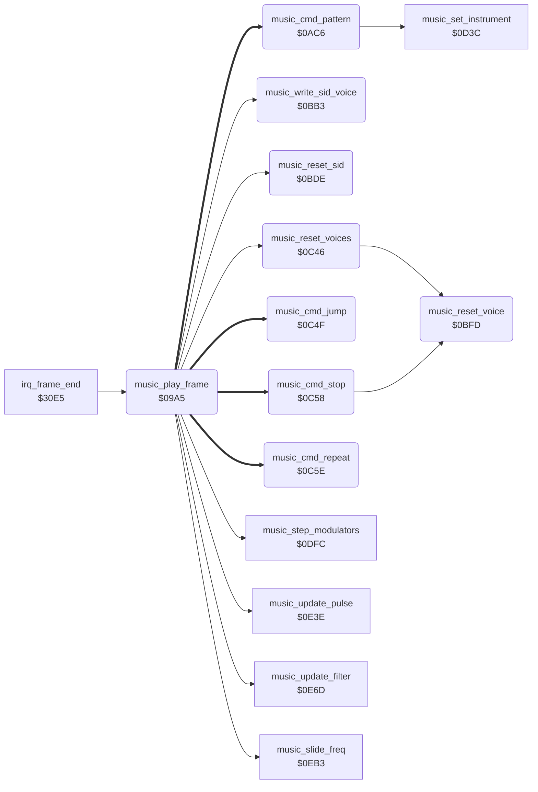

<!-- Generated by c64-docs from knowledge revision 20261025T214835.634-4kntaa and .c64-re-tools/local/generated/src/source-map.json. Do not edit: change the knowledge, generate the source again, then run docs.ts generate. -->
# music/music_driver.asm: Music driver: frame entry, tune start, order lists and pattern reader

Range `$09A5-$0C8B`. Source: [music/music_driver.asm](../../../../src/music/music_driver.asm). Index: [the reference](../../index.md).

## Routines

| Routine | Address | Reached from | Summary |
|---|---|---|---|
| [`music_play_frame`](music_driver.md#music_play_frame) | `$09A5` | [`irq_frame_end`](../irq/irq_screen_split.md#irq_frame_end) | Plays one frame of music. |
| [`music_cmd_pattern`](music_driver.md#music_cmd_pattern) | `$0AC6` | [`music_play_frame`](music_driver.md#music_play_frame) | Order command 1, pattern: on a new entry it sets the pattern address (offset + music_pattern_base) and reads the first byte. |
| [`music_write_sid_voice`](music_driver.md#music_write_sid_voice) | `$0BB3` | [`music_play_frame`](music_driver.md#music_play_frame) | Writes frequency, pulse width, ADSR and control of voice X to the SID voice at $d400+Y. |
| [`music_reset_sid`](music_driver.md#music_reset_sid) | `$0BDE` | [`music_play_frame`](music_driver.md#music_play_frame) | Clears the SID registers, the volume, the resonance and the filter sweep values, and sets the cutoff base to $6400. |
| [`music_reset_voice`](music_driver.md#music_reset_voice) | `$0BFD` | [`music_reset_voices`](music_driver.md#music_reset_voices), [`music_cmd_stop`](music_driver.md#music_cmd_stop) | Clears the state of voice X and switches the voice off. |
| [`music_reset_voices`](music_driver.md#music_reset_voices) | `$0C46` | [`music_play_frame`](music_driver.md#music_play_frame) | Resets voices 2 to 0 with music_reset_voice. |
| [`music_cmd_jump`](music_driver.md#music_cmd_jump) | `$0C4F` | [`music_play_frame`](music_driver.md#music_play_frame) | Order command 2, position: the order list continues at that byte position. |
| [`music_cmd_stop`](music_driver.md#music_cmd_stop) | `$0C58` | [`music_play_frame`](music_driver.md#music_play_frame) | Order command 0: resets and switches off the voice. |
| [`music_cmd_repeat`](music_driver.md#music_cmd_repeat) | `$0C5E` | [`music_play_frame`](music_driver.md#music_play_frame) | Order command 3, position, count: jumps to the position count more times, then skips its 3 bytes. |

## Call graph

A solid arrow is a call, a thick arrow a table entry. Rounded nodes are in this file.

## Details

### [`music_play_frame`](../../../../src/music/music_driver.asm#L6) `$09A5`

*routine*

Plays one frame of music. The frame-end raster IRQ calls it at $3111. game_mode is the tune: 0 silences the SID, a new value starts that tune. Tunes: 1 demo, 2 one player, 3 two players, 4 name entry.

- **Called from:** [`irq_frame_end`](../irq/irq_screen_split.md#irq_frame_end)
- **Calls:** [`music_reset_sid`](music_driver.md#music_reset_sid), [`music_reset_voices`](music_driver.md#music_reset_voices), [`music_slide_freq`](music_effects.md#music_slide_freq), [`music_step_modulators`](music_effects.md#music_step_modulators), [`music_update_pulse`](music_effects.md#music_update_pulse), [`music_update_filter`](music_effects.md#music_update_filter), [`music_write_sid_voice`](music_driver.md#music_write_sid_voice)
- **Jumps to:** [`fighter_f39_parts`](../graphics/fighter_shapes_a800.md#fighter_f39_parts)
- **Reads:** [`game_mode`](../../memory-map.md#game_mode), [`music_current_tune`](music_workspace_0cdb.md#music_current_tune), [`music_volume`](music_workspace_0cdb.md#music_volume), [`music_resonance`](music_workspace_0cdb.md#music_resonance), [`music_cutoff_lo`](music_workspace.md#music_cutoff_lo), [`music_cutoff_hi`](music_workspace.md#music_cutoff_hi), [`music_tune_volumes`](music_tables.md#music_tune_volumes), [`music_tune_tempos`](music_tables.md#music_tune_tempos), [`music_tune_bases`](music_tables.md#music_tune_bases), [`music_tune_pattern_tables`](music_tables.md#music_tune_pattern_tables), [`music_ptab_hi_operand`](music_driver.md#music_ptab_hi_operand), [`music_ptab_hi_page`](music_driver.md#music_ptab_hi_page) and 17 more
- **Writes:** [`SIGVOL`](../../memory-map.md#SIGVOL), [`RESON`](../../memory-map.md#RESON), [`CUTLO`](../../memory-map.md#CUTLO), [`CUTHI`](../../memory-map.md#CUTHI), [`music_current_tune`](music_workspace_0cdb.md#music_current_tune), [`music_voice_on`](music_workspace.md#music_voice_on), [`music_volume`](music_workspace_0cdb.md#music_volume), [`music_tempo_count`](music_workspace.md#music_tempo_count), [`music_tempo`](music_workspace.md#music_tempo), [`music_pattern_base`](music_tables.md#music_pattern_base), [`music_ptab_hi_operand`](music_driver.md#music_ptab_hi_operand), [`music_ptab_lo_operand`](music_driver.md#music_ptab_lo_operand) and 9 more
- **Refers to:** [`music_voice_on`](music_workspace.md#music_voice_on), [`music_tempo_count`](music_workspace.md#music_tempo_count), [`music_tempo`](music_workspace.md#music_tempo), [`music_tune_bases`](music_tables.md#music_tune_bases), [`music_pattern_base`](music_tables.md#music_pattern_base), [`music_tune_pattern_tables`](music_tables.md#music_tune_pattern_tables), [`music_ptab_hi_operand`](music_driver.md#music_ptab_hi_operand), [`music_ptab_lo_operand`](music_driver.md#music_ptab_lo_operand), [`music_tune_orders_v0`](music_tables.md#music_tune_orders_v0), [`music_order_lo`](music_workspace.md#music_order_lo), [`music_tune_orders_v1`](music_tables.md#music_tune_orders_v1), [`music_order_hi`](music_workspace.md#music_order_hi) and 5 more

| Label | Address | Comment |
|---|---|---|
| [`music_silence`](../../../../src/music/music_driver.asm#L9) | `$09A9` |  |
| [`music_check_tune`](../../../../src/music/music_driver.asm#L14) | `$09AF` |  |
| [`music_write_globals`](../../../../src/music/music_driver.asm#L18) | `$09B4` | Same tune: writes volume, resonance and cutoff base to the SID, then steps the voices. |
| [`music_start_tune`](../../../../src/music/music_driver.asm#L26) | `$09CF` | Starts tune A: resets the SID and the voices, sets volume and tempo, and copies the pattern base, pattern table and order lists. It does not play in this frame. |
| [`music_set_order_ptrs`](../../../../src/music/music_driver.asm#L58) | `$0A2C` |  |
| [`music_play_voices`](../../../../src/music/music_driver.asm#L73) | `$0A51` | Steps voices 2 to 0. A voice reads its order list and pattern when its tempo counter reaches 0. In the other frames only its frequency changes. |
| [`music_voice_loop`](../../../../src/music/music_driver.asm#L75) | `$0A53` |  |
| [`music_read_order`](../../../../src/music/music_driver.asm#L91) | `$0A77` | Reads the order list command at music_order_pos and jumps through music_order_commands: 0 stop, 1 pattern, 2 jump, 3 repeat. |
| [`music_voice_freq`](../../../../src/music/music_driver.asm#L103) | `$0A8E` | Frequency of this frame: a slide instrument moves toward the note frequency, other instruments get the note frequency at once. |
| [`music_set_freq_now`](../../../../src/music/music_driver.asm#L108) | `$0A99` |  |
| [`music_next_voice`](../../../../src/music/music_driver.asm#L113) | `$0AA5` |  |
| [`music_write_loop`](../../../../src/music/music_driver.asm#L121) | `$0AB5` |  |
| [`music_write_next`](../../../../src/music/music_driver.asm#L125) | `$0ABD` |  |

### [`music_cmd_pattern`](../../../../src/music/music_driver.asm#L134) `$0AC6`

*label*

Order command 1, pattern: on a new entry it sets the pattern address (offset + music_pattern_base) and reads the first byte. Else the note counts down.

- **Entry of:** [`music_order_commands`](../../tables.md#music_order_commands)
- **Calls:** [`music_set_instrument`](music_effects.md#music_set_instrument)
- **Jumps to:** [`music_voice_freq`](music_driver.md#music_voice_freq), [`music_read_order`](music_driver.md#music_read_order)
- **Reads:** [`music_need_pattern`](music_workspace.md#music_need_pattern), [`music_order_ptr`](../../memory-map.md#music_order_ptr), [`screen_scene_rows`](../../memory-map.md#screen_scene_rows), [`music_pattern_base`](music_tables.md#music_pattern_base), [`music_note_timer`](music_workspace.md#music_note_timer), [`music_note_released`](music_workspace.md#music_note_released), [`music_note_flags`](music_workspace.md#music_note_flags), [`music_ctrl`](music_workspace.md#music_ctrl), [`music_pattern_pos`](music_workspace.md#music_pattern_pos), [`music_pattern_ptr`](../../memory-map.md#music_pattern_ptr), [`music_order_pos`](music_workspace.md#music_order_pos), [`music_note_freqs`](music_workspace_0cdb.md#music_note_freqs) and 5 more
- **Writes:** [`music_pattern_lo`](music_workspace.md#music_pattern_lo), [`music_pattern_ptr`](../../memory-map.md#music_pattern_ptr), [`music_pattern_hi`](music_workspace.md#music_pattern_hi), [`music_pattern_pos`](music_workspace.md#music_pattern_pos), [`music_need_pattern`](music_workspace.md#music_need_pattern), [`music_note_timer`](music_workspace.md#music_note_timer), [`music_note_released`](music_workspace.md#music_note_released), [`music_ctrl`](music_workspace.md#music_ctrl), [`music_order_pos`](music_workspace.md#music_order_pos), [`music_note_value`](music_workspace.md#music_note_value), [`music_freq_lo`](music_workspace.md#music_freq_lo), [`music_freq_hi`](music_workspace.md#music_freq_hi) and 4 more
- **Refers to:** [`music_pattern_base`](music_tables.md#music_pattern_base), [`music_pattern_ptr`](../../memory-map.md#music_pattern_ptr)

| Label | Address | Comment |
|---|---|---|
| [`music_note_tick`](../../../../src/music/music_driver.asm#L159) | `$0AF2` | Counts the note down. At 0 the note gets one release tick with the gate off. Duration flag bit 6 keeps the gate on. |
| [`music_note_ended`](../../../../src/music/music_driver.asm#L163) | `$0AFA` |  |
| [`music_release_started`](../../../../src/music/music_driver.asm#L175) | `$0B16` |  |
| [`music_next_byte`](../../../../src/music/music_driver.asm#L178) | `$0B19` | Reads the next pattern byte: $ff ends the pattern, $80-$fe selects an instrument, other values start a note of two bytes. |
| [`music_read_pattern`](../../../../src/music/music_driver.asm#L180) | `$0B1C` |  |
| [`music_pattern_instrument`](../../../../src/music/music_driver.asm#L191) | `$0B35` | $80-$fe: instrument number |
| [`music_read_note`](../../../../src/music/music_driver.asm#L196) | `$0B3D` | Note byte: bits 0-3 note (0 rest, 1-12 C to B), bits 4-6 octave. Frequency = (music_note_freqs + $100) << (octave + instrument octave). |
| [`music_set_note_freq`](../../../../src/music/music_driver.asm#L204) | `$0B4A` |  |
| [`music_octave_shift`](../../../../src/music/music_driver.asm#L220) | `$0B66` |  |
| [`music_read_duration`](../../../../src/music/music_driver.asm#L226) | `$0B6F` | Duration byte: bits 0-3 index music_durations, bits 6-7 go to music_note_flags. A note lasts the table value + 1 ticks. Y is always 0 here, thus the release flag clears |
| [`music_check_glide`](../../../../src/music/music_driver.asm#L242) | `$0B8C` | If the previous note had flags, the current frequency stays. Thus a slide instrument glides into the new note. |
| [`music_store_flags`](../../../../src/music/music_driver.asm#L249) | `$0B9D` |  |
| [`music_note_done`](../../../../src/music/music_driver.asm#L258) | `$0BB0` |  |

### [`music_ptab_lo_operand`](../../../../src/music/music_driver.asm#L141) `$0AD1`

*variable*

- **Written by:** [`music_play_frame`](music_driver.md#music_play_frame)
- **Referred to by:** [`music_play_frame`](music_driver.md#music_play_frame)

### [`music_ptab_lo_page`](../../../../src/music/music_driver.asm#L142) `$0AD2-$0ADC`

*variable*

- **Written by:** [`music_play_frame`](music_driver.md#music_play_frame)

### [`music_ptab_hi_operand`](../../../../src/music/music_driver.asm#L148) `$0ADD`

*variable*

- **Read by:** [`music_play_frame`](music_driver.md#music_play_frame)
- **Written by:** [`music_play_frame`](music_driver.md#music_play_frame)
- **Referred to by:** [`music_play_frame`](music_driver.md#music_play_frame)

### [`music_ptab_hi_page`](../../../../src/music/music_driver.asm#L149) `$0ADE-$0AF1`

*variable*

- **Read by:** [`music_play_frame`](music_driver.md#music_play_frame)
- **Written by:** [`music_play_frame`](music_driver.md#music_play_frame)

### [`music_write_sid_voice`](../../../../src/music/music_driver.asm#L261) `$0BB3`

*routine*

Writes frequency, pulse width, ADSR and control of voice X to the SID voice at $d400+Y. Called from $0aba with Y = 14, 7 and 0.

- **Called from:** [`music_play_frame`](music_driver.md#music_play_frame)
- **Reads:** [`music_cur_freq_lo`](music_workspace_0cdb.md#music_cur_freq_lo), [`music_cur_freq_hi`](music_workspace_0cdb.md#music_cur_freq_hi), [`music_pw_lo`](music_workspace_0cdb.md#music_pw_lo), [`music_pw_hi`](music_workspace_0cdb.md#music_pw_hi), [`music_attack_decay`](music_workspace.md#music_attack_decay), [`music_sustain_release`](music_workspace.md#music_sustain_release), [`music_ctrl`](music_workspace.md#music_ctrl)
- **Writes:** [`judge_sprite_scene23`](../graphics/judge_sprites_d000_d3c0.md#judge_sprite_scene23), [`FREHI1`](../../memory-map.md#FREHI1), [`PWLO1`](../../memory-map.md#PWLO1), [`PWHI1`](../../memory-map.md#PWHI1), [`ATDCY1`](../../memory-map.md#ATDCY1), [`SUREL1`](../../memory-map.md#SUREL1), [`VCREG1`](../../memory-map.md#VCREG1)

### [`music_reset_sid`](../../../../src/music/music_driver.asm#L278) `$0BDE`

*routine*

Clears the SID registers, the volume, the resonance and the filter sweep values, and sets the cutoff base to $6400. Called at tune start ($09d4).

- **Called from:** [`music_play_frame`](music_driver.md#music_play_frame)
- **Writes:** [`judge_sprite_scene23`](../graphics/judge_sprites_d000_d3c0.md#judge_sprite_scene23), [`music_resonance`](music_workspace_0cdb.md#music_resonance), [`music_volume`](music_workspace_0cdb.md#music_volume), [`music_filter_shift`](music_workspace.md#music_filter_shift), [`music_filter_down`](music_workspace.md#music_filter_down), [`music_cutoff_lo`](music_workspace.md#music_cutoff_lo), [`music_cutoff_hi`](music_workspace.md#music_cutoff_hi)

| Label | Address | Comment |
|---|---|---|
| [`music_clear_sid_loop`](../../../../src/music/music_driver.asm#L281) | `$0BE2` |  |

### [`music_reset_voice`](../../../../src/music/music_driver.asm#L294) `$0BFD`

*routine*

Clears the state of voice X and switches the voice off. Sets the tempo counters and the new-pattern flag to 1. Called from $0c48 and $0c58.

- **Called from:** [`music_reset_voices`](music_driver.md#music_reset_voices), [`music_cmd_stop`](music_driver.md#music_cmd_stop)
- **Writes:** [`music_voice_on`](music_workspace.md#music_voice_on), [`music_repeat_count`](music_workspace_0cdb.md#music_repeat_count), [`music_order_pos`](music_workspace.md#music_order_pos), [`music_inst_octave`](music_workspace.md#music_inst_octave), [`music_note_flags`](music_workspace.md#music_note_flags), [`music_ctrl`](music_workspace.md#music_ctrl), [`music_mod_values`](music_workspace_0cdb.md#music_mod_values), [`music_lfo_speed`](music_workspace_0cdb.md#music_lfo_speed), [`music_lfo_falling`](music_workspace_0cdb.md#music_lfo_falling), [`music_pwm_shift`](music_workspace_0cdb.md#music_pwm_shift), [`music_pw_base_lo`](music_workspace.md#music_pw_base_lo), [`music_pw_base_hi`](music_workspace.md#music_pw_base_hi) and 10 more

### [`music_reset_voices`](../../../../src/music/music_driver.asm#L322) `$0C46`

*routine*

Resets voices 2 to 0 with music_reset_voice. Called at tune start ($09d7).

- **Called from:** [`music_play_frame`](music_driver.md#music_play_frame)
- **Calls:** [`music_reset_voice`](music_driver.md#music_reset_voice)

| Label | Address | Comment |
|---|---|---|
| [`music_reset_voices_loop`](../../../../src/music/music_driver.asm#L324) | `$0C48` |  |

### [`music_cmd_jump`](../../../../src/music/music_driver.asm#L330) `$0C4F`

*label*

Order command 2, position: the order list continues at that byte position.

- **Entry of:** [`music_order_commands`](../../tables.md#music_order_commands)
- **Jumps to:** [`music_read_order`](music_driver.md#music_read_order)
- **Reads:** [`music_order_ptr`](../../memory-map.md#music_order_ptr)
- **Writes:** [`music_order_pos`](music_workspace.md#music_order_pos)

### [`music_cmd_stop`](../../../../src/music/music_driver.asm#L336) `$0C58`

*label*

Order command 0: resets and switches off the voice. Only tune 4 uses it, at the end of each of its order lists.

- **Entry of:** [`music_order_commands`](../../tables.md#music_order_commands)
- **Calls:** [`music_reset_voice`](music_driver.md#music_reset_voice)
- **Jumps to:** [`music_next_voice`](music_driver.md#music_next_voice)

### [`music_cmd_repeat`](../../../../src/music/music_driver.asm#L340) `$0C5E`

*label*

Order command 3, position, count: jumps to the position count more times, then skips its 3 bytes. Each voice has one repeat counter.

- **Entry of:** [`music_order_commands`](../../tables.md#music_order_commands)
- **Jumps to:** [`music_read_order`](music_driver.md#music_read_order)
- **Reads:** [`music_repeat_count`](music_workspace_0cdb.md#music_repeat_count), [`music_order_ptr`](../../memory-map.md#music_order_ptr), [`music_order_pos`](music_workspace.md#music_order_pos)
- **Writes:** [`music_order_pos`](music_workspace.md#music_order_pos), [`music_repeat_count`](music_workspace_0cdb.md#music_repeat_count)

| Label | Address | Comment |
|---|---|---|
| [`music_repeat_again`](../../../../src/music/music_driver.asm#L350) | `$0C72` |  |
| [`music_repeat_done`](../../../../src/music/music_driver.asm#L358) | `$0C80` |  |
