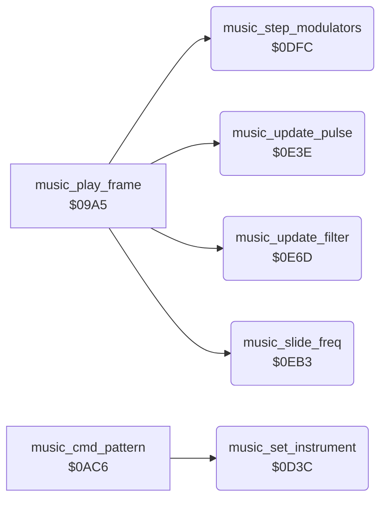

<!-- Generated by c64-docs from knowledge revision 20261025T214835.634-4kntaa and .c64-re-tools/local/generated/src/source-map.json. Do not edit: change the knowledge, generate the source again, then run docs.ts generate. -->
# music/music_effects.asm: Music driver: instruments, modulators, pulse width, filter and slides

Range `$0D3C-$0F51`. Source: [music/music_effects.asm](../../../../src/music/music_effects.asm). Index: [the reference](../../index.md).

## Routines

| Routine | Address | Reached from | Summary |
|---|---|---|---|
| [`music_set_instrument`](music_effects.md#music_set_instrument) | `$0D3C` | [`music_cmd_pattern`](music_driver.md#music_cmd_pattern) | Sets instrument A on voice X from music_instrument_ptrs: waveform, pulse width and modulation, ADSR, slide, octave and filter. |
| [`music_step_modulators`](music_effects.md#music_step_modulators) | `$0DFC` | [`music_play_frame`](music_driver.md#music_play_frame) | Steps the three triangle LFOs in music_mod_values between 0 and $ff, and copies ENV3 and OSC3 into slots 3 and 4. |
| [`music_update_pulse`](music_effects.md#music_update_pulse) | `$0E3E` | [`music_play_frame`](music_driver.md#music_play_frame) | Sets the pulse width of each modulated voice to base + (LFO << music_pwm_shift). |
| [`music_update_filter`](music_effects.md#music_update_filter) | `$0E6D` | [`music_play_frame`](music_driver.md#music_play_frame) | Writes the cutoff: base plus or minus (modulator << music_filter_shift) when music_filter_source is positive. |
| [`music_slide_freq`](music_effects.md#music_slide_freq) | `$0EB3` | [`music_play_frame`](music_driver.md#music_play_frame) | Moves the current frequency of voice X toward the note frequency by (slide step << note octave) and stops at the note. |

## Call graph

A solid arrow is a call, a thick arrow a table entry. Rounded nodes are in this file.

## Details

### [`music_set_instrument`](../../../../src/music/music_effects.asm#L6) `$0D3C`

*routine*

Sets instrument A on voice X from music_instrument_ptrs: waveform, pulse width and modulation, ADSR, slide, octave and filter. Called from the pattern reader at $0b37.

- **Called from:** [`music_cmd_pattern`](music_driver.md#music_cmd_pattern)
- **Reads:** [`music_instrument_ptrs`](music_tables.md#music_instrument_ptrs), [`music_ctrl`](music_workspace.md#music_ctrl), [`music_work_ptr`](../../memory-map.md#music_work_ptr), [`music_resonance`](music_workspace_0cdb.md#music_resonance), [`music_voice_bit_masks`](music_workspace_0cdb.md#music_voice_bit_masks), [`music_volume`](music_workspace_0cdb.md#music_volume), [`music_voice_clear_masks`](music_workspace_0cdb.md#music_voice_clear_masks)
- **Writes:** [`music_work_ptr`](../../memory-map.md#music_work_ptr), [`music_ctrl`](music_workspace.md#music_ctrl), [`music_pw_base_lo`](music_workspace.md#music_pw_base_lo), [`music_pw_lo`](music_workspace_0cdb.md#music_pw_lo), [`music_pw_base_hi`](music_workspace.md#music_pw_base_hi), [`music_pw_hi`](music_workspace_0cdb.md#music_pw_hi), [`music_pwm_source`](music_workspace_0cdb.md#music_pwm_source), [`music_pwm_shift`](music_workspace_0cdb.md#music_pwm_shift), [`music_lfo_speed`](music_workspace_0cdb.md#music_lfo_speed), [`music_attack_decay`](music_workspace.md#music_attack_decay), [`music_sustain_release`](music_workspace.md#music_sustain_release), [`music_slide_step_lo`](music_workspace_0cdb.md#music_slide_step_lo) and 13 more
- **Refers to:** [`music_instrument_ptrs`](music_tables.md#music_instrument_ptrs), [`music_work_ptr`](../../memory-map.md#music_work_ptr)

| Label | Address | Comment |
|---|---|---|
| [`music_store_pwm_source`](../../../../src/music/music_effects.asm#L32) | `$0D70` |  |
| [`music_read_envelope`](../../../../src/music/music_effects.asm#L41) | `$0D7F` | Envelope, slide step, octave offset and filter flag. Without filter the voice leaves the filter. |
| [`music_filter_off`](../../../../src/music/music_effects.asm#L93) | `$0DEF` |  |

### [`music_step_modulators`](../../../../src/music/music_effects.asm#L100) `$0DFC`

*routine*

Steps the three triangle LFOs in music_mod_values between 0 and $ff, and copies ENV3 and OSC3 into slots 3 and 4. Called each frame from $0aa8.

- **Called from:** [`music_play_frame`](music_driver.md#music_play_frame)
- **Reads:** [`ENV3`](../../memory-map.md#ENV3), [`RANDOM`](../../memory-map.md#RANDOM), [`music_lfo_falling`](music_workspace_0cdb.md#music_lfo_falling), [`music_mod_values`](music_workspace_0cdb.md#music_mod_values), [`music_lfo_speed`](music_workspace_0cdb.md#music_lfo_speed)
- **Writes:** [`music_mod_env3`](music_workspace_0cdb.md#music_mod_env3), [`music_mod_osc3`](music_workspace_0cdb.md#music_mod_osc3), [`music_mod_values`](music_workspace_0cdb.md#music_mod_values), [`music_lfo_falling`](music_workspace_0cdb.md#music_lfo_falling)

| Label | Address | Comment |
|---|---|---|
| [`music_modulator_loop`](../../../../src/music/music_effects.asm#L106) | `$0E0A` |  |
| [`music_modulator_down`](../../../../src/music/music_effects.asm#L118) | `$0E26` |  |
| [`music_modulator_next`](../../../../src/music/music_effects.asm#L127) | `$0E3A` |  |

### [`music_update_pulse`](../../../../src/music/music_effects.asm#L132) `$0E3E`

*routine*

Sets the pulse width of each modulated voice to base + (LFO << music_pwm_shift). Called each frame from $0aab.

- **Called from:** [`music_play_frame`](music_driver.md#music_play_frame)
- **Reads:** [`music_pwm_source`](music_workspace_0cdb.md#music_pwm_source), [`music_mod_values`](music_workspace_0cdb.md#music_mod_values), [`music_pwm_shift`](music_workspace_0cdb.md#music_pwm_shift), [`music_temp_hi`](music_workspace.md#music_temp_hi), [`music_pw_base_lo`](music_workspace.md#music_pw_base_lo), [`music_pw_base_hi`](music_workspace.md#music_pw_base_hi)
- **Writes:** [`music_temp_hi`](music_workspace.md#music_temp_hi), [`music_pw_lo`](music_workspace_0cdb.md#music_pw_lo), [`music_pw_hi`](music_workspace_0cdb.md#music_pw_hi)

| Label | Address | Comment |
|---|---|---|
| [`music_pulse_loop`](../../../../src/music/music_effects.asm#L134) | `$0E40` |  |
| [`music_pulse_shift`](../../../../src/music/music_effects.asm#L142) | `$0E52` |  |
| [`music_pulse_add`](../../../../src/music/music_effects.asm#L147) | `$0E59` |  |
| [`music_pulse_next`](../../../../src/music/music_effects.asm#L154) | `$0E69` |  |

### [`music_update_filter`](../../../../src/music/music_effects.asm#L159) `$0E6D`

*routine*

Writes the cutoff: base plus or minus (modulator << music_filter_shift) when music_filter_source is positive. Called each frame from $0aae.

- **Called from:** [`music_play_frame`](music_driver.md#music_play_frame)
- **Reads:** [`music_filter_source`](music_workspace.md#music_filter_source), [`music_mod_values`](music_workspace_0cdb.md#music_mod_values), [`music_filter_shift`](music_workspace.md#music_filter_shift), [`music_temp_hi`](music_workspace.md#music_temp_hi), [`music_filter_down`](music_workspace.md#music_filter_down), [`music_work_ptr`](../../memory-map.md#music_work_ptr), [`music_cutoff_lo`](music_workspace.md#music_cutoff_lo), [`music_cutoff_hi`](music_workspace.md#music_cutoff_hi)
- **Writes:** [`music_temp_hi`](music_workspace.md#music_temp_hi), [`music_work_ptr`](../../memory-map.md#music_work_ptr), [`CUTLO`](../../memory-map.md#CUTLO), [`CUTHI`](../../memory-map.md#CUTHI)

| Label | Address | Comment |
|---|---|---|
| [`music_filter_shift_loop`](../../../../src/music/music_effects.asm#L167) | `$0E7F` |  |
| [`music_filter_apply`](../../../../src/music/music_effects.asm#L172) | `$0E86` |  |
| [`music_filter_subtract`](../../../../src/music/music_effects.asm#L184) | `$0EA0` |  |
| [`music_filter_done`](../../../../src/music/music_effects.asm#L192) | `$0EB2` |  |

### [`music_slide_freq`](../../../../src/music/music_effects.asm#L195) `$0EB3`

*routine*

Moves the current frequency of voice X toward the note frequency by (slide step << note octave) and stops at the note. Called from $0a93.

- **Called from:** [`music_play_frame`](music_driver.md#music_play_frame)
- **Reads:** [`music_cur_freq_hi`](music_workspace_0cdb.md#music_cur_freq_hi), [`music_freq_hi`](music_workspace.md#music_freq_hi), [`music_cur_freq_lo`](music_workspace_0cdb.md#music_cur_freq_lo), [`music_freq_lo`](music_workspace.md#music_freq_lo), [`music_slide_step_hi`](music_workspace_0cdb.md#music_slide_step_hi), [`music_slide_step_lo`](music_workspace_0cdb.md#music_slide_step_lo), [`music_note_octave`](music_workspace.md#music_note_octave), [`music_temp_hi`](music_workspace.md#music_temp_hi), [`music_temp_lo`](music_workspace.md#music_temp_lo)
- **Writes:** [`music_temp_hi`](music_workspace.md#music_temp_hi), [`music_cur_freq_lo`](music_workspace_0cdb.md#music_cur_freq_lo), [`music_cur_freq_hi`](music_workspace_0cdb.md#music_cur_freq_hi), [`music_temp_lo`](music_workspace.md#music_temp_lo)

| Label | Address | Comment |
|---|---|---|
| [`music_slide_up`](../../../../src/music/music_effects.asm#L205) | `$0EC8` |  |
| [`music_slide_up_shift`](../../../../src/music/music_effects.asm#L211) | `$0ED6` |  |
| [`music_slide_up_add`](../../../../src/music/music_effects.asm#L216) | `$0EDD` |  |
| [`music_slide_up_exit`](../../../../src/music/music_effects.asm#L226) | `$0EF4` |  |
| [`music_slide_up_check_lo`](../../../../src/music/music_effects.asm#L228) | `$0EF5` |  |
| [`music_slide_up_clamp`](../../../../src/music/music_effects.asm#L232) | `$0EFD` |  |
| [`music_slide_down`](../../../../src/music/music_effects.asm#L238) | `$0F0A` |  |
| [`music_slide_down_shift`](../../../../src/music/music_effects.asm#L244) | `$0F18` |  |
| [`music_slide_down_sub`](../../../../src/music/music_effects.asm#L249) | `$0F1F` |  |
| [`music_slide_down_exit`](../../../../src/music/music_effects.asm#L261) | `$0F3C` |  |
| [`music_slide_down_check_lo`](../../../../src/music/music_effects.asm#L263) | `$0F3D` |  |
| [`music_slide_down_clamp`](../../../../src/music/music_effects.asm#L267) | `$0F45` |  |
