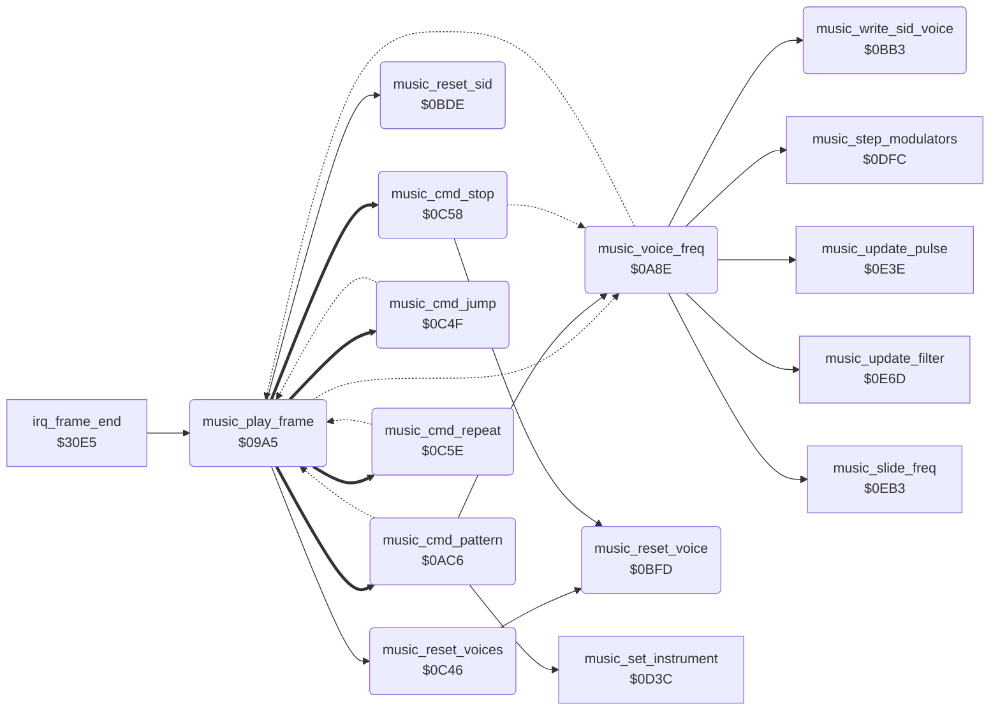

<!-- Generated by c64-docs from knowledge revision 20261021T021734.812-ub0xzr and src/source-map.json. Do not edit: change the knowledge, generate the source again, then run docs.ts generate. -->
# music_driver.asm: Music driver: frame entry, tune start, order lists and pattern reader

Range `$09A5-$0C8B`. Source: [music_driver.asm](../../../src/music_driver.asm). Index: [the reference](../index.md).

## Call graph

A solid arrow is a call, a thick arrow a table entry, a dotted arrow a jump. Rounded nodes are in this file.

## Names

### [`music_play_frame`](../../../src/music_driver.asm#L6) `$09A5`

*routine*

Plays one frame of music. The frame-end raster IRQ calls it at $3111. game_mode is the tune: 0 silences the SID, a new value starts that tune. Tunes: 1 demo, 2 one player, 3 two players, 4 name entry.

- **Called from:** [`irq_frame_end`](irq_screen_split.md#irq_frame_end) [`$3111`](../../../src/irq_screen_split.asm#L200)
- **Calls:** [`music_reset_sid`](music_driver.md#music_reset_sid), [`music_reset_voices`](music_driver.md#music_reset_voices)
- **Jumps to:** [`music_next_voice`](music_driver.md#music_next_voice), [`music_voice_freq`](music_driver.md#music_voice_freq), [`music_cmd_pattern`](music_driver.md#music_cmd_pattern), [`music_cmd_jump`](music_driver.md#music_cmd_jump), [`music_cmd_stop`](music_driver.md#music_cmd_stop), [`music_cmd_repeat`](music_driver.md#music_cmd_repeat)
- **Reads:** [`game_mode`](../memory-map.md#game_mode), [`music_current_tune`](music_workspace.md#music_current_tune), [`music_volume`](music_workspace.md#music_volume), [`music_resonance`](music_workspace.md#music_resonance), [`music_cutoff_lo`](music_workspace.md#music_cutoff_lo), [`music_cutoff_hi`](music_workspace.md#music_cutoff_hi), [`music_t1_order_v1+1`](music_tables.md#music_t1_order_v1), [`music_t1_order_v1+6`](music_tables.md#music_t1_order_v1), [`music_instrument_ptrs+14`](music_tables.md#music_instrument_ptrs), [`music_instrument_ptrs+15`](music_tables.md#music_instrument_ptrs), [`music_instrument_ptrs+24`](music_tables.md#music_instrument_ptrs), [`music_instrument_ptrs+25`](music_tables.md#music_instrument_ptrs), [`music_ptab_hi_operand`](music_driver.md#music_ptab_hi_operand), [`music_ptab_hi_page`](music_driver.md#music_ptab_hi_page), [`music_instrument_ptrs+34`](music_tables.md#music_instrument_ptrs), [`music_instrument_ptrs+35`](music_tables.md#music_instrument_ptrs), [`music_instrument_ptrs+44`](music_tables.md#music_instrument_ptrs), [`music_instrument_ptrs+45`](music_tables.md#music_instrument_ptrs), [`music_tune_volumes+4`](music_tables.md#music_tune_volumes), [`music_tune_tempos`](music_tables.md#music_tune_tempos), [`music_voice_on+2`](music_workspace.md#music_voice_on), [`music_tempo_count+2`](music_workspace.md#music_tempo_count), [`music_tempo+2`](music_workspace.md#music_tempo), [`music_order_lo+2`](music_workspace.md#music_order_lo), [`music_order_hi+2`](music_workspace.md#music_order_hi), [`music_pattern_lo+2`](music_workspace.md#music_pattern_lo), [`music_pattern_hi+2`](music_workspace.md#music_pattern_hi), [`music_order_pos+2`](music_workspace.md#music_order_pos), [`music_order_ptr`](../memory-map.md#music_order_ptr), [`music_work_ptr`](../memory-map.md#music_work_ptr)
- **Writes:** [`SIGVOL`](../memory-map.md#SIGVOL), [`RESON`](../memory-map.md#RESON), [`CUTLO`](../memory-map.md#CUTLO), [`CUTHI`](../memory-map.md#CUTHI), [`music_current_tune`](music_workspace.md#music_current_tune), [`music_voice_on`](music_workspace.md#music_voice_on), [`music_voice_on+1`](music_workspace.md#music_voice_on), [`music_voice_on+2`](music_workspace.md#music_voice_on), [`music_volume`](music_workspace.md#music_volume), [`music_tempo_count`](music_workspace.md#music_tempo_count), [`music_tempo_count+1`](music_workspace.md#music_tempo_count), [`music_tempo_count+2`](music_workspace.md#music_tempo_count), [`music_tempo`](music_workspace.md#music_tempo), [`music_tempo+1`](music_workspace.md#music_tempo), [`music_tempo+2`](music_workspace.md#music_tempo), [`music_pattern_base`](music_tables.md#music_pattern_base), [`music_pattern_base+1`](music_tables.md#music_pattern_base), [`music_ptab_hi_operand`](music_driver.md#music_ptab_hi_operand), [`music_ptab_lo_operand`](music_driver.md#music_ptab_lo_operand), [`music_ptab_hi_page`](music_driver.md#music_ptab_hi_page), [`music_ptab_lo_page`](music_driver.md#music_ptab_lo_page), [`music_order_lo`](music_workspace.md#music_order_lo), [`music_order_hi`](music_workspace.md#music_order_hi), [`music_order_lo+1`](music_workspace.md#music_order_lo), [`music_order_hi+1`](music_workspace.md#music_order_hi), [`music_order_lo+2`](music_workspace.md#music_order_lo), [`music_order_hi+2`](music_workspace.md#music_order_hi), [`music_order_ptr`](../memory-map.md#music_order_ptr), [`music_order_ptr+1`](../memory-map.md#music_order_ptr), [`music_pattern_ptr`](../memory-map.md#music_pattern_ptr), [`music_pattern_ptr+1`](../memory-map.md#music_pattern_ptr), [`music_work_ptr`](../memory-map.md#music_work_ptr), [`music_work_ptr+1`](../memory-map.md#music_work_ptr)
- **Refers to:** [`music_voice_on`](music_workspace.md#music_voice_on), [`music_tempo_count`](music_workspace.md#music_tempo_count), [`music_tempo`](music_workspace.md#music_tempo), [`music_tune_bases`](music_tables.md#music_tune_bases), [`music_pattern_base`](music_tables.md#music_pattern_base), [`music_tune_pattern_tables`](music_tables.md#music_tune_pattern_tables), [`music_ptab_hi_operand`](music_driver.md#music_ptab_hi_operand), [`music_ptab_lo_operand`](music_driver.md#music_ptab_lo_operand), [`music_tune_orders_v0`](music_tables.md#music_tune_orders_v0), [`music_order_lo`](music_workspace.md#music_order_lo), [`music_tune_orders_v1`](music_tables.md#music_tune_orders_v1), [`music_order_hi`](music_workspace.md#music_order_hi), [`music_tune_orders_v2`](music_tables.md#music_tune_orders_v2), [`music_order_ptr`](../memory-map.md#music_order_ptr), [`music_pattern_ptr`](../memory-map.md#music_pattern_ptr), [`music_order_commands`](music_workspace.md#music_order_commands), [`music_work_ptr`](../memory-map.md#music_work_ptr)

### [`music_silence`](../../../src/music_driver.asm#L9) `$09A9`

*label*

### [`music_check_tune`](../../../src/music_driver.asm#L14) `$09AF`

*label*

- **Jumped to from:** [`music_play_frame`](music_driver.md#music_play_frame) [`$09A7`](../../../src/music_driver.asm#L8)

### [`music_write_globals`](../../../src/music_driver.asm#L18) `$09B4`

*label*

Same tune: writes volume, resonance and cutoff base to the SID, then steps the voices.

### [`music_start_tune`](../../../src/music_driver.asm#L29) `$09CF`

*label*

Starts tune A: resets the SID and the voices, sets volume and tempo, and copies the pattern base, pattern table and order lists. It does not play in this frame.

- **Jumped to from:** [`music_play_frame`](music_driver.md#music_play_frame) [`$09B2`](../../../src/music_driver.asm#L16)

### [`music_set_order_ptrs`](../../../src/music_driver.asm#L64) `$0A2C`

*label*

- **Jumped to from:** [`music_play_frame`](music_driver.md#music_play_frame) [`$0A27`](../../../src/music_driver.asm#L61)

### [`music_play_voices`](../../../src/music_driver.asm#L79) `$0A51`

*label*

Steps voices 2 to 0. A voice reads its order list and pattern when its tempo counter reaches 0. In the other frames only its frequency changes.

- **Jumped to from:** [`music_play_frame`](music_driver.md#music_play_frame) [`$09CC`](../../../src/music_driver.asm#L27)

### [`music_voice_loop`](../../../src/music_driver.asm#L81) `$0A53`

*label*

- **Jumped to from:** [`music_voice_freq`](music_driver.md#music_voice_freq) [`$0AA6`](../../../src/music_driver.asm#L121)

### [`music_read_order`](../../../src/music_driver.asm#L97) `$0A77`

*label*

Reads the order list command at music_order_pos and jumps through music_order_commands: 0 stop, 1 pattern, 2 jump, 3 repeat.

- **Jumped to from:** [`music_cmd_pattern`](music_driver.md#music_cmd_pattern) [`$0B32`](../../../src/music_driver.asm#L196), [`music_cmd_jump`](music_driver.md#music_cmd_jump) [`$0C55`](../../../src/music_driver.asm#L340), [`music_cmd_repeat`](music_driver.md#music_cmd_repeat) [`$0C6F`](../../../src/music_driver.asm#L355), [`music_cmd_repeat`](music_driver.md#music_cmd_repeat) [`$0C7D`](../../../src/music_driver.asm#L363), [`music_cmd_repeat`](music_driver.md#music_cmd_repeat) [`$0C89`](../../../src/music_driver.asm#L368)

### [`music_voice_freq`](../../../src/music_driver.asm#L109) `$0A8E`

*label*

Frequency of this frame: a slide instrument moves toward the note frequency, other instruments get the note frequency at once.

- **Called from:** [`music_cmd_pattern`](music_driver.md#music_cmd_pattern) [`$0AF7`](../../../src/music_driver.asm#L168), [`music_cmd_pattern`](music_driver.md#music_cmd_pattern) [`$0B16`](../../../src/music_driver.asm#L182), [`music_cmd_pattern`](music_driver.md#music_cmd_pattern) [`$0BB0`](../../../src/music_driver.asm#L265)
- **Jumped to from:** [`music_play_frame`](music_driver.md#music_play_frame) [`$0A5B`](../../../src/music_driver.asm#L85)
- **Calls:** [`music_slide_freq`](music_effects.md#music_slide_freq), [`music_step_modulators`](music_effects.md#music_step_modulators), [`music_update_pulse`](music_effects.md#music_update_pulse), [`music_update_filter`](music_effects.md#music_update_filter), [`music_write_sid_voice`](music_driver.md#music_write_sid_voice)
- **Jumps to:** [`music_voice_loop`](music_driver.md#music_voice_loop)
- **Reads:** [`music_voice_on+1`](music_workspace.md#music_voice_on), [`music_voice_on+2`](music_workspace.md#music_voice_on)
- **Refers to:** [`music_slide_on`](music_workspace.md#music_slide_on), [`music_freq_lo`](music_workspace.md#music_freq_lo), [`music_cur_freq_lo`](music_workspace.md#music_cur_freq_lo), [`music_freq_hi`](music_workspace.md#music_freq_hi), [`music_cur_freq_hi`](music_workspace.md#music_cur_freq_hi)

### [`music_set_freq_now`](../../../src/music_driver.asm#L114) `$0A99`

*label*

- **Jumped to from:** [`music_voice_freq`](music_driver.md#music_voice_freq) [`$0A91`](../../../src/music_driver.asm#L111)

### [`music_next_voice`](../../../src/music_driver.asm#L119) `$0AA5`

*label*

- **Jumped to from:** [`music_play_frame`](music_driver.md#music_play_frame) [`$0A56`](../../../src/music_driver.asm#L83), [`music_voice_freq`](music_driver.md#music_voice_freq) [`$0A96`](../../../src/music_driver.asm#L113), [`music_cmd_stop`](music_driver.md#music_cmd_stop) [`$0C5B`](../../../src/music_driver.asm#L344)

### [`music_write_loop`](../../../src/music_driver.asm#L127) `$0AB5`

*label*

- **Jumped to from:** [`music_voice_freq`](music_driver.md#music_voice_freq) [`$0AC3`](../../../src/music_driver.asm#L137)

### [`music_write_next`](../../../src/music_driver.asm#L131) `$0ABD`

*label*

- **Jumped to from:** [`music_voice_freq`](music_driver.md#music_voice_freq) [`$0AB8`](../../../src/music_driver.asm#L129)

### [`music_cmd_pattern`](../../../src/music_driver.asm#L140) `$0AC6`

*label*

Order command 1, pattern: on a new entry it sets the pattern address (offset + music_pattern_base) and reads the first byte. Else the note counts down.

- **Jumped to from:** [`music_play_frame`](music_driver.md#music_play_frame) [`$0A8B`](../../../src/music_driver.asm#L107)
- **Entry of:** [`music_order_commands`](../tables.md#music_order_commands)
- **Calls:** [`music_voice_freq`](music_driver.md#music_voice_freq), [`music_set_instrument`](music_effects.md#music_set_instrument)
- **Jumps to:** [`music_read_order`](music_driver.md#music_read_order)
- **Reads:** [`music_order_ptr`](../memory-map.md#music_order_ptr), [`music_pattern_base`](music_tables.md#music_pattern_base), [`music_pattern_base+1`](music_tables.md#music_pattern_base), [`music_pattern_ptr`](../memory-map.md#music_pattern_ptr)
- **Writes:** [`music_pattern_ptr`](../memory-map.md#music_pattern_ptr), [`music_pattern_ptr+1`](../memory-map.md#music_pattern_ptr)
- **Refers to:** [`music_need_pattern`](music_workspace.md#music_need_pattern), `$CF00`, [`music_pattern_lo`](music_workspace.md#music_pattern_lo), `$CF01`, [`music_pattern_base`](music_tables.md#music_pattern_base), [`music_pattern_hi`](music_workspace.md#music_pattern_hi), [`music_pattern_ptr`](../memory-map.md#music_pattern_ptr), [`music_pattern_pos`](music_workspace.md#music_pattern_pos), [`music_note_timer`](music_workspace.md#music_note_timer), [`music_note_released`](music_workspace.md#music_note_released), [`music_note_flags`](music_workspace.md#music_note_flags), [`music_ctrl`](music_workspace.md#music_ctrl), [`music_order_pos`](music_workspace.md#music_order_pos), [`music_note_value`](music_workspace.md#music_note_value), [`music_note_freqs`](music_workspace.md#music_note_freqs), [`music_freq_lo`](music_workspace.md#music_freq_lo), [`music_freq_hi`](music_workspace.md#music_freq_hi), [`music_inst_octave`](music_workspace.md#music_inst_octave), [`music_note_octave`](music_workspace.md#music_note_octave), [`music_durations`](music_workspace.md#music_durations), [`music_cur_freq_lo`](music_workspace.md#music_cur_freq_lo), [`music_cur_freq_hi`](music_workspace.md#music_cur_freq_hi)

### [`music_ptab_lo_operand`](../../../src/music_driver.asm#L147) `$0AD1`

*variable*

- **Written by:** [`music_play_frame`](music_driver.md#music_play_frame) [`$0A18`](../../../src/music_driver.asm#L56)
- **Referred to by:** [`music_play_frame`](music_driver.md#music_play_frame) [`$0A21`](../../../src/music_driver.asm#L59)

### [`music_ptab_lo_page`](../../../src/music_driver.asm#L148) `$0AD2-$0ADC`

*variable*

- **Written by:** [`music_play_frame`](music_driver.md#music_play_frame) [`$0A21`](../../../src/music_driver.asm#L59)

### [`music_ptab_hi_operand`](../../../src/music_driver.asm#L154) `$0ADD`

*variable*

- **Read by:** [`music_play_frame`](music_driver.md#music_play_frame) [`$0A24`](../../../src/music_driver.asm#L60)
- **Written by:** [`music_play_frame`](music_driver.md#music_play_frame) [`$0A15`](../../../src/music_driver.asm#L55), [`music_play_frame`](music_driver.md#music_play_frame) [`$0A24`](../../../src/music_driver.asm#L60)
- **Referred to by:** [`music_play_frame`](music_driver.md#music_play_frame) [`$0A1E`](../../../src/music_driver.asm#L58), [`music_play_frame`](music_driver.md#music_play_frame) [`$0A29`](../../../src/music_driver.asm#L63)

### [`music_ptab_hi_page`](../../../src/music_driver.asm#L155) `$0ADE-$0AF1`

*variable*

- **Read by:** [`music_play_frame`](music_driver.md#music_play_frame) [`$0A29`](../../../src/music_driver.asm#L63)
- **Written by:** [`music_play_frame`](music_driver.md#music_play_frame) [`$0A1E`](../../../src/music_driver.asm#L58), [`music_play_frame`](music_driver.md#music_play_frame) [`$0A29`](../../../src/music_driver.asm#L63)

### [`music_note_tick`](../../../src/music_driver.asm#L165) `$0AF2`

*label*

Counts the note down. At 0 the note gets one release tick with the gate off. Duration flag bit 6 keeps the gate on.

- **Jumped to from:** [`music_cmd_pattern`](music_driver.md#music_cmd_pattern) [`$0AC9`](../../../src/music_driver.asm#L142)

### [`music_note_ended`](../../../src/music_driver.asm#L169) `$0AFA`

*label*

- **Jumped to from:** [`music_cmd_pattern`](music_driver.md#music_cmd_pattern) [`$0AF5`](../../../src/music_driver.asm#L167)

### [`music_release_started`](../../../src/music_driver.asm#L181) `$0B16`

*label*

- **Jumped to from:** [`music_cmd_pattern`](music_driver.md#music_cmd_pattern) [`$0B0C`](../../../src/music_driver.asm#L177)

### [`music_next_byte`](../../../src/music_driver.asm#L184) `$0B19`

*label*

Reads the next pattern byte: $ff ends the pattern, $80-$fe selects an instrument, other values start a note of two bytes.

- **Jumped to from:** [`music_cmd_pattern`](music_driver.md#music_cmd_pattern) [`$0AFD`](../../../src/music_driver.asm#L171), [`music_cmd_pattern`](music_driver.md#music_cmd_pattern) [`$0B3A`](../../../src/music_driver.asm#L200)

### [`music_read_pattern`](../../../src/music_driver.asm#L186) `$0B1C`

*label*

- **Jumped to from:** [`music_cmd_pattern`](music_driver.md#music_cmd_pattern) [`$0AEF`](../../../src/music_driver.asm#L163)

### [`music_pattern_instrument`](../../../src/music_driver.asm#L197) `$0B35`

*label*

$80-$fe: instrument number

- **Jumped to from:** [`music_cmd_pattern`](music_driver.md#music_cmd_pattern) [`$0B25`](../../../src/music_driver.asm#L191)

### [`music_read_note`](../../../src/music_driver.asm#L202) `$0B3D`

*label*

Note byte: bits 0-3 note (0 rest, 1-12 C to B), bits 4-6 octave. Frequency = (music_note_freqs + $100) << (octave + instrument octave).

- **Jumped to from:** [`music_cmd_pattern`](music_driver.md#music_cmd_pattern) [`$0B21`](../../../src/music_driver.asm#L189)

### [`music_set_note_freq`](../../../src/music_driver.asm#L210) `$0B4A`

*label*

- **Jumped to from:** [`music_cmd_pattern`](music_driver.md#music_cmd_pattern) [`$0B44`](../../../src/music_driver.asm#L207)

### [`music_octave_shift`](../../../src/music_driver.asm#L226) `$0B66`

*label*

- **Jumped to from:** [`music_cmd_pattern`](music_driver.md#music_cmd_pattern) [`$0B6D`](../../../src/music_driver.asm#L230)

### [`music_read_duration`](../../../src/music_driver.asm#L232) `$0B6F`

*label*

Duration byte: bits 0-3 index music_durations, bits 6-7 go to music_note_flags. A note lasts the table value + 1 ticks.
Y is always 0 here, thus the release flag clears

- **Jumped to from:** [`music_cmd_pattern`](music_driver.md#music_cmd_pattern) [`$0B47`](../../../src/music_driver.asm#L209), [`music_cmd_pattern`](music_driver.md#music_cmd_pattern) [`$0B64`](../../../src/music_driver.asm#L225)

### [`music_check_glide`](../../../src/music_driver.asm#L248) `$0B8C`

*label*

If the previous note had flags, the current frequency stays. Thus a slide instrument glides into the new note.

- **Jumped to from:** [`music_cmd_pattern`](music_driver.md#music_cmd_pattern) [`$0B87`](../../../src/music_driver.asm#L244)

### [`music_store_flags`](../../../src/music_driver.asm#L255) `$0B9D`

*label*

- **Jumped to from:** [`music_cmd_pattern`](music_driver.md#music_cmd_pattern) [`$0B8F`](../../../src/music_driver.asm#L250)

### [`music_note_done`](../../../src/music_driver.asm#L264) `$0BB0`

*label*

- **Jumped to from:** [`music_cmd_pattern`](music_driver.md#music_cmd_pattern) [`$0BA6`](../../../src/music_driver.asm#L260)

### [`music_write_sid_voice`](../../../src/music_driver.asm#L267) `$0BB3`

*routine*

Writes frequency, pulse width, ADSR and control of voice X to the SID voice at $d400+Y. Called from $0aba with Y = 14, 7 and 0.

- **Called from:** [`music_voice_freq`](music_driver.md#music_voice_freq) [`$0ABA`](../../../src/music_driver.asm#L130)
- **Refers to:** [`music_cur_freq_lo`](music_workspace.md#music_cur_freq_lo), [`judge_sprite_scene23`](judge_sprites_d000.md#judge_sprite_scene23), [`music_cur_freq_hi`](music_workspace.md#music_cur_freq_hi), [`FREHI1`](../memory-map.md#FREHI1), [`music_pw_lo`](music_workspace.md#music_pw_lo), [`PWLO1`](../memory-map.md#PWLO1), [`music_pw_hi`](music_workspace.md#music_pw_hi), [`PWHI1`](../memory-map.md#PWHI1), [`music_attack_decay`](music_workspace.md#music_attack_decay), [`ATDCY1`](../memory-map.md#ATDCY1), [`music_sustain_release`](music_workspace.md#music_sustain_release), [`SUREL1`](../memory-map.md#SUREL1), [`music_ctrl`](music_workspace.md#music_ctrl), [`VCREG1`](../memory-map.md#VCREG1)

### [`music_reset_sid`](../../../src/music_driver.asm#L284) `$0BDE`

*routine*

Clears the SID registers, the volume, the resonance and the filter sweep values, and sets the cutoff base to $6400. Called at tune start ($09d4).

- **Called from:** [`music_play_frame`](music_driver.md#music_play_frame) [`$09D4`](../../../src/music_driver.asm#L33)
- **Writes:** [`RESON`](../memory-map.md#RESON), [`SIGVOL`](../memory-map.md#SIGVOL), [`music_resonance`](music_workspace.md#music_resonance), [`music_volume`](music_workspace.md#music_volume), [`music_filter_shift`](music_workspace.md#music_filter_shift), [`music_filter_down`](music_workspace.md#music_filter_down), [`music_cutoff_lo`](music_workspace.md#music_cutoff_lo), [`music_cutoff_hi`](music_workspace.md#music_cutoff_hi)
- **Refers to:** [`judge_sprite_scene23`](judge_sprites_d000.md#judge_sprite_scene23)

### [`music_clear_sid_loop`](../../../src/music_driver.asm#L287) `$0BE2`

*label*

- **Jumped to from:** [`music_reset_sid`](music_driver.md#music_reset_sid) [`$0BE6`](../../../src/music_driver.asm#L290)

### [`music_reset_voice`](../../../src/music_driver.asm#L300) `$0BFD`

*routine*

Clears the state of voice X and switches the voice off. Sets the tempo counters and the new-pattern flag to 1. Called from $0c48 and $0c58.

- **Called from:** [`music_reset_voices`](music_driver.md#music_reset_voices) [`$0C48`](../../../src/music_driver.asm#L331), [`music_cmd_stop`](music_driver.md#music_cmd_stop) [`$0C58`](../../../src/music_driver.asm#L343)
- **Writes:** [`music_filter_source`](music_workspace.md#music_filter_source)
- **Refers to:** [`music_voice_on`](music_workspace.md#music_voice_on), [`music_repeat_count`](music_workspace.md#music_repeat_count), [`music_order_pos`](music_workspace.md#music_order_pos), [`music_inst_octave`](music_workspace.md#music_inst_octave), [`music_note_flags`](music_workspace.md#music_note_flags), [`music_ctrl`](music_workspace.md#music_ctrl), [`music_mod_values`](music_workspace.md#music_mod_values), [`music_lfo_speed`](music_workspace.md#music_lfo_speed), [`music_lfo_falling`](music_workspace.md#music_lfo_falling), [`music_pwm_shift`](music_workspace.md#music_pwm_shift), [`music_pw_base_lo`](music_workspace.md#music_pw_base_lo), [`music_pw_base_hi`](music_workspace.md#music_pw_base_hi), [`music_pw_lo`](music_workspace.md#music_pw_lo), [`music_pw_hi`](music_workspace.md#music_pw_hi), [`music_slide_on`](music_workspace.md#music_slide_on), [`music_slide_step_lo`](music_workspace.md#music_slide_step_lo), [`music_slide_step_hi`](music_workspace.md#music_slide_step_hi), [`music_need_pattern`](music_workspace.md#music_need_pattern), [`music_tempo`](music_workspace.md#music_tempo), [`music_tempo_count`](music_workspace.md#music_tempo_count), [`music_pwm_source`](music_workspace.md#music_pwm_source)

### [`music_reset_voices`](../../../src/music_driver.asm#L328) `$0C46`

*routine*

Resets voices 2 to 0 with music_reset_voice. Called at tune start ($09d7).

- **Called from:** [`music_play_frame`](music_driver.md#music_play_frame) [`$09D7`](../../../src/music_driver.asm#L34)
- **Calls:** [`music_reset_voice`](music_driver.md#music_reset_voice)

### [`music_reset_voices_loop`](../../../src/music_driver.asm#L330) `$0C48`

*label*

- **Jumped to from:** [`music_reset_voices`](music_driver.md#music_reset_voices) [`$0C4C`](../../../src/music_driver.asm#L333)

### [`music_cmd_jump`](../../../src/music_driver.asm#L336) `$0C4F`

*label*

Order command 2, position: the order list continues at that byte position.

- **Jumped to from:** [`music_play_frame`](music_driver.md#music_play_frame) [`$0A8B`](../../../src/music_driver.asm#L107)
- **Entry of:** [`music_order_commands`](../tables.md#music_order_commands)
- **Jumps to:** [`music_read_order`](music_driver.md#music_read_order)
- **Reads:** [`music_order_ptr`](../memory-map.md#music_order_ptr)
- **Refers to:** [`music_order_pos`](music_workspace.md#music_order_pos)

### [`music_cmd_stop`](../../../src/music_driver.asm#L342) `$0C58`

*label*

Order command 0: resets and switches off the voice. Only tune 4 uses it, at the end of each of its order lists.

- **Jumped to from:** [`music_play_frame`](music_driver.md#music_play_frame) [`$0A8B`](../../../src/music_driver.asm#L107)
- **Entry of:** [`music_order_commands`](../tables.md#music_order_commands)
- **Calls:** [`music_reset_voice`](music_driver.md#music_reset_voice)
- **Jumps to:** [`music_next_voice`](music_driver.md#music_next_voice)

### [`music_cmd_repeat`](../../../src/music_driver.asm#L346) `$0C5E`

*label*

Order command 3, position, count: jumps to the position count more times, then skips its 3 bytes. Each voice has one repeat counter.

- **Jumped to from:** [`music_play_frame`](music_driver.md#music_play_frame) [`$0A8B`](../../../src/music_driver.asm#L107)
- **Entry of:** [`music_order_commands`](../tables.md#music_order_commands)
- **Jumps to:** [`music_read_order`](music_driver.md#music_read_order)
- **Reads:** [`music_order_ptr`](../memory-map.md#music_order_ptr)
- **Refers to:** [`music_repeat_count`](music_workspace.md#music_repeat_count), [`music_order_pos`](music_workspace.md#music_order_pos)

### [`music_repeat_again`](../../../src/music_driver.asm#L356) `$0C72`

*label*

- **Jumped to from:** [`music_cmd_repeat`](music_driver.md#music_cmd_repeat) [`$0C61`](../../../src/music_driver.asm#L348)

### [`music_repeat_done`](../../../src/music_driver.asm#L364) `$0C80`

*label*

- **Jumped to from:** [`music_cmd_repeat`](music_driver.md#music_cmd_repeat) [`$0C75`](../../../src/music_driver.asm#L358)
