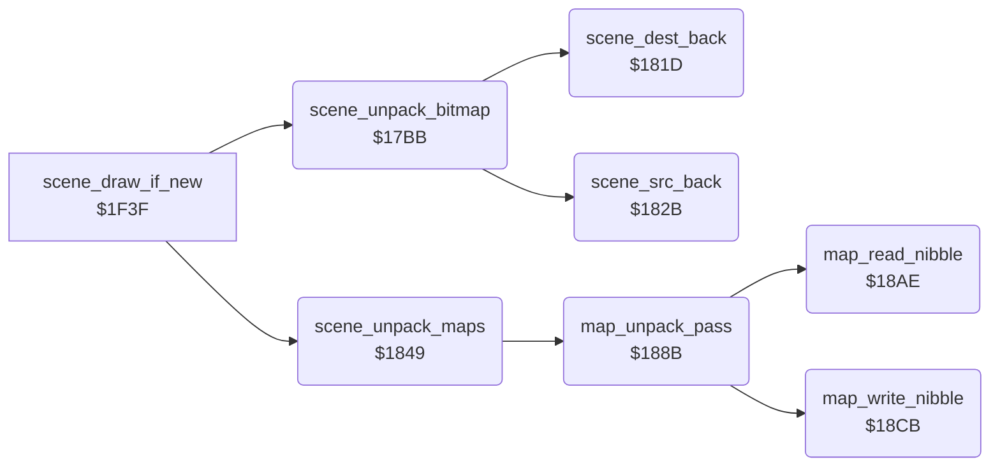

<!-- Generated by c64-docs from knowledge revision 20261021T021734.812-ub0xzr and src/source-map.json. Do not edit: change the knowledge, generate the source again, then run docs.ts generate. -->
# scene_unpack.asm: Scene unpackers: backward RLE bitmap, nibble RLE colour and screen maps, and their pointers

Range `$17BB-$18E7`. Source: [scene_unpack.asm](../../../src/scene_unpack.asm). Index: [the reference](../index.md).

## Call graph

A solid arrow is a call, a thick arrow a table entry, a dotted arrow a jump. Rounded nodes are in this file.

## Data

| Range | Type | Name | Read by | Written by |
|---|---|---|---|---|
| [`$1839`](../../../src/scene_unpack.asm#L85)-`$1840` | addresses | [`scene_packed_ptrs`](../../../src/scene_unpack.asm#L84) | [`scene_unpack_bitmap`](scene_unpack.md#scene_unpack_bitmap) |  |
| [`$1841`](../../../src/scene_unpack.asm#L88)-`$1848` | addresses | [`scene_map_packed_ptrs`](../../../src/scene_unpack.asm#L87) | [`scene_unpack_maps`](scene_unpack.md#scene_unpack_maps) |  |

## Names

### [`scene_unpack_bitmap`](../../../src/scene_unpack.asm#L6) `$17BB`

*routine*

Unpacks the bitmap of scene stage_counter AND 3 backwards into $e640-$f53f. The data starts with its length. Called by scene_draw_if_new at $1f54.

- **Called from:** [`scene_draw_if_new`](title_and_scene.md#scene_draw_if_new) [`$1F54`](../../../src/title_and_scene.asm#L148)
- **Calls:** [`scene_dest_back`](scene_unpack.md#scene_dest_back), [`scene_src_back`](scene_unpack.md#scene_src_back)
- **Reads:** [`stage_counter`](../memory-map.md#stage_counter), [`scene_packed_ptrs+6`](scene_unpack.md#scene_packed_ptrs), [`scene_packed_ptrs+7`](scene_unpack.md#scene_packed_ptrs), [`scene_src_ptr`](../memory-map.md#scene_src_ptr), [`scene_src_ptr+1`](../memory-map.md#scene_src_ptr), [`scene_run_length`](../memory-map.md#scene_run_length), [`scene_dest_ptr`](../memory-map.md#scene_dest_ptr)
- **Writes:** [`scene_src_ptr`](../memory-map.md#scene_src_ptr), [`scene_src_ptr+1`](../memory-map.md#scene_src_ptr), [`scene_dest_ptr`](../memory-map.md#scene_dest_ptr), [`scene_dest_ptr+1`](../memory-map.md#scene_dest_ptr), [`scene_run_length`](../memory-map.md#scene_run_length)
- **Refers to:** [`scene_packed_ptrs`](scene_unpack.md#scene_packed_ptrs), [`scene_src_ptr`](../memory-map.md#scene_src_ptr), [`scene_dest_ptr`](../memory-map.md#scene_dest_ptr)

### [`scene_unpack_loop`](../../../src/scene_unpack.asm#L30) `$17E5`

*label*

- **Jumped to from:** [`scene_unpack_bitmap`](scene_unpack.md#scene_unpack_bitmap) [`$17FE`](../../../src/scene_unpack.asm#L44), [`scene_unpack_bitmap`](scene_unpack.md#scene_unpack_bitmap) [`$181A`](../../../src/scene_unpack.asm#L60)

### [`scene_unpack_copy`](../../../src/scene_unpack.asm#L39) `$17F7`

*label*

- **Jumped to from:** [`scene_unpack_bitmap`](scene_unpack.md#scene_unpack_bitmap) [`$17FC`](../../../src/scene_unpack.asm#L43)

### [`scene_unpack_run`](../../../src/scene_unpack.asm#L45) `$1800`

*label*

- **Jumped to from:** [`scene_unpack_bitmap`](scene_unpack.md#scene_unpack_bitmap) [`$17EB`](../../../src/scene_unpack.asm#L34)

### [`scene_unpack_fill`](../../../src/scene_unpack.asm#L56) `$1815`

*label*

- **Jumped to from:** [`scene_unpack_bitmap`](scene_unpack.md#scene_unpack_bitmap) [`$1818`](../../../src/scene_unpack.asm#L59)

### [`scene_unpack_done`](../../../src/scene_unpack.asm#L61) `$181C`

*label*

- **Jumped to from:** [`scene_unpack_bitmap`](scene_unpack.md#scene_unpack_bitmap) [`$17E9`](../../../src/scene_unpack.asm#L33)

### [`scene_dest_back`](../../../src/scene_unpack.asm#L64) `$181D`

*routine*

Moves scene_dest_ptr down by scene_run_length. Called by scene_unpack_bitmap.

- **Called from:** [`scene_unpack_bitmap`](scene_unpack.md#scene_unpack_bitmap) [`$17EF`](../../../src/scene_unpack.asm#L36), [`scene_unpack_bitmap`](scene_unpack.md#scene_unpack_bitmap) [`$180C`](../../../src/scene_unpack.asm#L52)
- **Reads:** [`scene_dest_ptr`](../memory-map.md#scene_dest_ptr), [`scene_run_length`](../memory-map.md#scene_run_length), [`scene_dest_ptr+1`](../memory-map.md#scene_dest_ptr)
- **Writes:** [`scene_dest_ptr`](../memory-map.md#scene_dest_ptr), [`scene_dest_ptr+1`](../memory-map.md#scene_dest_ptr)
- **Refers to:** [`scene_dest_ptr`](../memory-map.md#scene_dest_ptr)

### [`scene_src_back`](../../../src/scene_unpack.asm#L74) `$182B`

*routine*

Moves scene_src_ptr down by scene_run_length plus 1 (CLC before SBC). Called by scene_unpack_bitmap.

- **Called from:** [`scene_unpack_bitmap`](scene_unpack.md#scene_unpack_bitmap) [`$17F2`](../../../src/scene_unpack.asm#L37), [`scene_unpack_bitmap`](scene_unpack.md#scene_unpack_bitmap) [`$1807`](../../../src/scene_unpack.asm#L50)
- **Reads:** [`scene_src_ptr`](../memory-map.md#scene_src_ptr), [`scene_run_length`](../memory-map.md#scene_run_length), [`scene_src_ptr+1`](../memory-map.md#scene_src_ptr)
- **Writes:** [`scene_src_ptr`](../memory-map.md#scene_src_ptr), [`scene_src_ptr+1`](../memory-map.md#scene_src_ptr)
- **Refers to:** [`scene_src_ptr`](../memory-map.md#scene_src_ptr)

### [`scene_packed_ptrs`](../../../src/scene_unpack.asm#L84) `$1839-$1840`

*data*

Packed bitmap of each scene: $3f5f, $4aae, $54ac, $5cec. The data is the same as in v1, $5cb bytes higher.

- **Read by:** [`scene_unpack_bitmap`](scene_unpack.md#scene_unpack_bitmap) [`$17C1`](../../../src/scene_unpack.asm#L11) (+6), [`scene_unpack_bitmap`](scene_unpack.md#scene_unpack_bitmap) [`$17C6`](../../../src/scene_unpack.asm#L13) (+7)

### [`scene_map_packed_ptrs`](../../../src/scene_unpack.asm#L87) `$1841-$1848`

*data*

Packed colour and screen maps of each scene for scene_unpack_maps: $68cb, $6b41, $6d96, $6fe0.

- **Read by:** [`scene_unpack_maps`](scene_unpack.md#scene_unpack_maps) [`$184F`](../../../src/scene_unpack.asm#L95) (+6), [`scene_unpack_maps`](scene_unpack.md#scene_unpack_maps) [`$1854`](../../../src/scene_unpack.asm#L97) (+7)

### [`scene_unpack_maps`](../../../src/scene_unpack.asm#L90) `$1849`

*routine*

Unpacks the maps of scene stage_counter AND 3 in three passes of 480 nibbles. Pass 1 fills colour RAM $d8c8, passes 2 and 3 the high and low nibbles of screen $ccc8. Called by scene_draw_if_new at $1f51.

- **Called from:** [`scene_draw_if_new`](title_and_scene.md#scene_draw_if_new) [`$1F51`](../../../src/title_and_scene.asm#L147)
- **Calls:** [`map_unpack_pass`](scene_unpack.md#map_unpack_pass)
- **Reads:** [`stage_counter`](../memory-map.md#stage_counter), [`scene_map_packed_ptrs+6`](scene_unpack.md#scene_map_packed_ptrs), [`scene_map_packed_ptrs+7`](scene_unpack.md#scene_map_packed_ptrs)
- **Writes:** [`map_src_ptr`](../memory-map.md#map_src_ptr), [`map_src_ptr+1`](../memory-map.md#map_src_ptr), [`map_src_mask`](../memory-map.md#map_src_mask), [`map_dest_mask`](../memory-map.md#map_dest_mask), [`scene_dest_ptr`](../memory-map.md#scene_dest_ptr), [`scene_dest_ptr+1`](../memory-map.md#scene_dest_ptr)
- **Refers to:** [`scene_map_packed_ptrs`](scene_unpack.md#scene_map_packed_ptrs), [`map_src_ptr`](../memory-map.md#map_src_ptr), [`scene_dest_ptr`](../memory-map.md#scene_dest_ptr)

### [`map_unpack_pass`](../../../src/scene_unpack.asm#L124) `$188B`

*routine*

Unpacks one pass. A control nibble n gives count n AND 7; count 0 ends the pass. Bit 3 clear: copy count nibbles. Bit 3 set: write the next nibble count times. Called by scene_unpack_maps.

- **Called from:** [`scene_unpack_maps`](scene_unpack.md#scene_unpack_maps) [`$1869`](../../../src/scene_unpack.asm#L107), [`scene_unpack_maps`](scene_unpack.md#scene_unpack_maps) [`$1878`](../../../src/scene_unpack.asm#L114), [`scene_unpack_maps`](scene_unpack.md#scene_unpack_maps) [`$1887`](../../../src/scene_unpack.asm#L121)
- **Calls:** [`map_read_nibble`](scene_unpack.md#map_read_nibble), [`map_write_nibble`](scene_unpack.md#map_write_nibble)
- **Reads:** [`map_nibble`](../memory-map.md#map_nibble)

### [`map_copy_loop`](../../../src/scene_unpack.asm#L131) `$1897`

*label*

- **Jumped to from:** [`map_unpack_pass`](scene_unpack.md#map_unpack_pass) [`$189E`](../../../src/scene_unpack.asm#L135)

### [`map_fill_run`](../../../src/scene_unpack.asm#L137) `$18A2`

*label*

- **Jumped to from:** [`map_unpack_pass`](scene_unpack.md#map_unpack_pass) [`$1895`](../../../src/scene_unpack.asm#L130)

### [`map_fill_loop`](../../../src/scene_unpack.asm#L139) `$18A5`

*label*

- **Jumped to from:** [`map_unpack_pass`](scene_unpack.md#map_unpack_pass) [`$18A9`](../../../src/scene_unpack.asm#L142)

### [`map_pass_done`](../../../src/scene_unpack.asm#L144) `$18AD`

*label*

- **Jumped to from:** [`map_unpack_pass`](scene_unpack.md#map_unpack_pass) [`$1891`](../../../src/scene_unpack.asm#L128)

### [`map_read_nibble`](../../../src/scene_unpack.asm#L147) `$18AE`

*routine*

Reads the next nibble of the packed map into map_nibble and A: the low nibble first, then the high nibble and the next byte. Called by map_unpack_pass.

- **Called from:** [`map_unpack_pass`](scene_unpack.md#map_unpack_pass) [`$188B`](../../../src/scene_unpack.asm#L125), [`map_unpack_pass`](scene_unpack.md#map_unpack_pass) [`$1897`](../../../src/scene_unpack.asm#L132), [`map_unpack_pass`](scene_unpack.md#map_unpack_pass) [`$18A2`](../../../src/scene_unpack.asm#L138)
- **Reads:** [`map_src_ptr`](../memory-map.md#map_src_ptr), [`map_src_mask`](../memory-map.md#map_src_mask), [`map_src_ptr+1`](../memory-map.md#map_src_ptr)
- **Writes:** [`map_src_ptr`](../memory-map.md#map_src_ptr), [`map_src_ptr+1`](../memory-map.md#map_src_ptr), [`map_nibble`](../memory-map.md#map_nibble), [`map_src_mask`](../memory-map.md#map_src_mask)
- **Refers to:** [`map_src_ptr`](../memory-map.md#map_src_ptr)

### [`map_read_store`](../../../src/scene_unpack.asm#L162) `$18C6`

*label*

- **Jumped to from:** [`map_read_nibble`](scene_unpack.md#map_read_nibble) [`$18B8`](../../../src/scene_unpack.asm#L153), [`map_read_nibble`](scene_unpack.md#map_read_nibble) [`$18C2`](../../../src/scene_unpack.asm#L160)

### [`map_write_nibble`](../../../src/scene_unpack.asm#L167) `$18CB`

*routine*

Writes map_nibble into the byte at scene_dest_ptr and steps the pointer. map_dest_mask $f0 keeps bits 4-7; $0f keeps bits 0-3 and shifts the nibble up. Called by map_unpack_pass.

- **Called from:** [`map_unpack_pass`](scene_unpack.md#map_unpack_pass) [`$189A`](../../../src/scene_unpack.asm#L133), [`map_unpack_pass`](scene_unpack.md#map_unpack_pass) [`$18A5`](../../../src/scene_unpack.asm#L140)
- **Reads:** [`scene_dest_ptr`](../memory-map.md#scene_dest_ptr), [`map_dest_mask`](../memory-map.md#map_dest_mask), [`map_nibble`](../memory-map.md#map_nibble), [`map_dest_keep`](../memory-map.md#map_dest_keep), [`scene_dest_ptr+1`](../memory-map.md#scene_dest_ptr)
- **Writes:** [`map_dest_keep`](../memory-map.md#map_dest_keep), [`scene_dest_ptr`](../memory-map.md#scene_dest_ptr), [`scene_dest_ptr+1`](../memory-map.md#scene_dest_ptr)
- **Refers to:** [`scene_dest_ptr`](../memory-map.md#scene_dest_ptr)

### [`map_write_merge`](../../../src/scene_unpack.asm#L179) `$18DD`

*label*

- **Jumped to from:** [`map_write_nibble`](scene_unpack.md#map_write_nibble) [`$18D7`](../../../src/scene_unpack.asm#L174)

### [`map_write_exit`](../../../src/scene_unpack.asm#L185) `$18E7`

*label*

- **Jumped to from:** [`map_write_nibble`](scene_unpack.md#map_write_nibble) [`$18E3`](../../../src/scene_unpack.asm#L183)
