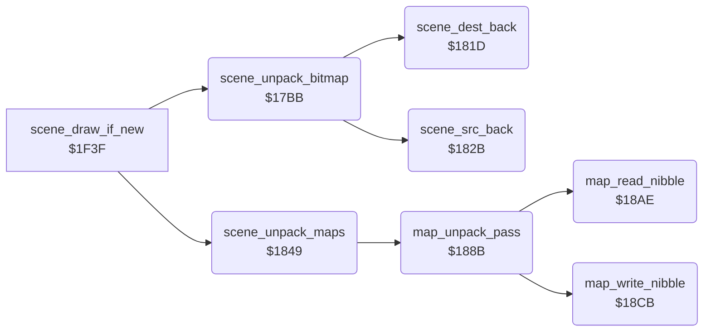

<!-- Generated by c64-docs from knowledge revision 20261025T214835.634-4kntaa and .c64-re-tools/local/generated/src/source-map.json. Do not edit: change the knowledge, generate the source again, then run docs.ts generate. -->
# scenes/scene_unpack.asm: Scene unpackers: backward RLE bitmap, nibble RLE colour and screen maps, and their pointers

Range `$17BB-$18E7`. Source: [scenes/scene_unpack.asm](../../../../src/scenes/scene_unpack.asm). Index: [the reference](../../index.md).

## Routines

| Routine | Address | Reached from | Summary |
|---|---|---|---|
| [`scene_unpack_bitmap`](scene_unpack.md#scene_unpack_bitmap) | `$17BB` | [`scene_draw_if_new`](../game/title_and_scene.md#scene_draw_if_new) | Unpacks the bitmap of scene stage_counter AND 3 backwards into $e640-$f53f. |
| [`scene_dest_back`](scene_unpack.md#scene_dest_back) | `$181D` | [`scene_unpack_bitmap`](scene_unpack.md#scene_unpack_bitmap) | Moves scene_dest_ptr down by scene_run_length. |
| [`scene_src_back`](scene_unpack.md#scene_src_back) | `$182B` | [`scene_unpack_bitmap`](scene_unpack.md#scene_unpack_bitmap) | Moves scene_src_ptr down by scene_run_length plus 1 (CLC before SBC). |
| [`scene_unpack_maps`](scene_unpack.md#scene_unpack_maps) | `$1849` | [`scene_draw_if_new`](../game/title_and_scene.md#scene_draw_if_new) | Unpacks the maps of scene stage_counter AND 3 in three passes of 480 nibbles. |
| [`map_unpack_pass`](scene_unpack.md#map_unpack_pass) | `$188B` | [`scene_unpack_maps`](scene_unpack.md#scene_unpack_maps) | Unpacks one pass. |
| [`map_read_nibble`](scene_unpack.md#map_read_nibble) | `$18AE` | [`map_unpack_pass`](scene_unpack.md#map_unpack_pass) | Reads the next nibble of the packed map into map_nibble and A: the low nibble first, then the high nibble and the next byte. |
| [`map_write_nibble`](scene_unpack.md#map_write_nibble) | `$18CB` | [`map_unpack_pass`](scene_unpack.md#map_unpack_pass) | Writes map_nibble into the byte at scene_dest_ptr and steps the pointer. |

## Data

| Range | Type | Name | Read by | Written by |
|---|---|---|---|---|
| [`$1839`](../../../../src/scenes/scene_unpack.asm#L82)-`$1840` | addresses | [`scene_packed_ptrs`](../../../../src/scenes/scene_unpack.asm#L81) | [`scene_unpack_bitmap`](scene_unpack.md#scene_unpack_bitmap) |  |
| [`$1841`](../../../../src/scenes/scene_unpack.asm#L85)-`$1848` | addresses | [`scene_map_packed_ptrs`](../../../../src/scenes/scene_unpack.asm#L84) | [`scene_unpack_maps`](scene_unpack.md#scene_unpack_maps) |  |

## Call graph

A solid arrow is a call, a thick arrow a table entry. Rounded nodes are in this file.

## Details

### [`scene_unpack_bitmap`](../../../../src/scenes/scene_unpack.asm#L6) `$17BB`

*routine*

Unpacks the bitmap of scene stage_counter AND 3 backwards into $e640-$f53f. The data starts with its length. Called by scene_draw_if_new at $1f54.

- **Called from:** [`scene_draw_if_new`](../game/title_and_scene.md#scene_draw_if_new)
- **Calls:** [`scene_dest_back`](scene_unpack.md#scene_dest_back), [`scene_src_back`](scene_unpack.md#scene_src_back)
- **Reads:** [`stage_counter`](../../memory-map.md#stage_counter), [`scene_packed_ptrs`](scene_unpack.md#scene_packed_ptrs), [`scene_src_ptr`](../../memory-map.md#scene_src_ptr), [`scene_run_length`](../../memory-map.md#scene_run_length), [`scene_dest_ptr`](../../memory-map.md#scene_dest_ptr)
- **Writes:** [`scene_src_ptr`](../../memory-map.md#scene_src_ptr), [`scene_dest_ptr`](../../memory-map.md#scene_dest_ptr), [`scene_run_length`](../../memory-map.md#scene_run_length)
- **Refers to:** [`scene_packed_ptrs`](scene_unpack.md#scene_packed_ptrs), [`scene_src_ptr`](../../memory-map.md#scene_src_ptr), [`scene_dest_ptr`](../../memory-map.md#scene_dest_ptr)

| Label | Address | Comment |
|---|---|---|
| [`scene_unpack_loop`](../../../../src/scenes/scene_unpack.asm#L27) | `$17E5` |  |
| [`scene_unpack_copy`](../../../../src/scenes/scene_unpack.asm#L36) | `$17F7` |  |
| [`scene_unpack_run`](../../../../src/scenes/scene_unpack.asm#L42) | `$1800` |  |
| [`scene_unpack_fill`](../../../../src/scenes/scene_unpack.asm#L53) | `$1815` |  |
| [`scene_unpack_done`](../../../../src/scenes/scene_unpack.asm#L58) | `$181C` |  |

### [`scene_dest_back`](../../../../src/scenes/scene_unpack.asm#L61) `$181D`

*routine*

Moves scene_dest_ptr down by scene_run_length. Called by scene_unpack_bitmap.

- **Called from:** [`scene_unpack_bitmap`](scene_unpack.md#scene_unpack_bitmap)
- **Reads:** [`scene_dest_ptr`](../../memory-map.md#scene_dest_ptr), [`scene_run_length`](../../memory-map.md#scene_run_length)
- **Writes:** [`scene_dest_ptr`](../../memory-map.md#scene_dest_ptr)
- **Refers to:** [`scene_dest_ptr`](../../memory-map.md#scene_dest_ptr)

### [`scene_src_back`](../../../../src/scenes/scene_unpack.asm#L71) `$182B`

*routine*

Moves scene_src_ptr down by scene_run_length plus 1 (CLC before SBC). Called by scene_unpack_bitmap.

- **Called from:** [`scene_unpack_bitmap`](scene_unpack.md#scene_unpack_bitmap)
- **Reads:** [`scene_src_ptr`](../../memory-map.md#scene_src_ptr), [`scene_run_length`](../../memory-map.md#scene_run_length)
- **Writes:** [`scene_src_ptr`](../../memory-map.md#scene_src_ptr)
- **Refers to:** [`scene_src_ptr`](../../memory-map.md#scene_src_ptr)

### [`scene_packed_ptrs`](../../../../src/scenes/scene_unpack.asm#L81) `$1839-$1840`

*data*

Packed bitmap of each scene: $3f5f, $4aae, $54ac, $5cec. The data is the same as in v1, $5cb bytes higher.

- **Read by:** [`scene_unpack_bitmap`](scene_unpack.md#scene_unpack_bitmap)

### [`scene_map_packed_ptrs`](../../../../src/scenes/scene_unpack.asm#L84) `$1841-$1848`

*data*

Packed colour and screen maps of each scene for scene_unpack_maps: $68cb, $6b41, $6d96, $6fe0.

- **Read by:** [`scene_unpack_maps`](scene_unpack.md#scene_unpack_maps)

### [`scene_unpack_maps`](../../../../src/scenes/scene_unpack.asm#L87) `$1849`

*routine*

Unpacks the maps of scene stage_counter AND 3 in three passes of 480 nibbles. Pass 1 fills colour RAM $d8c8, passes 2 and 3 the high and low nibbles of screen $ccc8. Called by scene_draw_if_new at $1f51.

- **Called from:** [`scene_draw_if_new`](../game/title_and_scene.md#scene_draw_if_new)
- **Calls:** [`map_unpack_pass`](scene_unpack.md#map_unpack_pass)
- **Reads:** [`stage_counter`](../../memory-map.md#stage_counter), [`scene_map_packed_ptrs`](scene_unpack.md#scene_map_packed_ptrs)
- **Writes:** [`map_src_ptr`](../../memory-map.md#map_src_ptr), [`map_src_mask`](../../memory-map.md#map_src_mask), [`map_dest_mask`](../../memory-map.md#map_dest_mask), [`scene_dest_ptr`](../../memory-map.md#scene_dest_ptr)
- **Refers to:** [`scene_map_packed_ptrs`](scene_unpack.md#scene_map_packed_ptrs), [`map_src_ptr`](../../memory-map.md#map_src_ptr), [`scene_dest_ptr`](../../memory-map.md#scene_dest_ptr)

### [`map_unpack_pass`](../../../../src/scenes/scene_unpack.asm#L112) `$188B`

*routine*

Unpacks one pass. A control nibble n gives count n AND 7; count 0 ends the pass. Bit 3 clear: copy count nibbles. Bit 3 set: write the next nibble count times. Called by scene_unpack_maps.

- **Called from:** [`scene_unpack_maps`](scene_unpack.md#scene_unpack_maps)
- **Calls:** [`map_read_nibble`](scene_unpack.md#map_read_nibble), [`map_write_nibble`](scene_unpack.md#map_write_nibble)
- **Reads:** [`map_nibble`](../../memory-map.md#map_nibble)

| Label | Address | Comment |
|---|---|---|
| [`map_copy_loop`](../../../../src/scenes/scene_unpack.asm#L119) | `$1897` |  |
| [`map_fill_run`](../../../../src/scenes/scene_unpack.asm#L125) | `$18A2` |  |
| [`map_fill_loop`](../../../../src/scenes/scene_unpack.asm#L127) | `$18A5` |  |
| [`map_pass_done`](../../../../src/scenes/scene_unpack.asm#L132) | `$18AD` |  |

### [`map_read_nibble`](../../../../src/scenes/scene_unpack.asm#L135) `$18AE`

*routine*

Reads the next nibble of the packed map into map_nibble and A: the low nibble first, then the high nibble and the next byte. Called by map_unpack_pass.

- **Called from:** [`map_unpack_pass`](scene_unpack.md#map_unpack_pass)
- **Reads:** [`map_src_ptr`](../../memory-map.md#map_src_ptr), [`map_src_mask`](../../memory-map.md#map_src_mask)
- **Writes:** [`map_src_ptr`](../../memory-map.md#map_src_ptr), [`map_nibble`](../../memory-map.md#map_nibble), [`map_src_mask`](../../memory-map.md#map_src_mask)
- **Refers to:** [`map_src_ptr`](../../memory-map.md#map_src_ptr)

| Label | Address | Comment |
|---|---|---|
| [`map_read_store`](../../../../src/scenes/scene_unpack.asm#L148) | `$18C6` |  |

### [`map_write_nibble`](../../../../src/scenes/scene_unpack.asm#L153) `$18CB`

*routine*

Writes map_nibble into the byte at scene_dest_ptr and steps the pointer. map_dest_mask $f0 keeps bits 4-7; $0f keeps bits 0-3 and shifts the nibble up. Called by map_unpack_pass.

- **Called from:** [`map_unpack_pass`](scene_unpack.md#map_unpack_pass)
- **Reads:** [`scene_dest_ptr`](../../memory-map.md#scene_dest_ptr), [`map_dest_mask`](../../memory-map.md#map_dest_mask), [`map_nibble`](../../memory-map.md#map_nibble), [`map_dest_keep`](../../memory-map.md#map_dest_keep)
- **Writes:** [`map_dest_keep`](../../memory-map.md#map_dest_keep), [`scene_dest_ptr`](../../memory-map.md#scene_dest_ptr)
- **Refers to:** [`scene_dest_ptr`](../../memory-map.md#scene_dest_ptr)

| Label | Address | Comment |
|---|---|---|
| [`map_write_merge`](../../../../src/scenes/scene_unpack.asm#L165) | `$18DD` |  |
| [`map_write_exit`](../../../../src/scenes/scene_unpack.asm#L169) | `$18E7` |  |
