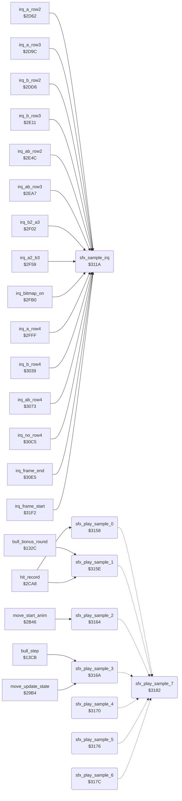

<!-- Generated by c64-docs from knowledge revision 20261022T104543.905-o1bqdy and .c64-re-tools/local/generated/src/source-map.json. Do not edit: change the knowledge, generate the source again, then run docs.ts generate. -->
# sfx/sfx_sample_player.asm: 1-bit sample player: CIA1 timer B IRQ and the sample start entries

Range `$311A-$31F1`. Source: [sfx/sfx_sample_player.asm](../../../../src/sfx/sfx_sample_player.asm). Index: [the reference](../../index.md).

## Call graph

A solid arrow is a call, a thick arrow a table entry, a dotted arrow a jump. Rounded nodes are in this file.

## Names

### [`sfx_sample_irq`](../../../../src/sfx/sfx_sample_player.asm#L6) `$311A`

*routine*

CIA1 timer B IRQ of the 1-bit sample player. The raster handlers acknowledge CIA1, do CLI and jump here. It toggles the SID volume between 0 and 15, reads the next sample byte and loads the time to the next toggle from sfx_period_hi/lo. At the end of the sample it sets sfx_done = $ff and leaves timer B stopped.

- **Called from:** [`irq_a_row2`](../irq/irq_sprite_rows.md#irq_a_row2) [`$2D68`](../../../../src/irq/irq_sprite_rows.asm#L10), [`irq_a_row3`](../irq/irq_sprite_rows.md#irq_a_row3) [`$2DA2`](../../../../src/irq/irq_sprite_rows.asm#L45), [`irq_b_row2`](../irq/irq_sprite_rows.md#irq_b_row2) [`$2DDC`](../../../../src/irq/irq_sprite_rows.asm#L80), [`irq_b_row3`](../irq/irq_sprite_rows.md#irq_b_row3) [`$2E17`](../../../../src/irq/irq_sprite_rows.asm#L116), [`irq_ab_row2`](../irq/irq_sprite_rows.md#irq_ab_row2) [`$2E52`](../../../../src/irq/irq_sprite_rows.asm#L152), [`irq_ab_row3`](../irq/irq_sprite_rows.md#irq_ab_row3) [`$2EAD`](../../../../src/irq/irq_sprite_rows.asm#L206), [`irq_b2_a3`](../irq/irq_sprite_rows.md#irq_b2_a3) [`$2F08`](../../../../src/irq/irq_sprite_rows.asm#L260), [`irq_a2_b3`](../irq/irq_sprite_rows.md#irq_a2_b3) [`$2F5F`](../../../../src/irq/irq_sprite_rows.asm#L312), [`irq_bitmap_on`](../irq/irq_screen_split.md#irq_bitmap_on) [`$2FB6`](../../../../src/irq/irq_screen_split.asm#L10), [`irq_a_row4`](../irq/irq_screen_split.md#irq_a_row4) [`$3005`](../../../../src/irq/irq_screen_split.asm#L58), [`irq_b_row4`](../irq/irq_screen_split.md#irq_b_row4) [`$303F`](../../../../src/irq/irq_screen_split.asm#L86), [`irq_ab_row4`](../irq/irq_screen_split.md#irq_ab_row4) [`$3079`](../../../../src/irq/irq_screen_split.asm#L114), [`irq_no_row4`](../irq/irq_screen_split.md#irq_no_row4) [`$30CB`](../../../../src/irq/irq_screen_split.asm#L154), [`irq_frame_end`](../irq/irq_screen_split.md#irq_frame_end) [`$30EB`](../../../../src/irq/irq_screen_split.asm#L169), [`irq_frame_start`](../irq/sprite_mux_plan.md#irq_frame_start) [`$31F8`](../../../../src/irq/sprite_mux_plan.asm#L10)
- **Reads:** [`sfx_volume`](../../memory-map.md#sfx_volume), [`sfx_sample_ptr`](../../memory-map.md#sfx_sample_ptr), [`sfx_sample_ptr+1`](../../memory-map.md#sfx_sample_ptr), [`sfx_sample_end`](../../memory-map.md#sfx_sample_end), [`sfx_sample_end+1`](../../memory-map.md#sfx_sample_end)
- **Writes:** [`SIGVOL`](../../memory-map.md#SIGVOL), [`sfx_volume`](../../memory-map.md#sfx_volume), [`CIATBHI`](../../memory-map.md#CIATBHI), [`CIATBLO`](../../memory-map.md#CIATBLO), [`sfx_sample_ptr`](../../memory-map.md#sfx_sample_ptr), [`sfx_sample_ptr+1`](../../memory-map.md#sfx_sample_ptr), [`sfx_done`](../../memory-map.md#sfx_done), [`CIACRB`](../../memory-map.md#CIACRB)
- **Refers to:** [`sfx_period_hi`](../../memory-map.md#sfx_period_hi), [`sfx_period_lo`](../../memory-map.md#sfx_period_lo), [`sfx_sample_ptr`](../../memory-map.md#sfx_sample_ptr), [`sfx_sample_end`](../../memory-map.md#sfx_sample_end)

### [`sfx_check_end`](../../../../src/sfx/sfx_sample_player.asm#L22) `$313D`

*label*

Continue while sfx_sample_end >= sfx_sample_ptr: the end byte is played

- **Jumped to from:** [`sfx_sample_irq`](sfx_sample_player.md#sfx_sample_irq) [`$3139`](../../../../src/sfx/sfx_sample_player.asm#L21)

### [`sfx_next_period`](../../../../src/sfx/sfx_sample_player.asm#L34) `$314F`

*label*

- **Jumped to from:** [`sfx_sample_irq`](sfx_sample_player.md#sfx_sample_irq) [`$3145`](../../../../src/sfx/sfx_sample_player.asm#L27)

### [`sfx_play_sample_0`](../../../../src/sfx/sfx_sample_player.asm#L42) `$3158`

*routine*

Starts sample 0: X = 0, the offset of entry 0 in sample_table. Called at $2ce7 when the opponent gets hit reaction $16 (the fall after most attacks). It keeps X.
Saved for the exit at $31ef

- **Called from:** [`hit_record`](../fighter/hit_test.md#hit_record) [`$2CE7`](../../../../src/fighter/hit_test.asm#L224)
- **Jumps to:** [`sfx_sample_start`](sfx_sample_player.md#sfx_sample_start)
- **Writes:** [`sfx_saved_x`](../../memory-map.md#sfx_saved_x)

### [`sfx_play_sample_1`](../../../../src/sfx/sfx_sample_player.asm#L47) `$315E`

*routine*

Starts sample 1: X = 4, the offset of entry 1 in sample_table. Called at $2cdc (hit reaction $1b), $2cf2 (hit reaction $1a) and $13b7 (the bull hits fighter 0). It keeps X.

- **Called from:** [`bull_bonus_round`](../game/bull_round_12f8.md#bull_bonus_round) [`$13B7`](../../../../src/game/bull_round_12f8.asm#L109), [`hit_record`](../fighter/hit_test.md#hit_record) [`$2CDC`](../../../../src/fighter/hit_test.asm#L218), [`hit_record`](../fighter/hit_test.md#hit_record) [`$2CF2`](../../../../src/fighter/hit_test.asm#L230)
- **Jumps to:** [`sfx_sample_start`](sfx_sample_player.md#sfx_sample_start)
- **Writes:** [`sfx_saved_x`](../../memory-map.md#sfx_saved_x)

### [`sfx_play_sample_2`](../../../../src/sfx/sfx_sample_player.asm#L52) `$3164`

*routine*

Starts sample 2: X = 8, the offset of entry 2 in sample_table. Called at $2b54 in move_start_anim when an attack move starts (move_attack_flags not 0). It keeps X.

- **Called from:** [`move_start_anim`](../fighter/fighter_moves.md#move_start_anim) [`$2B54`](../../../../src/fighter/fighter_moves.asm#L272)
- **Jumps to:** [`sfx_sample_start`](sfx_sample_player.md#sfx_sample_start)
- **Writes:** [`sfx_saved_x`](../../memory-map.md#sfx_saved_x)

### [`sfx_play_sample_3`](../../../../src/sfx/sfx_sample_player.asm#L57) `$316A`

*routine*

Starts sample 3: X = 12, the offset of entry 3 in sample_table. Called at $29e9 when a fighter reaches frame $28 or $2c (the floor pose of reactions $1a and $16), and at $141f (bull run start). It keeps X.

- **Called from:** [`bull_step`](../game/bull_round_12f8.md#bull_step) [`$141F`](../../../../src/game/bull_round_12f8.asm#L172), [`move_update_state`](../fighter/fighter_moves.md#move_update_state) [`$29E9`](../../../../src/fighter/fighter_moves.asm#L37)
- **Jumps to:** [`sfx_sample_start`](sfx_sample_player.md#sfx_sample_start)
- **Writes:** [`sfx_saved_x`](../../memory-map.md#sfx_saved_x)

### [`sfx_play_sample_4`](../../../../src/sfx/sfx_sample_player.asm#L62) `$3170`

*routine*

Starts sample 4: X = 16. Nothing calls this entry, and no run executed it. Table entry 4 at $f550 holds sample bytes, not offsets.

- **Jumps to:** [`sfx_sample_start`](sfx_sample_player.md#sfx_sample_start)
- **Writes:** [`sfx_saved_x`](../../memory-map.md#sfx_saved_x)

### [`sfx_play_sample_5`](../../../../src/sfx/sfx_sample_player.asm#L68) `$3176`

*routine*

Starts sample 5: X = 20. Nothing calls this entry, and no run executed it. Table entry 5 at $f554 holds sample bytes, not offsets.

- **Jumps to:** [`sfx_sample_start`](sfx_sample_player.md#sfx_sample_start)
- **Writes:** [`sfx_saved_x`](../../memory-map.md#sfx_saved_x)

### [`sfx_play_sample_6`](../../../../src/sfx/sfx_sample_player.asm#L73) `$317C`

*routine*

Starts sample 6: X = 24. Nothing calls this entry, and no run executed it. Table entry 6 at $f558 holds sample bytes, not offsets.

- **Jumps to:** [`sfx_sample_start`](sfx_sample_player.md#sfx_sample_start)
- **Writes:** [`sfx_saved_x`](../../memory-map.md#sfx_saved_x)

### [`sfx_play_sample_7`](../../../../src/sfx/sfx_sample_player.asm#L78) `$3182`

*routine*

Starts sample 7: X = 28. Nothing calls this entry, and no run executed it. Table entry 7 at $f55c holds sample bytes, not offsets.

- **Reads:** [`samples_off`](../../memory-map.md#samples_off), [`sfx_table_unused+12`](sfx_samples_f540.md#sfx_table_unused), [`sfx_table_unused+13`](sfx_samples_f540.md#sfx_table_unused), [`sfx_table_unused+14`](sfx_samples_f540.md#sfx_table_unused), [`sfx_table_unused+15`](sfx_samples_f540.md#sfx_table_unused), [`CIAICR`](../../memory-map.md#CIAICR), [`sfx_saved_x`](../../memory-map.md#sfx_saved_x)
- **Writes:** [`sfx_saved_x`](../../memory-map.md#sfx_saved_x), [`CIAICR`](../../memory-map.md#CIAICR), [`CIACRA`](../../memory-map.md#CIACRA), [`CIACRB`](../../memory-map.md#CIACRB), [`sfx_sample_ptr`](../../memory-map.md#sfx_sample_ptr), [`sfx_sample_ptr+1`](../../memory-map.md#sfx_sample_ptr), [`sfx_sample_end`](../../memory-map.md#sfx_sample_end), [`sfx_sample_end+1`](../../memory-map.md#sfx_sample_end), [`CIATALO`](../../memory-map.md#CIATALO), [`CIATALO+1`](../../memory-map.md#CIATALO), [`sfx_done`](../../memory-map.md#sfx_done), [`RANDOM`](../../memory-map.md#RANDOM), [`ENV3`](../../memory-map.md#ENV3), [`sfx_volume`](../../memory-map.md#sfx_volume), [`CIATBLO`](../../memory-map.md#CIATBLO), [`CIATBHI`](../../memory-map.md#CIATBHI)
- **Refers to:** [`sfx_sample_table`](sfx_samples_f540.md#sfx_sample_table), [`sfx_sample_ptr`](../../memory-map.md#sfx_sample_ptr), [`sfx_sample_end`](../../memory-map.md#sfx_sample_end), [`judge_sprite_scene23`](../graphics/judge_sprites_d000_d3c0.md#judge_sprite_scene23)

### [`sfx_sample_start`](../../../../src/sfx/sfx_sample_player.asm#L82) `$3186`

*label*

Common part of the sample start entries, X = 4 * sample number. When samples_off is not 0 (DEL on the title), it starts nothing; a sample that plays goes on to its end. Else it stops the CIA1 timers and IRQs and sets the read and end pointers from sample_table. Then it clears the SID and starts timers A and B with the timer B IRQ on.

- **Jumped to from:** [`sfx_play_sample_0`](sfx_sample_player.md#sfx_play_sample_0) [`$315C`](../../../../src/sfx/sfx_sample_player.asm#L45), [`sfx_play_sample_1`](sfx_sample_player.md#sfx_play_sample_1) [`$3162`](../../../../src/sfx/sfx_sample_player.asm#L50), [`sfx_play_sample_2`](sfx_sample_player.md#sfx_play_sample_2) [`$3168`](../../../../src/sfx/sfx_sample_player.asm#L55), [`sfx_play_sample_3`](sfx_sample_player.md#sfx_play_sample_3) [`$316E`](../../../../src/sfx/sfx_sample_player.asm#L60), [`sfx_play_sample_4`](sfx_sample_player.md#sfx_play_sample_4) [`$3174`](../../../../src/sfx/sfx_sample_player.asm#L66), [`sfx_play_sample_5`](sfx_sample_player.md#sfx_play_sample_5) [`$317A`](../../../../src/sfx/sfx_sample_player.asm#L71), [`sfx_play_sample_6`](sfx_sample_player.md#sfx_play_sample_6) [`$3180`](../../../../src/sfx/sfx_sample_player.asm#L76)

### [`sfx_clear_sid_loop`](../../../../src/sfx/sfx_sample_player.asm#L108) `$31C5`

*label*

- **Jumped to from:** [`sfx_play_sample_7`](sfx_sample_player.md#sfx_play_sample_7) [`$31C9`](../../../../src/sfx/sfx_sample_player.asm#L111)

### [`sfx_sample_start_exit`](../../../../src/sfx/sfx_sample_player.asm#L124) `$31EF`

*label*

- **Jumped to from:** [`sfx_play_sample_7`](sfx_sample_player.md#sfx_play_sample_7) [`$3188`](../../../../src/sfx/sfx_sample_player.asm#L84)
