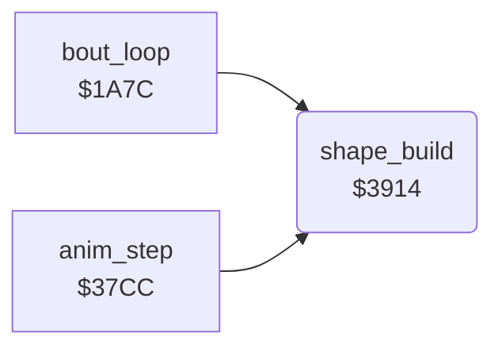

<!-- Generated by c64-docs from knowledge revision 20261021T021734.812-ub0xzr and src/source-map.json. Do not edit: change the knowledge, generate the source again, then run docs.ts generate. -->
# shape_build.asm: Shape builder: tables, entry, normal copy of the 9 sprite parts, shadow pointers, direct bull pointers

Range `$38B0-$3BC4`. Source: [shape_build.asm](../../../src/shape_build.asm). Index: [the reference](../index.md).

## Call graph

A solid arrow is a call, a thick arrow a table entry, a dotted arrow a jump. Rounded nodes are in this file.

## Data

| Range | Type | Name | Read by | Written by |
|---|---|---|---|---|
| [`$38B0`](../../../src/shape_build.asm#L7)-`$38B3` | bytes | [`shape_part_lo`](../../../src/shape_build.asm#L6) |  |  |
| [`$38B4`](../../../src/shape_build.asm#L10)-`$38D7` | bytes of 9 | [`shape_ptr_lists`](../../../src/shape_build.asm#L9) |  |  |
| [`$38D8`](../../../src/shape_build.asm#L16)-`$38FB` | unused | [`shape_unused_mirror_lists`](../../../src/shape_build.asm#L15) |  |  |
| [`$38FC`](../../../src/shape_build.asm#L23)-`$3903` | addresses-split | [`shape_ptr_list_lo`](../../../src/shape_build.asm#L22) |  |  |
| [`$3904`](../../../src/shape_build.asm#L28)-`$390B` | unused | [`shape_unused_mlist_lo`](../../../src/shape_build.asm#L27) |  |  |
| [`$390C`](../../../src/shape_build.asm#L33)-`$3913` | addresses-split | [`shape_buffer_lo`](../../../src/shape_build.asm#L32) |  |  |
| [`$3B5D`](../../../src/shape_build.asm#L394)-`$3B64` | bytes | [`shape_row4_frames`](../../../src/shape_build.asm#L393) | [`shape_build`](shape_build.md#shape_build) |  |
| [`$3B65`](../../../src/shape_build.asm#L397)-`$3B74` | bytes of 8 | [`shape_row4_left`](../../../src/shape_build.asm#L396) | [`shape_build`](shape_build.md#shape_build) |  |
| [`$3B75`](../../../src/shape_build.asm#L401)-`$3B84` | bytes of 8 | [`shape_row4_mid`](../../../src/shape_build.asm#L400) | [`shape_build`](shape_build.md#shape_build) |  |
| [`$3B85`](../../../src/shape_build.asm#L404)-`$3B94` | bytes of 8 | [`shape_row4_right`](../../../src/shape_build.asm#L403) | [`shape_build`](shape_build.md#shape_build) |  |

## Names

### [`shape_part_lo`](../../../src/shape_build.asm#L6) `$38B0-$38B3`

*data*

Low byte of a 64-byte part in its page, indexed by part AND 3. With the page table $7f00 the source is $8000 + part*64.

- **Referred to by:** [`shape_build`](shape_build.md#shape_build) [`$3963`](../../../src/shape_build.asm#L83), [`shape_build`](shape_build.md#shape_build) [`$3997`](../../../src/shape_build.asm#L115), [`shape_build`](shape_build.md#shape_build) [`$39CB`](../../../src/shape_build.asm#L147), [`shape_build`](shape_build.md#shape_build) [`$39FF`](../../../src/shape_build.asm#L179), [`shape_build`](shape_build.md#shape_build) [`$3A33`](../../../src/shape_build.asm#L211), [`shape_build`](shape_build.md#shape_build) [`$3A67`](../../../src/shape_build.asm#L243), [`shape_build`](shape_build.md#shape_build) [`$3A9B`](../../../src/shape_build.asm#L275), [`shape_build`](shape_build.md#shape_build) [`$3ACF`](../../../src/shape_build.asm#L307), [`shape_build`](shape_build.md#shape_build) [`$3B03`](../../../src/shape_build.asm#L339), [`shape_copy_mirrored_part`](shape_build_mirror.md#shape_copy_mirrored_part) [`$3E51`](../../../src/shape_build_mirror.asm#L299)

### [`shape_ptr_lists`](../../../src/shape_build.asm#L9) `$38B4-$38D7`

*data*

The 9 sprite pointers of each frame buffer (VIC bank $c000): buffer 0 $01-$09 ($c040), 1 $0a-$12 ($c280), 2 $13-$1b ($c4c0), 3 $1c-$24 ($c700).

- **Entry of:** [`shape_ptr_list_lo`](../tables.md#shape_ptr_list_lo)

### [`shape_unused_mirror_lists`](../../../src/shape_build.asm#L15) `$38D8-$38FB`

*data*

Unused: the 4 pointer lists of shape_ptr_lists with columns 1 and 3 of each row exchanged. Nothing reads them; the mirrored copy changes the part order instead.

### [`shape_ptr_list_lo`](../../../src/shape_build.asm#L22) `$38FC-$38FF`

*data*

Address of the pointer list of each buffer in shape_ptr_lists: low bytes $38fc, high bytes $3900.

- **Referred to by:** [`shape_build`](shape_build.md#shape_build) [`$3933`](../../../src/shape_build.asm#L56), [`$3BF1`](../../../src/shape_build_mirror.asm#L23)

### [`shape_ptr_list_hi`](../../../src/shape_build.asm#L24) `$3900-$3903`

*data*

- **Referred to by:** [`shape_build`](shape_build.md#shape_build) [`$3939`](../../../src/shape_build.asm#L58), [`$3BF7`](../../../src/shape_build_mirror.asm#L25)

### [`shape_unused_mlist_lo`](../../../src/shape_build.asm#L27) `$3904-$3907`

*data*

Unused address table of shape_unused_mirror_lists ($38d8, $38e1, $38ea, $38f3): low bytes $3904, high bytes $3908. Nothing reads it; the v2 addresses show that it is still assembled.

### [`shape_unused_mlist_hi`](../../../src/shape_build.asm#L29) `$3908-$390B`

*data*

### [`shape_buffer_lo`](../../../src/shape_build.asm#L32) `$390C-$390F`

*data*

Start of the 9 x 64 byte sprite buffer of each draw_buffer value: $c040, $c280, $c4c0, $c700. Low bytes $390c, high bytes $3910.

- **Referred to by:** [`shape_build`](shape_build.md#shape_build) [`$3929`](../../../src/shape_build.asm#L52), [`$3BC5`](../../../src/shape_build_mirror.asm#L7)

### [`shape_buffer_hi`](../../../src/shape_build.asm#L34) `$3910-$3913`

*data*

- **Referred to by:** [`shape_build`](shape_build.md#shape_build) [`$392E`](../../../src/shape_build.asm#L54), [`$3BD1`](../../../src/shape_build_mirror.asm#L11)

### [`shape_build`](../../../src/shape_build.asm#L37) `$3914`

*routine*

Shows fighter_frame of fighter X. With shape_page_offset 0 it builds the 9 sprites into a hidden buffer (shape_build_copy). When it is not 0 (the bull), it takes the sprite pointers directly from the part tables ($3b95). Callers: anim_step $3834, time up $1ae2/$1ae7.

- **Called from:** [`bout_loop`](bout_loop.md#bout_loop) [`$1AE2`](../../../src/bout_loop.asm#L103), [`bout_loop`](bout_loop.md#bout_loop) [`$1AE7`](../../../src/bout_loop.asm#L105), [`anim_step`](anim_step.md#anim_step) [`$3834`](../../../src/anim_step.asm#L80)
- **Jumps to:** [`shape_build_mirrored`](shape_build_mirror.md#shape_build_mirrored)
- **Reads:** [`shape_page_offset`](../memory-map.md#shape_page_offset), [`shape_parts+7`](fighter_shapes_8000.md#shape_parts), [`shape_parts+8`](fighter_shapes_8000.md#shape_parts), [`shape_parts+62`](fighter_shapes_8000.md#shape_parts), [`shape_parts+63`](fighter_shapes_8000.md#shape_parts), [`shape_dest_ptr`](../memory-map.md#shape_dest_ptr), [`shape_dest_ptr+1`](../memory-map.md#shape_dest_ptr), [`part_ptr_build`](../memory-map.md#part_ptr_build), [`part_ptr_build+1`](../memory-map.md#part_ptr_build), [`part_ptr_build+2`](../memory-map.md#part_ptr_build), [`part_ptr_build+3`](../memory-map.md#part_ptr_build), [`part_ptr_build+4`](../memory-map.md#part_ptr_build), [`part_ptr_build+5`](../memory-map.md#part_ptr_build), [`part_ptr_build+6`](../memory-map.md#part_ptr_build), [`part_ptr_build+7`](../memory-map.md#part_ptr_build), [`part_ptr_build+8`](../memory-map.md#part_ptr_build)
- **Writes:** [`shape_dest_ptr`](../memory-map.md#shape_dest_ptr), [`shape_dest_ptr+1`](../memory-map.md#shape_dest_ptr), [`part_ptr_build+7`](../memory-map.md#part_ptr_build), [`part_ptr_build+8`](../memory-map.md#part_ptr_build), [`part_ptr_build`](../memory-map.md#part_ptr_build), [`part_ptr_build+1`](../memory-map.md#part_ptr_build), [`part_ptr_build+2`](../memory-map.md#part_ptr_build), [`part_ptr_build+3`](../memory-map.md#part_ptr_build), [`part_ptr_build+4`](../memory-map.md#part_ptr_build), [`part_ptr_build+5`](../memory-map.md#part_ptr_build), [`part_ptr_build+6`](../memory-map.md#part_ptr_build)
- **Refers to:** [`shape_buffer_lo`](shape_build.md#shape_buffer_lo), [`shape_buffer_hi`](shape_build.md#shape_buffer_hi), [`shape_dest_ptr`](../memory-map.md#shape_dest_ptr), [`shape_ptr_list_lo`](shape_build.md#shape_ptr_list_lo), [`shape_ptr_list_hi`](shape_build.md#shape_ptr_list_hi), [`frame_parts_top_left`](frame_part_tables.md#frame_parts_top_left), [`shape_part_page_table`](shape_lookup_tables.md#shape_part_page_table), [`shape_part_lo`](shape_build.md#shape_part_lo), [`frame_parts_top_mid`](frame_part_tables.md#frame_parts_top_mid), [`part_ptr_build`](../memory-map.md#part_ptr_build), [`frame_parts_top_right`](frame_part_tables.md#frame_parts_top_right), [`frame_parts_mid_left`](frame_part_tables.md#frame_parts_mid_left), [`frame_parts_mid_mid`](frame_part_tables.md#frame_parts_mid_mid), [`frame_parts_mid_right`](frame_part_tables.md#frame_parts_mid_right), [`frame_parts_low_left`](frame_part_tables.md#frame_parts_low_left), [`frame_parts_low_mid`](frame_part_tables.md#frame_parts_low_mid), [`frame_parts_low_right`](frame_part_tables.md#frame_parts_low_right), [`fighter_part_ptrs`](../memory-map.md#fighter_part_ptrs)

### [`shape_build_copy`](../../../src/shape_build.asm#L42) `$391B`

*label*

Toggles draw_buffer (0/1 fighter 0, 2/3 fighter 1), copies the 9 parts into that buffer and then publishes the 9 pointers. Facing 1 uses the mirrored copy shape_build_mirrored $3bc5.

- **Jumped to from:** [`shape_build`](shape_build.md#shape_build) [`$3916`](../../../src/shape_build.asm#L39)

### [`shape_build_normal`](../../../src/shape_build.asm#L51) `$3929`

*label*

Normal copy: slot n gets part table n ($7ae0 + n*$4f) at fighter_frame. Slots 0-2 are row 1, 3-5 row 2, 6-8 row 3, left to right.

- **Jumped to from:** [`shape_build`](shape_build.md#shape_build) [`$3924`](../../../src/shape_build.asm#L48)

### [`shape_copy_ptr_list`](../../../src/shape_build.asm#L61) `$3941`

*label*

- **Jumped to from:** [`shape_build`](shape_build.md#shape_build) [`$3948`](../../../src/shape_build.asm#L67)

### [`shape_ptr_src_lo`](../../../src/shape_build.asm#L62) `$3942`

*variable*

- **Written by:** [`shape_build`](shape_build.md#shape_build) [`$3936`](../../../src/shape_build.asm#L57)

### [`shape_ptr_src_hi`](../../../src/shape_build.asm#L63) `$3943-$3955`

*variable*

- **Written by:** [`shape_build`](shape_build.md#shape_build) [`$393C`](../../../src/shape_build.asm#L59)

### [`shape_part0_copy`](../../../src/shape_build.asm#L75) `$3956`

*label*

Source page = $7f00[part] + shape_page_offset

- **Jumped to from:** [`shape_build`](shape_build.md#shape_build) [`$3950`](../../../src/shape_build.asm#L72)

### [`shape_part0_loop`](../../../src/shape_build.asm#L86) `$396B`

*label*

- **Jumped to from:** [`shape_build`](shape_build.md#shape_build) [`$3971`](../../../src/shape_build.asm#L92)

### [`shape_part0_src_lo`](../../../src/shape_build.asm#L87) `$396C`

*variable*

- **Written by:** [`shape_build`](shape_build.md#shape_build) [`$3966`](../../../src/shape_build.asm#L84)

### [`shape_part0_src_hi`](../../../src/shape_build.asm#L88) `$396D-$3972`

*variable*

- **Written by:** [`shape_build`](shape_build.md#shape_build) [`$395C`](../../../src/shape_build.asm#L79)

### [`shape_part0_next`](../../../src/shape_build.asm#L93) `$3973`

*label*

Next 64-byte sprite in the buffer, also for an empty slot

- **Jumped to from:** [`shape_build`](shape_build.md#shape_build) [`$3954`](../../../src/shape_build.asm#L74)

### [`shape_part1`](../../../src/shape_build.asm#L100) `$397E`

*label*

- **Jumped to from:** [`shape_build`](shape_build.md#shape_build) [`$397A`](../../../src/shape_build.asm#L98)

### [`shape_part1_copy`](../../../src/shape_build.asm#L107) `$398A`

*label*

- **Jumped to from:** [`shape_build`](shape_build.md#shape_build) [`$3984`](../../../src/shape_build.asm#L104)

### [`shape_part1_loop`](../../../src/shape_build.asm#L118) `$399F`

*label*

- **Jumped to from:** [`shape_build`](shape_build.md#shape_build) [`$39A5`](../../../src/shape_build.asm#L124)

### [`shape_part1_src_lo`](../../../src/shape_build.asm#L119) `$39A0`

*variable*

- **Written by:** [`shape_build`](shape_build.md#shape_build) [`$399A`](../../../src/shape_build.asm#L116)

### [`shape_part1_src_hi`](../../../src/shape_build.asm#L120) `$39A1-$39A6`

*variable*

- **Written by:** [`shape_build`](shape_build.md#shape_build) [`$3990`](../../../src/shape_build.asm#L111)

### [`shape_part1_next`](../../../src/shape_build.asm#L125) `$39A7`

*label*

- **Jumped to from:** [`shape_build`](shape_build.md#shape_build) [`$3988`](../../../src/shape_build.asm#L106)

### [`shape_part2`](../../../src/shape_build.asm#L132) `$39B2`

*label*

- **Jumped to from:** [`shape_build`](shape_build.md#shape_build) [`$39AE`](../../../src/shape_build.asm#L130)

### [`shape_part2_copy`](../../../src/shape_build.asm#L139) `$39BE`

*label*

- **Jumped to from:** [`shape_build`](shape_build.md#shape_build) [`$39B8`](../../../src/shape_build.asm#L136)

### [`shape_part2_loop`](../../../src/shape_build.asm#L150) `$39D3`

*label*

- **Jumped to from:** [`shape_build`](shape_build.md#shape_build) [`$39D9`](../../../src/shape_build.asm#L156)

### [`shape_part2_src_lo`](../../../src/shape_build.asm#L151) `$39D4`

*variable*

- **Written by:** [`shape_build`](shape_build.md#shape_build) [`$39CE`](../../../src/shape_build.asm#L148)

### [`shape_part2_src_hi`](../../../src/shape_build.asm#L152) `$39D5-$39DA`

*variable*

- **Written by:** [`shape_build`](shape_build.md#shape_build) [`$39C4`](../../../src/shape_build.asm#L143)

### [`shape_part2_next`](../../../src/shape_build.asm#L157) `$39DB`

*label*

- **Jumped to from:** [`shape_build`](shape_build.md#shape_build) [`$39BC`](../../../src/shape_build.asm#L138)

### [`shape_part3`](../../../src/shape_build.asm#L164) `$39E6`

*label*

- **Jumped to from:** [`shape_build`](shape_build.md#shape_build) [`$39E2`](../../../src/shape_build.asm#L162)

### [`shape_part3_copy`](../../../src/shape_build.asm#L171) `$39F2`

*label*

- **Jumped to from:** [`shape_build`](shape_build.md#shape_build) [`$39EC`](../../../src/shape_build.asm#L168)

### [`shape_part3_loop`](../../../src/shape_build.asm#L182) `$3A07`

*label*

- **Jumped to from:** [`shape_build`](shape_build.md#shape_build) [`$3A0D`](../../../src/shape_build.asm#L188)

### [`shape_part3_src_lo`](../../../src/shape_build.asm#L183) `$3A08`

*variable*

- **Written by:** [`shape_build`](shape_build.md#shape_build) [`$3A02`](../../../src/shape_build.asm#L180)

### [`shape_part3_src_hi`](../../../src/shape_build.asm#L184) `$3A09-$3A0E`

*variable*

- **Written by:** [`shape_build`](shape_build.md#shape_build) [`$39F8`](../../../src/shape_build.asm#L175)

### [`shape_part3_next`](../../../src/shape_build.asm#L189) `$3A0F`

*label*

- **Jumped to from:** [`shape_build`](shape_build.md#shape_build) [`$39F0`](../../../src/shape_build.asm#L170)

### [`shape_part4`](../../../src/shape_build.asm#L196) `$3A1A`

*label*

- **Jumped to from:** [`shape_build`](shape_build.md#shape_build) [`$3A16`](../../../src/shape_build.asm#L194)

### [`shape_part4_copy`](../../../src/shape_build.asm#L203) `$3A26`

*label*

- **Jumped to from:** [`shape_build`](shape_build.md#shape_build) [`$3A20`](../../../src/shape_build.asm#L200)

### [`shape_part4_loop`](../../../src/shape_build.asm#L214) `$3A3B`

*label*

- **Jumped to from:** [`shape_build`](shape_build.md#shape_build) [`$3A41`](../../../src/shape_build.asm#L220)

### [`shape_part4_src_lo`](../../../src/shape_build.asm#L215) `$3A3C`

*variable*

- **Written by:** [`shape_build`](shape_build.md#shape_build) [`$3A36`](../../../src/shape_build.asm#L212)

### [`shape_part4_src_hi`](../../../src/shape_build.asm#L216) `$3A3D-$3A42`

*variable*

- **Written by:** [`shape_build`](shape_build.md#shape_build) [`$3A2C`](../../../src/shape_build.asm#L207)

### [`shape_part4_next`](../../../src/shape_build.asm#L221) `$3A43`

*label*

- **Jumped to from:** [`shape_build`](shape_build.md#shape_build) [`$3A24`](../../../src/shape_build.asm#L202)

### [`shape_part5`](../../../src/shape_build.asm#L228) `$3A4E`

*label*

- **Jumped to from:** [`shape_build`](shape_build.md#shape_build) [`$3A4A`](../../../src/shape_build.asm#L226)

### [`shape_part5_copy`](../../../src/shape_build.asm#L235) `$3A5A`

*label*

- **Jumped to from:** [`shape_build`](shape_build.md#shape_build) [`$3A54`](../../../src/shape_build.asm#L232)

### [`shape_part5_loop`](../../../src/shape_build.asm#L246) `$3A6F`

*label*

- **Jumped to from:** [`shape_build`](shape_build.md#shape_build) [`$3A75`](../../../src/shape_build.asm#L252)

### [`shape_part5_src_lo`](../../../src/shape_build.asm#L247) `$3A70`

*variable*

- **Written by:** [`shape_build`](shape_build.md#shape_build) [`$3A6A`](../../../src/shape_build.asm#L244)

### [`shape_part5_src_hi`](../../../src/shape_build.asm#L248) `$3A71-$3A76`

*variable*

- **Written by:** [`shape_build`](shape_build.md#shape_build) [`$3A60`](../../../src/shape_build.asm#L239)

### [`shape_part5_next`](../../../src/shape_build.asm#L253) `$3A77`

*label*

- **Jumped to from:** [`shape_build`](shape_build.md#shape_build) [`$3A58`](../../../src/shape_build.asm#L234)

### [`shape_part6`](../../../src/shape_build.asm#L260) `$3A82`

*label*

- **Jumped to from:** [`shape_build`](shape_build.md#shape_build) [`$3A7E`](../../../src/shape_build.asm#L258)

### [`shape_part6_copy`](../../../src/shape_build.asm#L267) `$3A8E`

*label*

- **Jumped to from:** [`shape_build`](shape_build.md#shape_build) [`$3A88`](../../../src/shape_build.asm#L264)

### [`shape_part6_loop`](../../../src/shape_build.asm#L278) `$3AA3`

*label*

- **Jumped to from:** [`shape_build`](shape_build.md#shape_build) [`$3AA9`](../../../src/shape_build.asm#L284)

### [`shape_part6_src_lo`](../../../src/shape_build.asm#L279) `$3AA4`

*variable*

- **Written by:** [`shape_build`](shape_build.md#shape_build) [`$3A9E`](../../../src/shape_build.asm#L276)

### [`shape_part6_src_hi`](../../../src/shape_build.asm#L280) `$3AA5-$3AAA`

*variable*

- **Written by:** [`shape_build`](shape_build.md#shape_build) [`$3A94`](../../../src/shape_build.asm#L271)

### [`shape_part6_next`](../../../src/shape_build.asm#L285) `$3AAB`

*label*

- **Jumped to from:** [`shape_build`](shape_build.md#shape_build) [`$3A8C`](../../../src/shape_build.asm#L266)

### [`shape_part7`](../../../src/shape_build.asm#L292) `$3AB6`

*label*

- **Jumped to from:** [`shape_build`](shape_build.md#shape_build) [`$3AB2`](../../../src/shape_build.asm#L290)

### [`shape_part7_copy`](../../../src/shape_build.asm#L299) `$3AC2`

*label*

- **Jumped to from:** [`shape_build`](shape_build.md#shape_build) [`$3ABC`](../../../src/shape_build.asm#L296)

### [`shape_part7_loop`](../../../src/shape_build.asm#L310) `$3AD7`

*label*

- **Jumped to from:** [`shape_build`](shape_build.md#shape_build) [`$3ADD`](../../../src/shape_build.asm#L316)

### [`shape_part7_src_lo`](../../../src/shape_build.asm#L311) `$3AD8`

*variable*

- **Written by:** [`shape_build`](shape_build.md#shape_build) [`$3AD2`](../../../src/shape_build.asm#L308)

### [`shape_part7_src_hi`](../../../src/shape_build.asm#L312) `$3AD9-$3ADE`

*variable*

- **Written by:** [`shape_build`](shape_build.md#shape_build) [`$3AC8`](../../../src/shape_build.asm#L303)

### [`shape_part7_next`](../../../src/shape_build.asm#L317) `$3ADF`

*label*

- **Jumped to from:** [`shape_build`](shape_build.md#shape_build) [`$3AC0`](../../../src/shape_build.asm#L298)

### [`shape_part8`](../../../src/shape_build.asm#L324) `$3AEA`

*label*

- **Jumped to from:** [`shape_build`](shape_build.md#shape_build) [`$3AE6`](../../../src/shape_build.asm#L322)

### [`shape_part8_copy`](../../../src/shape_build.asm#L331) `$3AF6`

*label*

- **Jumped to from:** [`shape_build`](shape_build.md#shape_build) [`$3AF0`](../../../src/shape_build.asm#L328)

### [`shape_part8_loop`](../../../src/shape_build.asm#L342) `$3B0B`

*label*

- **Jumped to from:** [`shape_build`](shape_build.md#shape_build) [`$3B11`](../../../src/shape_build.asm#L348)

### [`shape_part8_src_lo`](../../../src/shape_build.asm#L343) `$3B0C`

*variable*

- **Written by:** [`shape_build`](shape_build.md#shape_build) [`$3B06`](../../../src/shape_build.asm#L340)

### [`shape_part8_src_hi`](../../../src/shape_build.asm#L344) `$3B0D-$3B12`

*variable*

- **Written by:** [`shape_build`](shape_build.md#shape_build) [`$3AFC`](../../../src/shape_build.asm#L335)

### [`shape_publish_ptrs`](../../../src/shape_build.asm#L350) `$3B13`

*label*

Copies the 9 new pointers to fighter_part_ptrs ($02+2n+X); the IRQ at line 0 reads them. Then it looks for fighter_frame in shape_row4_frames.

- **Jumped to from:** [`shape_build`](shape_build.md#shape_build) [`$3AF4`](../../../src/shape_build.asm#L330), [`$3E3A`](../../../src/shape_build_mirror.asm#L286)

### [`shape_find_row4_frame`](../../../src/shape_build.asm#L370) `$3B39`

*label*

- **Jumped to from:** [`shape_build`](shape_build.md#shape_build) [`$3B41`](../../../src/shape_build.asm#L375)

### [`shape_set_row4`](../../../src/shape_build.asm#L377) `$3B44`

*label*

Not in the list: row4_ptr_* keep their old values

- **Jumped to from:** [`shape_build`](shape_build.md#shape_build) [`$3B3E`](../../../src/shape_build.asm#L373)

### [`shape_row4_load`](../../../src/shape_build.asm#L384) `$3B4D`

*label*

- **Jumped to from:** [`shape_build`](shape_build.md#shape_build) [`$3B46`](../../../src/shape_build.asm#L379)

### [`shape_row4_frames`](../../../src/shape_build.asm#L393) `$3B5D-$3B64`

*data*

The 8 frames of the jumps and somersaults (animations 5, 8, 9 and $0e) that have a floor shadow in sprite row 4.

- **Read by:** [`shape_build`](shape_build.md#shape_build) [`$3B39`](../../../src/shape_build.asm#L371) (+6), [`shape_build`](shape_build.md#shape_build) [`$3B39`](../../../src/shape_build.asm#L371) (+7)

### [`shape_row4_left`](../../../src/shape_build.asm#L396) `$3B65-$3B74`

*data*

Shadow sprite pointers of the left, middle and right column ($3b65, $3b75, $3b85): entries 0-7 facing 0, 8-15 facing 1. Pointers $52-$70 are fixed sprites at $d480-$dc3f; 0 is the blank sprite.

- **Read by:** [`shape_build`](shape_build.md#shape_build) [`$3B4D`](../../../src/shape_build.asm#L385) (+6)

### [`shape_row4_mid`](../../../src/shape_build.asm#L400) `$3B75-$3B84`

*data*

Middle column of the shadow. Entries 3-7 use the left and middle column for facing 0, and the middle and right column for facing 1.

- **Read by:** [`shape_build`](shape_build.md#shape_build) [`$3B4D`](../../../src/shape_build.asm#L385) (+4), [`shape_build`](shape_build.md#shape_build) [`$3B52`](../../../src/shape_build.asm#L387) (+6)

### [`shape_row4_right`](../../../src/shape_build.asm#L403) `$3B85-$3B94`

*data*

- **Read by:** [`shape_build`](shape_build.md#shape_build) [`$3B52`](../../../src/shape_build.asm#L387) (+4), [`shape_build`](shape_build.md#shape_build) [`$3B57`](../../../src/shape_build.asm#L389) (+6)

### [`shape_direct_ptrs`](../../../src/shape_build.asm#L407) `$3B95`

*label*

Bull path: the part table values are sprite pointers in VIC bank $c000. It writes the 9 values of fighter_frame to fighter_part_ptrs. No copy, no buffer toggle, no mirror and no shadow pointers.

- **Jumped to from:** [`shape_build`](shape_build.md#shape_build) [`$3918`](../../../src/shape_build.asm#L40)

### [`shape_direct_table_hi`](../../../src/shape_build.asm#L409) `$3B99-$3BC4`

*variable*

- **Read by:** [`shape_build`](shape_build.md#shape_build) [`$3B57`](../../../src/shape_build.asm#L389)
