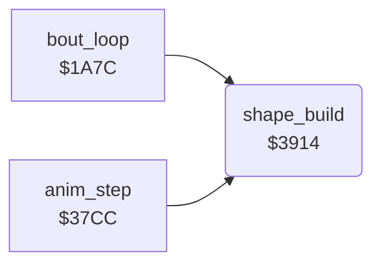

<!-- Generated by c64-docs from knowledge revision 20261025T191824.573-5s4oe2 and .c64-re-tools/local/generated/src/source-map.json. Do not edit: change the knowledge, generate the source again, then run docs.ts generate. -->
# shapes/shape_build_390c.asm

Range `$390C-$3BC4`. Source: [shapes/shape_build_390c.asm](../../../../src/shapes/shape_build_390c.asm). Index: [the reference](../../index.md).

## Routines

| Routine | Address | Reached from | Summary |
|---|---|---|---|
| [`shape_build`](shape_build_390c.md#shape_build) | `$3914` | [`bout_loop`](../game/bout_loop.md#bout_loop), [`anim_step`](../fighter/anim_step.md#anim_step) | Shows fighter_frame of fighter X. |
| [`shape_publish_ptrs`](shape_build_390c.md#shape_publish_ptrs) | `$3B13` | [`$3E3A`](../../../../src/shapes/shape_build_mirror.asm#L286) | Copies the 9 new pointers to fighter_part_ptrs ($02+2n+X); the IRQ at line 0 reads them. |

## Data

| Range | Type | Name | Read by | Written by |
|---|---|---|---|---|
| [`$390C`](../../../../src/shapes/shape_build_390c.asm#L7)-`$3913` | addresses-split | [`shape_buffer_lo`](../../../../src/shapes/shape_build_390c.asm#L6) | [`shape_build`](shape_build_390c.md#shape_build), `$3BC5`, `$3BD1` |  |
| [`$3B5D`](../../../../src/shapes/shape_build_390c.asm#L368)-`$3B64` | bytes | [`shape_row4_frames`](../../../../src/shapes/shape_build_390c.asm#L367) | [`shape_build`](shape_build_390c.md#shape_build) |  |
| [`$3B65`](../../../../src/shapes/shape_build_390c.asm#L371)-`$3B74` | bytes of 8 | [`shape_row4_left`](../../../../src/shapes/shape_build_390c.asm#L370) | [`shape_build`](shape_build_390c.md#shape_build) |  |
| [`$3B75`](../../../../src/shapes/shape_build_390c.asm#L375)-`$3B84` | bytes of 8 | [`shape_row4_mid`](../../../../src/shapes/shape_build_390c.asm#L374) | [`shape_build`](shape_build_390c.md#shape_build) |  |
| [`$3B85`](../../../../src/shapes/shape_build_390c.asm#L378)-`$3B94` | bytes of 8 | [`shape_row4_right`](../../../../src/shapes/shape_build_390c.asm#L377) | [`shape_build`](shape_build_390c.md#shape_build) |  |

## Call graph

A solid arrow is a call, a thick arrow a table entry. Rounded nodes are in this file.

## Details

### [`shape_buffer_lo`](../../../../src/shapes/shape_build_390c.asm#L6) `$390C-$390F`

*data*

Start of the 9 x 64 byte sprite buffer of each draw_buffer value: $c040, $c280, $c4c0, $c700. Low bytes $390c, high bytes $3910.

- **Read by:** [`shape_build`](shape_build_390c.md#shape_build), [`$3BC5`](../../../../src/shapes/shape_build_mirror.asm#L7)

### [`shape_buffer_hi`](../../../../src/shapes/shape_build_390c.asm#L8) `$3910-$3913`

*data*

- **Read by:** [`shape_build`](shape_build_390c.md#shape_build), [`$3BD1`](../../../../src/shapes/shape_build_mirror.asm#L11)

### [`shape_build`](../../../../src/shapes/shape_build_390c.asm#L11) `$3914`

*routine*

Shows fighter_frame of fighter X. With shape_page_offset 0 it builds the 9 sprites into a hidden buffer (shape_build_copy). When it is not 0 (the bull), it takes the sprite pointers directly from the part tables ($3b95). Callers: anim_step $3834, time up $1ae2/$1ae7.

- **Called from:** [`bout_loop`](../game/bout_loop.md#bout_loop), [`anim_step`](../fighter/anim_step.md#anim_step)
- **Jumps to:** [`shape_build_mirrored`](shape_build_mirror.md#shape_build_mirrored)
- **Reads:** [`shape_page_offset`](../../memory-map.md#shape_page_offset), [`draw_buffer`](../../memory-map.md#draw_buffer), [`fighter_facing`](../../memory-map.md#fighter_facing), [`shape_buffer_lo`](shape_build_390c.md#shape_buffer_lo), [`shape_buffer_hi`](shape_build_390c.md#shape_buffer_hi), [`shape_ptr_list_lo`](shape_build_38fc.md#shape_ptr_list_lo), [`shape_ptr_list_hi`](shape_build_38fc.md#shape_ptr_list_hi), [`shape_parts`](../graphics/fighter_shapes_8000.md#shape_parts), [`fighter_frame`](../../memory-map.md#fighter_frame), [`frame_parts_top_left`](frame_part_tables.md#frame_parts_top_left), [`shape_part_page_table`](shape_lookup_tables.md#shape_part_page_table), [`shape_part_lo`](shape_build.md#shape_part_lo) and 10 more
- **Writes:** [`draw_buffer`](../../memory-map.md#draw_buffer), [`shape_dest_ptr`](../../memory-map.md#shape_dest_ptr), [`part_ptr_build`](../../memory-map.md#part_ptr_build), [`fighter_part_ptrs`](../../memory-map.md#fighter_part_ptrs), [`row4_ptr_left`](../../memory-map.md#row4_ptr_left), [`row4_ptr_mid`](../../memory-map.md#row4_ptr_mid), [`row4_ptr_right`](../../memory-map.md#row4_ptr_right)
- **Refers to:** [`shape_dest_ptr`](../../memory-map.md#shape_dest_ptr), [`part_ptr_build`](../../memory-map.md#part_ptr_build), [`fighter_part_ptrs`](../../memory-map.md#fighter_part_ptrs)

| Label | Address | Comment |
|---|---|---|
| [`shape_build_copy`](../../../../src/shapes/shape_build_390c.asm#L16) | `$391B` | Toggles draw_buffer (0/1 fighter 0, 2/3 fighter 1), copies the 9 parts into that buffer and then publishes the 9 pointers. Facing 1 uses the mirrored copy shape_build_mirrored $3bc5. |
| [`shape_build_normal`](../../../../src/shapes/shape_build_390c.asm#L25) | `$3929` | Normal copy: slot n gets part table n ($7ae0 + n*$4f) at fighter_frame. Slots 0-2 are row 1, 3-5 row 2, 6-8 row 3, left to right. |
| [`shape_copy_ptr_list`](../../../../src/shapes/shape_build_390c.asm#L35) | `$3941` |  |
| [`shape_part0_copy`](../../../../src/shapes/shape_build_390c.asm#L49) | `$3956` | Source page = $7f00[part] + shape_page_offset |
| [`shape_part0_loop`](../../../../src/shapes/shape_build_390c.asm#L60) | `$396B` |  |
| [`shape_part0_next`](../../../../src/shapes/shape_build_390c.asm#L67) | `$3973` | Next 64-byte sprite in the buffer, also for an empty slot |
| [`shape_part1`](../../../../src/shapes/shape_build_390c.asm#L74) | `$397E` |  |
| [`shape_part1_copy`](../../../../src/shapes/shape_build_390c.asm#L81) | `$398A` |  |
| [`shape_part1_loop`](../../../../src/shapes/shape_build_390c.asm#L92) | `$399F` |  |
| [`shape_part1_next`](../../../../src/shapes/shape_build_390c.asm#L99) | `$39A7` |  |
| [`shape_part2`](../../../../src/shapes/shape_build_390c.asm#L106) | `$39B2` |  |
| [`shape_part2_copy`](../../../../src/shapes/shape_build_390c.asm#L113) | `$39BE` |  |
| [`shape_part2_loop`](../../../../src/shapes/shape_build_390c.asm#L124) | `$39D3` |  |
| [`shape_part2_next`](../../../../src/shapes/shape_build_390c.asm#L131) | `$39DB` |  |
| [`shape_part3`](../../../../src/shapes/shape_build_390c.asm#L138) | `$39E6` |  |
| [`shape_part3_copy`](../../../../src/shapes/shape_build_390c.asm#L145) | `$39F2` |  |
| [`shape_part3_loop`](../../../../src/shapes/shape_build_390c.asm#L156) | `$3A07` |  |
| [`shape_part3_next`](../../../../src/shapes/shape_build_390c.asm#L163) | `$3A0F` |  |
| [`shape_part4`](../../../../src/shapes/shape_build_390c.asm#L170) | `$3A1A` |  |
| [`shape_part4_copy`](../../../../src/shapes/shape_build_390c.asm#L177) | `$3A26` |  |
| [`shape_part4_loop`](../../../../src/shapes/shape_build_390c.asm#L188) | `$3A3B` |  |
| [`shape_part4_next`](../../../../src/shapes/shape_build_390c.asm#L195) | `$3A43` |  |
| [`shape_part5`](../../../../src/shapes/shape_build_390c.asm#L202) | `$3A4E` |  |
| [`shape_part5_copy`](../../../../src/shapes/shape_build_390c.asm#L209) | `$3A5A` |  |
| [`shape_part5_loop`](../../../../src/shapes/shape_build_390c.asm#L220) | `$3A6F` |  |
| [`shape_part5_next`](../../../../src/shapes/shape_build_390c.asm#L227) | `$3A77` |  |
| [`shape_part6`](../../../../src/shapes/shape_build_390c.asm#L234) | `$3A82` |  |
| [`shape_part6_copy`](../../../../src/shapes/shape_build_390c.asm#L241) | `$3A8E` |  |
| [`shape_part6_loop`](../../../../src/shapes/shape_build_390c.asm#L252) | `$3AA3` |  |
| [`shape_part6_next`](../../../../src/shapes/shape_build_390c.asm#L259) | `$3AAB` |  |
| [`shape_part7`](../../../../src/shapes/shape_build_390c.asm#L266) | `$3AB6` |  |
| [`shape_part7_copy`](../../../../src/shapes/shape_build_390c.asm#L273) | `$3AC2` |  |
| [`shape_part7_loop`](../../../../src/shapes/shape_build_390c.asm#L284) | `$3AD7` |  |
| [`shape_part7_next`](../../../../src/shapes/shape_build_390c.asm#L291) | `$3ADF` |  |
| [`shape_part8`](../../../../src/shapes/shape_build_390c.asm#L298) | `$3AEA` |  |
| [`shape_part8_copy`](../../../../src/shapes/shape_build_390c.asm#L305) | `$3AF6` |  |
| [`shape_part8_loop`](../../../../src/shapes/shape_build_390c.asm#L316) | `$3B0B` |  |
| [`shape_find_row4_frame`](../../../../src/shapes/shape_build_390c.asm#L344) | `$3B39` |  |
| [`shape_set_row4`](../../../../src/shapes/shape_build_390c.asm#L351) | `$3B44` | Not in the list: row4_ptr_* keep their old values |
| [`shape_row4_load`](../../../../src/shapes/shape_build_390c.asm#L358) | `$3B4D` |  |
| [`shape_direct_ptrs`](../../../../src/shapes/shape_build_390c.asm#L381) | `$3B95` | Bull path: the part table values are sprite pointers in VIC bank $c000. It writes the 9 values of fighter_frame to fighter_part_ptrs. No copy, no buffer toggle, no mirror and no shadow pointers. |

### [`shape_ptr_src_lo`](../../../../src/shapes/shape_build_390c.asm#L36) `$3942`

*variable*

- **Written by:** [`shape_build`](shape_build_390c.md#shape_build)

### [`shape_ptr_src_hi`](../../../../src/shapes/shape_build_390c.asm#L37) `$3943-$3955`

*variable*

- **Written by:** [`shape_build`](shape_build_390c.md#shape_build)

### [`shape_part0_src_lo`](../../../../src/shapes/shape_build_390c.asm#L61) `$396C`

*variable*

- **Written by:** [`shape_build`](shape_build_390c.md#shape_build)

### [`shape_part0_src_hi`](../../../../src/shapes/shape_build_390c.asm#L62) `$396D-$3972`

*variable*

- **Written by:** [`shape_build`](shape_build_390c.md#shape_build)

### [`shape_part1_src_lo`](../../../../src/shapes/shape_build_390c.asm#L93) `$39A0`

*variable*

- **Written by:** [`shape_build`](shape_build_390c.md#shape_build)

### [`shape_part1_src_hi`](../../../../src/shapes/shape_build_390c.asm#L94) `$39A1-$39A6`

*variable*

- **Written by:** [`shape_build`](shape_build_390c.md#shape_build)

### [`shape_part2_src_lo`](../../../../src/shapes/shape_build_390c.asm#L125) `$39D4`

*variable*

- **Written by:** [`shape_build`](shape_build_390c.md#shape_build)

### [`shape_part2_src_hi`](../../../../src/shapes/shape_build_390c.asm#L126) `$39D5-$39DA`

*variable*

- **Written by:** [`shape_build`](shape_build_390c.md#shape_build)

### [`shape_part3_src_lo`](../../../../src/shapes/shape_build_390c.asm#L157) `$3A08`

*variable*

- **Written by:** [`shape_build`](shape_build_390c.md#shape_build)

### [`shape_part3_src_hi`](../../../../src/shapes/shape_build_390c.asm#L158) `$3A09-$3A0E`

*variable*

- **Written by:** [`shape_build`](shape_build_390c.md#shape_build)

### [`shape_part4_src_lo`](../../../../src/shapes/shape_build_390c.asm#L189) `$3A3C`

*variable*

- **Written by:** [`shape_build`](shape_build_390c.md#shape_build)

### [`shape_part4_src_hi`](../../../../src/shapes/shape_build_390c.asm#L190) `$3A3D-$3A42`

*variable*

- **Written by:** [`shape_build`](shape_build_390c.md#shape_build)

### [`shape_part5_src_lo`](../../../../src/shapes/shape_build_390c.asm#L221) `$3A70`

*variable*

- **Written by:** [`shape_build`](shape_build_390c.md#shape_build)

### [`shape_part5_src_hi`](../../../../src/shapes/shape_build_390c.asm#L222) `$3A71-$3A76`

*variable*

- **Written by:** [`shape_build`](shape_build_390c.md#shape_build)

### [`shape_part6_src_lo`](../../../../src/shapes/shape_build_390c.asm#L253) `$3AA4`

*variable*

- **Written by:** [`shape_build`](shape_build_390c.md#shape_build)

### [`shape_part6_src_hi`](../../../../src/shapes/shape_build_390c.asm#L254) `$3AA5-$3AAA`

*variable*

- **Written by:** [`shape_build`](shape_build_390c.md#shape_build)

### [`shape_part7_src_lo`](../../../../src/shapes/shape_build_390c.asm#L285) `$3AD8`

*variable*

- **Written by:** [`shape_build`](shape_build_390c.md#shape_build)

### [`shape_part7_src_hi`](../../../../src/shapes/shape_build_390c.asm#L286) `$3AD9-$3ADE`

*variable*

- **Written by:** [`shape_build`](shape_build_390c.md#shape_build)

### [`shape_part8_src_lo`](../../../../src/shapes/shape_build_390c.asm#L317) `$3B0C`

*variable*

- **Written by:** [`shape_build`](shape_build_390c.md#shape_build)

### [`shape_part8_src_hi`](../../../../src/shapes/shape_build_390c.asm#L318) `$3B0D-$3B12`

*variable*

- **Written by:** [`shape_build`](shape_build_390c.md#shape_build)

### [`shape_publish_ptrs`](../../../../src/shapes/shape_build_390c.asm#L324) `$3B13`

*label*

Copies the 9 new pointers to fighter_part_ptrs ($02+2n+X); the IRQ at line 0 reads them. Then it looks for fighter_frame in shape_row4_frames.

- **Jumped to from:** [`shape_build`](shape_build_390c.md#shape_build), [`$3E3A`](../../../../src/shapes/shape_build_mirror.asm#L286)

### [`shape_row4_frames`](../../../../src/shapes/shape_build_390c.asm#L367) `$3B5D-$3B64`

*data*

The 8 frames of the jumps and somersaults (animations 5, 8, 9 and $0e) that have a floor shadow in sprite row 4.

- **Read by:** [`shape_build`](shape_build_390c.md#shape_build)

### [`shape_row4_left`](../../../../src/shapes/shape_build_390c.asm#L370) `$3B65-$3B74`

*data*

Shadow sprite pointers of the left, middle and right column ($3b65, $3b75, $3b85): entries 0-7 facing 0, 8-15 facing 1. Pointers $52-$70 are fixed sprites at $d480-$dc3f; 0 is the blank sprite.

- **Read by:** [`shape_build`](shape_build_390c.md#shape_build)

### [`shape_row4_mid`](../../../../src/shapes/shape_build_390c.asm#L374) `$3B75-$3B84`

*data*

Middle column of the shadow. Entries 3-7 use the left and middle column for facing 0, and the middle and right column for facing 1.

- **Read by:** [`shape_build`](shape_build_390c.md#shape_build)

### [`shape_row4_right`](../../../../src/shapes/shape_build_390c.asm#L377) `$3B85-$3B94`

*data*

- **Read by:** [`shape_build`](shape_build_390c.md#shape_build)

### [`shape_direct_table_hi`](../../../../src/shapes/shape_build_390c.asm#L383) `$3B99-$3BC4`

*variable*
