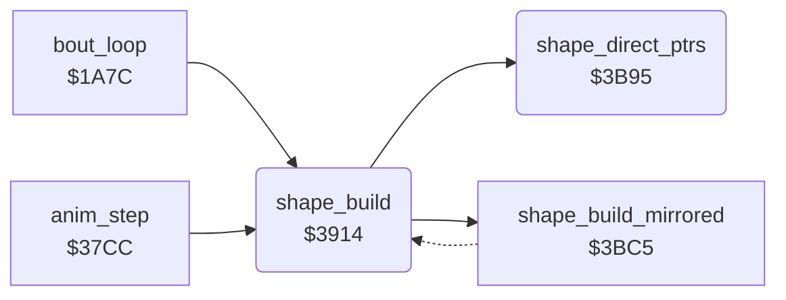

<!-- Generated by c64-docs from knowledge revision 20261022T104543.905-o1bqdy and .c64-re-tools/local/generated/src/source-map.json. Do not edit: change the knowledge, generate the source again, then run docs.ts generate. -->
# shapes/shape_build_390c.asm

Range `$390C-$3BC4`. Source: [shapes/shape_build_390c.asm](../../../../src/shapes/shape_build_390c.asm). Index: [the reference](../../index.md).

## Call graph

A solid arrow is a call, a thick arrow a table entry, a dotted arrow a jump. Rounded nodes are in this file.

## Data

| Range | Type | Name | Read by | Written by |
|---|---|---|---|---|
| [`$390C`](../../../../src/shapes/shape_build_390c.asm#L7)-`$3913` | addresses-split | [`shape_buffer_lo`](../../../../src/shapes/shape_build_390c.asm#L6) |  |  |
| [`$3B5D`](../../../../src/shapes/shape_build_390c.asm#L368)-`$3B64` | bytes | [`shape_row4_frames`](../../../../src/shapes/shape_build_390c.asm#L367) | [`shape_build`](shape_build_390c.md#shape_build) |  |
| [`$3B65`](../../../../src/shapes/shape_build_390c.asm#L371)-`$3B74` | bytes of 8 | [`shape_row4_left`](../../../../src/shapes/shape_build_390c.asm#L370) | [`shape_build`](shape_build_390c.md#shape_build) |  |
| [`$3B75`](../../../../src/shapes/shape_build_390c.asm#L375)-`$3B84` | bytes of 8 | [`shape_row4_mid`](../../../../src/shapes/shape_build_390c.asm#L374) | [`shape_build`](shape_build_390c.md#shape_build) |  |
| [`$3B85`](../../../../src/shapes/shape_build_390c.asm#L378)-`$3B94` | bytes of 8 | [`shape_row4_right`](../../../../src/shapes/shape_build_390c.asm#L377) | [`shape_build`](shape_build_390c.md#shape_build) |  |

## Names

### [`shape_buffer_lo`](../../../../src/shapes/shape_build_390c.asm#L6) `$390C-$390F`

*data*

Start of the 9 x 64 byte sprite buffer of each draw_buffer value: $c040, $c280, $c4c0, $c700. Low bytes $390c, high bytes $3910.

- **Referred to by:** [`shape_build`](shape_build_390c.md#shape_build) [`$3929`](../../../../src/shapes/shape_build_390c.asm#L26), [`shape_build_mirrored`](shape_build_mirror.md#shape_build_mirrored) [`$3BC5`](../../../../src/shapes/shape_build_mirror.asm#L7)

### [`shape_buffer_hi`](../../../../src/shapes/shape_build_390c.asm#L8) `$3910-$3913`

*data*

- **Referred to by:** [`shape_build`](shape_build_390c.md#shape_build) [`$392E`](../../../../src/shapes/shape_build_390c.asm#L28), [`shape_build_mirrored`](shape_build_mirror.md#shape_build_mirrored) [`$3BD1`](../../../../src/shapes/shape_build_mirror.asm#L11)

### [`shape_build`](../../../../src/shapes/shape_build_390c.asm#L11) `$3914`

*routine*

Shows fighter_frame of fighter X. With shape_page_offset 0 it builds the 9 sprites into a hidden buffer (shape_build_copy). When it is not 0 (the bull), it takes the sprite pointers directly from the part tables ($3b95). Callers: anim_step $3834, time up $1ae2/$1ae7.

- **Called from:** [`bout_loop`](../game/bout_loop.md#bout_loop) [`$1AE2`](../../../../src/game/bout_loop.asm#L103), [`bout_loop`](../game/bout_loop.md#bout_loop) [`$1AE7`](../../../../src/game/bout_loop.asm#L105), [`anim_step`](../fighter/anim_step.md#anim_step) [`$3834`](../../../../src/fighter/anim_step_37d8.asm#L59)
- **Calls:** [`shape_direct_ptrs`](shape_build_390c.md#shape_direct_ptrs), [`shape_build_mirrored`](shape_build_mirror.md#shape_build_mirrored)
- **Reads:** [`shape_page_offset`](../../memory-map.md#shape_page_offset), [`shape_parts+7`](../graphics/fighter_shapes_8000.md#shape_parts), [`shape_parts+8`](../graphics/fighter_shapes_8000.md#shape_parts), [`shape_parts+62`](../graphics/fighter_shapes_8000.md#shape_parts), [`shape_parts+63`](../graphics/fighter_shapes_8000.md#shape_parts), [`shape_dest_ptr`](../../memory-map.md#shape_dest_ptr), [`shape_dest_ptr+1`](../../memory-map.md#shape_dest_ptr), [`part_ptr_build`](../../memory-map.md#part_ptr_build), [`part_ptr_build+1`](../../memory-map.md#part_ptr_build), [`part_ptr_build+2`](../../memory-map.md#part_ptr_build), [`part_ptr_build+3`](../../memory-map.md#part_ptr_build), [`part_ptr_build+4`](../../memory-map.md#part_ptr_build), [`part_ptr_build+5`](../../memory-map.md#part_ptr_build), [`part_ptr_build+6`](../../memory-map.md#part_ptr_build), [`part_ptr_build+7`](../../memory-map.md#part_ptr_build), [`part_ptr_build+8`](../../memory-map.md#part_ptr_build), [`shape_direct_table_hi`](shape_build_390c.md#shape_direct_table_hi)
- **Writes:** [`shape_dest_ptr`](../../memory-map.md#shape_dest_ptr), [`shape_dest_ptr+1`](../../memory-map.md#shape_dest_ptr), [`part_ptr_build+7`](../../memory-map.md#part_ptr_build), [`part_ptr_build+8`](../../memory-map.md#part_ptr_build), [`part_ptr_build`](../../memory-map.md#part_ptr_build), [`part_ptr_build+1`](../../memory-map.md#part_ptr_build), [`part_ptr_build+2`](../../memory-map.md#part_ptr_build), [`part_ptr_build+3`](../../memory-map.md#part_ptr_build), [`part_ptr_build+4`](../../memory-map.md#part_ptr_build), [`part_ptr_build+5`](../../memory-map.md#part_ptr_build), [`part_ptr_build+6`](../../memory-map.md#part_ptr_build)
- **Refers to:** [`shape_buffer_lo`](shape_build_390c.md#shape_buffer_lo), [`shape_buffer_hi`](shape_build_390c.md#shape_buffer_hi), [`shape_dest_ptr`](../../memory-map.md#shape_dest_ptr), [`shape_ptr_list_lo`](shape_build_38fc.md#shape_ptr_list_lo), [`shape_ptr_list_hi`](shape_build_38fc.md#shape_ptr_list_hi), [`frame_parts_top_left`](frame_part_tables.md#frame_parts_top_left), [`shape_part_page_table`](shape_lookup_tables.md#shape_part_page_table), [`shape_part_lo`](shape_build.md#shape_part_lo), [`frame_parts_top_mid`](frame_part_tables.md#frame_parts_top_mid), [`part_ptr_build`](../../memory-map.md#part_ptr_build), [`frame_parts_top_right`](frame_part_tables.md#frame_parts_top_right), [`frame_parts_mid_left`](frame_part_tables.md#frame_parts_mid_left), [`frame_parts_mid_mid`](frame_part_tables.md#frame_parts_mid_mid), [`frame_parts_mid_right`](frame_part_tables.md#frame_parts_mid_right), [`frame_parts_low_left`](frame_part_tables.md#frame_parts_low_left), [`frame_parts_low_mid`](frame_part_tables.md#frame_parts_low_mid), [`frame_parts_low_right`](frame_part_tables.md#frame_parts_low_right), [`fighter_part_ptrs`](../../memory-map.md#fighter_part_ptrs)

### [`shape_build_copy`](../../../../src/shapes/shape_build_390c.asm#L16) `$391B`

*label*

Toggles draw_buffer (0/1 fighter 0, 2/3 fighter 1), copies the 9 parts into that buffer and then publishes the 9 pointers. Facing 1 uses the mirrored copy shape_build_mirrored $3bc5.

- **Jumped to from:** [`shape_build`](shape_build_390c.md#shape_build) [`$3916`](../../../../src/shapes/shape_build_390c.asm#L13)

### [`shape_build_normal`](../../../../src/shapes/shape_build_390c.asm#L25) `$3929`

*label*

Normal copy: slot n gets part table n ($7ae0 + n*$4f) at fighter_frame. Slots 0-2 are row 1, 3-5 row 2, 6-8 row 3, left to right.

- **Jumped to from:** [`shape_build`](shape_build_390c.md#shape_build) [`$3924`](../../../../src/shapes/shape_build_390c.asm#L22)

### [`shape_copy_ptr_list`](../../../../src/shapes/shape_build_390c.asm#L35) `$3941`

*label*

- **Jumped to from:** [`shape_build`](shape_build_390c.md#shape_build) [`$3948`](../../../../src/shapes/shape_build_390c.asm#L41)

### [`shape_ptr_src_lo`](../../../../src/shapes/shape_build_390c.asm#L36) `$3942`

*variable*

- **Written by:** [`shape_build`](shape_build_390c.md#shape_build) [`$3936`](../../../../src/shapes/shape_build_390c.asm#L31)

### [`shape_ptr_src_hi`](../../../../src/shapes/shape_build_390c.asm#L37) `$3943-$3955`

*variable*

- **Written by:** [`shape_build`](shape_build_390c.md#shape_build) [`$393C`](../../../../src/shapes/shape_build_390c.asm#L33)

### [`shape_part0_copy`](../../../../src/shapes/shape_build_390c.asm#L49) `$3956`

*label*

Source page = $7f00[part] + shape_page_offset

- **Jumped to from:** [`shape_build`](shape_build_390c.md#shape_build) [`$3950`](../../../../src/shapes/shape_build_390c.asm#L46)

### [`shape_part0_loop`](../../../../src/shapes/shape_build_390c.asm#L60) `$396B`

*label*

- **Jumped to from:** [`shape_build`](shape_build_390c.md#shape_build) [`$3971`](../../../../src/shapes/shape_build_390c.asm#L66)

### [`shape_part0_src_lo`](../../../../src/shapes/shape_build_390c.asm#L61) `$396C`

*variable*

- **Written by:** [`shape_build`](shape_build_390c.md#shape_build) [`$3966`](../../../../src/shapes/shape_build_390c.asm#L58)

### [`shape_part0_src_hi`](../../../../src/shapes/shape_build_390c.asm#L62) `$396D-$3972`

*variable*

- **Written by:** [`shape_build`](shape_build_390c.md#shape_build) [`$395C`](../../../../src/shapes/shape_build_390c.asm#L53)

### [`shape_part0_next`](../../../../src/shapes/shape_build_390c.asm#L67) `$3973`

*label*

Next 64-byte sprite in the buffer, also for an empty slot

- **Jumped to from:** [`shape_build`](shape_build_390c.md#shape_build) [`$3954`](../../../../src/shapes/shape_build_390c.asm#L48)

### [`shape_part1`](../../../../src/shapes/shape_build_390c.asm#L74) `$397E`

*label*

- **Jumped to from:** [`shape_build`](shape_build_390c.md#shape_build) [`$397A`](../../../../src/shapes/shape_build_390c.asm#L72)

### [`shape_part1_copy`](../../../../src/shapes/shape_build_390c.asm#L81) `$398A`

*label*

- **Jumped to from:** [`shape_build`](shape_build_390c.md#shape_build) [`$3984`](../../../../src/shapes/shape_build_390c.asm#L78)

### [`shape_part1_loop`](../../../../src/shapes/shape_build_390c.asm#L92) `$399F`

*label*

- **Jumped to from:** [`shape_build`](shape_build_390c.md#shape_build) [`$39A5`](../../../../src/shapes/shape_build_390c.asm#L98)

### [`shape_part1_src_lo`](../../../../src/shapes/shape_build_390c.asm#L93) `$39A0`

*variable*

- **Written by:** [`shape_build`](shape_build_390c.md#shape_build) [`$399A`](../../../../src/shapes/shape_build_390c.asm#L90)

### [`shape_part1_src_hi`](../../../../src/shapes/shape_build_390c.asm#L94) `$39A1-$39A6`

*variable*

- **Written by:** [`shape_build`](shape_build_390c.md#shape_build) [`$3990`](../../../../src/shapes/shape_build_390c.asm#L85)

### [`shape_part1_next`](../../../../src/shapes/shape_build_390c.asm#L99) `$39A7`

*label*

- **Jumped to from:** [`shape_build`](shape_build_390c.md#shape_build) [`$3988`](../../../../src/shapes/shape_build_390c.asm#L80)

### [`shape_part2`](../../../../src/shapes/shape_build_390c.asm#L106) `$39B2`

*label*

- **Jumped to from:** [`shape_build`](shape_build_390c.md#shape_build) [`$39AE`](../../../../src/shapes/shape_build_390c.asm#L104)

### [`shape_part2_copy`](../../../../src/shapes/shape_build_390c.asm#L113) `$39BE`

*label*

- **Jumped to from:** [`shape_build`](shape_build_390c.md#shape_build) [`$39B8`](../../../../src/shapes/shape_build_390c.asm#L110)

### [`shape_part2_loop`](../../../../src/shapes/shape_build_390c.asm#L124) `$39D3`

*label*

- **Jumped to from:** [`shape_build`](shape_build_390c.md#shape_build) [`$39D9`](../../../../src/shapes/shape_build_390c.asm#L130)

### [`shape_part2_src_lo`](../../../../src/shapes/shape_build_390c.asm#L125) `$39D4`

*variable*

- **Written by:** [`shape_build`](shape_build_390c.md#shape_build) [`$39CE`](../../../../src/shapes/shape_build_390c.asm#L122)

### [`shape_part2_src_hi`](../../../../src/shapes/shape_build_390c.asm#L126) `$39D5-$39DA`

*variable*

- **Written by:** [`shape_build`](shape_build_390c.md#shape_build) [`$39C4`](../../../../src/shapes/shape_build_390c.asm#L117)

### [`shape_part2_next`](../../../../src/shapes/shape_build_390c.asm#L131) `$39DB`

*label*

- **Jumped to from:** [`shape_build`](shape_build_390c.md#shape_build) [`$39BC`](../../../../src/shapes/shape_build_390c.asm#L112)

### [`shape_part3`](../../../../src/shapes/shape_build_390c.asm#L138) `$39E6`

*label*

- **Jumped to from:** [`shape_build`](shape_build_390c.md#shape_build) [`$39E2`](../../../../src/shapes/shape_build_390c.asm#L136)

### [`shape_part3_copy`](../../../../src/shapes/shape_build_390c.asm#L145) `$39F2`

*label*

- **Jumped to from:** [`shape_build`](shape_build_390c.md#shape_build) [`$39EC`](../../../../src/shapes/shape_build_390c.asm#L142)

### [`shape_part3_loop`](../../../../src/shapes/shape_build_390c.asm#L156) `$3A07`

*label*

- **Jumped to from:** [`shape_build`](shape_build_390c.md#shape_build) [`$3A0D`](../../../../src/shapes/shape_build_390c.asm#L162)

### [`shape_part3_src_lo`](../../../../src/shapes/shape_build_390c.asm#L157) `$3A08`

*variable*

- **Written by:** [`shape_build`](shape_build_390c.md#shape_build) [`$3A02`](../../../../src/shapes/shape_build_390c.asm#L154)

### [`shape_part3_src_hi`](../../../../src/shapes/shape_build_390c.asm#L158) `$3A09-$3A0E`

*variable*

- **Written by:** [`shape_build`](shape_build_390c.md#shape_build) [`$39F8`](../../../../src/shapes/shape_build_390c.asm#L149)

### [`shape_part3_next`](../../../../src/shapes/shape_build_390c.asm#L163) `$3A0F`

*label*

- **Jumped to from:** [`shape_build`](shape_build_390c.md#shape_build) [`$39F0`](../../../../src/shapes/shape_build_390c.asm#L144)

### [`shape_part4`](../../../../src/shapes/shape_build_390c.asm#L170) `$3A1A`

*label*

- **Jumped to from:** [`shape_build`](shape_build_390c.md#shape_build) [`$3A16`](../../../../src/shapes/shape_build_390c.asm#L168)

### [`shape_part4_copy`](../../../../src/shapes/shape_build_390c.asm#L177) `$3A26`

*label*

- **Jumped to from:** [`shape_build`](shape_build_390c.md#shape_build) [`$3A20`](../../../../src/shapes/shape_build_390c.asm#L174)

### [`shape_part4_loop`](../../../../src/shapes/shape_build_390c.asm#L188) `$3A3B`

*label*

- **Jumped to from:** [`shape_build`](shape_build_390c.md#shape_build) [`$3A41`](../../../../src/shapes/shape_build_390c.asm#L194)

### [`shape_part4_src_lo`](../../../../src/shapes/shape_build_390c.asm#L189) `$3A3C`

*variable*

- **Written by:** [`shape_build`](shape_build_390c.md#shape_build) [`$3A36`](../../../../src/shapes/shape_build_390c.asm#L186)

### [`shape_part4_src_hi`](../../../../src/shapes/shape_build_390c.asm#L190) `$3A3D-$3A42`

*variable*

- **Written by:** [`shape_build`](shape_build_390c.md#shape_build) [`$3A2C`](../../../../src/shapes/shape_build_390c.asm#L181)

### [`shape_part4_next`](../../../../src/shapes/shape_build_390c.asm#L195) `$3A43`

*label*

- **Jumped to from:** [`shape_build`](shape_build_390c.md#shape_build) [`$3A24`](../../../../src/shapes/shape_build_390c.asm#L176)

### [`shape_part5`](../../../../src/shapes/shape_build_390c.asm#L202) `$3A4E`

*label*

- **Jumped to from:** [`shape_build`](shape_build_390c.md#shape_build) [`$3A4A`](../../../../src/shapes/shape_build_390c.asm#L200)

### [`shape_part5_copy`](../../../../src/shapes/shape_build_390c.asm#L209) `$3A5A`

*label*

- **Jumped to from:** [`shape_build`](shape_build_390c.md#shape_build) [`$3A54`](../../../../src/shapes/shape_build_390c.asm#L206)

### [`shape_part5_loop`](../../../../src/shapes/shape_build_390c.asm#L220) `$3A6F`

*label*

- **Jumped to from:** [`shape_build`](shape_build_390c.md#shape_build) [`$3A75`](../../../../src/shapes/shape_build_390c.asm#L226)

### [`shape_part5_src_lo`](../../../../src/shapes/shape_build_390c.asm#L221) `$3A70`

*variable*

- **Written by:** [`shape_build`](shape_build_390c.md#shape_build) [`$3A6A`](../../../../src/shapes/shape_build_390c.asm#L218)

### [`shape_part5_src_hi`](../../../../src/shapes/shape_build_390c.asm#L222) `$3A71-$3A76`

*variable*

- **Written by:** [`shape_build`](shape_build_390c.md#shape_build) [`$3A60`](../../../../src/shapes/shape_build_390c.asm#L213)

### [`shape_part5_next`](../../../../src/shapes/shape_build_390c.asm#L227) `$3A77`

*label*

- **Jumped to from:** [`shape_build`](shape_build_390c.md#shape_build) [`$3A58`](../../../../src/shapes/shape_build_390c.asm#L208)

### [`shape_part6`](../../../../src/shapes/shape_build_390c.asm#L234) `$3A82`

*label*

- **Jumped to from:** [`shape_build`](shape_build_390c.md#shape_build) [`$3A7E`](../../../../src/shapes/shape_build_390c.asm#L232)

### [`shape_part6_copy`](../../../../src/shapes/shape_build_390c.asm#L241) `$3A8E`

*label*

- **Jumped to from:** [`shape_build`](shape_build_390c.md#shape_build) [`$3A88`](../../../../src/shapes/shape_build_390c.asm#L238)

### [`shape_part6_loop`](../../../../src/shapes/shape_build_390c.asm#L252) `$3AA3`

*label*

- **Jumped to from:** [`shape_build`](shape_build_390c.md#shape_build) [`$3AA9`](../../../../src/shapes/shape_build_390c.asm#L258)

### [`shape_part6_src_lo`](../../../../src/shapes/shape_build_390c.asm#L253) `$3AA4`

*variable*

- **Written by:** [`shape_build`](shape_build_390c.md#shape_build) [`$3A9E`](../../../../src/shapes/shape_build_390c.asm#L250)

### [`shape_part6_src_hi`](../../../../src/shapes/shape_build_390c.asm#L254) `$3AA5-$3AAA`

*variable*

- **Written by:** [`shape_build`](shape_build_390c.md#shape_build) [`$3A94`](../../../../src/shapes/shape_build_390c.asm#L245)

### [`shape_part6_next`](../../../../src/shapes/shape_build_390c.asm#L259) `$3AAB`

*label*

- **Jumped to from:** [`shape_build`](shape_build_390c.md#shape_build) [`$3A8C`](../../../../src/shapes/shape_build_390c.asm#L240)

### [`shape_part7`](../../../../src/shapes/shape_build_390c.asm#L266) `$3AB6`

*label*

- **Jumped to from:** [`shape_build`](shape_build_390c.md#shape_build) [`$3AB2`](../../../../src/shapes/shape_build_390c.asm#L264)

### [`shape_part7_copy`](../../../../src/shapes/shape_build_390c.asm#L273) `$3AC2`

*label*

- **Jumped to from:** [`shape_build`](shape_build_390c.md#shape_build) [`$3ABC`](../../../../src/shapes/shape_build_390c.asm#L270)

### [`shape_part7_loop`](../../../../src/shapes/shape_build_390c.asm#L284) `$3AD7`

*label*

- **Jumped to from:** [`shape_build`](shape_build_390c.md#shape_build) [`$3ADD`](../../../../src/shapes/shape_build_390c.asm#L290)

### [`shape_part7_src_lo`](../../../../src/shapes/shape_build_390c.asm#L285) `$3AD8`

*variable*

- **Written by:** [`shape_build`](shape_build_390c.md#shape_build) [`$3AD2`](../../../../src/shapes/shape_build_390c.asm#L282)

### [`shape_part7_src_hi`](../../../../src/shapes/shape_build_390c.asm#L286) `$3AD9-$3ADE`

*variable*

- **Written by:** [`shape_build`](shape_build_390c.md#shape_build) [`$3AC8`](../../../../src/shapes/shape_build_390c.asm#L277)

### [`shape_part7_next`](../../../../src/shapes/shape_build_390c.asm#L291) `$3ADF`

*label*

- **Jumped to from:** [`shape_build`](shape_build_390c.md#shape_build) [`$3AC0`](../../../../src/shapes/shape_build_390c.asm#L272)

### [`shape_part8`](../../../../src/shapes/shape_build_390c.asm#L298) `$3AEA`

*label*

- **Jumped to from:** [`shape_build`](shape_build_390c.md#shape_build) [`$3AE6`](../../../../src/shapes/shape_build_390c.asm#L296)

### [`shape_part8_copy`](../../../../src/shapes/shape_build_390c.asm#L305) `$3AF6`

*label*

- **Jumped to from:** [`shape_build`](shape_build_390c.md#shape_build) [`$3AF0`](../../../../src/shapes/shape_build_390c.asm#L302)

### [`shape_part8_loop`](../../../../src/shapes/shape_build_390c.asm#L316) `$3B0B`

*label*

- **Jumped to from:** [`shape_build`](shape_build_390c.md#shape_build) [`$3B11`](../../../../src/shapes/shape_build_390c.asm#L322)

### [`shape_part8_src_lo`](../../../../src/shapes/shape_build_390c.asm#L317) `$3B0C`

*variable*

- **Written by:** [`shape_build`](shape_build_390c.md#shape_build) [`$3B06`](../../../../src/shapes/shape_build_390c.asm#L314)

### [`shape_part8_src_hi`](../../../../src/shapes/shape_build_390c.asm#L318) `$3B0D-$3B12`

*variable*

- **Written by:** [`shape_build`](shape_build_390c.md#shape_build) [`$3AFC`](../../../../src/shapes/shape_build_390c.asm#L309)

### [`shape_publish_ptrs`](../../../../src/shapes/shape_build_390c.asm#L324) `$3B13`

*label*

Copies the 9 new pointers to fighter_part_ptrs ($02+2n+X); the IRQ at line 0 reads them. Then it looks for fighter_frame in shape_row4_frames.

- **Jumped to from:** [`shape_build`](shape_build_390c.md#shape_build) [`$3AF4`](../../../../src/shapes/shape_build_390c.asm#L304), [`shape_build_mirrored`](shape_build_mirror.md#shape_build_mirrored) [`$3E3A`](../../../../src/shapes/shape_build_mirror.asm#L286)

### [`shape_find_row4_frame`](../../../../src/shapes/shape_build_390c.asm#L344) `$3B39`

*label*

- **Jumped to from:** [`shape_build`](shape_build_390c.md#shape_build) [`$3B41`](../../../../src/shapes/shape_build_390c.asm#L349)

### [`shape_set_row4`](../../../../src/shapes/shape_build_390c.asm#L351) `$3B44`

*label*

Not in the list: row4_ptr_* keep their old values

- **Jumped to from:** [`shape_build`](shape_build_390c.md#shape_build) [`$3B3E`](../../../../src/shapes/shape_build_390c.asm#L347)

### [`shape_row4_load`](../../../../src/shapes/shape_build_390c.asm#L358) `$3B4D`

*label*

- **Jumped to from:** [`shape_build`](shape_build_390c.md#shape_build) [`$3B46`](../../../../src/shapes/shape_build_390c.asm#L353)

### [`shape_row4_frames`](../../../../src/shapes/shape_build_390c.asm#L367) `$3B5D-$3B64`

*data*

The 8 frames of the jumps and somersaults (animations 5, 8, 9 and $0e) that have a floor shadow in sprite row 4.

- **Read by:** [`shape_build`](shape_build_390c.md#shape_build) [`$3B39`](../../../../src/shapes/shape_build_390c.asm#L345) (+6), [`shape_build`](shape_build_390c.md#shape_build) [`$3B39`](../../../../src/shapes/shape_build_390c.asm#L345) (+7)

### [`shape_row4_left`](../../../../src/shapes/shape_build_390c.asm#L370) `$3B65-$3B74`

*data*

Shadow sprite pointers of the left, middle and right column ($3b65, $3b75, $3b85): entries 0-7 facing 0, 8-15 facing 1. Pointers $52-$70 are fixed sprites at $d480-$dc3f; 0 is the blank sprite.

- **Read by:** [`shape_build`](shape_build_390c.md#shape_build) [`$3B4D`](../../../../src/shapes/shape_build_390c.asm#L359) (+6)

### [`shape_row4_mid`](../../../../src/shapes/shape_build_390c.asm#L374) `$3B75-$3B84`

*data*

Middle column of the shadow. Entries 3-7 use the left and middle column for facing 0, and the middle and right column for facing 1.

- **Read by:** [`shape_build`](shape_build_390c.md#shape_build) [`$3B4D`](../../../../src/shapes/shape_build_390c.asm#L359) (+4), [`shape_build`](shape_build_390c.md#shape_build) [`$3B52`](../../../../src/shapes/shape_build_390c.asm#L361) (+6)

### [`shape_row4_right`](../../../../src/shapes/shape_build_390c.asm#L377) `$3B85-$3B94`

*data*

- **Read by:** [`shape_build`](shape_build_390c.md#shape_build) [`$3B52`](../../../../src/shapes/shape_build_390c.asm#L361) (+4), [`shape_build`](shape_build_390c.md#shape_build) [`$3B57`](../../../../src/shapes/shape_build_390c.asm#L363) (+6)

### [`shape_direct_ptrs`](../../../../src/shapes/shape_build_390c.asm#L381) `$3B95`

*label*

Bull path: the part table values are sprite pointers in VIC bank $c000. It writes the 9 values of fighter_frame to fighter_part_ptrs. No copy, no buffer toggle, no mirror and no shadow pointers.

- **Called from:** [`shape_build`](shape_build_390c.md#shape_build) [`$3918`](../../../../src/shapes/shape_build_390c.asm#L14)
- **Refers to:** [`frame_parts_top_left`](frame_part_tables.md#frame_parts_top_left), [`frame_parts_top_mid`](frame_part_tables.md#frame_parts_top_mid), [`fighter_part_ptrs`](../../memory-map.md#fighter_part_ptrs), [`frame_parts_top_right`](frame_part_tables.md#frame_parts_top_right), [`frame_parts_mid_left`](frame_part_tables.md#frame_parts_mid_left), [`frame_parts_mid_mid`](frame_part_tables.md#frame_parts_mid_mid), [`frame_parts_mid_right`](frame_part_tables.md#frame_parts_mid_right), [`frame_parts_low_left`](frame_part_tables.md#frame_parts_low_left), [`frame_parts_low_mid`](frame_part_tables.md#frame_parts_low_mid), [`frame_parts_low_right`](frame_part_tables.md#frame_parts_low_right)

### [`shape_direct_table_hi`](../../../../src/shapes/shape_build_390c.asm#L383) `$3B99-$3BC4`

*variable*

- **Read by:** [`shape_build`](shape_build_390c.md#shape_build) [`$3B57`](../../../../src/shapes/shape_build_390c.asm#L363)
