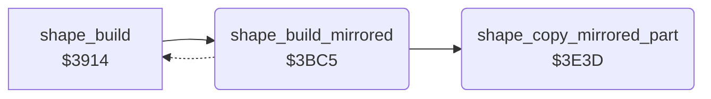

<!-- Generated by c64-docs from knowledge revision 20261022T104543.905-o1bqdy and .c64-re-tools/local/generated/src/source-map.json. Do not edit: change the knowledge, generate the source again, then run docs.ts generate. -->
# shapes/shape_build_mirror.asm: Shape builder: mirrored copy of the 9 sprite parts for facing 1

Range `$3BC5-$3E7F`. Source: [shapes/shape_build_mirror.asm](../../../../src/shapes/shape_build_mirror.asm). Index: [the reference](../../index.md).

## Call graph

A solid arrow is a call, a thick arrow a table entry, a dotted arrow a jump. Rounded nodes are in this file.

## Names

### [`shape_build_mirrored`](../../../../src/shapes/shape_build_mirror.asm#L6) `$3BC5`

*label*

Mirrored copy for facing 1. Slot order: row 1 takes parts 2,1,0, row 2 parts 5,4,3, row 3 parts 8,7,6 (columns exchanged). Each part goes through shape_copy_mirrored_part with the store bases destination-2, destination and destination+2.

- **Called from:** [`shape_build`](shape_build_390c.md#shape_build) [`$3926`](../../../../src/shapes/shape_build_390c.asm#L23)
- **Calls:** [`shape_copy_mirrored_part`](shape_build_mirror.md#shape_copy_mirrored_part)
- **Jumps to:** [`shape_publish_ptrs`](shape_build_390c.md#shape_publish_ptrs)
- **Reads:** [`shape_mdst2_lo`](shape_build_mirror.md#shape_mdst2_lo), [`shape_mdst0_lo`](shape_build_mirror.md#shape_mdst0_lo), [`shape_mdst0_hi`](shape_build_mirror.md#shape_mdst0_hi), [`shape_parts+7`](../graphics/fighter_shapes_8000.md#shape_parts), [`shape_parts+8`](../graphics/fighter_shapes_8000.md#shape_parts), [`shape_mdst1_lo`](shape_build_mirror.md#shape_mdst1_lo), [`shape_mdst1_hi`](shape_build_mirror.md#shape_mdst1_hi), [`shape_mdst2_hi`](shape_build_mirror.md#shape_mdst2_hi), [`draw_saved_x`](../../memory-map.md#draw_saved_x)
- **Writes:** [`shape_mdst0_lo`](shape_build_mirror.md#shape_mdst0_lo), [`shape_mdst1_lo`](shape_build_mirror.md#shape_mdst1_lo), [`shape_mdst2_lo`](shape_build_mirror.md#shape_mdst2_lo), [`shape_mdst0_hi`](shape_build_mirror.md#shape_mdst0_hi), [`shape_mdst1_hi`](shape_build_mirror.md#shape_mdst1_hi), [`shape_mdst2_hi`](shape_build_mirror.md#shape_mdst2_hi), [`part_ptr_build+7`](../../memory-map.md#part_ptr_build), [`part_ptr_build+8`](../../memory-map.md#part_ptr_build), [`draw_saved_x`](../../memory-map.md#draw_saved_x), [`part_ptr_build`](../../memory-map.md#part_ptr_build), [`part_ptr_build+1`](../../memory-map.md#part_ptr_build), [`part_ptr_build+2`](../../memory-map.md#part_ptr_build), [`part_ptr_build+3`](../../memory-map.md#part_ptr_build), [`part_ptr_build+4`](../../memory-map.md#part_ptr_build), [`part_ptr_build+5`](../../memory-map.md#part_ptr_build), [`part_ptr_build+6`](../../memory-map.md#part_ptr_build)
- **Refers to:** [`shape_buffer_lo`](shape_build_390c.md#shape_buffer_lo), [`shape_buffer_hi`](shape_build_390c.md#shape_buffer_hi), [`shape_ptr_list_lo`](shape_build_38fc.md#shape_ptr_list_lo), [`shape_ptr_list_hi`](shape_build_38fc.md#shape_ptr_list_hi), [`frame_parts_top_right`](frame_part_tables.md#frame_parts_top_right), [`frame_parts_top_mid`](frame_part_tables.md#frame_parts_top_mid), [`part_ptr_build`](../../memory-map.md#part_ptr_build), [`frame_parts_top_left`](frame_part_tables.md#frame_parts_top_left), [`frame_parts_mid_right`](frame_part_tables.md#frame_parts_mid_right), [`frame_parts_mid_mid`](frame_part_tables.md#frame_parts_mid_mid), [`frame_parts_mid_left`](frame_part_tables.md#frame_parts_mid_left), [`frame_parts_low_right`](frame_part_tables.md#frame_parts_low_right), [`frame_parts_low_mid`](frame_part_tables.md#frame_parts_low_mid), [`frame_parts_low_left`](frame_part_tables.md#frame_parts_low_left)

### [`shape_mirror_init_dec`](../../../../src/shapes/shape_build_mirror.asm#L20) `$3BEB`

*label*

First store base = destination - 2

- **Jumped to from:** [`shape_build_mirrored`](shape_build_mirror.md#shape_build_mirrored) [`$3BE6`](../../../../src/shapes/shape_build_mirror.asm#L18)

### [`shape_mirror_copy_ptrs`](../../../../src/shapes/shape_build_mirror.asm#L28) `$3BFF`

*label*

- **Jumped to from:** [`shape_build_mirrored`](shape_build_mirror.md#shape_build_mirrored) [`$3C06`](../../../../src/shapes/shape_build_mirror.asm#L34)

### [`shape_mptr_src_lo`](../../../../src/shapes/shape_build_mirror.asm#L29) `$3C00`

*variable*

- **Written by:** [`shape_build_mirrored`](shape_build_mirror.md#shape_build_mirrored) [`$3BF4`](../../../../src/shapes/shape_build_mirror.asm#L24)

### [`shape_mptr_src_hi`](../../../../src/shapes/shape_build_mirror.asm#L30) `$3C01-$3C07`

*variable*

- **Written by:** [`shape_build_mirrored`](shape_build_mirror.md#shape_build_mirrored) [`$3BFA`](../../../../src/shapes/shape_build_mirror.asm#L26)

### [`shape_mirror_slot0`](../../../../src/shapes/shape_build_mirror.asm#L35) `$3C08`

*label*

### [`shape_mslot0_copy`](../../../../src/shapes/shape_build_mirror.asm#L42) `$3C15`

*label*

- **Jumped to from:** [`shape_build_mirrored`](shape_build_mirror.md#shape_build_mirrored) [`$3C0F`](../../../../src/shapes/shape_build_mirror.asm#L39)

### [`shape_mslot0_next`](../../../../src/shapes/shape_build_mirror.asm#L44) `$3C18`

*label*

Next 64-byte sprite: all three store bases + $40

- **Jumped to from:** [`shape_build_mirrored`](shape_build_mirror.md#shape_build_mirrored) [`$3C13`](../../../../src/shapes/shape_build_mirror.asm#L41)

### [`shape_mslot0_hi_ok`](../../../../src/shapes/shape_build_mirror.asm#L57) `$3C38`

*label*

- **Jumped to from:** [`shape_build_mirrored`](shape_build_mirror.md#shape_build_mirrored) [`$3C2D`](../../../../src/shapes/shape_build_mirror.asm#L53)

### [`shape_mslot0_lo_dec`](../../../../src/shapes/shape_build_mirror.asm#L61) `$3C40`

*label*

- **Jumped to from:** [`shape_build_mirrored`](shape_build_mirror.md#shape_build_mirrored) [`$3C3B`](../../../../src/shapes/shape_build_mirror.asm#L59)

### [`shape_mslot1_copy`](../../../../src/shapes/shape_build_mirror.asm#L72) `$3C59`

*label*

- **Jumped to from:** [`shape_build_mirrored`](shape_build_mirror.md#shape_build_mirrored) [`$3C53`](../../../../src/shapes/shape_build_mirror.asm#L69)

### [`shape_mslot1_next`](../../../../src/shapes/shape_build_mirror.asm#L74) `$3C5C`

*label*

- **Jumped to from:** [`shape_build_mirrored`](shape_build_mirror.md#shape_build_mirrored) [`$3C57`](../../../../src/shapes/shape_build_mirror.asm#L71)

### [`shape_mslot1_hi_ok`](../../../../src/shapes/shape_build_mirror.asm#L87) `$3C7C`

*label*

- **Jumped to from:** [`shape_build_mirrored`](shape_build_mirror.md#shape_build_mirrored) [`$3C71`](../../../../src/shapes/shape_build_mirror.asm#L83)

### [`shape_mslot1_lo_dec`](../../../../src/shapes/shape_build_mirror.asm#L91) `$3C84`

*label*

- **Jumped to from:** [`shape_build_mirrored`](shape_build_mirror.md#shape_build_mirrored) [`$3C7F`](../../../../src/shapes/shape_build_mirror.asm#L89)

### [`shape_mslot2_copy`](../../../../src/shapes/shape_build_mirror.asm#L102) `$3C9D`

*label*

- **Jumped to from:** [`shape_build_mirrored`](shape_build_mirror.md#shape_build_mirrored) [`$3C97`](../../../../src/shapes/shape_build_mirror.asm#L99)

### [`shape_mslot2_next`](../../../../src/shapes/shape_build_mirror.asm#L104) `$3CA0`

*label*

- **Jumped to from:** [`shape_build_mirrored`](shape_build_mirror.md#shape_build_mirrored) [`$3C9B`](../../../../src/shapes/shape_build_mirror.asm#L101)

### [`shape_mslot2_hi_ok`](../../../../src/shapes/shape_build_mirror.asm#L117) `$3CC0`

*label*

- **Jumped to from:** [`shape_build_mirrored`](shape_build_mirror.md#shape_build_mirrored) [`$3CB5`](../../../../src/shapes/shape_build_mirror.asm#L113)

### [`shape_mslot2_lo_dec`](../../../../src/shapes/shape_build_mirror.asm#L121) `$3CC8`

*label*

- **Jumped to from:** [`shape_build_mirrored`](shape_build_mirror.md#shape_build_mirrored) [`$3CC3`](../../../../src/shapes/shape_build_mirror.asm#L119)

### [`shape_mslot3_copy`](../../../../src/shapes/shape_build_mirror.asm#L132) `$3CE1`

*label*

- **Jumped to from:** [`shape_build_mirrored`](shape_build_mirror.md#shape_build_mirrored) [`$3CDB`](../../../../src/shapes/shape_build_mirror.asm#L129)

### [`shape_mslot3_next`](../../../../src/shapes/shape_build_mirror.asm#L134) `$3CE4`

*label*

- **Jumped to from:** [`shape_build_mirrored`](shape_build_mirror.md#shape_build_mirrored) [`$3CDF`](../../../../src/shapes/shape_build_mirror.asm#L131)

### [`shape_mslot3_hi_ok`](../../../../src/shapes/shape_build_mirror.asm#L147) `$3D04`

*label*

- **Jumped to from:** [`shape_build_mirrored`](shape_build_mirror.md#shape_build_mirrored) [`$3CF9`](../../../../src/shapes/shape_build_mirror.asm#L143)

### [`shape_mslot3_lo_dec`](../../../../src/shapes/shape_build_mirror.asm#L151) `$3D0C`

*label*

- **Jumped to from:** [`shape_build_mirrored`](shape_build_mirror.md#shape_build_mirrored) [`$3D07`](../../../../src/shapes/shape_build_mirror.asm#L149)

### [`shape_mslot4_copy`](../../../../src/shapes/shape_build_mirror.asm#L162) `$3D25`

*label*

- **Jumped to from:** [`shape_build_mirrored`](shape_build_mirror.md#shape_build_mirrored) [`$3D1F`](../../../../src/shapes/shape_build_mirror.asm#L159)

### [`shape_mslot4_next`](../../../../src/shapes/shape_build_mirror.asm#L164) `$3D28`

*label*

- **Jumped to from:** [`shape_build_mirrored`](shape_build_mirror.md#shape_build_mirrored) [`$3D23`](../../../../src/shapes/shape_build_mirror.asm#L161)

### [`shape_mslot4_hi_ok`](../../../../src/shapes/shape_build_mirror.asm#L177) `$3D48`

*label*

- **Jumped to from:** [`shape_build_mirrored`](shape_build_mirror.md#shape_build_mirrored) [`$3D3D`](../../../../src/shapes/shape_build_mirror.asm#L173)

### [`shape_mslot4_lo_dec`](../../../../src/shapes/shape_build_mirror.asm#L181) `$3D50`

*label*

- **Jumped to from:** [`shape_build_mirrored`](shape_build_mirror.md#shape_build_mirrored) [`$3D4B`](../../../../src/shapes/shape_build_mirror.asm#L179)

### [`shape_mslot5_copy`](../../../../src/shapes/shape_build_mirror.asm#L192) `$3D69`

*label*

- **Jumped to from:** [`shape_build_mirrored`](shape_build_mirror.md#shape_build_mirrored) [`$3D63`](../../../../src/shapes/shape_build_mirror.asm#L189)

### [`shape_mslot5_next`](../../../../src/shapes/shape_build_mirror.asm#L194) `$3D6C`

*label*

- **Jumped to from:** [`shape_build_mirrored`](shape_build_mirror.md#shape_build_mirrored) [`$3D67`](../../../../src/shapes/shape_build_mirror.asm#L191)

### [`shape_mslot5_hi_ok`](../../../../src/shapes/shape_build_mirror.asm#L207) `$3D8C`

*label*

- **Jumped to from:** [`shape_build_mirrored`](shape_build_mirror.md#shape_build_mirrored) [`$3D81`](../../../../src/shapes/shape_build_mirror.asm#L203)

### [`shape_mslot5_lo_dec`](../../../../src/shapes/shape_build_mirror.asm#L211) `$3D94`

*label*

- **Jumped to from:** [`shape_build_mirrored`](shape_build_mirror.md#shape_build_mirrored) [`$3D8F`](../../../../src/shapes/shape_build_mirror.asm#L209)

### [`shape_mslot6_copy`](../../../../src/shapes/shape_build_mirror.asm#L222) `$3DAD`

*label*

- **Jumped to from:** [`shape_build_mirrored`](shape_build_mirror.md#shape_build_mirrored) [`$3DA7`](../../../../src/shapes/shape_build_mirror.asm#L219)

### [`shape_mslot6_next`](../../../../src/shapes/shape_build_mirror.asm#L224) `$3DB0`

*label*

- **Jumped to from:** [`shape_build_mirrored`](shape_build_mirror.md#shape_build_mirrored) [`$3DAB`](../../../../src/shapes/shape_build_mirror.asm#L221)

### [`shape_mslot6_hi_ok`](../../../../src/shapes/shape_build_mirror.asm#L237) `$3DD0`

*label*

- **Jumped to from:** [`shape_build_mirrored`](shape_build_mirror.md#shape_build_mirrored) [`$3DC5`](../../../../src/shapes/shape_build_mirror.asm#L233)

### [`shape_mslot6_lo_dec`](../../../../src/shapes/shape_build_mirror.asm#L241) `$3DD8`

*label*

- **Jumped to from:** [`shape_build_mirrored`](shape_build_mirror.md#shape_build_mirrored) [`$3DD3`](../../../../src/shapes/shape_build_mirror.asm#L239)

### [`shape_mslot7_copy`](../../../../src/shapes/shape_build_mirror.asm#L252) `$3DF1`

*label*

- **Jumped to from:** [`shape_build_mirrored`](shape_build_mirror.md#shape_build_mirrored) [`$3DEB`](../../../../src/shapes/shape_build_mirror.asm#L249)

### [`shape_mslot7_next`](../../../../src/shapes/shape_build_mirror.asm#L254) `$3DF4`

*label*

- **Jumped to from:** [`shape_build_mirrored`](shape_build_mirror.md#shape_build_mirrored) [`$3DEF`](../../../../src/shapes/shape_build_mirror.asm#L251)

### [`shape_mslot7_hi_ok`](../../../../src/shapes/shape_build_mirror.asm#L267) `$3E14`

*label*

- **Jumped to from:** [`shape_build_mirrored`](shape_build_mirror.md#shape_build_mirrored) [`$3E09`](../../../../src/shapes/shape_build_mirror.asm#L263)

### [`shape_mslot7_lo_dec`](../../../../src/shapes/shape_build_mirror.asm#L271) `$3E1C`

*label*

- **Jumped to from:** [`shape_build_mirrored`](shape_build_mirror.md#shape_build_mirrored) [`$3E17`](../../../../src/shapes/shape_build_mirror.asm#L269)

### [`shape_mslot8_copy`](../../../../src/shapes/shape_build_mirror.asm#L282) `$3E35`

*label*

- **Jumped to from:** [`shape_build_mirrored`](shape_build_mirror.md#shape_build_mirrored) [`$3E2F`](../../../../src/shapes/shape_build_mirror.asm#L279)

### [`shape_mirror_done`](../../../../src/shapes/shape_build_mirror.asm#L284) `$3E38`

*label*

- **Jumped to from:** [`shape_build_mirrored`](shape_build_mirror.md#shape_build_mirrored) [`$3E33`](../../../../src/shapes/shape_build_mirror.asm#L281)

### [`shape_copy_mirrored_part`](../../../../src/shapes/shape_build_mirror.asm#L288) `$3E3D`

*routine*

Copies part A mirrored: source $8000 + part*64 via $7f00 and shape_part_lo. For each of the 21 lines it exchanges bytes 0 and 2 and mirrors each byte with $7e00 (pixel pairs reversed). It copies 63 bytes. Called 9 times from shape_build_mirrored.

- **Called from:** [`shape_build_mirrored`](shape_build_mirror.md#shape_build_mirrored) [`$3C15`](../../../../src/shapes/shape_build_mirror.asm#L43), [`shape_build_mirrored`](shape_build_mirror.md#shape_build_mirrored) [`$3C59`](../../../../src/shapes/shape_build_mirror.asm#L73), [`shape_build_mirrored`](shape_build_mirror.md#shape_build_mirrored) [`$3C9D`](../../../../src/shapes/shape_build_mirror.asm#L103), [`shape_build_mirrored`](shape_build_mirror.md#shape_build_mirrored) [`$3CE1`](../../../../src/shapes/shape_build_mirror.asm#L133), [`shape_build_mirrored`](shape_build_mirror.md#shape_build_mirrored) [`$3D25`](../../../../src/shapes/shape_build_mirror.asm#L163), [`shape_build_mirrored`](shape_build_mirror.md#shape_build_mirrored) [`$3D69`](../../../../src/shapes/shape_build_mirror.asm#L193), [`shape_build_mirrored`](shape_build_mirror.md#shape_build_mirrored) [`$3DAD`](../../../../src/shapes/shape_build_mirror.asm#L223), [`shape_build_mirrored`](shape_build_mirror.md#shape_build_mirrored) [`$3DF1`](../../../../src/shapes/shape_build_mirror.asm#L253), [`shape_build_mirrored`](shape_build_mirror.md#shape_build_mirrored) [`$3E35`](../../../../src/shapes/shape_build_mirror.asm#L283)
- **Reads:** [`shape_page_offset`](../../memory-map.md#shape_page_offset), [`shape_parts+59`](../graphics/fighter_shapes_8000.md#shape_parts), [`shape_parts+62`](../graphics/fighter_shapes_8000.md#shape_parts), [`shape_parts+58`](../graphics/fighter_shapes_8000.md#shape_parts), [`shape_parts+61`](../graphics/fighter_shapes_8000.md#shape_parts), [`shape_parts+57`](../graphics/fighter_shapes_8000.md#shape_parts), [`shape_parts+60`](../graphics/fighter_shapes_8000.md#shape_parts)
- **Writes:** [`shape_parts+59`](../graphics/fighter_shapes_8000.md#shape_parts), [`shape_parts+62`](../graphics/fighter_shapes_8000.md#shape_parts), [`shape_parts+58`](../graphics/fighter_shapes_8000.md#shape_parts), [`shape_parts+61`](../graphics/fighter_shapes_8000.md#shape_parts), [`shape_parts+57`](../graphics/fighter_shapes_8000.md#shape_parts), [`shape_parts+60`](../graphics/fighter_shapes_8000.md#shape_parts)
- **Refers to:** [`shape_part_page_table`](shape_lookup_tables.md#shape_part_page_table), [`shape_part_lo`](shape_build.md#shape_part_lo), [`shape_mirror_table`](shape_lookup_tables.md#shape_mirror_table)

### [`shape_mirror_loop`](../../../../src/shapes/shape_build_mirror.asm#L304) `$3E5F`

*label*

- **Jumped to from:** [`shape_copy_mirrored_part`](shape_build_mirror.md#shape_copy_mirrored_part) [`$3E7D`](../../../../src/shapes/shape_build_mirror.asm#L329)

### [`shape_msrc0_lo`](../../../../src/shapes/shape_build_mirror.asm#L305) `$3E60`

*variable*

- **Written by:** [`shape_copy_mirrored_part`](shape_build_mirror.md#shape_copy_mirrored_part) [`$3E54`](../../../../src/shapes/shape_build_mirror.asm#L300)

### [`shape_msrc0_hi`](../../../../src/shapes/shape_build_mirror.asm#L306) `$3E61-$3E65`

*variable*

- **Written by:** [`shape_copy_mirrored_part`](shape_build_mirror.md#shape_copy_mirrored_part) [`$3E44`](../../../../src/shapes/shape_build_mirror.asm#L293)

### [`shape_mdst0_lo`](../../../../src/shapes/shape_build_mirror.asm#L309) `$3E66`

*variable*

- **Read by:** [`shape_build_mirrored`](shape_build_mirror.md#shape_build_mirrored) [`$3BE3`](../../../../src/shapes/shape_build_mirror.asm#L17), [`shape_build_mirrored`](shape_build_mirror.md#shape_build_mirrored) [`$3BEB`](../../../../src/shapes/shape_build_mirror.asm#L21), [`shape_build_mirrored`](shape_build_mirror.md#shape_build_mirrored) [`$3BEE`](../../../../src/shapes/shape_build_mirror.asm#L22), [`shape_build_mirrored`](shape_build_mirror.md#shape_build_mirrored) [`$3C38`](../../../../src/shapes/shape_build_mirror.asm#L58), [`shape_build_mirrored`](shape_build_mirror.md#shape_build_mirrored) [`$3C40`](../../../../src/shapes/shape_build_mirror.asm#L62), [`shape_build_mirrored`](shape_build_mirror.md#shape_build_mirrored) [`$3C43`](../../../../src/shapes/shape_build_mirror.asm#L63), [`shape_build_mirrored`](shape_build_mirror.md#shape_build_mirrored) [`$3C7C`](../../../../src/shapes/shape_build_mirror.asm#L88), [`shape_build_mirrored`](shape_build_mirror.md#shape_build_mirrored) [`$3C84`](../../../../src/shapes/shape_build_mirror.asm#L92), [`shape_build_mirrored`](shape_build_mirror.md#shape_build_mirrored) [`$3C87`](../../../../src/shapes/shape_build_mirror.asm#L93), [`shape_build_mirrored`](shape_build_mirror.md#shape_build_mirrored) [`$3CC0`](../../../../src/shapes/shape_build_mirror.asm#L118), [`shape_build_mirrored`](shape_build_mirror.md#shape_build_mirrored) [`$3CC8`](../../../../src/shapes/shape_build_mirror.asm#L122), [`shape_build_mirrored`](shape_build_mirror.md#shape_build_mirrored) [`$3CCB`](../../../../src/shapes/shape_build_mirror.asm#L123), [`shape_build_mirrored`](shape_build_mirror.md#shape_build_mirrored) [`$3D04`](../../../../src/shapes/shape_build_mirror.asm#L148), [`shape_build_mirrored`](shape_build_mirror.md#shape_build_mirrored) [`$3D0C`](../../../../src/shapes/shape_build_mirror.asm#L152), [`shape_build_mirrored`](shape_build_mirror.md#shape_build_mirrored) [`$3D0F`](../../../../src/shapes/shape_build_mirror.asm#L153), [`shape_build_mirrored`](shape_build_mirror.md#shape_build_mirrored) [`$3D48`](../../../../src/shapes/shape_build_mirror.asm#L178), [`shape_build_mirrored`](shape_build_mirror.md#shape_build_mirrored) [`$3D50`](../../../../src/shapes/shape_build_mirror.asm#L182), [`shape_build_mirrored`](shape_build_mirror.md#shape_build_mirrored) [`$3D53`](../../../../src/shapes/shape_build_mirror.asm#L183), [`shape_build_mirrored`](shape_build_mirror.md#shape_build_mirrored) [`$3D8C`](../../../../src/shapes/shape_build_mirror.asm#L208), [`shape_build_mirrored`](shape_build_mirror.md#shape_build_mirrored) [`$3D94`](../../../../src/shapes/shape_build_mirror.asm#L212), [`shape_build_mirrored`](shape_build_mirror.md#shape_build_mirrored) [`$3D97`](../../../../src/shapes/shape_build_mirror.asm#L213), [`shape_build_mirrored`](shape_build_mirror.md#shape_build_mirrored) [`$3DD0`](../../../../src/shapes/shape_build_mirror.asm#L238), [`shape_build_mirrored`](shape_build_mirror.md#shape_build_mirrored) [`$3DD8`](../../../../src/shapes/shape_build_mirror.asm#L242), [`shape_build_mirrored`](shape_build_mirror.md#shape_build_mirrored) [`$3DDB`](../../../../src/shapes/shape_build_mirror.asm#L243), [`shape_build_mirrored`](shape_build_mirror.md#shape_build_mirrored) [`$3E14`](../../../../src/shapes/shape_build_mirror.asm#L268), [`shape_build_mirrored`](shape_build_mirror.md#shape_build_mirrored) [`$3E1C`](../../../../src/shapes/shape_build_mirror.asm#L272), [`shape_build_mirrored`](shape_build_mirror.md#shape_build_mirrored) [`$3E1F`](../../../../src/shapes/shape_build_mirror.asm#L273)
- **Written by:** [`shape_build_mirrored`](shape_build_mirror.md#shape_build_mirrored) [`$3BC8`](../../../../src/shapes/shape_build_mirror.asm#L8), [`shape_build_mirrored`](shape_build_mirror.md#shape_build_mirrored) [`$3BEB`](../../../../src/shapes/shape_build_mirror.asm#L21), [`shape_build_mirrored`](shape_build_mirror.md#shape_build_mirrored) [`$3BEE`](../../../../src/shapes/shape_build_mirror.asm#L22), [`shape_build_mirrored`](shape_build_mirror.md#shape_build_mirrored) [`$3C1E`](../../../../src/shapes/shape_build_mirror.asm#L48), [`shape_build_mirrored`](shape_build_mirror.md#shape_build_mirrored) [`$3C40`](../../../../src/shapes/shape_build_mirror.asm#L62), [`shape_build_mirrored`](shape_build_mirror.md#shape_build_mirrored) [`$3C43`](../../../../src/shapes/shape_build_mirror.asm#L63), [`shape_build_mirrored`](shape_build_mirror.md#shape_build_mirrored) [`$3C62`](../../../../src/shapes/shape_build_mirror.asm#L78), [`shape_build_mirrored`](shape_build_mirror.md#shape_build_mirrored) [`$3C84`](../../../../src/shapes/shape_build_mirror.asm#L92), [`shape_build_mirrored`](shape_build_mirror.md#shape_build_mirrored) [`$3C87`](../../../../src/shapes/shape_build_mirror.asm#L93), [`shape_build_mirrored`](shape_build_mirror.md#shape_build_mirrored) [`$3CA6`](../../../../src/shapes/shape_build_mirror.asm#L108), [`shape_build_mirrored`](shape_build_mirror.md#shape_build_mirrored) [`$3CC8`](../../../../src/shapes/shape_build_mirror.asm#L122), [`shape_build_mirrored`](shape_build_mirror.md#shape_build_mirrored) [`$3CCB`](../../../../src/shapes/shape_build_mirror.asm#L123), [`shape_build_mirrored`](shape_build_mirror.md#shape_build_mirrored) [`$3CEA`](../../../../src/shapes/shape_build_mirror.asm#L138), [`shape_build_mirrored`](shape_build_mirror.md#shape_build_mirrored) [`$3D0C`](../../../../src/shapes/shape_build_mirror.asm#L152), [`shape_build_mirrored`](shape_build_mirror.md#shape_build_mirrored) [`$3D0F`](../../../../src/shapes/shape_build_mirror.asm#L153), [`shape_build_mirrored`](shape_build_mirror.md#shape_build_mirrored) [`$3D2E`](../../../../src/shapes/shape_build_mirror.asm#L168), [`shape_build_mirrored`](shape_build_mirror.md#shape_build_mirrored) [`$3D50`](../../../../src/shapes/shape_build_mirror.asm#L182), [`shape_build_mirrored`](shape_build_mirror.md#shape_build_mirrored) [`$3D53`](../../../../src/shapes/shape_build_mirror.asm#L183), [`shape_build_mirrored`](shape_build_mirror.md#shape_build_mirrored) [`$3D72`](../../../../src/shapes/shape_build_mirror.asm#L198), [`shape_build_mirrored`](shape_build_mirror.md#shape_build_mirrored) [`$3D94`](../../../../src/shapes/shape_build_mirror.asm#L212), [`shape_build_mirrored`](shape_build_mirror.md#shape_build_mirrored) [`$3D97`](../../../../src/shapes/shape_build_mirror.asm#L213), [`shape_build_mirrored`](shape_build_mirror.md#shape_build_mirrored) [`$3DB6`](../../../../src/shapes/shape_build_mirror.asm#L228), [`shape_build_mirrored`](shape_build_mirror.md#shape_build_mirrored) [`$3DD8`](../../../../src/shapes/shape_build_mirror.asm#L242), [`shape_build_mirrored`](shape_build_mirror.md#shape_build_mirrored) [`$3DDB`](../../../../src/shapes/shape_build_mirror.asm#L243), [`shape_build_mirrored`](shape_build_mirror.md#shape_build_mirrored) [`$3DFA`](../../../../src/shapes/shape_build_mirror.asm#L258), [`shape_build_mirrored`](shape_build_mirror.md#shape_build_mirrored) [`$3E1C`](../../../../src/shapes/shape_build_mirror.asm#L272), [`shape_build_mirrored`](shape_build_mirror.md#shape_build_mirrored) [`$3E1F`](../../../../src/shapes/shape_build_mirror.asm#L273)

### [`shape_mdst0_hi`](../../../../src/shapes/shape_build_mirror.asm#L310) `$3E67-$3E69`

*variable*

- **Read by:** [`shape_build_mirrored`](shape_build_mirror.md#shape_build_mirrored) [`$3BE8`](../../../../src/shapes/shape_build_mirror.asm#L19), [`shape_build_mirrored`](shape_build_mirror.md#shape_build_mirrored) [`$3C2F`](../../../../src/shapes/shape_build_mirror.asm#L54), [`shape_build_mirrored`](shape_build_mirror.md#shape_build_mirrored) [`$3C3D`](../../../../src/shapes/shape_build_mirror.asm#L60), [`shape_build_mirrored`](shape_build_mirror.md#shape_build_mirrored) [`$3C73`](../../../../src/shapes/shape_build_mirror.asm#L84), [`shape_build_mirrored`](shape_build_mirror.md#shape_build_mirrored) [`$3C81`](../../../../src/shapes/shape_build_mirror.asm#L90), [`shape_build_mirrored`](shape_build_mirror.md#shape_build_mirrored) [`$3CB7`](../../../../src/shapes/shape_build_mirror.asm#L114), [`shape_build_mirrored`](shape_build_mirror.md#shape_build_mirrored) [`$3CC5`](../../../../src/shapes/shape_build_mirror.asm#L120), [`shape_build_mirrored`](shape_build_mirror.md#shape_build_mirrored) [`$3CFB`](../../../../src/shapes/shape_build_mirror.asm#L144), [`shape_build_mirrored`](shape_build_mirror.md#shape_build_mirrored) [`$3D09`](../../../../src/shapes/shape_build_mirror.asm#L150), [`shape_build_mirrored`](shape_build_mirror.md#shape_build_mirrored) [`$3D3F`](../../../../src/shapes/shape_build_mirror.asm#L174), [`shape_build_mirrored`](shape_build_mirror.md#shape_build_mirrored) [`$3D4D`](../../../../src/shapes/shape_build_mirror.asm#L180), [`shape_build_mirrored`](shape_build_mirror.md#shape_build_mirrored) [`$3D83`](../../../../src/shapes/shape_build_mirror.asm#L204), [`shape_build_mirrored`](shape_build_mirror.md#shape_build_mirrored) [`$3D91`](../../../../src/shapes/shape_build_mirror.asm#L210), [`shape_build_mirrored`](shape_build_mirror.md#shape_build_mirrored) [`$3DC7`](../../../../src/shapes/shape_build_mirror.asm#L234), [`shape_build_mirrored`](shape_build_mirror.md#shape_build_mirrored) [`$3DD5`](../../../../src/shapes/shape_build_mirror.asm#L240), [`shape_build_mirrored`](shape_build_mirror.md#shape_build_mirrored) [`$3E0B`](../../../../src/shapes/shape_build_mirror.asm#L264), [`shape_build_mirrored`](shape_build_mirror.md#shape_build_mirrored) [`$3E19`](../../../../src/shapes/shape_build_mirror.asm#L270)
- **Written by:** [`shape_build_mirrored`](shape_build_mirror.md#shape_build_mirrored) [`$3BD4`](../../../../src/shapes/shape_build_mirror.asm#L12), [`shape_build_mirrored`](shape_build_mirror.md#shape_build_mirrored) [`$3BE8`](../../../../src/shapes/shape_build_mirror.asm#L19), [`shape_build_mirrored`](shape_build_mirror.md#shape_build_mirrored) [`$3C2A`](../../../../src/shapes/shape_build_mirror.asm#L52), [`shape_build_mirrored`](shape_build_mirror.md#shape_build_mirrored) [`$3C2F`](../../../../src/shapes/shape_build_mirror.asm#L54), [`shape_build_mirrored`](shape_build_mirror.md#shape_build_mirrored) [`$3C3D`](../../../../src/shapes/shape_build_mirror.asm#L60), [`shape_build_mirrored`](shape_build_mirror.md#shape_build_mirrored) [`$3C6E`](../../../../src/shapes/shape_build_mirror.asm#L82), [`shape_build_mirrored`](shape_build_mirror.md#shape_build_mirrored) [`$3C73`](../../../../src/shapes/shape_build_mirror.asm#L84), [`shape_build_mirrored`](shape_build_mirror.md#shape_build_mirrored) [`$3C81`](../../../../src/shapes/shape_build_mirror.asm#L90), [`shape_build_mirrored`](shape_build_mirror.md#shape_build_mirrored) [`$3CB2`](../../../../src/shapes/shape_build_mirror.asm#L112), [`shape_build_mirrored`](shape_build_mirror.md#shape_build_mirrored) [`$3CB7`](../../../../src/shapes/shape_build_mirror.asm#L114), [`shape_build_mirrored`](shape_build_mirror.md#shape_build_mirrored) [`$3CC5`](../../../../src/shapes/shape_build_mirror.asm#L120), [`shape_build_mirrored`](shape_build_mirror.md#shape_build_mirrored) [`$3CF6`](../../../../src/shapes/shape_build_mirror.asm#L142), [`shape_build_mirrored`](shape_build_mirror.md#shape_build_mirrored) [`$3CFB`](../../../../src/shapes/shape_build_mirror.asm#L144), [`shape_build_mirrored`](shape_build_mirror.md#shape_build_mirrored) [`$3D09`](../../../../src/shapes/shape_build_mirror.asm#L150), [`shape_build_mirrored`](shape_build_mirror.md#shape_build_mirrored) [`$3D3A`](../../../../src/shapes/shape_build_mirror.asm#L172), [`shape_build_mirrored`](shape_build_mirror.md#shape_build_mirrored) [`$3D3F`](../../../../src/shapes/shape_build_mirror.asm#L174), [`shape_build_mirrored`](shape_build_mirror.md#shape_build_mirrored) [`$3D4D`](../../../../src/shapes/shape_build_mirror.asm#L180), [`shape_build_mirrored`](shape_build_mirror.md#shape_build_mirrored) [`$3D7E`](../../../../src/shapes/shape_build_mirror.asm#L202), [`shape_build_mirrored`](shape_build_mirror.md#shape_build_mirrored) [`$3D83`](../../../../src/shapes/shape_build_mirror.asm#L204), [`shape_build_mirrored`](shape_build_mirror.md#shape_build_mirrored) [`$3D91`](../../../../src/shapes/shape_build_mirror.asm#L210), [`shape_build_mirrored`](shape_build_mirror.md#shape_build_mirrored) [`$3DC2`](../../../../src/shapes/shape_build_mirror.asm#L232), [`shape_build_mirrored`](shape_build_mirror.md#shape_build_mirrored) [`$3DC7`](../../../../src/shapes/shape_build_mirror.asm#L234), [`shape_build_mirrored`](shape_build_mirror.md#shape_build_mirrored) [`$3DD5`](../../../../src/shapes/shape_build_mirror.asm#L240), [`shape_build_mirrored`](shape_build_mirror.md#shape_build_mirrored) [`$3E06`](../../../../src/shapes/shape_build_mirror.asm#L262), [`shape_build_mirrored`](shape_build_mirror.md#shape_build_mirrored) [`$3E0B`](../../../../src/shapes/shape_build_mirror.asm#L264), [`shape_build_mirrored`](shape_build_mirror.md#shape_build_mirrored) [`$3E19`](../../../../src/shapes/shape_build_mirror.asm#L270)

### [`shape_msrc1_lo`](../../../../src/shapes/shape_build_mirror.asm#L313) `$3E6A`

*variable*

- **Written by:** [`shape_copy_mirrored_part`](shape_build_mirror.md#shape_copy_mirrored_part) [`$3E57`](../../../../src/shapes/shape_build_mirror.asm#L301)

### [`shape_msrc1_hi`](../../../../src/shapes/shape_build_mirror.asm#L314) `$3E6B-$3E6F`

*variable*

- **Written by:** [`shape_copy_mirrored_part`](shape_build_mirror.md#shape_copy_mirrored_part) [`$3E47`](../../../../src/shapes/shape_build_mirror.asm#L294)

### [`shape_mdst1_lo`](../../../../src/shapes/shape_build_mirror.asm#L317) `$3E70`

*variable*

- **Read by:** [`shape_build_mirrored`](shape_build_mirror.md#shape_build_mirrored) [`$3C18`](../../../../src/shapes/shape_build_mirror.asm#L45), [`shape_build_mirrored`](shape_build_mirror.md#shape_build_mirrored) [`$3C5C`](../../../../src/shapes/shape_build_mirror.asm#L75), [`shape_build_mirrored`](shape_build_mirror.md#shape_build_mirrored) [`$3CA0`](../../../../src/shapes/shape_build_mirror.asm#L105), [`shape_build_mirrored`](shape_build_mirror.md#shape_build_mirrored) [`$3CE4`](../../../../src/shapes/shape_build_mirror.asm#L135), [`shape_build_mirrored`](shape_build_mirror.md#shape_build_mirrored) [`$3D28`](../../../../src/shapes/shape_build_mirror.asm#L165), [`shape_build_mirrored`](shape_build_mirror.md#shape_build_mirrored) [`$3D6C`](../../../../src/shapes/shape_build_mirror.asm#L195), [`shape_build_mirrored`](shape_build_mirror.md#shape_build_mirrored) [`$3DB0`](../../../../src/shapes/shape_build_mirror.asm#L225), [`shape_build_mirrored`](shape_build_mirror.md#shape_build_mirrored) [`$3DF4`](../../../../src/shapes/shape_build_mirror.asm#L255)
- **Written by:** [`shape_build_mirrored`](shape_build_mirror.md#shape_build_mirrored) [`$3BCB`](../../../../src/shapes/shape_build_mirror.asm#L9), [`shape_build_mirrored`](shape_build_mirror.md#shape_build_mirrored) [`$3C21`](../../../../src/shapes/shape_build_mirror.asm#L49), [`shape_build_mirrored`](shape_build_mirror.md#shape_build_mirrored) [`$3C65`](../../../../src/shapes/shape_build_mirror.asm#L79), [`shape_build_mirrored`](shape_build_mirror.md#shape_build_mirrored) [`$3CA9`](../../../../src/shapes/shape_build_mirror.asm#L109), [`shape_build_mirrored`](shape_build_mirror.md#shape_build_mirrored) [`$3CED`](../../../../src/shapes/shape_build_mirror.asm#L139), [`shape_build_mirrored`](shape_build_mirror.md#shape_build_mirrored) [`$3D31`](../../../../src/shapes/shape_build_mirror.asm#L169), [`shape_build_mirrored`](shape_build_mirror.md#shape_build_mirrored) [`$3D75`](../../../../src/shapes/shape_build_mirror.asm#L199), [`shape_build_mirrored`](shape_build_mirror.md#shape_build_mirrored) [`$3DB9`](../../../../src/shapes/shape_build_mirror.asm#L229), [`shape_build_mirrored`](shape_build_mirror.md#shape_build_mirrored) [`$3DFD`](../../../../src/shapes/shape_build_mirror.asm#L259)

### [`shape_mdst1_hi`](../../../../src/shapes/shape_build_mirror.asm#L318) `$3E71-$3E73`

*variable*

- **Read by:** [`shape_build_mirrored`](shape_build_mirror.md#shape_build_mirrored) [`$3C27`](../../../../src/shapes/shape_build_mirror.asm#L51), [`shape_build_mirrored`](shape_build_mirror.md#shape_build_mirrored) [`$3C32`](../../../../src/shapes/shape_build_mirror.asm#L55), [`shape_build_mirrored`](shape_build_mirror.md#shape_build_mirrored) [`$3C6B`](../../../../src/shapes/shape_build_mirror.asm#L81), [`shape_build_mirrored`](shape_build_mirror.md#shape_build_mirrored) [`$3C76`](../../../../src/shapes/shape_build_mirror.asm#L85), [`shape_build_mirrored`](shape_build_mirror.md#shape_build_mirrored) [`$3CAF`](../../../../src/shapes/shape_build_mirror.asm#L111), [`shape_build_mirrored`](shape_build_mirror.md#shape_build_mirrored) [`$3CBA`](../../../../src/shapes/shape_build_mirror.asm#L115), [`shape_build_mirrored`](shape_build_mirror.md#shape_build_mirrored) [`$3CF3`](../../../../src/shapes/shape_build_mirror.asm#L141), [`shape_build_mirrored`](shape_build_mirror.md#shape_build_mirrored) [`$3CFE`](../../../../src/shapes/shape_build_mirror.asm#L145), [`shape_build_mirrored`](shape_build_mirror.md#shape_build_mirrored) [`$3D37`](../../../../src/shapes/shape_build_mirror.asm#L171), [`shape_build_mirrored`](shape_build_mirror.md#shape_build_mirrored) [`$3D42`](../../../../src/shapes/shape_build_mirror.asm#L175), [`shape_build_mirrored`](shape_build_mirror.md#shape_build_mirrored) [`$3D7B`](../../../../src/shapes/shape_build_mirror.asm#L201), [`shape_build_mirrored`](shape_build_mirror.md#shape_build_mirrored) [`$3D86`](../../../../src/shapes/shape_build_mirror.asm#L205), [`shape_build_mirrored`](shape_build_mirror.md#shape_build_mirrored) [`$3DBF`](../../../../src/shapes/shape_build_mirror.asm#L231), [`shape_build_mirrored`](shape_build_mirror.md#shape_build_mirrored) [`$3DCA`](../../../../src/shapes/shape_build_mirror.asm#L235), [`shape_build_mirrored`](shape_build_mirror.md#shape_build_mirrored) [`$3E03`](../../../../src/shapes/shape_build_mirror.asm#L261), [`shape_build_mirrored`](shape_build_mirror.md#shape_build_mirrored) [`$3E0E`](../../../../src/shapes/shape_build_mirror.asm#L265)
- **Written by:** [`shape_build_mirrored`](shape_build_mirror.md#shape_build_mirrored) [`$3BD7`](../../../../src/shapes/shape_build_mirror.asm#L13), [`shape_build_mirrored`](shape_build_mirror.md#shape_build_mirrored) [`$3C32`](../../../../src/shapes/shape_build_mirror.asm#L55), [`shape_build_mirrored`](shape_build_mirror.md#shape_build_mirrored) [`$3C76`](../../../../src/shapes/shape_build_mirror.asm#L85), [`shape_build_mirrored`](shape_build_mirror.md#shape_build_mirrored) [`$3CBA`](../../../../src/shapes/shape_build_mirror.asm#L115), [`shape_build_mirrored`](shape_build_mirror.md#shape_build_mirrored) [`$3CFE`](../../../../src/shapes/shape_build_mirror.asm#L145), [`shape_build_mirrored`](shape_build_mirror.md#shape_build_mirrored) [`$3D42`](../../../../src/shapes/shape_build_mirror.asm#L175), [`shape_build_mirrored`](shape_build_mirror.md#shape_build_mirrored) [`$3D86`](../../../../src/shapes/shape_build_mirror.asm#L205), [`shape_build_mirrored`](shape_build_mirror.md#shape_build_mirrored) [`$3DCA`](../../../../src/shapes/shape_build_mirror.asm#L235), [`shape_build_mirrored`](shape_build_mirror.md#shape_build_mirrored) [`$3E0E`](../../../../src/shapes/shape_build_mirror.asm#L265)

### [`shape_msrc2_lo`](../../../../src/shapes/shape_build_mirror.asm#L321) `$3E74`

*variable*

- **Written by:** [`shape_copy_mirrored_part`](shape_build_mirror.md#shape_copy_mirrored_part) [`$3E5A`](../../../../src/shapes/shape_build_mirror.asm#L302)

### [`shape_msrc2_hi`](../../../../src/shapes/shape_build_mirror.asm#L322) `$3E75-$3E79`

*variable*

- **Written by:** [`shape_copy_mirrored_part`](shape_build_mirror.md#shape_copy_mirrored_part) [`$3E4A`](../../../../src/shapes/shape_build_mirror.asm#L295)

### [`shape_mdst2_lo`](../../../../src/shapes/shape_build_mirror.asm#L325) `$3E7A`

*variable*

- **Read by:** [`shape_build_mirrored`](shape_build_mirror.md#shape_build_mirrored) [`$3BDD`](../../../../src/shapes/shape_build_mirror.asm#L15), [`shape_build_mirrored`](shape_build_mirror.md#shape_build_mirrored) [`$3BE0`](../../../../src/shapes/shape_build_mirror.asm#L16), [`shape_build_mirrored`](shape_build_mirror.md#shape_build_mirrored) [`$3C46`](../../../../src/shapes/shape_build_mirror.asm#L64), [`shape_build_mirrored`](shape_build_mirror.md#shape_build_mirrored) [`$3C49`](../../../../src/shapes/shape_build_mirror.asm#L65), [`shape_build_mirrored`](shape_build_mirror.md#shape_build_mirrored) [`$3C8A`](../../../../src/shapes/shape_build_mirror.asm#L94), [`shape_build_mirrored`](shape_build_mirror.md#shape_build_mirrored) [`$3C8D`](../../../../src/shapes/shape_build_mirror.asm#L95), [`shape_build_mirrored`](shape_build_mirror.md#shape_build_mirrored) [`$3CCE`](../../../../src/shapes/shape_build_mirror.asm#L124), [`shape_build_mirrored`](shape_build_mirror.md#shape_build_mirrored) [`$3CD1`](../../../../src/shapes/shape_build_mirror.asm#L125), [`shape_build_mirrored`](shape_build_mirror.md#shape_build_mirrored) [`$3D12`](../../../../src/shapes/shape_build_mirror.asm#L154), [`shape_build_mirrored`](shape_build_mirror.md#shape_build_mirrored) [`$3D15`](../../../../src/shapes/shape_build_mirror.asm#L155), [`shape_build_mirrored`](shape_build_mirror.md#shape_build_mirrored) [`$3D56`](../../../../src/shapes/shape_build_mirror.asm#L184), [`shape_build_mirrored`](shape_build_mirror.md#shape_build_mirrored) [`$3D59`](../../../../src/shapes/shape_build_mirror.asm#L185), [`shape_build_mirrored`](shape_build_mirror.md#shape_build_mirrored) [`$3D9A`](../../../../src/shapes/shape_build_mirror.asm#L214), [`shape_build_mirrored`](shape_build_mirror.md#shape_build_mirrored) [`$3D9D`](../../../../src/shapes/shape_build_mirror.asm#L215), [`shape_build_mirrored`](shape_build_mirror.md#shape_build_mirrored) [`$3DDE`](../../../../src/shapes/shape_build_mirror.asm#L244), [`shape_build_mirrored`](shape_build_mirror.md#shape_build_mirrored) [`$3DE1`](../../../../src/shapes/shape_build_mirror.asm#L245), [`shape_build_mirrored`](shape_build_mirror.md#shape_build_mirrored) [`$3E22`](../../../../src/shapes/shape_build_mirror.asm#L274), [`shape_build_mirrored`](shape_build_mirror.md#shape_build_mirrored) [`$3E25`](../../../../src/shapes/shape_build_mirror.asm#L275)
- **Written by:** [`shape_build_mirrored`](shape_build_mirror.md#shape_build_mirrored) [`$3BCE`](../../../../src/shapes/shape_build_mirror.asm#L10), [`shape_build_mirrored`](shape_build_mirror.md#shape_build_mirrored) [`$3BDD`](../../../../src/shapes/shape_build_mirror.asm#L15), [`shape_build_mirrored`](shape_build_mirror.md#shape_build_mirrored) [`$3BE0`](../../../../src/shapes/shape_build_mirror.asm#L16), [`shape_build_mirrored`](shape_build_mirror.md#shape_build_mirrored) [`$3C24`](../../../../src/shapes/shape_build_mirror.asm#L50), [`shape_build_mirrored`](shape_build_mirror.md#shape_build_mirrored) [`$3C46`](../../../../src/shapes/shape_build_mirror.asm#L64), [`shape_build_mirrored`](shape_build_mirror.md#shape_build_mirrored) [`$3C49`](../../../../src/shapes/shape_build_mirror.asm#L65), [`shape_build_mirrored`](shape_build_mirror.md#shape_build_mirrored) [`$3C68`](../../../../src/shapes/shape_build_mirror.asm#L80), [`shape_build_mirrored`](shape_build_mirror.md#shape_build_mirrored) [`$3C8A`](../../../../src/shapes/shape_build_mirror.asm#L94), [`shape_build_mirrored`](shape_build_mirror.md#shape_build_mirrored) [`$3C8D`](../../../../src/shapes/shape_build_mirror.asm#L95), [`shape_build_mirrored`](shape_build_mirror.md#shape_build_mirrored) [`$3CAC`](../../../../src/shapes/shape_build_mirror.asm#L110), [`shape_build_mirrored`](shape_build_mirror.md#shape_build_mirrored) [`$3CCE`](../../../../src/shapes/shape_build_mirror.asm#L124), [`shape_build_mirrored`](shape_build_mirror.md#shape_build_mirrored) [`$3CD1`](../../../../src/shapes/shape_build_mirror.asm#L125), [`shape_build_mirrored`](shape_build_mirror.md#shape_build_mirrored) [`$3CF0`](../../../../src/shapes/shape_build_mirror.asm#L140), [`shape_build_mirrored`](shape_build_mirror.md#shape_build_mirrored) [`$3D12`](../../../../src/shapes/shape_build_mirror.asm#L154), [`shape_build_mirrored`](shape_build_mirror.md#shape_build_mirrored) [`$3D15`](../../../../src/shapes/shape_build_mirror.asm#L155), [`shape_build_mirrored`](shape_build_mirror.md#shape_build_mirrored) [`$3D34`](../../../../src/shapes/shape_build_mirror.asm#L170), [`shape_build_mirrored`](shape_build_mirror.md#shape_build_mirrored) [`$3D56`](../../../../src/shapes/shape_build_mirror.asm#L184), [`shape_build_mirrored`](shape_build_mirror.md#shape_build_mirrored) [`$3D59`](../../../../src/shapes/shape_build_mirror.asm#L185), [`shape_build_mirrored`](shape_build_mirror.md#shape_build_mirrored) [`$3D78`](../../../../src/shapes/shape_build_mirror.asm#L200), [`shape_build_mirrored`](shape_build_mirror.md#shape_build_mirrored) [`$3D9A`](../../../../src/shapes/shape_build_mirror.asm#L214), [`shape_build_mirrored`](shape_build_mirror.md#shape_build_mirrored) [`$3D9D`](../../../../src/shapes/shape_build_mirror.asm#L215), [`shape_build_mirrored`](shape_build_mirror.md#shape_build_mirrored) [`$3DBC`](../../../../src/shapes/shape_build_mirror.asm#L230), [`shape_build_mirrored`](shape_build_mirror.md#shape_build_mirrored) [`$3DDE`](../../../../src/shapes/shape_build_mirror.asm#L244), [`shape_build_mirrored`](shape_build_mirror.md#shape_build_mirrored) [`$3DE1`](../../../../src/shapes/shape_build_mirror.asm#L245), [`shape_build_mirrored`](shape_build_mirror.md#shape_build_mirrored) [`$3E00`](../../../../src/shapes/shape_build_mirror.asm#L260), [`shape_build_mirrored`](shape_build_mirror.md#shape_build_mirrored) [`$3E22`](../../../../src/shapes/shape_build_mirror.asm#L274), [`shape_build_mirrored`](shape_build_mirror.md#shape_build_mirrored) [`$3E25`](../../../../src/shapes/shape_build_mirror.asm#L275)

### [`shape_mdst2_hi`](../../../../src/shapes/shape_build_mirror.asm#L326) `$3E7B-$3E7F`

*variable*

- **Read by:** [`shape_build_mirrored`](shape_build_mirror.md#shape_build_mirrored) [`$3C35`](../../../../src/shapes/shape_build_mirror.asm#L56), [`shape_build_mirrored`](shape_build_mirror.md#shape_build_mirrored) [`$3C79`](../../../../src/shapes/shape_build_mirror.asm#L86), [`shape_build_mirrored`](shape_build_mirror.md#shape_build_mirrored) [`$3CBD`](../../../../src/shapes/shape_build_mirror.asm#L116), [`shape_build_mirrored`](shape_build_mirror.md#shape_build_mirrored) [`$3D01`](../../../../src/shapes/shape_build_mirror.asm#L146), [`shape_build_mirrored`](shape_build_mirror.md#shape_build_mirrored) [`$3D45`](../../../../src/shapes/shape_build_mirror.asm#L176), [`shape_build_mirrored`](shape_build_mirror.md#shape_build_mirrored) [`$3D89`](../../../../src/shapes/shape_build_mirror.asm#L206), [`shape_build_mirrored`](shape_build_mirror.md#shape_build_mirrored) [`$3DCD`](../../../../src/shapes/shape_build_mirror.asm#L236), [`shape_build_mirrored`](shape_build_mirror.md#shape_build_mirrored) [`$3E11`](../../../../src/shapes/shape_build_mirror.asm#L266)
- **Written by:** [`shape_build_mirrored`](shape_build_mirror.md#shape_build_mirrored) [`$3BDA`](../../../../src/shapes/shape_build_mirror.asm#L14), [`shape_build_mirrored`](shape_build_mirror.md#shape_build_mirrored) [`$3C35`](../../../../src/shapes/shape_build_mirror.asm#L56), [`shape_build_mirrored`](shape_build_mirror.md#shape_build_mirrored) [`$3C79`](../../../../src/shapes/shape_build_mirror.asm#L86), [`shape_build_mirrored`](shape_build_mirror.md#shape_build_mirrored) [`$3CBD`](../../../../src/shapes/shape_build_mirror.asm#L116), [`shape_build_mirrored`](shape_build_mirror.md#shape_build_mirrored) [`$3D01`](../../../../src/shapes/shape_build_mirror.asm#L146), [`shape_build_mirrored`](shape_build_mirror.md#shape_build_mirrored) [`$3D45`](../../../../src/shapes/shape_build_mirror.asm#L176), [`shape_build_mirrored`](shape_build_mirror.md#shape_build_mirrored) [`$3D89`](../../../../src/shapes/shape_build_mirror.asm#L206), [`shape_build_mirrored`](shape_build_mirror.md#shape_build_mirrored) [`$3DCD`](../../../../src/shapes/shape_build_mirror.asm#L236), [`shape_build_mirrored`](shape_build_mirror.md#shape_build_mirrored) [`$3E11`](../../../../src/shapes/shape_build_mirror.asm#L266)
