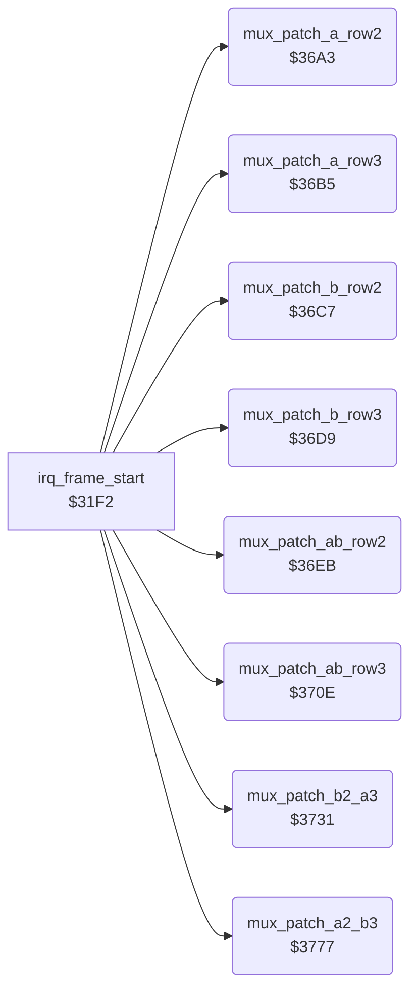

<!-- Generated by c64-docs from knowledge revision 20261021T021734.812-ub0xzr and src/source-map.json. Do not edit: change the knowledge, generate the source again, then run docs.ts generate. -->
# sprite_mux_patch.asm: Sprite multiplexer: copy the row 2/3 pointers of the fighters into the raster handler operands

Range `$36A3-$37BC`. Source: [sprite_mux_patch.asm](../../../src/sprite_mux_patch.asm). Index: [the reference](../index.md).

## Call graph

A solid arrow is a call, a thick arrow a table entry, a dotted arrow a jump. Rounded nodes are in this file.

## Data

| Range | Type | Name | Read by | Written by |
|---|---|---|---|---|
| [`$3754`](../../../src/sprite_mux_patch.asm#L98)-`$3776` | unused | [`mux_unused_patch_b3_a2`](../../../src/sprite_mux_patch.asm#L97) |  |  |
| [`$379A`](../../../src/sprite_mux_patch.asm#L122)-`$37BC` | unused | [`mux_unused_patch_a3_b2`](../../../src/sprite_mux_patch.asm#L121) |  |  |

## Names

### [`mux_patch_a_row2`](../../../src/sprite_mux_patch.asm#L6) `$36A3`

*routine*

Copies the pointers of parts 3-5 (row 2) of the group A fighter into handler $2d62 (sprites 0-2). Called from the layout code of irq_frame_start.

- **Called from:** [`irq_frame_start`](sprite_mux_plan.md#irq_frame_start) [`$3355`](../../../src/sprite_mux_plan.asm#L195), [`irq_frame_start`](sprite_mux_plan.md#irq_frame_start) [`$33CE`](../../../src/sprite_mux_plan.asm#L251), [`irq_frame_start`](sprite_mux_plan.md#irq_frame_start) [`$3441`](../../../src/sprite_mux_plan.asm#L305), [`irq_frame_start`](sprite_mux_plan.md#irq_frame_start) [`$3505`](../../../src/sprite_mux_plan.asm#L397), [`irq_frame_start`](sprite_mux_plan.md#irq_frame_start) [`$3581`](../../../src/sprite_mux_plan.asm#L454)
- **Reads:** [`group_a_fighter`](../memory-map.md#group_a_fighter)
- **Writes:** [`irq_a_row2_ptr_left`](irq_sprite_rows.md#irq_a_row2_ptr_left), [`irq_a_row2_ptr_mid`](irq_sprite_rows.md#irq_a_row2_ptr_mid), [`irq_a_row2_ptr_right`](irq_sprite_rows.md#irq_a_row2_ptr_right)
- **Refers to:** [`fighter_part_ptrs`](../memory-map.md#fighter_part_ptrs)

### [`mux_patch_a_row3`](../../../src/sprite_mux_patch.asm#L16) `$36B5`

*routine*

Copies the pointers of parts 6-8 (row 3) of the group A fighter into handler $2d9c (sprites 0-2). Called from the layout code of irq_frame_start.

- **Called from:** [`irq_frame_start`](sprite_mux_plan.md#irq_frame_start) [`$335B`](../../../src/sprite_mux_plan.asm#L197), [`irq_frame_start`](sprite_mux_plan.md#irq_frame_start) [`$33D4`](../../../src/sprite_mux_plan.asm#L253), [`irq_frame_start`](sprite_mux_plan.md#irq_frame_start) [`$34A9`](../../../src/sprite_mux_plan.asm#L353), [`irq_frame_start`](sprite_mux_plan.md#irq_frame_start) [`$3508`](../../../src/sprite_mux_plan.asm#L398), [`irq_frame_start`](sprite_mux_plan.md#irq_frame_start) [`$3584`](../../../src/sprite_mux_plan.asm#L455)
- **Reads:** [`group_a_fighter`](../memory-map.md#group_a_fighter)
- **Writes:** [`irq_a_row3_ptr_left`](irq_sprite_rows.md#irq_a_row3_ptr_left), [`irq_a_row3_ptr_mid`](irq_sprite_rows.md#irq_a_row3_ptr_mid), [`irq_a_row3_ptr_right`](irq_sprite_rows.md#irq_a_row3_ptr_right)
- **Refers to:** [`fighter_part_ptrs`](../memory-map.md#fighter_part_ptrs)

### [`mux_patch_b_row2`](../../../src/sprite_mux_patch.asm#L26) `$36C7`

*routine*

Copies the pointers of parts 3-5 (row 2) of the group B fighter into handler $2dd6 (sprites 3-5). Called from the layout code of irq_frame_start.

- **Called from:** [`irq_frame_start`](sprite_mux_plan.md#irq_frame_start) [`$3358`](../../../src/sprite_mux_plan.asm#L196), [`irq_frame_start`](sprite_mux_plan.md#irq_frame_start) [`$33CB`](../../../src/sprite_mux_plan.asm#L250), [`irq_frame_start`](sprite_mux_plan.md#irq_frame_start) [`$34A3`](../../../src/sprite_mux_plan.asm#L351), [`irq_frame_start`](sprite_mux_plan.md#irq_frame_start) [`$350B`](../../../src/sprite_mux_plan.asm#L399), [`irq_frame_start`](sprite_mux_plan.md#irq_frame_start) [`$357B`](../../../src/sprite_mux_plan.asm#L452)
- **Reads:** [`group_b_fighter`](../memory-map.md#group_b_fighter)
- **Writes:** [`irq_b_row2_ptr_left`](irq_sprite_rows.md#irq_b_row2_ptr_left), [`irq_b_row2_ptr_mid`](irq_sprite_rows.md#irq_b_row2_ptr_mid), [`irq_b_row2_ptr_right`](irq_sprite_rows.md#irq_b_row2_ptr_right)
- **Refers to:** [`fighter_part_ptrs`](../memory-map.md#fighter_part_ptrs)

### [`mux_patch_b_row3`](../../../src/sprite_mux_patch.asm#L36) `$36D9`

*routine*

Copies the pointers of parts 6-8 (row 3) of the group B fighter into handler $2e11 (sprites 3-5). Called from the layout code of irq_frame_start.

- **Called from:** [`irq_frame_start`](sprite_mux_plan.md#irq_frame_start) [`$335E`](../../../src/sprite_mux_plan.asm#L198), [`irq_frame_start`](sprite_mux_plan.md#irq_frame_start) [`$33D1`](../../../src/sprite_mux_plan.asm#L252), [`irq_frame_start`](sprite_mux_plan.md#irq_frame_start) [`$3447`](../../../src/sprite_mux_plan.asm#L307), [`irq_frame_start`](sprite_mux_plan.md#irq_frame_start) [`$350E`](../../../src/sprite_mux_plan.asm#L400), [`irq_frame_start`](sprite_mux_plan.md#irq_frame_start) [`$357E`](../../../src/sprite_mux_plan.asm#L453)
- **Reads:** [`group_b_fighter`](../memory-map.md#group_b_fighter)
- **Writes:** [`irq_b_row3_ptr_left`](irq_sprite_rows.md#irq_b_row3_ptr_left), [`irq_b_row3_ptr_mid`](irq_sprite_rows.md#irq_b_row3_ptr_mid), [`irq_b_row3_ptr_right`](irq_sprite_rows.md#irq_b_row3_ptr_right)
- **Refers to:** [`fighter_part_ptrs`](../memory-map.md#fighter_part_ptrs)

### [`mux_patch_ab_row2`](../../../src/sprite_mux_patch.asm#L46) `$36EB`

*routine*

Copies the row 2 pointers (parts 3-5) of both group fighters into the combined handler $2e4c. Layout 1 only ($3307).

- **Called from:** [`irq_frame_start`](sprite_mux_plan.md#irq_frame_start) [`$3307`](../../../src/sprite_mux_plan.asm#L157)
- **Reads:** [`group_a_fighter`](../memory-map.md#group_a_fighter), [`group_b_fighter`](../memory-map.md#group_b_fighter)
- **Writes:** [`irq_ab_row2_a_ptr_left`](irq_sprite_rows.md#irq_ab_row2_a_ptr_left), [`irq_ab_row2_a_ptr_mid`](irq_sprite_rows.md#irq_ab_row2_a_ptr_mid), [`irq_ab_row2_a_ptr_right`](irq_sprite_rows.md#irq_ab_row2_a_ptr_right), [`irq_ab_row2_b_ptr_left`](irq_sprite_rows.md#irq_ab_row2_b_ptr_left), [`irq_ab_row2_b_ptr_mid`](irq_sprite_rows.md#irq_ab_row2_b_ptr_mid), [`irq_ab_row2_b_ptr_right`](irq_sprite_rows.md#irq_ab_row2_b_ptr_right)
- **Refers to:** [`fighter_part_ptrs`](../memory-map.md#fighter_part_ptrs)

### [`mux_patch_ab_row3`](../../../src/sprite_mux_patch.asm#L63) `$370E`

*routine*

Copies the row 3 pointers (parts 6-8) of both group fighters into the combined handler $2ea7. Layout 1 only ($330a).

- **Called from:** [`irq_frame_start`](sprite_mux_plan.md#irq_frame_start) [`$330A`](../../../src/sprite_mux_plan.asm#L158)
- **Reads:** [`group_a_fighter`](../memory-map.md#group_a_fighter), [`group_b_fighter`](../memory-map.md#group_b_fighter)
- **Writes:** [`irq_ab_row3_a_ptr_left`](irq_sprite_rows.md#irq_ab_row3_a_ptr_left), [`irq_ab_row3_a_ptr_mid`](irq_sprite_rows.md#irq_ab_row3_a_ptr_mid), [`irq_ab_row3_a_ptr_right`](irq_sprite_rows.md#irq_ab_row3_a_ptr_right), [`irq_ab_row3_b_ptr_left`](irq_sprite_rows.md#irq_ab_row3_b_ptr_left), [`irq_ab_row3_b_ptr_mid`](irq_sprite_rows.md#irq_ab_row3_b_ptr_mid), [`irq_ab_row3_b_ptr_right`](irq_sprite_rows.md#irq_ab_row3_b_ptr_right)
- **Refers to:** [`fighter_part_ptrs`](../memory-map.md#fighter_part_ptrs)

### [`mux_patch_b2_a3`](../../../src/sprite_mux_patch.asm#L80) `$3731`

*routine*

Copies row 2 of the group B fighter and row 3 of the group A fighter into the combined handler $2f02. Layout 4 only ($3444).

- **Called from:** [`irq_frame_start`](sprite_mux_plan.md#irq_frame_start) [`$3444`](../../../src/sprite_mux_plan.asm#L306)
- **Reads:** [`group_a_fighter`](../memory-map.md#group_a_fighter), [`group_b_fighter`](../memory-map.md#group_b_fighter)
- **Writes:** [`irq_b2_a3_a_ptr_left`](irq_sprite_rows.md#irq_b2_a3_a_ptr_left), [`irq_b2_a3_a_ptr_mid`](irq_sprite_rows.md#irq_b2_a3_a_ptr_mid), [`irq_b2_a3_a_ptr_right`](irq_sprite_rows.md#irq_b2_a3_a_ptr_right), [`irq_b2_a3_b_ptr_left`](irq_sprite_rows.md#irq_b2_a3_b_ptr_left), [`irq_b2_a3_b_ptr_mid`](irq_sprite_rows.md#irq_b2_a3_b_ptr_mid), [`irq_b2_a3_b_ptr_right`](irq_sprite_rows.md#irq_b2_a3_b_ptr_right)
- **Refers to:** [`fighter_part_ptrs`](../memory-map.md#fighter_part_ptrs)

### [`mux_unused_patch_b3_a2`](../../../src/sprite_mux_patch.asm#L97) `$3754-$3776`

*data*

Unused code, never called: row 2 of group A into the second set of $2f02, row 3 of group B into the first set. It is mux_patch_b2_a3 with the rows exchanged. The operands are v2 handler addresses, so it is still in the source.

### [`mux_patch_a2_b3`](../../../src/sprite_mux_patch.asm#L104) `$3777`

*routine*

Copies row 2 of the group A fighter and row 3 of the group B fighter into the combined handler $2f59. Layout 5 only ($34a6).

- **Called from:** [`irq_frame_start`](sprite_mux_plan.md#irq_frame_start) [`$34A6`](../../../src/sprite_mux_plan.asm#L352)
- **Reads:** [`group_a_fighter`](../memory-map.md#group_a_fighter), [`group_b_fighter`](../memory-map.md#group_b_fighter)
- **Writes:** [`irq_a2_b3_a_ptr_left`](irq_sprite_rows.md#irq_a2_b3_a_ptr_left), [`irq_a2_b3_a_ptr_mid`](irq_sprite_rows.md#irq_a2_b3_a_ptr_mid), [`irq_a2_b3_a_ptr_right`](irq_sprite_rows.md#irq_a2_b3_a_ptr_right), [`irq_a2_b3_b_ptr_left`](irq_sprite_rows.md#irq_a2_b3_b_ptr_left), [`irq_a2_b3_b_ptr_mid`](irq_sprite_rows.md#irq_a2_b3_b_ptr_mid), [`irq_a2_b3_b_ptr_right`](irq_sprite_rows.md#irq_a2_b3_b_ptr_right)
- **Refers to:** [`fighter_part_ptrs`](../memory-map.md#fighter_part_ptrs)

### [`mux_unused_patch_a3_b2`](../../../src/sprite_mux_patch.asm#L121) `$379A-$37BC`

*data*

Unused code, never called: row 3 of group A into the first set of $2f59, row 2 of group B into the second set. It is mux_patch_a2_b3 with the rows exchanged. The operands are v2 handler addresses.
