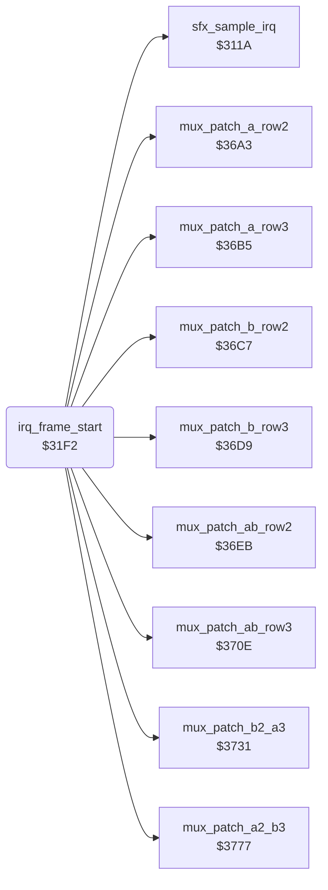

<!-- Generated by c64-docs from knowledge revision 20261021T021734.812-ub0xzr and src/source-map.json. Do not edit: change the knowledge, generate the source again, then run docs.ts generate. -->
# sprite_mux_plan.asm: Frame-start raster IRQ: sprite groups, row-4 handler, 7 multiplexer layouts, sprite row 1

Range `$31F2-$36A2`. Source: [sprite_mux_plan.asm](../../../src/sprite_mux_plan.asm). Index: [the reference](../index.md).

## Call graph

A solid arrow is a call, a thick arrow a table entry, a dotted arrow a jump. Rounded nodes are in this file.

## Data

| Range | Type | Name | Read by | Written by |
|---|---|---|---|---|
| [`$369B`](../../../src/sprite_mux_plan.asm#L592)-`$369E` | bytes | [`mux_msb_bits_a`](../../../src/sprite_mux_plan.asm#L591) | [`irq_frame_start`](sprite_mux_plan.md#irq_frame_start) |  |
| [`$369F`](../../../src/sprite_mux_plan.asm#L595)-`$36A2` | bytes | [`mux_msb_bits_b`](../../../src/sprite_mux_plan.asm#L594) | [`irq_frame_start`](sprite_mux_plan.md#irq_frame_start) |  |

## Names

### [`irq_frame_start`](../../../src/sprite_mux_plan.asm#L6) `$31F2`

*routine*

Raster IRQ at line 0, the start of the sprite multiplexer; init $1958 and irq_frame_end $30f9 set the vector. A CIA1 IRQ goes to the sample player $311a. Else it sets the next IRQ, irq_bitmap_on $2fb0 at line $59, and the sprite multicolours. It puts front_fighter in group A, selects the row-4 handler, patches the row handlers for one of 7 layouts and sets sprite row 1.

- **Referred to by:** [`init_vectors_cias`](init_machine.md#init_vectors_cias) [`$1958`](../../../src/init_machine.asm#L74), [`init_vectors_cias`](init_machine.md#init_vectors_cias) [`$195D`](../../../src/init_machine.asm#L76), [`irq_frame_end`](irq_screen_split.md#irq_frame_end) [`$30F9`](../../../src/irq_screen_split.asm#L188), [`irq_frame_end`](irq_screen_split.md#irq_frame_end) [`$30FE`](../../../src/irq_screen_split.asm#L190)
- **Calls:** [`sfx_sample_irq`](sfx_sample_player.md#sfx_sample_irq), [`mux_patch_ab_row2`](sprite_mux_patch.md#mux_patch_ab_row2), [`mux_patch_ab_row3`](sprite_mux_patch.md#mux_patch_ab_row3), [`mux_patch_a_row2`](sprite_mux_patch.md#mux_patch_a_row2), [`mux_patch_b_row2`](sprite_mux_patch.md#mux_patch_b_row2), [`mux_patch_a_row3`](sprite_mux_patch.md#mux_patch_a_row3), [`mux_patch_b_row3`](sprite_mux_patch.md#mux_patch_b_row3), [`mux_patch_b2_a3`](sprite_mux_patch.md#mux_patch_b2_a3), [`mux_patch_a2_b3`](sprite_mux_patch.md#mux_patch_a2_b3)
- **Reads:** [`CIAICR`](../memory-map.md#CIAICR), [`front_fighter`](../memory-map.md#front_fighter), [`group_a_fighter`](../memory-map.md#group_a_fighter), [`sprite_y+1`](../memory-map.md#sprite_y), [`sprite_x_lo+1`](../memory-map.md#sprite_x_lo), [`sprite_x_msb+1`](../memory-map.md#sprite_x_msb), [`group_b_fighter`](../memory-map.md#group_b_fighter), [`group_y`](../memory-map.md#group_y), [`group_y+1`](../memory-map.md#group_y), [`row4_ptr_left+1`](../memory-map.md#row4_ptr_left), [`row4_ptr_mid+1`](../memory-map.md#row4_ptr_mid), [`row4_ptr_right+1`](../memory-map.md#row4_ptr_right), [`row4_irq_vector`](../memory-map.md#row4_irq_vector), [`row4_irq_vector+1`](../memory-map.md#row4_irq_vector), [`fighter_part_ptrs+3`](../memory-map.md#fighter_part_ptrs), [`fighter_part_ptrs+5`](../memory-map.md#fighter_part_ptrs), [`fighter_colour+1`](../memory-map.md#fighter_colour), [`group_x_msb`](../memory-map.md#group_x_msb), [`group_x_lo`](../memory-map.md#group_x_lo), [`MSIGX`](../memory-map.md#MSIGX), [`group_x_msb+1`](../memory-map.md#group_x_msb), [`group_x_lo+1`](../memory-map.md#group_x_lo)
- **Writes:** [`VICIRQ`](../memory-map.md#VICIRQ), [`hw_irq_vector`](../memory-map.md#hw_irq_vector), [`hw_irq_vector+1`](../memory-map.md#hw_irq_vector), [`RASTER`](../memory-map.md#RASTER), [`SPMC0`](../memory-map.md#SPMC0), [`SPMC1`](../memory-map.md#SPMC1), [`group_a_fighter`](../memory-map.md#group_a_fighter), [`group_b_fighter`](../memory-map.md#group_b_fighter), [`group_y`](../memory-map.md#group_y), [`group_x_lo`](../memory-map.md#group_x_lo), [`group_x_msb`](../memory-map.md#group_x_msb), [`group_y+1`](../memory-map.md#group_y), [`group_x_lo+1`](../memory-map.md#group_x_lo), [`group_x_msb+1`](../memory-map.md#group_x_msb), [`row4_irq_vector`](../memory-map.md#row4_irq_vector), [`row4_irq_vector+1`](../memory-map.md#row4_irq_vector), [`irq_a_row4_ptr_left`](irq_screen_split.md#irq_a_row4_ptr_left), [`irq_a_row4_ptr_mid`](irq_screen_split.md#irq_a_row4_ptr_mid), [`irq_a_row4_ptr_right`](irq_screen_split.md#irq_a_row4_ptr_right), [`irq_ab_row4_a_ptr_left`](irq_screen_split.md#irq_ab_row4_a_ptr_left), [`irq_ab_row4_a_ptr_mid`](irq_screen_split.md#irq_ab_row4_a_ptr_mid), [`irq_ab_row4_a_ptr_right`](irq_screen_split.md#irq_ab_row4_a_ptr_right), [`irq_ab_row4_b_ptr_left`](irq_screen_split.md#irq_ab_row4_b_ptr_left), [`irq_ab_row4_b_ptr_mid`](irq_screen_split.md#irq_ab_row4_b_ptr_mid), [`irq_ab_row4_b_ptr_right`](irq_screen_split.md#irq_ab_row4_b_ptr_right), [`irq_b_row4_ptr_left`](irq_screen_split.md#irq_b_row4_ptr_left), [`irq_b_row4_ptr_mid`](irq_screen_split.md#irq_b_row4_ptr_mid), [`irq_b_row4_ptr_right`](irq_screen_split.md#irq_b_row4_ptr_right), [`irq_bitmap_on_next_lo`](irq_screen_split.md#irq_bitmap_on_next_lo), [`irq_bitmap_on_next_hi`](irq_screen_split.md#irq_bitmap_on_next_hi), [`irq_ab_row2_next_lo`](irq_sprite_rows.md#irq_ab_row2_next_lo), [`irq_ab_row2_next_hi`](irq_sprite_rows.md#irq_ab_row2_next_hi), [`irq_ab_row3_next_lo`](irq_sprite_rows.md#irq_ab_row3_next_lo), [`irq_ab_row3_next_hi`](irq_sprite_rows.md#irq_ab_row3_next_hi), [`irq_bitmap_on_next_line`](irq_screen_split.md#irq_bitmap_on_next_line), [`irq_ab_row2_wait_line`](irq_sprite_rows.md#irq_ab_row2_wait_line), [`irq_ab_row2_y`](irq_sprite_rows.md#irq_ab_row2_y), [`irq_ab_row2_next_line`](irq_sprite_rows.md#irq_ab_row2_next_line), [`irq_ab_row3_wait_line`](irq_sprite_rows.md#irq_ab_row3_wait_line), [`irq_ab_row3_y`](irq_sprite_rows.md#irq_ab_row3_y) and 52 more
- **Refers to:** [`irq_bitmap_on`](irq_screen_split.md#irq_bitmap_on), [`group_y`](../memory-map.md#group_y), [`group_x_lo`](../memory-map.md#group_x_lo), [`group_x_msb`](../memory-map.md#group_x_msb), [`irq_b_row4`](irq_screen_split.md#irq_b_row4), [`row4_irq_vector`](../memory-map.md#row4_irq_vector), [`irq_ab_row4`](irq_screen_split.md#irq_ab_row4), [`irq_a_row4`](irq_screen_split.md#irq_a_row4), [`irq_no_row4`](irq_screen_split.md#irq_no_row4), [`irq_ab_row2`](irq_sprite_rows.md#irq_ab_row2), [`irq_ab_row3`](irq_sprite_rows.md#irq_ab_row3), [`irq_a_row2`](irq_sprite_rows.md#irq_a_row2), [`irq_b_row2`](irq_sprite_rows.md#irq_b_row2), [`irq_a_row3`](irq_sprite_rows.md#irq_a_row3), [`irq_b_row3`](irq_sprite_rows.md#irq_b_row3), [`irq_b2_a3`](irq_sprite_rows.md#irq_b2_a3), [`irq_a2_b3`](irq_sprite_rows.md#irq_a2_b3), [`fighter_part_ptrs`](../memory-map.md#fighter_part_ptrs)

### [`irq_frame_start_vic`](../../../src/sprite_mux_plan.asm#L11) `$31FB`

*label*

- **Jumped to from:** [`irq_frame_start`](sprite_mux_plan.md#irq_frame_start) [`$31F5`](../../../src/sprite_mux_plan.asm#L8)

### [`mux_front_is_fighter1`](../../../src/sprite_mux_plan.asm#L38) `$322F`

*label*

- **Jumped to from:** [`irq_frame_start`](sprite_mux_plan.md#irq_frame_start) [`$3222`](../../../src/sprite_mux_plan.asm#L32)

### [`mux_copy_group_pos`](../../../src/sprite_mux_plan.asm#L44) `$3237`

*label*

Copies sprite_y, sprite_x_lo and sprite_x_msb of the group A fighter to $1c/$1a/$1e and of the group B fighter to $1d/$1b/$1f.

- **Jumped to from:** [`irq_frame_start`](sprite_mux_plan.md#irq_frame_start) [`$322C`](../../../src/sprite_mux_plan.asm#L37)

### [`mux_a_off_ground`](../../../src/sprite_mux_plan.asm#L70) `$3268`

*label*

- **Jumped to from:** [`irq_frame_start`](sprite_mux_plan.md#irq_frame_start) [`$3257`](../../../src/sprite_mux_plan.asm#L62)

### [`mux_row4_a_only`](../../../src/sprite_mux_plan.asm#L78) `$3277`

*label*

- **Jumped to from:** [`irq_frame_start`](sprite_mux_plan.md#irq_frame_start) [`$326A`](../../../src/sprite_mux_plan.asm#L72)

### [`mux_no_row4`](../../../src/sprite_mux_plan.asm#L84) `$3282`

*label*

- **Jumped to from:** [`irq_frame_start`](sprite_mux_plan.md#irq_frame_start) [`$325B`](../../../src/sprite_mux_plan.asm#L64)

### [`mux_patch_row4_ptrs`](../../../src/sprite_mux_plan.asm#L91) `$328D`

*label*

Copies the row 4 (floor shadow) pointers row4_ptr_left/mid/right of group A into handlers $2fff and $3073, and of group B into $3073 and $3039.

- **Jumped to from:** [`irq_frame_start`](sprite_mux_plan.md#irq_frame_start) [`$3265`](../../../src/sprite_mux_plan.asm#L69), [`irq_frame_start`](sprite_mux_plan.md#irq_frame_start) [`$3274`](../../../src/sprite_mux_plan.asm#L77), [`irq_frame_start`](sprite_mux_plan.md#irq_frame_start) [`$327F`](../../../src/sprite_mux_plan.asm#L83)

### [`mux_choose_layout`](../../../src/sprite_mux_plan.asm#L119) `$32CD`

*label*

Selects one of 7 layouts from the Y gap between group A ($1c) and group B ($1d). Sprite Y is fighter_y*2 and all script dy values are even, thus the gap is a multiple of 4. Of these gaps, only $14 puts two row IRQs one raster line apart; it gets a combined handler.

- **Jumped to from:** [`irq_frame_start`](sprite_mux_plan.md#irq_frame_start) [`$328A`](../../../src/sprite_mux_plan.asm#L89)

### [`mux_y_differ`](../../../src/sprite_mux_plan.asm#L125) `$32D7`

*label*

- **Jumped to from:** [`irq_frame_start`](sprite_mux_plan.md#irq_frame_start) [`$32D2`](../../../src/sprite_mux_plan.asm#L123)

### [`mux_a_above_b`](../../../src/sprite_mux_plan.asm#L128) `$32DC`

*label*

- **Jumped to from:** [`irq_frame_start`](sprite_mux_plan.md#irq_frame_start) [`$32D7`](../../../src/sprite_mux_plan.asm#L126)

### [`mux_a_above_gap_test`](../../../src/sprite_mux_plan.asm#L134) `$32E5`

*label*

- **Jumped to from:** [`irq_frame_start`](sprite_mux_plan.md#irq_frame_start) [`$32E3`](../../../src/sprite_mux_plan.asm#L133)

### [`mux_a_above_near`](../../../src/sprite_mux_plan.asm#L137) `$32EA`

*label*

- **Jumped to from:** [`irq_frame_start`](sprite_mux_plan.md#irq_frame_start) [`$32E5`](../../../src/sprite_mux_plan.asm#L135)

### [`mux_a_above_interleave`](../../../src/sprite_mux_plan.asm#L141) `$32F1`

*label*

- **Jumped to from:** [`irq_frame_start`](sprite_mux_plan.md#irq_frame_start) [`$32EC`](../../../src/sprite_mux_plan.asm#L139)

### [`mux_b_above_a`](../../../src/sprite_mux_plan.asm#L143) `$32F4`

*label*

- **Jumped to from:** [`irq_frame_start`](sprite_mux_plan.md#irq_frame_start) [`$32D9`](../../../src/sprite_mux_plan.asm#L127)

### [`mux_b_above_gap_test`](../../../src/sprite_mux_plan.asm#L146) `$32F8`

*label*

- **Jumped to from:** [`irq_frame_start`](sprite_mux_plan.md#irq_frame_start) [`$32F6`](../../../src/sprite_mux_plan.asm#L145)

### [`mux_b_above_near`](../../../src/sprite_mux_plan.asm#L149) `$32FD`

*label*

- **Jumped to from:** [`irq_frame_start`](sprite_mux_plan.md#irq_frame_start) [`$32F8`](../../../src/sprite_mux_plan.asm#L147)

### [`mux_b_above_interleave`](../../../src/sprite_mux_plan.asm#L153) `$3304`

*label*

- **Jumped to from:** [`irq_frame_start`](sprite_mux_plan.md#irq_frame_start) [`$32FF`](../../../src/sprite_mux_plan.asm#L151)

### [`mux_layout_same_y`](../../../src/sprite_mux_plan.asm#L156) `$3307`

*label*

Layout 1, both groups at the same Y. Handler $2e4c gets the IRQ at line Y+$12, waits for line Y+$14 and starts row 2 of both groups. Handler $2ea7 gets the IRQ at Y+$27, waits for Y+$29 and starts row 3. The row-4 handler follows at line $d9.

- **Jumped to from:** [`irq_frame_start`](sprite_mux_plan.md#irq_frame_start) [`$32D4`](../../../src/sprite_mux_plan.asm#L124)

### [`mux_layout_a_interleave`](../../../src/sprite_mux_plan.asm#L194) `$3355`

*label*

Layout 2, group A above group B by 4 to $10 (any gap below $16 except $14). IRQ chain: A row 2 ($2d62), B row 2 ($2dd6), A row 3 ($2d9c), B row 3 ($2e11), row-4 handler at line $d9.

- **Jumped to from:** [`irq_frame_start`](sprite_mux_plan.md#irq_frame_start) [`$32F1`](../../../src/sprite_mux_plan.asm#L142)

### [`mux_layout_b_interleave`](../../../src/sprite_mux_plan.asm#L249) `$33CB`

*label*

Layout 3, group B above group A by 4 to $10. IRQ chain: B row 2 ($2dd6), A row 2 ($2d62), B row 3 ($2e11), A row 3 ($2d9c), row-4 handler at line $d9.

- **Jumped to from:** [`irq_frame_start`](sprite_mux_plan.md#irq_frame_start) [`$3304`](../../../src/sprite_mux_plan.asm#L154)

### [`mux_layout_a_gap14`](../../../src/sprite_mux_plan.asm#L304) `$3441`

*label*

Layout 4, group A above group B by exactly $14: B row 2 starts one line before A row 3. IRQ chain: A row 2 ($2d62), $2f02 at line A+$28 for B row 2 and A row 3, B row 3 ($2e11), row-4 handler.

- **Jumped to from:** [`irq_frame_start`](sprite_mux_plan.md#irq_frame_start) [`$32EE`](../../../src/sprite_mux_plan.asm#L140)

### [`mux_layout_b_gap14`](../../../src/sprite_mux_plan.asm#L350) `$34A3`

*label*

Layout 5, group B above group A by exactly $14. IRQ chain: B row 2 ($2dd6), $2f59 at line B+$28 for A row 2 and B row 3, A row 3 ($2d9c), row-4 handler.

- **Jumped to from:** [`irq_frame_start`](sprite_mux_plan.md#irq_frame_start) [`$3301`](../../../src/sprite_mux_plan.asm#L152)

### [`mux_layout_a_apart`](../../../src/sprite_mux_plan.asm#L396) `$3505`

*label*

Layout 6, group A above group B by $16 or more: the rows of B start after row 3 of A. IRQ chain: A row 2, A row 3, B row 2, B row 3, row-4 handler.

- **Jumped to from:** [`irq_frame_start`](sprite_mux_plan.md#irq_frame_start) [`$32E7`](../../../src/sprite_mux_plan.asm#L136)

### [`mux_layout_b_apart`](../../../src/sprite_mux_plan.asm#L451) `$357B`

*label*

Layout 7, group B above group A by $16 or more. IRQ chain: B row 2, B row 3, A row 2, A row 3, row-4 handler.

- **Jumped to from:** [`irq_frame_start`](sprite_mux_plan.md#irq_frame_start) [`$32FA`](../../../src/sprite_mux_plan.asm#L148)

### [`mux_set_row1`](../../../src/sprite_mux_plan.asm#L506) `$35F1`

*label*

Sets sprite row 1 of both groups: pointers $cff8-$cffd from parts 0-2, Y and colours. X is group X +0, +$18 and +$30, with X bit 8 from mux_msb_bits_a/b. Then it restores X, Y and A and returns from the IRQ.

- **Jumped to from:** [`irq_frame_start`](sprite_mux_plan.md#irq_frame_start) [`$3352`](../../../src/sprite_mux_plan.asm#L192), [`irq_frame_start`](sprite_mux_plan.md#irq_frame_start) [`$33C8`](../../../src/sprite_mux_plan.asm#L247), [`irq_frame_start`](sprite_mux_plan.md#irq_frame_start) [`$343E`](../../../src/sprite_mux_plan.asm#L302), [`irq_frame_start`](sprite_mux_plan.md#irq_frame_start) [`$34A0`](../../../src/sprite_mux_plan.asm#L348), [`irq_frame_start`](sprite_mux_plan.md#irq_frame_start) [`$3502`](../../../src/sprite_mux_plan.asm#L394), [`irq_frame_start`](sprite_mux_plan.md#irq_frame_start) [`$3578`](../../../src/sprite_mux_plan.asm#L449), [`irq_frame_start`](sprite_mux_plan.md#irq_frame_start) [`$35EE`](../../../src/sprite_mux_plan.asm#L504)

### [`mux_a_col2_x`](../../../src/sprite_mux_plan.asm#L554) `$365B`

*label*

- **Jumped to from:** [`irq_frame_start`](sprite_mux_plan.md#irq_frame_start) [`$3656`](../../../src/sprite_mux_plan.asm#L551)

### [`mux_a_set_msb`](../../../src/sprite_mux_plan.asm#L559) `$3664`

*label*

- **Jumped to from:** [`irq_frame_start`](sprite_mux_plan.md#irq_frame_start) [`$3660`](../../../src/sprite_mux_plan.asm#L557)

### [`mux_b_col2_x`](../../../src/sprite_mux_plan.asm#L575) `$3683`

*label*

- **Jumped to from:** [`irq_frame_start`](sprite_mux_plan.md#irq_frame_start) [`$367E`](../../../src/sprite_mux_plan.asm#L572)

### [`mux_b_set_msb`](../../../src/sprite_mux_plan.asm#L580) `$368C`

*label*

- **Jumped to from:** [`irq_frame_start`](sprite_mux_plan.md#irq_frame_start) [`$3688`](../../../src/sprite_mux_plan.asm#L578)

### [`mux_msb_bits_a`](../../../src/sprite_mux_plan.asm#L591) `$369B-$369E`

*data*

X bit 8 masks of sprites 0-2: index 0 none, 1 all three (group X >= 256), 2 sprites 1-2, 3 sprite 2.

- **Read by:** [`irq_frame_start`](sprite_mux_plan.md#irq_frame_start) [`$3669`](../../../src/sprite_mux_plan.asm#L562) (+2), [`irq_frame_start`](sprite_mux_plan.md#irq_frame_start) [`$3669`](../../../src/sprite_mux_plan.asm#L562) (+3)

### [`mux_msb_bits_b`](../../../src/sprite_mux_plan.asm#L594) `$369F-$36A2`

*data*

X bit 8 masks of sprites 3-5, the same order as mux_msb_bits_a.

- **Read by:** [`irq_frame_start`](sprite_mux_plan.md#irq_frame_start) [`$368C`](../../../src/sprite_mux_plan.asm#L581) (+2), [`irq_frame_start`](sprite_mux_plan.md#irq_frame_start) [`$368C`](../../../src/sprite_mux_plan.asm#L581) (+3)
