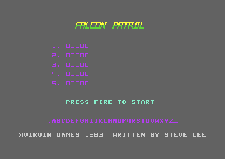

# Falcon Patrol

Falcon Patrol is a two-way scrolling shoot'em-up by Steve Lee, published by Virgin Games in 1983. The player flies a jet that can hover and land over a desert with houses, palms and oil tanks. The jet shoots down waves of enemy jets with AAM missiles, and it lands on an airfield for fuel and missiles. This documentation is for the game file of the T.Bombardieri crack, the base release, and for two other cracks: Derbyshire Ram and RGR.

**Evidence.** **Observed** marks a fact that a run or a byte compare showed. **Code** marks a fact from the code only. **Conclusion** marks an interpretation.

## The development

The game file is one block of 16 KB at `$2000-$5FFF`, with one byte more at `$6000`. Most routines start at a round address, for example `$4200`, `$4800` or `$5700`. The bytes between them are NOP fill, 784 bytes in 75 ranges. Some routines have NOP runs inside them where an instruction went away (**Code**). **Conclusion:** the author assembled each routine at a fixed address and patched the code in place, so that no other routine had to move.

The file keeps older copies of two routines: the input masks before [`jet_flight` `$5495`](src/player/flight.asm#L32), and the first version of the enemy fire at `$5900`. Four more small routines have no caller. They write the spare jets at a different place of the panel, fill screen rows, or wait in a delay loop (**Code**). The routine at `$5220` writes a 40-column screen at `$6400` at each new jet, but the VIC-II never shows that memory (**Code**). Three tests have `AND #$00` in front of their branch. Two of them made the missiles and the enemy shots move only on some ticks, and now they move in each pass (**Code**).

The gaps of the file hold the pattern of C64 RAM after power-on, and an unused text "FALCON PATROL" lies after the credit line (**Code**). **Conclusion:** the author saved the memory of the development machine as the game file. The details are on [docs/development.md](docs/development.md).

## The copy protection

The game file has no copy protection. It makes no disk or tape access, it checks no loader and it has no checksum (**Code**). The original Virgin tape and its loader are not in the three releases. Thus a protection of the original loader, if there was one, is not known. The details are on [docs/releases.md](docs/releases.md).

## Findings

- **One start in six hangs.** [`cold_start` `$4100`](src/init/cold_start.asm#L6) turns off the CIA 1 interrupts but never reads `$DC0D`. When the KERNAL timer runs out in the 2775 cycles between the SEI and that store, its flag stays set. The game then runs its raster interrupt without end and never shows the title (**Observed**). The window is 2775 of 16422 cycles. Thus about one start in six from BASIC hangs (**Conclusion**). A player sees a frozen screen and must start the game again. The loader of the rebuild always starts the game. See [docs/main_loop.md](docs/main_loop.md).
- **An enemy at the top cannot be shot.** The kill test finds the screen cell under an enemy sprite from its Y position. At the entry height of a wave, Y 42, the row wraps to 31. Thus the test reads the title-screen RAM, not the missile row (**Code**). Missiles fly only in rows 0-10. Thus a player must wait until an enemy comes down. In 20 timed shots at a wave at the top, no missile hit (**Observed**). See [docs/enemies.md](docs/enemies.md).
- **The wave size comes from the score, not from the wave count.** The manual says that one more jet joins every six waves. The code gives 2 jets below 400 points, 3 from 400 and 4 from 1500. It reads only the thousands and hundreds digits, so from 10000 points the waves are small again (**Code**). See [docs/enemies.md](docs/enemies.md).
- **The kill points double in each wave.** The first kill of a wave gives 25 points, then 50, 100 and 200, as the manual says. The value doubles in one byte, so a fifth kill would give 144 points. A wave has at most 4 jets, so this does not occur (**Code**).
- **A pass of the main loop is not one frame.** CIA 2 timer B paces the main loop with about 33000 cycles for each pass. That is about 1.65 frames, or about 30 passes in each second on a PAL machine (**Code**). See [docs/main_loop.md](docs/main_loop.md).
- **The joystick and the keyboard are one input.** The game reads only `$DC01`. The keys LEFT ARROW, 1, CTRL, 2 and SPACE are in column 7 of the keyboard matrix. Thus they give the bits of joystick port 1. The keyboard control of the manual costs no code (**Observed** by the keyboard recording). See [docs/flight.md](docs/flight.md).
- **The high-score table exists only on the screen.** The five scores and names are bytes of the title screen at `$08D2`. The panel reads the top score from there (**Code**). See [docs/title.md](docs/title.md).
- **The trainer of Derbyshire Ram resets the score.** With infinite lives the spare-jet count stays 3. The test for the first jet of a game uses that count. Thus each new jet runs the start prompt code, and that code clears the score. A run with the trainer byte and a score of 01750 shows 00000 at the next jet (**Observed**). Thus a player with the trainer loses the score at each crash until the extra jet. See [docs/main_loop.md](docs/main_loop.md).
- **Two cracks are memory dumps of a game that ran.** Derbyshire Ram and RGR have the GAS gauge character, the radar characters and a buffer byte as the game left them after a refuel. RGR also has the crater characters (**Observed**). See [docs/releases.md](docs/releases.md).

## How the game works

The game starts at `$4100` with SYS 16640. The cold start clears the zero page, starts the timers, sets the raster interrupt and builds the title screen at `$0800`. The title plays a short tune and shows the high scores. FIRE starts a game. Each jet starts on an airfield, and the game fills its tank before the player can move. Then the main loop runs one pass of the game in each turn of a CIA timer.

~~~mermaid
flowchart TB
  A["Cold start (cold_start)"] --> B["Title: high scores, tune, name entry (title_screen)"]
  B -->|FIRE| C["New jet: screen, landscape, panel, refuel on the pad"]
  C --> D["Main loop: one pass per CIA 2 timer B (main_loop)"]
  D -->|jet lost, spare jets left| C
  D -->|no spare jet| B
  I["Raster interrupt: sky, ground, panel colours (raster_irq)"] -.-> D
~~~

~~~mermaid
flowchart LR
  P["Jet on the pad: refuel"] -->|UP| F["Flight: speed, climb, missiles"]
  F -->|speed 0 over an airfield| P
  F -->|hit, collision or crash| L["Jet lost: smoke, wreck"]
  F -->|GAS 000| N["No fuel: the jet sinks"]
  N --> L
  N -->|lands on an airfield| P
~~~

1. **The start runs one time.** [`cold_start` `$4100`](src/init/cold_start.asm#L6) clears `$03-$72`, sets the VIC-II from a table and starts the CIA 2 timers. It sets the raster interrupt and builds the title screen (**Code**).
2. **The title waits for FIRE.** [`title_screen` `$46A0`](src/title/title_screen.asm#L6) checks the score of the last game, takes a name for a new high score and plays the tune. Without FIRE the game screen shows PRESS FIRE TO START (**Observed**). After a time limit the game goes back to the title (**Code**).
3. **The main loop sets the pace.** [`main_loop` `$4185`](src/game/main_loop.asm#L54) calls the parts of the game in a fixed order. The order is the radar, the input and the flight, the scroll, the panel and the fuel. Then come the landing, the missiles, the enemies, the shots and bombs, the collisions and the sound. Then it waits for CIA 2 timer B (**Code**).
4. **The interrupt only changes colours.** [`raster_irq` `$4AC0`](src/irq/raster_irq.asm#L6) splits the screen three times in each frame for the sky, the ground and the panel. It does no game work (**Code**).
5. **A lost jet ends the pass.** When the jet is lost, the loop waits for the crash animation and clears the play state. Then it starts the next jet, or it goes back to the title (**Observed**).

## The pages

| Page | Content |
|---|---|
| [docs/development.md](docs/development.md) | **The development.** The code at fixed addresses, the old copies, the dead routines, the tests that the author turned off and the RAM in the file. |
| [docs/main_loop.md](docs/main_loop.md) | **The start, the main loop and the interrupt.** The cold start and its hang, the life of a game, the pace of the main loop and the raster splits. |
| [docs/flight.md](docs/flight.md) | **The jet.** The input, the flight model, the missiles, the fuel, the landing, the refuel and the loss of a jet. |
| [docs/enemies.md](docs/enemies.md) | **The enemies.** The waves, the steering, the shots and bombs, the collisions, the kill test and the score. |
| [docs/landscape.md](docs/landscape.md) | **The screen.** The landscape map, the scroll, the radar, the panel and the characters that change at run time. |
| [docs/title.md](docs/title.md) | **The title.** The title screen, the tune, the high-score table and the name entry. |
| [docs/sound.md](docs/sound.md) | **The sound.** The use of the three SID voices, the sound tables and the engine rumble. |
| [docs/releases.md](docs/releases.md) | **The releases.** The three cracks of the rebuild, the run state of two of them, and the other cracks on CSDb. |

## The releases

| Label | File | SHA-256 |
|---|---|---|
| `BOMBARDIERI` | `original/bombardieri/falcon.prg` | `eb95c68bf34f5501205ed71e59c99c3faa0d4f76f51aa75e40602196fc069bdf` |
| `DERBYSHIRE_RAM` | `original/derbyshire_ram/falcon_patrol_dr.prg` | `0cdae3461f7c2fc16bf99000794578c9a74eeac28e95c2147dc82be2f90e9bce` |
| `RGR` | `original/rgr/falcon_patrol_rgr.prg` | `c99b1f55a8a579f37160bb50b895f043cf04c158df8650543dd6fe5bd7164b1d` |

- **T.Bombardieri** (CSDb 147560): a BASIC boot loads the game file `FALCON!` and starts it with SYS 16640. The game bytes are the clean game file.
- **Derbyshire Ram** (CSDb 161485, "cracked 1983"): a packed file with a trainer question. The answer Y changes one byte of the game.
- **RGR** (CSDb 207856): a memory dump of a game that ran, with "MIKE" in place of "VIRGIN" in the credit line.

The trainer of Derbyshire Ram changes the `DEC lives` at `$417C` in [`game_life_begin` `$4173`](src/game/main_loop.asm#L31) into an `LDA`. Thus a lost jet costs no spare jet (**Observed**). RGR and Derbyshire Ram are dumps of a running game. Their gauge and radar characters are as a refuel left them, and that tells the state of the game when the crackers saved it (**Observed**). The other 10 cracks on CSDb have the same game file, some with a new credit line. The details are on [docs/releases.md](docs/releases.md).

## The rebuild

The base release is `BOMBARDIERI`: the file `FALCON!` at `$2000-$6000`, captured at the entry `$4100` after the boot of the crack. The capture leaves out the text screen and the BASIC boot of the crack. The game reads neither before it writes it (**Observed**). The game has no Virgin loading picture, and its title screen is a part of the program, so the loader shows no start screen.

| Switch | Kind | Default | Releases |
|---|---|---|---|
| `TRAINER` | trainer | 0 | `DERBYSHIRE_RAM` |
| `CRACK_RGR` | crack | 0 | `RGR` |
| `RUN_STATE` | change | 0 | `DERBYSHIRE_RAM`, `RGR` |
| `RUN_STATE_RGR` | change | 0 | `RGR` |

The source in `src/` builds each release byte for byte. The default build is the clean game: no trainer, the credit line of Virgin, the bytes of the game file and no leftovers. The loader `build/clean_loader.prg` starts with RUN and sets the machine state of the capture.

- The default build: assemble `src/main.asm` (the c64-assembler skill: `build src main.asm`).
- A release: `build src main.asm --release RGR --compare`. Each release compares identical.
- The loader: `generate --out src --loader` (the c64-source skill) writes and checks it.

Five recordings of the original with scripted input replay on the default build. At each pass of the main loop the replay compares the score, the lives, the AAM and GAS counts and the jet state. It also compares the speed and climb of the jet and the map column. All are the same (**Observed**). One recording uses a test hook that writes a score, because no scripted session shot an enemy down. A test compares the title screen of the loader with the title screen of the original file (**Observed**). [tests/README.md](tests/README.md) describes the tests.

## Still open

- **A real kill.** No run shot an enemy down. Thus the kill code, the score of a kill, the extra jet at 3000 points and the low-fuel alarm ran in no test. A recording of a person who plays can give the coverage.
- **The original release.** The file names and the loader of the Virgin tape or disk are not known. The directory in the Mr. Copy dump names "FALCON LOADER", "FALCON" and "CODE" on a collector's disk. An original tape image can answer it.
- **The VIC bank of `$6400`.** No code shows the 40-column screen that `$5220` writes. An earlier version of the game can show it.

## The reference

[docs/reference/index.md](docs/reference/index.md)
