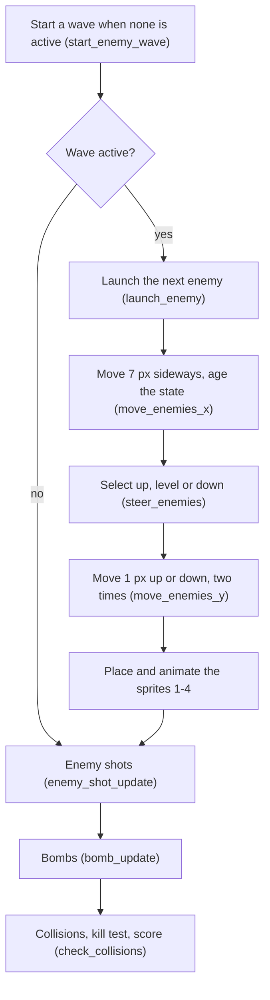
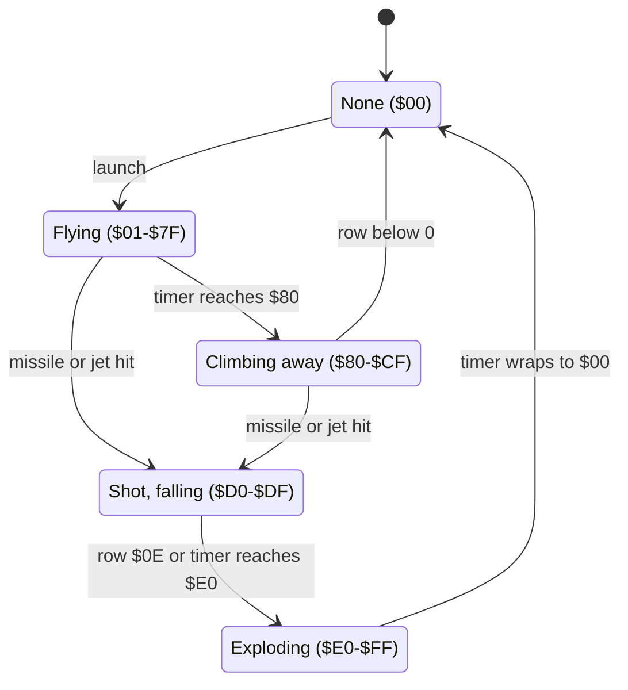

# The enemies: waves, attacks, collisions and the score

The game shows each enemy as a red jet. The enemies fly over the landscape in waves of 2 to 4. They shoot at the jet of the player, drop bombs on the airfields and fly away after some time. The player shoots them with missiles. Each kill in a wave gives more points than the kill before it. This page tells how the game starts a wave and how it moves and steers each enemy. It also tells how the game finds collisions and kills, and how it adds the score.


**Conventions.**

- Addresses are C64 addresses. Names are the names of the knowledge.
- A *pass* is one run of the main loop. A pass takes about 1.65 frames, so the game does about 30 passes in each second.
- The *tick* is a counter that the game adds 1 to in each pass.
- A *row* and a *column* are a character cell of the game screen at `$0400`. The landscape is in the rows 12-19.
- A *map column* is a column of the landscape map of 256 columns. `map_column` is the map column at the left edge of the screen.
- An *enemy* has an index 1-4. Enemy 1 is sprite 1, enemy 4 is sprite 4. The bombs are the sprites 5 and 6.
- **Observed** marks a fact that a run showed. **Code** marks a fact from the code only. **Conclusion** marks an interpretation.

## How it works

The main loop calls three enemy parts in each pass: the wave, the enemy shots and the bombs. Then the collision code reads the collision registers of the VIC-II and finds the hits.



[`enemy_wave_update` `$58D0`](../src/enemy/enemy_wave_update.asm#L6) is the entry of the wave part. It does these steps in each pass:

1. It calls `start_enemy_wave`. This routine starts a new wave only when no wave, no bomb and no enemy shot is active.
2. It stops when bit 0 of `wave_flags` is 0, because then no wave is active.
3. It calls `launch_enemy`, which starts the next enemy of the wave after a delay.
4. It calls `move_enemies_x`, which moves each enemy 7 pixels in the direction of the wave. This routine also adds to the state of each enemy, because the state is also a timer.
5. It calls `steer_enemies`, which sets the vertical direction of each enemy from its state and its row.
6. It calls `move_enemies_y` two times. Each call moves an enemy 1 pixel up or down. Thus an enemy climbs or dives 2 pixels in each pass.
7. It calls [`position_enemy_sprites` `$4730`](../src/enemy/enemy_positions.asm#L6) and [`animate_enemy_sprites` `$4340`](../src/enemy/enemy_frames.asm#L6). These routines change the map position into sprite X and Y and select the frame.

(**Code**)

The enemies move in map coordinates, not in screen coordinates. The landscape scrolls under them by the speed of the jet. Thus an enemy that flies against the jet moves faster on the screen than an enemy that flies with the jet (**Conclusion**).

## The enemy data

Each enemy has one byte in six arrays. The arrays use the index 1-4. The byte `$47` before the first array holds the row of the kill test.

| Array | Bytes | Meaning |
|---|---|---|
| `enemy_row` | `$48-$4B` | The row, 0 at the top. `$47` holds the row of the kill test. |
| `enemy_col` | `$4C-$4F` | The map column. |
| `enemy_y_fine` | `$50-$53` | The pixel line in the row, 0-7. |
| `enemy_x_fine` | `$54-$57` | The pixel in the column, 0-7. |
| `enemy_state` | `$58-$5B` | The state and the age timer (see the state machine). |
| `enemy_climb` | `$5C-$5F` | `$01` up, `$00` level, `$FF` down. |

A wave has these bytes (**Code**):

- `wave_dir`: `$01` flies left, `$FF` flies right.
- `wave_flags`: bit 0 wave active, bit 1 a bomb falls, bit 2 an enemy shot flies.
- `wave_start_col`, `wave_size` and `kill_points`.
- `launch_delay`, `launch_timer` and `wave_launched`: the counters that start the enemies one after the other.

The sprite position comes from the map position. [`position_enemy_sprites` `$4730`](../src/enemy/enemy_positions.asm#L6) calculates the screen value *c* = `enemy_col` - `map_column` + 3. It hides the sprite when *c* is `$2C` or more. Then it sets these values (**Code**):

- sprite X = *c* × 8 + `enemy_x_fine`, with bit 8 in `$D010` for *c* = `$20` or more.
- sprite Y = `enemy_row` × 8 + 42 + `enemy_y_fine`.

Sprite X 24 is the left edge of the screen, so *c* = 3 is the screen column 0. Sprite Y 50 is the top line of the screen, so an enemy in row 0 with fine Y 0 is at sprite Y 42. Its top 8 lines are in the border (**Conclusion**).


## The waves

### The start of a wave

[`start_enemy_wave` `$4500`](../src/enemy/enemy_waves.asm#L6) starts a wave when these conditions are true (**Code**):

- Bits 0-2 of `wave_flags` are 0. Thus no wave is active, no bomb falls and no enemy shot flies.
- The tick AND `$3F` is 0. Thus the start waits up to 64 passes, about 2 seconds.

The routine then sets the start column to `map_column` + `$60` + a random value 0-63. This is 96 to 159 map columns right of the left screen edge. The map has 256 columns and wraps, so the enemies reach the screen in the two directions. A random bit selects `wave_dir`. The routine sets bit 0 of `wave_flags`, clears `launch_timer` and `wave_launched` and sets `kill_points` to 25. Last, `set_enemy_wave_frames` sets the level frame of the direction and calls `set_wave_size` (**Code**).

### The size of a wave

[`set_wave_size` `$4A80`](../src/enemy/wave_size.asm#L6) sets the number of enemies from the score. The score is 5 digits at `$12-$16`, one digit 0-9 in each byte, with `$12` as the ten-thousands digit. The routine reads only the thousands digit `$13` and the hundreds digit `$14` (**Code**).

| Score | Thousands digit `$13` | Hundreds digit `$14` | Enemies |
|---|---|---|---|
| 0-399 | 0 | 0-3 | 2 |
| 400-999 | 0 | 4-9 | 3 |
| 1000-1499 | 1 | 0-4 | 3 |
| 1500-9999 | 1 (with 5-9) or 2-9 | any | 4 |
| 10000-10399 | 0 | 0-3 | 2 |
| 10400-11499 | 0 (with 4-9) or 1 (with 0-4) | 4-9 or 0-4 | 3 |
| 11500-19999 | 1 (with 5-9) or 2-9 | any | 4 |

The manual says that each sixth wave has one more jet. The code does not count waves. It uses only the score (**Code**).

The routine does not read the ten-thousands digit. Thus the size starts again at 2 from 10000 points, and again at each further 10000. The table above repeats for each block of 10000 points. This is a bug, because a better player gets smaller waves for 1500 points in each block (**Conclusion**).

The routine also sets `launch_delay`, the number of passes between the starts of two enemies. The value is 2 × size + 2, plus one random value 0-3 for each enemy after the first (**Code**):

| Enemies | `launch_delay` (passes) | Distance between two enemies |
|---|---|---|
| 2 | 6-9 | 42-63 px |
| 3 | 8-14 | 56-98 px |
| 4 | 10-19 | 70-133 px |

### The start of each enemy

[`launch_enemy` `$4540`](../src/enemy/enemy_waves.asm#L44) adds 1 to `launch_timer` in each pass. When the timer reaches `launch_delay`, the routine sets the timer to 0 and starts the next enemy. All enemies of a wave start at the same map column, in row 0, with fine X and fine Y 0 and the direction "down". The state goes from 0 to 1. When `wave_launched` equals `wave_size`, no more enemies start (**Code**).

Thus the enemies of a wave fly in a line, one after the other, with the distance of the second table (**Conclusion**). An exploration run saw a wave of 2 enemies enter at sprite Y 42 from the right and pass over the jet (**Observed**).

The wave ends in `move_enemies_y`. When `wave_launched` equals `wave_size` and each state is 0, the routine clears bit 0 of `wave_flags` (**Code**).

## The movement and the steering

[`move_enemies_x` `$4570`](../src/enemy/enemy_waves.asm#L72) moves each active enemy 1 pixel, seven times in each pass. When the fine X goes past 0 or 7, the routine changes `enemy_col` by 1. An enemy with a state of `$E0` or more does not move (**Code**).

The same loop is also the age timer of the enemies. When the tick AND `$1F` is 0, the loop adds 1 to the state of each active enemy. The loop does this in each of its seven steps. Thus the state goes up by 7 each 32 passes, not by 1 (**Code**). An enemy that starts with state 1 reaches `$80` after 19 steps of the timer, after about 20 seconds. Then it climbs away (**Conclusion**).

An increment that makes the state 0 stops the timer, because the loop skips an enemy with state 0. This is how an explosion ends (**Code**).

[`steer_enemies` `$460E`](../src/enemy/enemy_waves.asm#L176) sets `enemy_climb` once in each pass. The rules are in this order (**Code**):

1. Row `$0E` or more: the state becomes at least `$E0` (explosion), and the enemy stays level.
2. State `$E0` or more: level.
3. State `$D0-$DF` (shot): down.
4. State `$80-$CF`: up.
5. Row 0: level or down, from a random bit.
6. Row `$0A` or more: level or up, from a random bit.
7. Rows 1-9: a change only at random. Else the enemy keeps its direction.

A flying enemy never gets the direction "down" in the rows 10-13. Thus it does not reach row `$0E`. Only a shot enemy falls to row `$0E` (**Conclusion**).

[`move_enemies_y` `$45C0`](../src/enemy/enemy_waves.asm#L128) moves each enemy 1 pixel by its `enemy_climb`. When the row goes below 0, the state becomes 0 and the enemy is gone (**Code**).

### The two sources of random numbers

The game uses two sources of random numbers for the enemies:

- `RANDOM` (`$D41B`) is the output of the oscillator of SID voice 3. The engine sound sets voice 3 to noise at a high frequency, so each read gives a new value. The wave start, `launch_delay`, the explosion frames and the rules 5 and 6 read it (**Code**).
- The low byte of the CIA 2 timer B (`$DD06`). The main loop starts this timer at the start of each pass to time the pass. Thus its low byte tells how many cycles the pass used before the read. Rule 7 reads it (**Code**).

Rule 7 changes the direction only when bits 0-4 of the timer value are 0. This is a chance of 1 in 32 for each enemy and each pass. Bit 7 then selects level (0) or a change (1). For a change, bit 0 selects up (1) or down (0). But bit 0 is always 0 at this point, because bits 0-4 are 0. Thus rule 7 gives only "level" or "down", never "up" (**Code**). An enemy in the rows 1-9 climbs only when it climbed into these rows from row 10 or more (**Conclusion**).

The value of the timer depends on the path of the code in the pass. The paths are often the same from one pass to the next, so this source is not a good random source (**Conclusion**).

## The state machine of an enemy

The state byte `enemy_state` is a state and a timer in one byte. The timer adds 7 each 32 passes, so a state changes into the next one also by age.



[`enemy_kill` `$5E6A`](../src/enemy/enemy_kill.asm#L6) sets the state `$D0` for a missile hit and adds the score. [`enemy_set_falling` `$4303`](../src/game/collisions_4303.asm#L6) sets `$D0` for a collision with the jet and adds no points. The two routines change only a state of `$01-$CF`, so an enemy cannot be shot two times (**Code**).

| State | Condition | Next state | Code |
|---|---|---|---|
| None `$00` | `launch_timer` reaches `launch_delay`, the wave is not complete | Flying `$01` | `launch_enemy` |
| Flying `$01-$7F` | the timer adds 7 and the state reaches `$80` | Climbing away `$80-$86` | `move_enemies_x` |
| Flying or climbing away | the enemy is over a missile character | Shot `$D0` | `enemy_kill` |
| Flying or climbing away | the enemy sprite touches the jet sprite | Shot `$D0` | `enemy_set_falling` |
| Climbing away `$80-$CF` | the row goes below 0 | None `$00` | `move_enemies_y` |
| Shot `$D0-$DF` | the row is `$0E` or more | Exploding `$E0` | `steer_enemies` |
| Shot `$D0-$DF` | the timer adds 7 and the state reaches `$E0` | Exploding `$E0-$E6` | `move_enemies_x` |
| Exploding `$E0-$FF` | the timer passes `$FF` | None `$00` | `move_enemies_x` |

A shot enemy falls 2 pixels in each pass. From row 0 it reaches row `$0E` in at most 56 passes. The timer needs at least 65 passes to take the state from `$D0` to `$E0`. Thus a shot enemy explodes on the ground, and the timer path does not occur (**Conclusion**).

An explosion starts at `$E0`. The fifth step of the timer takes the state past `$FF` to 0. Thus the explosion stays on the screen for 129-160 passes, about 4 to 5 seconds (**Conclusion**).

While it falls, the enemy changes between the red frame `$94` or `$99` and a white explosion frame in alternate passes. An exploding enemy shows a random explosion frame `$88-$8B` in multicolour (**Code**).

## The enemy shots

[`enemy_shot_update` `$5A00`](../src/enemy/enemy_shots_5a00.asm#L6) calls four routines: spawn, erase, move and draw. A shot is a character, not a sprite. Four slots hold a row (`$3C-$3F`) and a column (`$40-$43`). A column of `$FF` is a free slot (**Code**).

[`enemy_shot_spawn` `$5B00`](../src/enemy/enemy_shot_spawn.asm#L6) gives one enemy a shot when the tick AND 7 is 0. The loop starts at enemy 4. The first enemy that agrees with all these conditions gets the shot (**Code**):

- Its state is `$01-$CF`.
- Its screen column (`enemy_col` - `map_column`) is 0-39.
- It is in the half of the screen in front of the centre. For a wave that flies left, this is the columns 20-39. For a wave that flies right, it is the columns 0-19.
- The shot row, one row below the enemy row, is less than 10.
- No other active shot has the same row.

Thus an enemy shoots only while it comes near the jet, which is at the screen centre (**Conclusion**). The shot sets bit 2 of `wave_flags`. Each pass, the shot moves one column in the direction of the wave. The character is `$26` for a wave that flies left and `$25` for a wave that flies right. A shot that leaves the columns 0-39 frees its slot (**Code**).

The jet is lost when its sprite touches a shot character. The collision code finds this as a collision of sprite 0 with the background (**Code**).

## The bombs

[`bomb_update` `$5BD0`](../src/enemy/enemy_bombs.asm#L6) controls two bombs, sprite 5 (slot 1) and sprite 6 (slot 2). Each slot has a row, a map column, a fine Y, a fine X and an active flag at `$A0-$A9` (**Code**).

[`bomb_drop` `$5C00`](../src/enemy/enemy_bombs_5c00.asm#L6) drops a bomb when the tick AND `$3F` is 0, about each 2 seconds. It finds the active enemy with the largest row and a state of `$01-$CF`. For equal rows, the enemy with the lowest index wins. An enemy in row 0 drops no bomb, so a wave that stays at the top drops no bombs. The bomb takes the row of the enemy + 1 and the column and fine values of the enemy (**Code**).

A bomb moves 2 pixels in the direction of the wave and 2 pixels down in each pass. At row 19 it ends. When no bomb is active, `bomb_flag_clear` clears bit 1 of `wave_flags` (**Code**).

The collision code ends a bomb that touches the ground. It finds the cell under the bomb in the same way as for an enemy (see the kill test). Then it does one of these actions (**Code**):

- The cell row is less than 11: nothing. The bomb continues to fall.
- The cell row is 11 (the horizon row): the airfield test.
- The cell row is more than 11: two crater characters `$2A` and `$2B` one row below the cell, with [`draw_bomb_hit_chars` `$42E0`](../src/game/collisions_42e0.asm#L6). The game changes the pixels of these two characters at random in each pass, so the crater shows fire.

The code skips the actions when the column is 39 or more, or when the row below the cell is 18 or more.

### The bombing of airfields and their restore

The landscape map has six airfields in its top row at `$3800`. They start at the map columns 4, 40, 84, 136, 172 and 200. Each airfield is the four characters `$16 $17 $16 $17` (**Code**).

[`airfield_bomb_hit` `$5F60`](../src/landscape/airfield_bombing.asm#L6) calculates a map column 11 columns left of the bomb. From this column, it searches to the right for the first `$16` (an intact airfield) or `$6F` (a destroyed airfield). For `$6F` it does nothing. For `$16` it changes four map bytes: `$16` becomes `$6F` and each other byte becomes `$70`. It also writes the new characters on the screen row 12 in black, when the column is on the screen (**Code**).

The search has no limit. Thus a bomb at the horizon destroys the next intact airfield, also an airfield far right of the bomb or outside the screen (**Conclusion**). A search that starts in the middle of an airfield finds its second `$16`. Then the code also changes the two landscape bytes after the airfield to `$70` (**Conclusion**).

When the jet is on a pad (bit 1 of `jet_state`), the routine sets bit 3: the jet is lost. The routine does not compare the destroyed airfield with the pad of the jet. Thus the jet is lost on any pad when a bomb destroys any airfield (**Code**). The recordings did not run this part of the code (**Observed**).

[`airfields_restore` `$5FD0`](../src/landscape/airfield_bombing_5fd0.asm#L6) changes each `$6F` in the top map row back to `$16` and each `$70` to `$17`. `reset_play_state` calls it after the loss of a jet, so the next jet sees all airfields intact (**Code**). After a restore, the two landscape bytes of a partial hit become `$17`, which is a part of an airfield (**Conclusion**).

## The collision code

[`check_collisions` `$4200`](../src/game/collisions.asm#L6) runs at the end of each pass. It reads `$D01E` (sprite with sprite) and `$D01F` (sprite with background) one time. A read clears each register. The routine does these steps (**Code**):

1. When bit 7 of `$D01E` is 1, it skips all tests of sprite with sprite. Sprite 7 is the smoke of a falling jet.
2. When bit 0 of `$D01E` is 1, the jet touches a sprite, and [`set_jet_lost` `$4400`](../src/player/jet_lost.asm#L6) loses the jet. Then each bomb in the collision ends, and each enemy in the collision falls through `enemy_set_falling`.
3. When bit 0 of `$D01F` is 1, the jet touches a character, and the jet is lost.
4. For each enemy with its bit set in `$D01F`, it does the kill test.
5. For each bomb with its bit set in `$D01F`, it does the ground test of the bombs.
6. It counts down `kill_sound_timer`.

The register bits do not tell which sprite touches which sprite. The routine acts on a sprite with sprite collision only when bit 0 is 1. Then it handles each other sprite in the register as a sprite that touches the jet. Thus two enemies that touch each other fall when the jet touches a bomb at the same time (**Conclusion**).

An enemy in the state "shot" or "exploding" is still a sprite. When it touches the jet, the jet is lost (**Code**).

## The kill test

A missile is a character on the screen, not a sprite. Thus an enemy over a missile gives a collision of a sprite with the background. But the enemy also gives this collision over the landscape and over an enemy shot. The kill test reads the screen under the enemy and looks for a missile character (**Code**).

### The cell under the sprite

[`sprite_cell_under` `$5DA0`](../src/game/sprite_cell.asm#L6) finds the cell under the pixel (6,6) of a sprite. It writes the row to `$47` and the column to `$46`:

```text
row    = (sprite Y - $2C) >> 3
column = ((sprite X low + 6) >> 3) + ($20 if the X bit 8 is set) - 3
```

The value `$2C` is 50 - 6, because the top screen line is at sprite Y 50 and the test pixel is 6 lines down. The column formula is (X - 18) / 8 in a different form. The left screen edge is at sprite X 24, and 18 is 24 - 6. Then [`screen_cell_address` `$5800`](../src/game/screen_cell_address.asm#L6) sets a pointer to `$0400` + row × 40 + column. The routine adds 40 for each row, so a row of 25 or more gives an address after the screen (**Code**).

With the sprite position of the enemy data, the test column is the screen column of the enemy for fine X 0-1. For fine X 2-7 it is one column more. The test row is the enemy row for fine Y 2-7, and the row above it for fine Y 0-1 (**Conclusion**).

### The characters that count

The test reads the cell and the two cells right of it, in one row. It finds a kill when one of the three characters is `$0C-$13` (**Code**). The missiles are the characters `$12` (to the right) and `$13` (to the left). The landscape map has no character in this range (**Code**). Thus the landscape, the enemy shots `$25`/`$26` and the craters do not give a kill (**Conclusion**).

The test reads only one row, but the sprite covers three rows. Thus a missile must be in the row of the sprite line 6 (**Conclusion**). [`missile_launch` `$5790`](../src/missile/missile_launch.asm#L6) puts a missile in the row (jet Y - `$28`) >> 3, the row of the jet sprite line 10. The jet is at Y `$2F` to `$7B` when it can shoot, so the missile rows are 0-10 (**Code**).

### Why an enemy at the top cannot be shot

A wave enters at row 0 with fine Y 0, at sprite Y 42. The test row is then (42 - 44) >> 3. The subtraction gives `$FE`, so the row is `$1F`, row 31. The address is `$0400` + 31 × 40 = `$08D8`, plus the column (**Code**).

The address `$08D8` is in the title screen at `$0800`. It is row 5, column 16 of the title. The cells `$08D8-$08FF` and the next cells hold spaces and the letters `$80-$9B` of the first high-score name. None of them is in the range `$0C-$13`. Thus an enemy at sprite Y 42 or 43 can never be shot (**Conclusion**).

The exploration runs saw the enemies stay in row 0 for a whole wave, and then leave upward. 20 timed shots at the first wave from 6 hover heights hit no enemy (**Observed**). The code explains these runs (**Conclusion**).

### The lost carry

The column calculation adds 6 to the low byte of sprite X. The `ADC #$06` can set the carry, but the next `LSR` does not use it. For sprite X `$FA-$FF` without bit 8, the sum wraps to `$00-$05` (**Code**).

The correct column is then 29. The code gives (0 >> 3) - 3 = `$FD`. The pointer is then the row × 40 + 253, which is 6 rows lower, at the columns 13-15. Thus an enemy at screen column 28 with fine X 2-7 cannot be shot, unless a missile is by chance in that other cell (**Conclusion**). With bit 8 set, the same X values are far right of the screen, where `position_enemy_sprites` hides the sprite (**Code**).

## The kill and the score

[`enemy_kill` `$5E6A`](../src/enemy/enemy_kill.asm#L6) does these steps (**Code**):

1. It stops when the state is 0 or `$D0` or more.
2. It sets the state `$D0`: the enemy falls.
3. It calls `score_add_kill`.
4. When the jet is not lost and `kill_sound_timer` is 0, it starts the explosion noise on SID voice 1 and sets the timer to 6. The collision code counts this timer down by 1 in each pass.

[`score_add_kill` `$5E10`](../src/game/score_add.asm#L6) adds `kill_points` to the last digit `$16`. Then it carries each digit from `$16` to `$13` into the next digit. While a digit is 10 or more, the routine subtracts 10 and adds 1 to the digit on its left. At the end, it doubles `kill_points` with an `ASL` (**Code**).

The wave start sets `kill_points` to 25. Thus the kills of one wave give these points (**Code**):

| Kill in the wave | Points | `kill_points` after the kill |
|---|---|---|
| 1 | 25 | 50 |
| 2 | 50 | 100 |
| 3 | 100 | 200 |
| 4 | 200 | 144 (400 AND `$FF`) |
| 5 | 144 | 32 |

The `ASL` has no limit, so a 5th kill would give 144 points. A wave has at most 4 enemies, and each enemy can be shot only one time. Thus the 5th kill cannot occur. A full wave of 4 gives 375 points, a wave of 2 gives 75 (**Conclusion**).

The score code adds the points also while the jet is lost. A missile that flies after the loss of the jet can still kill an enemy (**Code**). The carry loop does not test the first digit `$12`. A score above 99999 makes this digit 10 or more (**Code**).

No scripted run shot an enemy, so no run did the kill and the score code (**Observed**).

## A worked example: the kill test

This example shows the kill test for one enemy. The values are an example, not from a run.

The jet flies left (speed negative) at Y `$43`. `map_column` is `$40`. Enemy 2 has `enemy_col` = `$50`, fine X 4, `enemy_row` = 3 and fine Y 5.

1. `position_enemy_sprites` calculates *c* = `$50` - (`$40` - 3) = `$13`. This is less than `$20`, so bit 8 of X is 0.
2. Sprite X = `$13` × 8 + 4 = `$9C` (156). Sprite Y = 3 × 8 + 42 + 5 = `$47` (71).
3. The missile row is (`$43` - `$28`) >> 3 = `$1B` >> 3 = 3. The jet flies left, so the missile starts at column 18 as the character `$13`.
4. The enemy sprite touches the missile character, so the VIC-II sets bit 2 in `$D01F`.
5. `sprite_cell_under` calculates the row (`$47` - `$2C`) >> 3 = `$1B` >> 3 = 3. The column is (`$9C` + 6) >> 3 - 3 = `$A2` >> 3 - 3 = 20 - 3 = 17.
6. `screen_cell_address` adds 3 × 40 = 120 to `$0400`, then 17. The pointer is `$0489`.
7. The test reads `$048B` (column 19), `$048A` (column 18) and `$0489` (column 17). The cell `$048A` holds `$13`, which is in `$0C-$13`. This is a kill.
8. `enemy_kill` sets the state of enemy 2 to `$D0`. When this is the first kill of the wave, `score_add_kill` adds 25.

With a score of 00975, the addition gives these digits:

| Step | `$12` | `$13` | `$14` | `$15` | `$16` |
|---|---|---|---|---|---|
| Before | 0 | 0 | 9 | 7 | 5 |
| Add 25 to `$16` | 0 | 0 | 9 | 7 | 30 |
| Carry `$16` three times | 0 | 0 | 9 | 10 | 0 |
| Carry `$15` | 0 | 0 | 10 | 0 | 0 |
| Carry `$14` | 0 | 1 | 0 | 0 | 0 |

The score is now 01000, and `kill_points` is 50. The next wave has 3 enemies, from the row 1000-1499 of the size table.

For comparison, the same enemy at row 0 with fine Y 0 has sprite Y 42. Step 5 then gives the row 31, and step 6 gives `$08D8` + 17 = `$08E9`. This cell is in the title screen, so the test finds no missile.

## Still open

- Why do the enemies stay in row 0 in the runs? Rule 5 reads `RANDOM` in each pass, and a "down" result moves the enemy 2 pixels down. Four such results move it to row 1. Perhaps the value of `RANDOM` at this read usually has a 0 in bit 7.
- Can an enemy in row 0 with fine Y 2-7 be shot? Its test row is 0. A missile from the jet at Y `$2F` is in row 0. No run tried this.
- How often does a bomb reach the horizon test, and how often the crater? The bomb sprite has pixels only in its lines 9-11, 3 to 5 lines below the test pixel.
- Why does the kill test count the characters `$0C-$11`? The game draws only `$12` and `$13` as missiles. Perhaps an earlier version had more missile characters.
- Does a crater stay on the screen when the landscape scrolls? The crater is only on the screen, not in the map.
