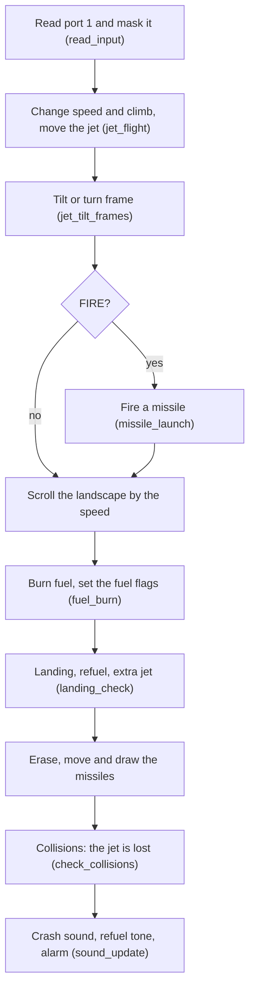
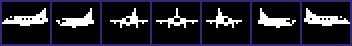
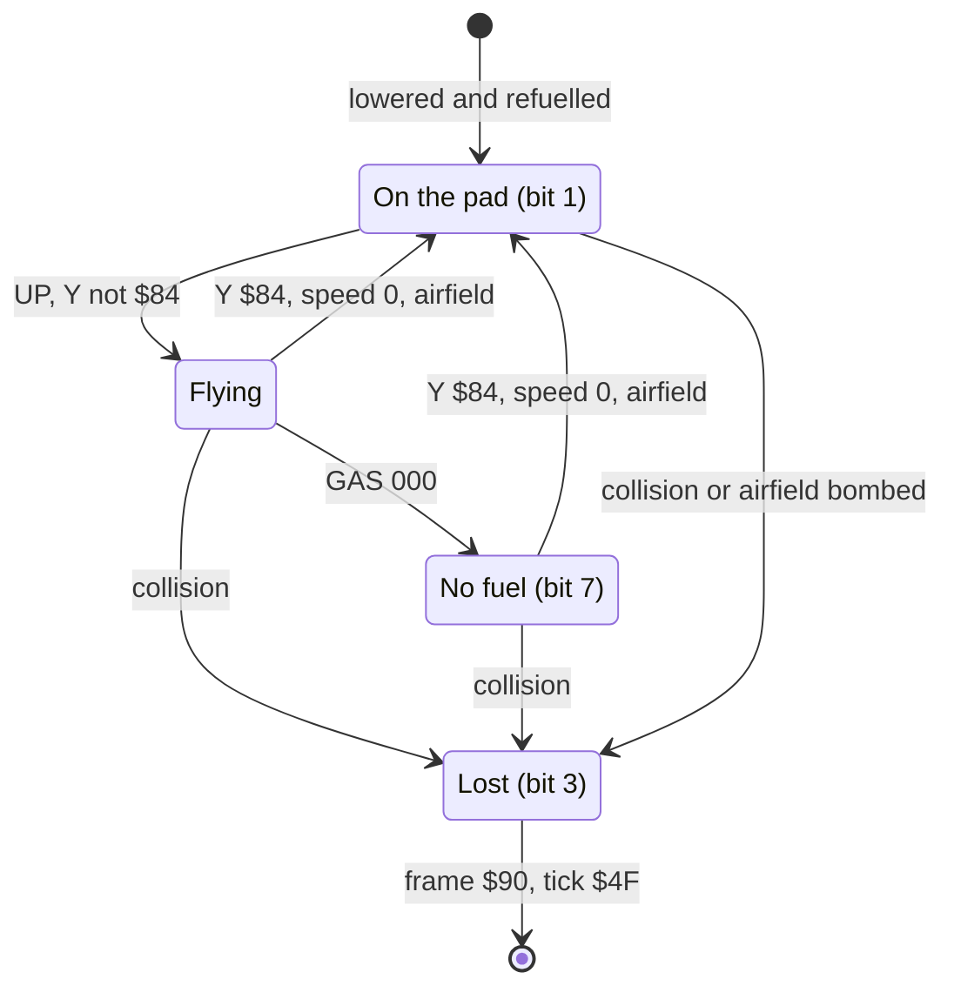

# The jet: input, flight, missiles, fuel and landing

The player flies one jet over a desert landscape. The joystick moves the jet up and down and sets its speed to the left or to the right. FIRE shoots an air-to-air missile (AAM). The jet burns fuel (GAS) and must land on an airfield to get fuel and missiles again. The jet itself stays at one position on the screen. The landscape scrolls under it, so the speed of the jet is the speed of the landscape. When the jet touches an enemy, a bomb or the ground, the player loses it.

**Conventions.**
- Addresses are C64 addresses. Names are the names of the knowledge.
- A *pass* is one run of the main loop. CIA 2 timer B sets its length to about 33000 cycles, thus about 30 passes in each second (**Conclusion**).
- A *tick* is the value of [`tick` `$2D`](../src/constants.asm#L39). The flight code adds 1 to it in each pass. "Every 8th tick" means the passes where `tick` AND 7 = 0.
- *Y* is the sprite Y position of the jet ($D001). A small Y is high on the screen.
- *Speed* is [`jet_speed_x` `$2A`](../src/constants.asm#L36), -3 to +3. A positive speed flies to the right. *Climb* is [`jet_climb` `$2B`](../src/constants.asm#L37): +1 climbs, 0 hovers, -1 descends.
- *GAS* and *AAM* are the two 3-digit counters of the panel: fuel at `$17-$19` and missiles at `$1A-$1C`.
- **Observed** marks a fact that a run showed. **Code** marks a fact from the code only. **Conclusion** marks an interpretation.

## How it works

The main loop calls the parts of the jet in this order in each pass. Other parts (enemies, radar, panel) run between them.

The entry of the jet code is [`read_input` `$5700`](../src/input/read_input.asm#L6). The main loop calls it one time in each pass, from [`main_loop` `$4185`](../src/game/main_loop.asm#L54).

### The input

The game reads only CIA 1 port B ($DC01), the lines of joystick port 1. It never writes port A ($DC00). Thus port A keeps the value of the last KERNAL keyboard scan. The keys of matrix column 7 then pull the same lines as the joystick (**Conclusion**). The keyboard recording plays the game with LEFT ARROW, 1, CTRL, 2 and SPACE only (**Observed**).

[`read_input` `$5700`](../src/input/read_input.asm#L6) copies the port into [`joy_bits` `$0C`](../src/constants.asm#L14). A bit 0 means "pressed". Then it sets bits to 1 to mask the inputs that the jet cannot use now:

1. Y < $30: it masks UP and sets the climb to 0. This is the ceiling of the jet.
2. Y >= $BF: it masks DOWN and sets the climb to 0. The runs never executed this test, because the jet touches the ground first (**Observed**, **Conclusion**).
3. Y >= $7C: it masks FIRE. A jet near the ground cannot fire.
4. The jet is on a pad (`jet_state` bit 1): only UP stays.
5. The jet is lost or has no fuel (bits 3 or 7): only DOWN stays. When the jet is lost and shows a wreck frame ($88 or more), no input stays, and the speed and the climb become 0.
6. Y >= $C0: a test for a jet without fuel at the bottom. The runs never executed it (**Observed**).

Then `read_input` calls [`jet_flight` `$5495`](../src/player/flight.asm#L32). When FIRE stays in `joy_bits`, it calls [`missile_launch` `$5790`](../src/missile/missile_launch.asm#L6) (**Code**).

An older copy of these masks is at [`unused_input_masks` `$5470`](../src/player/flight.asm#L6). Nothing calls it, and it runs on into `jet_flight` (**Code**).

### The flight model

[`jet_flight` `$5495`](../src/player/flight.asm#L32) adds 1 to `tick` first. It reads the input at three rates (**Code**):

- Every 8th tick, LEFT subtracts 1 from the speed and RIGHT adds 1, in the range -3 to +3. A change from 0 to full speed takes 24 passes, about 0.8 seconds (**Conclusion**).
- On each even tick, UP adds 1 to the climb and DOWN subtracts 1, in the range -1 to +1. A change from a climb to a descent takes two even ticks.
- In each pass, the jet moves one line up or down by the climb. That is about 30 lines in each second (**Conclusion**).

Thus a short DOWN tap after a climb gives climb 0, and the jet hovers. A 3-frame DOWN tap after a climb gave climb 0 at Y $6E (**Observed**). A hover is possible at each speed, also at speed 0.

The jet sprite stays at X 172 ($AC). No code writes another X for sprite 0 (**Code**).

[`landscape_scroll_step` `$5F00`](../src/landscape/scroll_by_speed.asm#L6) moves the landscape one character column. At speed 3 it moves in each pass, at speed 2 in each 2nd pass, and at speed 1 in each 4th pass. A positive speed moves the landscape to the left and adds 1 to `map_column` (**Code**). The scroll is a coarse scroll of 8 pixels. At each jet, `vic_set_registers` writes $18 to $D016, and the game loop never changes it. Thus the fine scroll stays 0 (**Code**). The map has 256 columns and wraps (**Code**).

### The tilt and turn frames

At the end of each flight call, [`jet_tilt_frames` `$5A20`](../src/player/jet_tilt_frames.asm#L6) selects the image of the jet. Two animations share the jet sprite (**Code**):

- **The tilt** at speed +3 or -3. Every 8th tick, the tilt steps one frame toward +2 when the jet climbs, toward -2 when it descends, and toward 0 when it hovers. The code copies the frame from the pitch frames into the sprite data of frame $86 ($2180) or $80 ($2000). Below full speed, the tilt steps back to the level frame, and then the turn animation continues.
- **The turn** in all other cases. Every 4th tick, [`jet_sprite_animate` `$5600`](../src/player/jet_sprite.asm#L6) moves the sprite pointer one frame toward its target. The target is $80 (speed < 0), $83 (speed 0, front view) or $86 (speed > 0). A full turn from $80 to $86 takes 6 steps, 24 passes.

The turn frames $80-$86 at $2000-$21BF. Frame $80 flies to the left, $83 is the front view, $86 flies to the right.

The 5 pitch frames of the jet that flies to the right, at $2C40-$2D7F. The level frame is the middle one at $2CC0.

Each step of the tilt moves the frame pointer by $40 bytes. The level frames are [`jet_level_left` `$2B80`](../src/data/jet_pitch_sprites.asm#L50) and [`jet_level_right` `$2CC0`](../src/data/jet_pitch_sprites.asm#L160). [`jet_frames_reset` `$5BA0`](../src/player/jet_frames_reset.asm#L6) copies the two level frames back after the loss of each jet (**Code**).

### The missiles

[`missile_launch` `$5790`](../src/missile/missile_launch.asm#L6) fires one missile when all these conditions are true (**Code**):

1. FIRE stays in `joy_bits` after the masks.
2. The tick is an 8th tick. Thus FIRE that the player holds gives one missile in 8 passes, about 4 in each second (**Conclusion**).
3. The speed is not 0. A jet at speed 0 cannot fire.
4. AAM is not 000.
5. One of the 4 slots is free.

The missile flies in the direction of the jet. At a positive speed it starts at column 21 and flies to the right, with character $12. At a negative speed it starts at column 18 and flies to the left, with character $13. The row is (Y - $28) / 8. Each shot subtracts 1 from AAM. It also starts the noise of SID voice 2, but not when the fuel alarm uses voice 2 (`jet_state` bits 6 or 7) (**Code**).

Three routines move the missiles in each pass, after the shot. [`missile_erase` `$5840`](../src/missile/missile_update.asm#L6) writes a space at the cell of each missile. [`missile_move` `$5870`](../src/missile/missile_update_5870.asm#L6) moves each missile one column. [`missile_draw` `$58A0`](../src/missile/missile_update_58a0.asm#L6) writes the character, with its colour from `char_colours` (red, colour 2). A missile that leaves columns 0-39 frees its slot (**Code**).

A missile moves one column in each pass, 4 times faster than the landscape at speed 1. The erase, the move and the draw run in the pass of the shot too. Thus the first cell of a missile is column 22 or 17, next to the jet. The landscape does not stop a missile, and a kill does not stop it (**Code**).

A missile lives 18 passes, and the rate of fire is one in 8 passes. Thus at most 3 missiles fly at the same time (**Conclusion**). The branch for "no free slot" never ran (**Observed**).

### The fuel and the alarm

[`fuel_burn` `$5540`](../src/player/fuel.asm#L6) subtracts 1 from GAS in two cases (**Code**):

- At speed +3 or -3: on each even tick, one unit in 2 passes. A full tank of 900 lasts about 60 seconds (**Conclusion**).
- At all other speeds, also in a hover: every 8th tick, one unit in 8 passes. A full tank lasts about 4 minutes (**Conclusion**).

The jet burns no fuel on a pad, when it is lost, or when it has no fuel (`jet_state` bits 1, 3 or 7). In each pass that it does not skip, `fuel_burn` sets the fuel flags again from the digits. GAS 000 sets bit 7 (no fuel) and clears bit 0. A hundreds digit of 0 sets bit 6 (GAS below 100) (**Code**).

Without fuel, the input keeps only DOWN. The jet descends one line in each pass at its last speed (**Code**). It cannot fire, and it cannot change its speed. Thus only a jet that hovers at speed 0 above an airfield can land without fuel (**Conclusion**).

[`fuel_alarm` `$4900`](../src/sound/fuel_alarm.asm#L6) plays the alarm when `jet_state` bit 6 or 7 is 1 and the jet is not on a pad. It sweeps the pitch of voice 2 up from $10 to $58 in steps of 2, then it stops the voice for a short time. Bit 2 of the alarm pitch flashes the GAS gauge red and white. No run used the fuel to below 100 (**Observed**: the alarm code never ran).

### The landing, refuel and rearm

[`landing_check` `$559A`](../src/player/landing.asm#L6) first clears `jet_state` bit 1 in each pass. Thus bit 1 means "on a pad in this pass". Then it sets bit 1 again when all these conditions are true (**Code**):

1. The jet is not lost.
2. Y is exactly $84.
3. The speed is 0.
4. Map row 0 has the airfield character $16 at the map columns `map_column` + $12 and `map_column` + $14.

Map row 0 is screen row 12, the top row of the landscape. The two test columns are the screen columns 18 and 20, under the jet sprite. An airfield in the map is the 4 characters $16 $17 $16 $17, thus both columns are on the same airfield (**Code**).

A descending jet stops at Y $84, because the code sets the climb from -1 to 0. A climbing jet keeps its climb and leaves the pad. Then, in the same pass, [`refuel_rearm_step` `$5420`](../src/player/refuel.asm#L6) runs two times (**Code**):

- Each step adds 1 to GAS until the hundreds digit is 9. Thus GAS stops at 900, and an empty tank fills in 450 passes, about 15 seconds (**Conclusion**).
- On an 8th tick, each step adds 1 to AAM until the hundreds digit is 1. Thus AAM stops at 100, and an empty store fills in 400 passes.
- Each step clears bit 7. A jet that has no fuel can fly again after the first step.

While the jet is on a pad, `sound_update` plays the refuel tone on voice 2 in place of the alarm. A jet at the start stays on the pad without input and refuels (**Observed**). Holding UP on the pad makes the jet leave the pad (**Observed**).

### The extra jet

The end of `landing_check` is [`extra_jet_check` `$55DF`](../src/player/landing.asm#L45). It runs in each pass, not only on a pad. When [`bonus_jet_flag` `$67`](../src/constants.asm#L59) is 0 and the thousands digit of the score ($13) is 3 or more, the jet gets a bonus. The code adds 1 to `lives` and sets `bonus_jet_flag` to $30 (**Code**).

[`extra_jet_beep` `$4FA0`](../src/sound/extra_jet_beep.asm#L6) then counts `bonus_jet_flag` up from $30 to $80, one count in each pass off the pad. Voice 2 beeps on and off every 8 counts. From $80 the flag blocks a second extra jet. Only `show_title` sets the flag back to 0 at the start of a new game. Thus a game gives one extra jet, at 3000 points (**Code**). The flag also stops the PRESS FIRE TO START prompt for a later jet when `lives` is 3 again (**Code**). No run reached 3000 points (**Observed**).

### The start of a jet

Each jet starts at [`game_life_begin` `$4173`](../src/game/main_loop.asm#L31). It starts the engine sound, subtracts 1 from `lives`, and sets `tick` to 0. Then [`life_start` `$5000`](../src/player/life_start.asm#L6) does these steps (**Code**):

1. It writes the character $1E over the PRESS FIRE TO START text.
2. [`jet_lower_to_start` `$5390`](../src/player/jet_start.asm#L6) puts the jet at X 172, Y $60, with the front frame $83. Only sprite 0 is on. It lowers the jet 36 lines to Y $84, with a delay loop between the lines. Then it sets `jet_state` bit 0.
3. A loop fills the tank. Each round does one refuel step with a beep (`refuel_step_with_sound`), one more refuel step, and a panel update. The pitch of the beep follows the GAS digits.
4. The loop stops when the GAS hundreds digit is 9.

The player cannot stop this loop, because no code reads the input. `tick` stays 0 during the loop, thus each step also adds 1 to AAM. AAM is full after 50 rounds and GAS after 450 rounds (**Conclusion**).

A new jet on the pad. The GAS gauge on the right fills during the refuel loop (**Observed**).

The first pass of the main loop finds the jet at Y $84, speed 0, above an airfield. Thus `landing_check` sets bit 1, and the jet is on a pad (**Code**, **Observed**).

### The loss of a jet

[`set_jet_lost` `$4400`](../src/player/jet_lost.asm#L6) marks the jet as lost. It sets `jet_state` bit 3 and clears all bits except bit 4. When Y is $7F or more, it also sets the speed and the climb to 0. Three places call it or do the same (**Code**):

- [`check_collisions` `$4200`](../src/game/collisions.asm#L6): the jet sprite touches another sprite or a landscape character. The sprite test does not run when sprite 7, the smoke, is in a collision.
- `airfield_bomb_hit`: a bomb destroys the airfield under a jet on a pad. No run did this (**Observed**).
- The bottom test of `read_input` for a jet without fuel. It never ran (**Observed**).

A jet that an enemy hits in the air falls. The input keeps only DOWN, thus the climb becomes -1, and the jet keeps its speed (**Code**). [`jet_lost_animate` `$5690`](../src/player/jet_lost_animation.asm#L6) turns on sprite 7 and puts it at the jet, 8 pixels behind it. Sprite 7 shows the smoke frames $90-$93, one frame in each pass. The crash sound starts, and its pitch rises in each pass while the jet falls (**Code**). A jet at the top of the screen that met an enemy wave fell with the smoke sprite (**Observed**).

A hit jet falls. The smoke sprite is behind the jet (**Observed**).

When the jet touches the landscape, `check_collisions` calls `set_jet_lost` again. Now Y is $7F or more, thus the speed and the climb become 0 (**Code**). Then these steps follow:

1. `jet_lost_animate` sees Y >= $7F and climb 0. It turns off sprite 7, makes the jet a white multicolour sprite, and shows a random wreck frame $88-$8F in each pass.
2. [`sound_update` `$4800`](../src/sound/sound_update.asm#L6) starts the ground part of the crash sound. The filter cutoff falls by 1 in each pass, from $60 to $3F.
3. At the end of the sound, `sound_update` stops all three voices. It sets the jet frame to $88 and `tick` to $90.
4. Every 8th tick, the jet frame steps from $88 to $90.
5. [`jet_lost_wait` `$5640`](../src/game/jet_lost.asm#L6) waits until the frame is $90 and `tick` is $4F. From the end of the sound, that is 191 passes, about 6 seconds (**Conclusion**).
6. [`reset_play_state` `$564E`](../src/game/jet_lost.asm#L15) restores the airfields and clears the play state. It keeps the score and `lives`.

Then the main loop starts the next jet, or ends the game when `lives` is 0 (**Code**). The high_score recording made a jet with lives 0 go into the ground, and the game went to the name entry (**Observed**).

## The data

### The input bits

| Bit of `joy_bits` | Joystick | Key (column 7) | Use |
|---|---|---|---|
| 0 | UP | 1 | Climb + 1 |
| 1 | DOWN | LEFT ARROW | Climb - 1 |
| 2 | LEFT | CTRL | Speed - 1 |
| 3 | RIGHT | 2 | Speed + 1 |
| 4 | FIRE | SPACE | Missile |

### The masks of `read_input`

| Condition | Inputs that stay | Other change |
|---|---|---|
| Y < $30 | All except UP | Climb 0 |
| Y >= $7C | All except FIRE | none |
| On a pad (bit 1) | UP only | none |
| No fuel (bit 7) or lost (bit 3) | DOWN only | none |
| Lost, frame $88 or more | none | Climb 0, speed 0 |

### The bits of `jet_state`

`jet_state` is at `$22` (**Code**).

| Bit | Meaning | Set by | Cleared by |
|---|---|---|---|
| 0 | The jet started | jet_lower_to_start | fuel_burn (GAS 000), set_jet_lost |
| 1 | On a pad in this pass | landing_check | landing_check, set_jet_lost |
| 3 | Lost | set_jet_lost, airfield_bomb_hit | reset_play_state |
| 4 | Kept by set_jet_lost | no code | reset_play_state |
| 6 | GAS below 100 | fuel_burn | fuel_burn, set_jet_lost |
| 7 | No fuel | fuel_burn | refuel_rearm_step, set_jet_lost |

No code reads bit 0, and no code sets bit 4 (**Code**).

### The missile slots

The 4 slots use three arrays with a step of 3 bytes. The code indexes them with X = 12, 9, 6, 3 from the bases `tick`, `gauge_colour` and `temp2`. A direction of 0 marks a free slot (**Code**).

| Slot (X) | Column | Row | Direction |
|---|---|---|---|
| 12 (searched first) | $39 | $3A | $3B |
| 9 | $36 | $37 | $38 |
| 6 | $33 | $34 | $35 |
| 3 | $30 | $31 | $32 |

| Direction | Flight | Start column | Character |
|---|---|---|---|
| $FF | To the right (speed > 0) | 21 ($15) | $12 |
| $01 | To the left (speed < 0) | 18 ($12) | $13 |

## The state machine of jet_state

The jet has four states. The bits 1, 3 and 7 of `jet_state` give the state. [`landing_check` `$559A`](../src/player/landing.asm#L6), [`fuel_burn` `$5540`](../src/player/fuel.asm#L6) and [`set_jet_lost` `$4400`](../src/player/jet_lost.asm#L6) make most of the changes.

| State | Condition | Next state | Code |
|---|---|---|---|
| Start | life_start lowers the jet to Y $84 and fills the tank, the first pass finds the airfield | On the pad | life_start, landing_check |
| On the pad | UP gives climb +1, the next pass finds Y not $84 | Flying | jet_flight, landing_check |
| Flying | Y = $84, speed 0, $16 at two map columns under the jet | On the pad | landing_check |
| Flying | GAS reaches 000 | No fuel | fuel_burn |
| No fuel | Y = $84, speed 0, airfield (first refuel step clears bit 7) | On the pad | landing_check, refuel_rearm_step |
| Flying | The jet sprite touches a sprite or a landscape character | Lost | check_collisions, set_jet_lost |
| No fuel | The jet touches the landscape | Lost | check_collisions, set_jet_lost |
| On the pad | A collision, or a bomb on the airfield under the jet | Lost | check_collisions, airfield_bomb_hit |
| Lost | Jet frame $90 and tick $4F | End of the jet (next jet or game over) | jet_lost_wait, reset_play_state |

Bit 6 (GAS below 100) is not a state. It only starts the alarm and stops the shot sound while the jet flies (**Code**).

## Worked example: a missile from Y $6E at speed +1

The jet hovers at Y $6E with speed +1 and AAM 100. The player holds FIRE, and the pass has `tick` = $28, an 8th tick. All slots are free. These are the steps of [`missile_launch` `$5790`](../src/missile/missile_launch.asm#L6) and of the three missile routines in the same pass (**Code**, by hand):

1. The masks keep FIRE, because Y $6E is below $7C.
2. `tick` AND 7 = 0, the speed is +1, AAM is not 000. The search starts at slot X = 12, and its direction byte $3B is 0, thus the slot is free.
3. The speed is positive, thus the direction is $FF. The code writes $FF to $3B and the start column $15 (21) to $39.
4. The row is ($6E - $28) / 8 = $46 / 8 = 8, with the remainder lost by the three LSR. The code writes 8 to $3A.
5. AAM 100 becomes 099. The ones digit $1C and the tens digit $1B go from 0 to 9. The hundreds digit $1A goes from 1 to 0.
6. Bits 6 and 7 of `jet_state` are 0, thus voice 2 plays the shot noise ($80, then $81 to $D40B).
7. `missile_erase` computes the cell of column 21, row 8: $0400 + 8 × 40 + 21 = $0555. It writes a space there.
8. `missile_move` sees the direction $FF and adds 1 to the column: 22.
9. `missile_draw` writes character $12 to $0556 and the colour $4012 = $02 (red) to $D956.

The jet sprite covers the screen pixels 148-171 in X, thus the columns 18 to 21. Column 22 is the first cell to the right of the nose. Row 8 starts at sprite Y $72, 4 lines below the top of the jet sprite. After 17 more passes the missile reaches column 39. In the 18th pass, the column becomes 40, and `missile_move` frees slot 12 (**Conclusion**).

The next missile can start at `tick` = $30. At speed +1 the landscape scrolls one column in 4 passes, thus the missile is 4 times faster than the ground below it.

## Still open

- The exact Y at which the jet sprite first touches a landscape character away from an airfield. No run measured it.
- The role of `jet_state` bit 0 and bit 4. No code reads bit 0, and no code sets bit 4.
- The low-fuel alarm, the landing without fuel, the extra jet and the loss of a jet on a bombed airfield did not run. Their description comes from the code only.
- The times in seconds use the estimate of about 30 passes in each second. No run measured the length of a pass.
