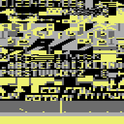

# The screen: landscape map, scrolling, radar and panel

The player flies over a desert with towns, palm trees and six airfields. The jet stays at the centre of the screen, and the landscape moves under it. The landscape is a map of 8 rows and 256 columns, and the map has no end: after column 255, column 0 comes again. A radar in the panel shows the full map, the airfields and the enemy jets. The panel also shows the score, the best score, the spare jets, the missiles (AAM) and a GAS gauge. All of this is a character screen in multicolour mode, with three raster splits for the colours of the sky, the ground and the panel.

**Conventions.**
- Addresses are C64 addresses. Names are the names of the knowledge.
- A *pass* is one run of the main loop. A pass takes about 33000 cycles, thus the game makes about 30 passes each second (**Conclusion** from the timer of the main loop).
- A *map column* is one column of the map, 0-255. `map_column` (`$0D`) is the map column at the left edge of the screen. The screen column of a map column is `(column - map_column) AND $FF`. Values 0-39 are on the screen.
- A *tile* is one byte of the map. It is a character code of the game charset at `$3000`.
- Multicolour pixel values: `%00` is `$D021`, `%01` is `$D022`, `%10` is `$D023`, `%11` is the colour RAM (bits 0-2). A colour RAM value with bit 3 set makes a multicolour cell. A value of 0-7 makes a hires cell.
- **Observed** marks a fact that a run showed. **Code** marks a fact from the code only. **Conclusion** marks an interpretation.

The image shows a new jet on its start pad. The radar in the centre of the panel shows five airfield dots and the white centre line. The sixth dot is under the line. The GAS gauge on the right fills during the refuel (**Observed**).

## How it works

The screen changes in two places. At the start of each jet, the code builds the full screen. In each pass, the code updates the parts that move.

~~~mermaid
flowchart TB
  A["New jet: clear the screen, map_column = $18"] --> B["Draw the panel from the layout"]
  B --> C["Clear the radar characters"]
  C --> D["Scroll left 42 times: the landscape"]
  D --> E["Fill row 11 with the horizon"]
  E --> F["Panel digits, radar characters and dots"]
  F --> G["Each pass: crater bits, radar, scroll, panel digits"]
  G --> G
~~~

[`game_new_life` `$4144`](../src/game/main_loop.asm#L10) builds the screen for each jet. The main loop [`main_loop` `$4185`](../src/game/main_loop.asm#L54) then does these screen steps in each pass, in this order (**Code**):

1. [`crater_chars_animate` `$5E45`](../src/graphics/crater_chars_animate.asm#L6) writes random bits into the crater characters `$2A` and `$2B`.
2. [`radar_clear` `$52A0`](../src/radar/radar_52a0.asm#L6) erases the radar characters and draws the centre line again.
3. [`radar_plot_all` `$52F0`](../src/radar/radar_52f0.asm#L6) plots a dot for each airfield and for each enemy.
4. `landscape_scroll_step` moves the landscape by the speed of the jet.
5. `panel_update` writes the digits and the GAS gauge.

The radar characters change, but the radar cells on the screen stay the same. The code changes only the character data at `$3680-$377F`. The screen thus shows a new radar without a write to the screen.

## The screen layout

The game screen is at `$0400` in VIC bank 0. `$D018` = `$1C` selects the charset at `$3000`, and `$D016` = `$18` sets multicolour mode with 40 columns. The only code that writes `$D016` copies `$18` from `vic_init_table`. The fine-scroll bits thus stay 0, and the landscape moves in steps of 8 pixels (**Code**).

| Rows | Screen | Contents | Written by |
|---|---|---|---|
| 0-10 | `$0400-$05B7` | Sky: spaces, missiles `$12`/`$13`, enemy shots `$25`/`$26` | clear_game_screen, the missile and shot code |
| 11 | `$05B8-$05DF` | Horizon: 40 times `$9E`, colour `$0F` | fill_row11_char_9e |
| 12-19 | `$05E0-$071F` | Landscape: map rows 0-7 | landscape_scroll_left, landscape_scroll_right |
| 20-24 | `$0720-$07E7` | Panel, with the radar at `$0754` | draw_panel, panel_update, radar_put_chars |

### The raster splits

[`raster_irq` `$4AC0`](../src/irq/raster_irq.asm#L6) runs three times in each frame. `irq_phase` (`$B0`) holds the next split. Each split sets two colours and the raster line of the next split. `$D022` stays yellow (`$07`) for the full frame, from `vic_init_table` (**Code**).

| Raster line | `$D021` | `$D023` | First text row below it |
|---|---|---|---|
| `$01` | `$0E` light blue | not changed (`$00` from the panel split) | row 0: the sky |
| `$8A` (138) | `$0C` grey | `$08` orange | row 11 (line 139): the horizon and the landscape |
| `$D2` (210) | `$0C` grey | `$00` black | row 20 (line 211): the panel |

With `$D011` = `$1B`, text row 0 starts at raster line 51, so row n starts at line 51 + 8n. Each split thus comes one raster line before the first row of its part (**Conclusion**).

The horizon character `$9E` has three empty pixel lines, then five lines of `%01`. Below the grey split, the empty lines show grey and the other lines show yellow sand (**Code**). The sky rows show only `$D021`, because their cells hold spaces.

## The landscape map

[`landscape_map` `$3800`](../src/data/map.asm#L6) holds the map, 2048 bytes at `$3800-$3FFF`. Each page of 256 bytes is one landscape row. The page `$38` is map row 0 (screen row 12), the page `$3F` is map row 7 (screen row 19). The byte at offset c of a page is the tile of map column c (**Code**).

| Tile | Look | Colour RAM (`$4000`) | Where |
|---|---|---|---|
| `$0B` | Sand: all bytes `$55`, so each pixel is `%01` (yellow) | `$0D` | All rows, most cells |
| `$16` `$17` `$16` `$17` | An airfield of 4 cells | `$09` (white) | Map row 0 only |
| `$6F` `$70` `$6F` `$70` | A destroyed airfield | `$00` (hires black) | Map row 0, after a bomb hit |
| `$57`, `$68`, `$69` | Other tiles of row 0 | `$09`, `$08`, `$08` | Map row 0 |
| `$30-$6B` | Buildings, trees and roads | from the table | Map rows 1-7 |

Map row 0 holds only the six codes `$0B`, `$16`, `$17`, `$57`, `$68` and `$69`. Rows 1-7 hold codes `$0B` and `$30-$6B` (**Code**, counted from the map bytes). The look of the codes `$30-$6B` comes from the charset image and the screenshots (**Conclusion**).

### The airfields

The map has six airfields, all in map row 0. They start at the map columns 4, 40, 84, 136, 172 and 200 (**Code**). Each airfield is the four tiles `$16 $17 $16 $17`.

The pattern fits the landing test. [`landing_check` `$559A`](../src/player/landing.asm#L6) reads the map columns `map_column + $12` and `map_column + $14`, and both must be `$16`. These are the screen columns 18 and 20, under the jet at sprite X 172. A pad of `$16 $17 $16 $17` gives `$16` at both columns (**Conclusion**).

A bomb that hits an airfield changes it in the map. [`airfield_bomb_hit` `$5F60`](../src/landscape/airfield_bombing.asm#L6) writes `$6F` for each `$16` and `$70` for each `$17`. It also writes these tiles to the screen in colour `$00`. [`airfields_restore` `$5FD0`](../src/landscape/airfield_bombing_5fd0.asm#L6) changes them back when the jet is lost (**Code**). The coverage of the runs shows writes to the map at the airfields of the map columns 40, 84 and 200 (**Observed**).

The bomb code does not get the airfield from the bomb position. It starts 11 map columns left of the hit cell and goes right to the first `$16` or `$6F`. On a `$6F`, the airfield is already destroyed, and the code stops (**Code**).

### The colour table

[`char_colours` `$4000`](../src/data/char_colours.asm#L6) holds one colour RAM value for each of the 256 character codes. The scroll uses it for each new landscape cell, and `draw_panel` uses it for each panel cell. A value of `$08-$0F` makes a multicolour cell, and the `%11` pixels get the colour of bits 0-2. A value of `$00-$07` makes a hires cell in that colour (**Code**).

Two parts of the code do not use the table. The horizon row gets `$0F`, but the table gives `$00` for `$9E`. The craters get `$0C`, but the table gives `$0F` for `$2A` and `$2B` (**Code**).

## The scroll

The jet sprite stays at X 172. The jet speed `jet_speed_x` (`$2A`) is -3 to +3, and it sets how often the landscape moves one column. [`landscape_scroll_step` `$5F00`](../src/landscape/scroll_by_speed.asm#L6) runs one time in each pass. It adds 1 to `scroll_tick` (`$2C`) and then does this (**Code**):

| Speed | Scroll | Columns each second |
|---|---|---|
| 0 | none | 0 |
| ±1 | when `scroll_tick AND 3` = 0 | about 7.5 |
| ±2 | when `scroll_tick AND 1` = 0 | about 15 |
| ±3 | each pass | about 30 |

At speed 3, the landscape moves 30 columns, or 240 pixels, in one second. The full map of 256 columns then goes past in about 8.5 seconds (**Conclusion** from the pass time).

A positive speed calls [`landscape_scroll_left` `$50F0`](../src/landscape/scroll_50f0.asm#L6): the jet flies right, so the landscape moves left. A negative speed calls [`landscape_scroll_right` `$5120`](../src/landscape/scroll_5120.asm#L6). When the scroll direction agrees with the direction of the enemy wave, the step also moves the enemy shots two more times (**Code**).

### How one scroll works

`landscape_scroll_left` does these steps (**Code**):

1. It sets the pointers: `$07/$08` = `$05E0` (screen row 12), `$09/$0A` = `$D9E0` (colour row 12), `$0E/$0F` = `$3800` (map row 0), and a count of 8 rows.
2. It adds 1 to `map_column`.
3. For each row, it copies the screen cells 1-39 and their colours one cell to the left.
4. It reads the tile of map column `map_column + 39` from the map page of the row. It writes the tile to screen column 39 and its colour from `char_colours` to the colour RAM.
5. It adds 40 to the screen and colour pointers and 1 to the map page. Then it does the next row.

The scroll to the right is the mirror. It subtracts 1 from `map_column`, copies the cells 0-38 one cell to the right, and draws screen column 0 from map column `map_column`. [`landscape_draw_map_char` `$509F`](../src/landscape/scroll_509f.asm#L6) draws the new cell for both directions.

~~~text
scroll_left:
  map_column = map_column + 1
  for row = 0 to 7:
    for x = 1 to 39:
      screen[12+row][x-1] = screen[12+row][x]
      colour[12+row][x-1] = colour[12+row][x]
    tile = map[row][(map_column + 39) AND $FF]
    screen[12+row][39] = tile
    colour[12+row][39] = char_colours[tile]
~~~

The copy loop takes 40 cycles for each cell. 8 rows of 39 cells thus take about 12500 cycles, about one third of a pass (**Conclusion**, counted from the code).

The names `colour_ptr` (`$07`) and `scroll_colour_ptr` (`$09`) come from other users of these bytes. In the scroll and in `radar_put_chars`, `$07/$08` points to the screen and `$09/$0A` points to the colour RAM (**Code**).

### The start of a jet

[`clear_game_screen` `$5080`](../src/landscape/scroll.asm#L6) fills the screen with spaces and sets `map_column` to `$18`. Then [`landscape_draw_initial` `$51B0`](../src/landscape/draw_initial.asm#L6) scrolls left 42 times, and each scroll draws one new column. After the 42 scrolls, `map_column` is `$42` (66) (**Code**).

The jet then sits above map columns 84-87, the airfield at `$3854-$3857`. Thus 42 scrolls put the start pad under the jet, and each jet starts on the same pad (**Conclusion**). After the last scroll, `fill_row11_char_9e` fills the horizon row.

## The run-time characters

The program changes four groups of characters while the game runs. The other characters of `$3000-$37FF` stay as the file holds them (**Code**).

| Characters | Address | Written by | Contents |
|---|---|---|---|
| `$2A`, `$2B` | `$3150-$315F` | crater_chars_animate, each pass | Random crater bits |
| `$B4` | `$35A0-$35A7` | make_gauge_part_char | The partial cell of the GAS gauge |
| `$D0-$DF` | `$3680-$36FF` | radar_clear, radar_plot_point | The upper radar rows 0-7 |
| `$E0-$EF` | `$3700-$377F` | radar_clear, radar_plot_point | The lower radar rows 8-15 |

### The craters

A bomb that hits the ground in the rows 12-16 puts a crater of two cells in the row below it. [`draw_bomb_hit_chars` `$42E0`](../src/game/collisions_42e0.asm#L6) writes `$2A $2B` there, with colour `$0C` (multicolour, colour 4 purple) (**Code**).

In each pass, `crater_chars_animate` fills the 16 bytes of `$2A` and `$2B`. Each byte is the CIA 2 timer A low byte (`$DD04`), AND a mask from `$3160-$316F`, OR `$55`. The `$55` sets the low bit of each pixel pair. Thus each pixel is `%01` (sand yellow) or `%11` (purple), and the mask gives the shape (**Code**).

All craters use the same two characters, so all craters on the screen change together. A crater is only in the screen RAM, not in the map. The scroll copies it with the cells around it, but it does not come back when its map column comes on the screen again (**Conclusion**).

### The gauge character and the radar characters

The section "The GAS gauge" tells how the code makes `$B4`. The section "The radar" tells how the code makes `$D0-$EF`. The characters `$F0-$FF` (`$3780-$37FF`) are not run-time characters. They hold `$FF` in the file, and no code reads or writes them (**Code**).

## The radar

The radar is a strip of 16 x 3 cells at screen columns 12-27 of the rows 21-23. [`radar_put_chars` `$5260`](../src/radar/radar.asm#L6) puts the characters `$D0-$DF` on row 21 and `$E0-$EF` on row 22, both in colour `$09`. It puts `$F0-$FF` on row 23 in colour `$07` (**Code**).

| Radar part | Characters | Pixels | Colour |
|---|---|---|---|
| Rows 0-7 | `$D0-$DF` | 64 x 8 multicolour | `%10` black, `%11` white |
| Rows 8-11 | `$E0-$EF`, bytes 0-3 = `$AA` | 64 x 4 multicolour | `%10` black, `%11` white |
| Rows 12-15 | `$E0-$EF`, bytes 4-7 = `$55` | 64 x 4 multicolour | `%01` yellow, `%11` white |
| Row 23 | `$F0-$FF`, all `$FF` | 128 x 8 hires | yellow |

The black part of the radar is the sky and the yellow part is the ground. Row 23 is a fixed yellow bar under the radar (**Code**). The screenshot shows 12 black pixel lines over 12 yellow pixel lines, as the table gives (**Observed**).

### What one radar pixel stands for

One radar pixel is 4 map columns wide and 1 character row high. The 64 pixels thus show all 256 map columns (**Code**).

[`radar_plot_all` `$52F0`](../src/radar/radar_52f0.asm#L6) sets `radar_offset` (`$11`) to `map_column - $6C`. This is the map column at the left edge of the radar. [`radar_plot_point` `$5340`](../src/radar/radar_5340.asm#L6) then finds the pixel of a map column and a row:

~~~text
x       = (column - radar_offset) AND $FF     ; 0-255
cell    = x >> 4                              ; character 0-15
pixel   = (x AND $0F) >> 2                    ; pixel pair 0-3 in the byte
row     = 0-15
address = $3680 + cell*8 + row   (rows 0-7)
        = $3700 + cell*8 + row-8 (rows 8-15)
byte    = byte OR (%11000000 >> 2*pixel)
~~~

The jet is at map column `map_column + 18` to `map_column + 21`. This gives x = 126-129, the radar pixels 31 and 32. `radar_clear` sets the right pixel of `$D7` in all 8 bytes and in bytes 0-4 of `$E7`. This is a white line in pixel 31, over the radar rows 0-12. The line thus marks the jet (**Conclusion**). The code plots no dot for the jet.

### What the radar shows

1. For each map column of map row 0 with tile `$16`, a dot at radar row 11. After each found tile, the scan skips the next two columns. Thus each airfield gives one dot, not two (**Code**).
2. For each enemy with `enemy_state` not 0, a dot at row `enemy_row` and column `enemy_col` (**Code**).

A destroyed airfield has no `$16`, so the radar does not show it (**Code**). The dots of the airfields sit on row 11, the last black row, just above the yellow ground.

In the screenshot of the new jet, `map_column` is 66 and `radar_offset` is 214. The airfields at the map columns 4, 40 and 84 then give the radar pixels 11, 20 and 31. The screenshot shows dots at these pixels, and the dot at pixel 31 is under the centre line (**Observed**).

## The panel

[`draw_panel` `$4E70`](../src/panel/panel_draw.asm#L6) copies [`panel_layout` `$2E00`](../src/data/panel_layout.asm#L6) to the rows 20-24 at the start of each jet. The layout has 5 rows of 40 screen codes. A byte `$FF` leaves the cell as it is, and each other byte goes to the screen with its colour from `char_colours`. The cells that change in the game hold `$FF` in the layout (**Code**).

| Row | Columns 0-11 | Columns 12-27 | Columns 28-39 |
|---|---|---|---|
| 20 | Frame `$A1`, `$A4`, `$A0`, `$AA` | Top frame `$A6` | `$AB`, `$A0`, `$A5`, frame `$A1` |
| 21 | `SCORE`, a jet cell `$AE`, the frame `$A2 $A0 $A8` | Radar `$D0-$DF` | Frame `$A9 $A0 $A3`, `GAS` at columns 34-36 |
| 22 | Score digits 0-4, jet cells `$AF`, lives at 7, `$B0`, frame | Radar `$E0-$EF` | Frame, the GAS gauge at columns 31-39 |
| 23 | `HI` at columns 1-2, jet cells `$B1 $B2 $B3`, frame | Radar `$F0-$FF` | Frame, `AAM` at columns 34-36 |
| 24 | High score digits 0-4, frame `$A2 $A0 $AC` | Bottom frame `$A7` | `$AD $A0 $A3`, AAM digits at columns 34-36 |

The letters are screen codes `$81-$9A` (A-Z). The cells `$AE`, `$AF`, `$B0` and `$B1-$B3` make a small jet picture, and the lives digit sits in it (**Conclusion** from the screenshot).

### The digits

[`panel_update` `$51C0`](../src/panel/panel_update.asm#L6) runs in each pass. It writes each value as a digit 0-9 with the colour, because the characters `$00-$09` are the digits (**Code**):

| Value | Source | Screen | Colour |
|---|---|---|---|
| Score | `score`, `$12-$16`, 5 digits | `$0770` | `$01` white |
| High score | `$08D2`, the first row of the title table | `$07C0` | `$06` blue |
| AAM | `aam_count`, `$1A-$1C`, 3 digits | `$07E2` | `$07` yellow |
| Lives | `lives`, `$1D` | `$0777` | `$02` red |

The high score comes from the screen RAM of the title screen at `$0800`. The title screen stays in memory while the game runs, so the panel can copy the best score from it. The page [The title screen](title.md) tells how that table changes. The lives cell shows the spare jets, not the jet in the air (**Code**). The screenshot of the first jet shows 2 (**Observed**).

### The GAS gauge

[`draw_gas_gauge` `$4EA0`](../src/panel/panel_draw_4ea0.asm#L6) draws 9 cells at `$078F`, row 22 columns 31-39. GAS is 3 digits, 000-900, in `gas_count` (`$17-$19`). Each cell stands for 100 units, so a full tank fills all 9 cells (**Code**).

1. It fills the work buffer `$6000-$6008` with spaces, and the 9 colour cells with `gauge_colour` (`$2E`).
2. It puts the full cell `$A0` in the first n bytes, n = the hundreds digit.
3. When n is not 9, it makes the partial cell `$B4` and puts it at byte n.
4. It copies the buffer to the screen.

[`make_gauge_part_char` `$4F70`](../src/panel/gas_gauge_char.asm#L6) makes the partial cell from the tens digit t and the units digit u. It sets `p = (10*t + u) / 12` pixels from the left in all 8 bytes of `$B4`. p is 0-8, so one hires pixel stands for 12 units (**Code**).

The gauge cells are hires, in the colour of `gauge_colour`. It is 2 (red) in normal flight. The low-fuel alarm changes it between 2 and 1 (white), so the gauge flashes (**Code**). The buffer at `$6000` is outside the game file except for its first byte. The file holds `$B4` there from the time of the capture.

## Worked example: map row 0 at `$3800`

The knowledge listing of `$3800` gives these first bytes of map row 0:

~~~text
$3800  0b 0b 0b 0b 16 17 16 17
$3808  0b 0b 0b 0b 0b 0b 0b 0b
~~~

Each byte is the tile of one map column in screen row 12:

| Map column | Byte | Tile | Colour RAM | Cell |
|---|---|---|---|---|
| 0-3 | `$0B` | sand | `$0D` | 8 lines of `$55`: all pixels `%01`, yellow |
| 4 | `$16` | airfield, left half | `$09` | multicolour, `%11` = white |
| 5 | `$17` | airfield, right half | `$09` | multicolour, `%11` = white |
| 6 | `$16` | airfield, left half | `$09` | multicolour, `%11` = white |
| 7 | `$17` | airfield, right half | `$09` | multicolour, `%11` = white |
| 8-15 | `$0B` | sand | `$0D` | yellow |

The character `$16` at `$30B0` has the bytes `FF EE FF 7B 7B 7F FF 55`. Its byte `$EE` is `%11 %10 %11 %10`: white, orange, white, orange. Orange is `$D023` below the grey split. The last byte `$55` is a yellow line, the same as the sand. Thus the airfield is a white pad with orange marks on the sand (**Code**).

These map columns are at screen column `(c - map_column) AND $FF`. At the start of a jet, `map_column` is 66, so the map columns 0-7 are at 190-197, not on the screen. The same bytes at `$3850-$3857` are on the screen at the start: the map columns 84-87 go to the screen columns 18-21, at `$05F2-$05F5` (**Code**).

When the jet flies left for some time, `map_column` goes down to `$FC` (252). Then map column 0 is at screen column 4. The airfield of the map columns 4-7 is then at the screen columns 8-11 (**Conclusion** from the formula).

## The charset

The image shows the charset at `$3000` in the pattern colours of the reference, not the game colours. Row n of the image holds the codes `$n0-$nF`. The digits and the landscape tiles are in the rows 0-7, and the letters are in the rows 8 and 9. The panel and the logo are in the rows A-C, and the radar is in the rows D-F.

## Still open

- Which tiles of map row 0 make a sprite-background collision for a bomb. Sand `$0B` has only `%01` pixels, and the VIC-II counts `%01` as background. A collision on `$57`, `$68` or `$69` can start the airfield search, and that search can destroy an airfield far to the right. No run showed this.
- Why the centre line covers the radar rows 0-12 and not the full 16 rows.
- What the codes `$30-$6B` show one by one. This page gives only their group.
