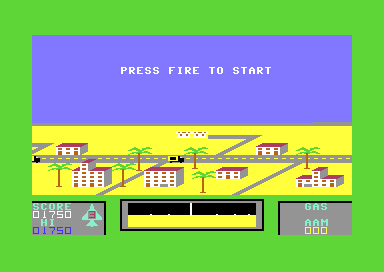
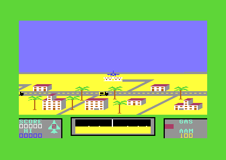
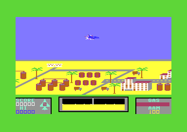

# The start, the main loop and the interrupt

This page tells how Falcon Patrol starts and how the game keeps its speed. It also tells how a game goes from the title to the jets and returns to the title. The game has no frame sync. One main loop runs all the game routines, and a CIA timer gives each pass the same length. A raster interrupt only changes the colours of the sky, the ground and the panel. The reference lists each routine and variable: [reference/index.md](reference/index.md).

**Conventions.**
- Addresses are C64 addresses. Names are the names of the knowledge.
- A *pass* is one run of the main loop. A *frame* is one PAL screen of 312 raster lines, 19,656 cycles, 1/50 second. Some comments of the source write "frame" for a pass.
- A *jet* is one life of the player. `lives` holds the spare jets.
- A *split* is one raster interrupt that changes the colours. The game has three splits in each frame.
- The *window* of the start is the time between the SEI at `$4100` and the store to `$DC0D` at `$4118`.
- **Observed** marks a fact that a run showed. **Code** marks a fact from the code only. **Conclusion** marks an interpretation.

## The cold start

The game file loads at `$2000-$6000`, and SYS 16640 starts it at [`cold_start` `$4100`](../src/init/cold_start.asm#L6). The game loads nothing more. The cold start prepares the machine one time. Then it shows the title (**Code**).

1. **It masks the interrupts and clears the zero page.** SEI, then `$03-$72` get 0. This clears the score, the lives and all game variables (**Code**).
2. **It sets the sprite pointers of the bombs.** Sprites 5 and 6 get the frame `$9E` (**Code**).
3. **It sets the VIC-II.** [`vic_init` `$502B`](../src/init/vic_setup.asm#L6) sets the CIA 1 port directions, clears `$0200-$0258` and copies `vic_init_table` to `$D000-$D02E`. A table byte `$FF` keeps the register (**Code**).
4. **It disables the CIA 1 interrupts.** The store of `$7F` to `$DC0D` at `$4118` disables the KERNAL timer interrupt. The code never reads `$DC0D`. The next section tells why this is a problem (**Code**).
5. **It starts the CIA 2 timers.** Timer A runs without a stop. `crater_chars_animate` reads its low byte as random bits. Timer B gives the pace of the main loop (**Code**).
6. **It sets the enemy values and the play state.** `launch_delay` gets `$0A`, `wave_size` gets 4, the enemy shots `$3C-$43` get `$FF`. Then [`reset_play_state` `$564E`](../src/game/jet_lost.asm#L15) clears the play variables and silences the SID (**Code**).
7. **It starts the raster interrupt.** [`raster_irq_init` `$4B20`](../src/irq/raster_irq_4b20.asm#L6) sets the vector `$0314`, waits for raster line `$FE` and executes CLI (**Code**).
8. **It builds the title screen and shows the title.** `build_title_screen` writes the title at `$0800`. Then a JMP goes to `show_title`, the second half of the game-over code (**Code**).

### The start-up hang

The cold start can hang before the title. The KERNAL timer A of CIA 1 gives an interrupt each 16,422 cycles. The SEI at `$4100` masks the interrupt, but the timer continues. When the timer ends in the window, CIA 1 sets bit 0 of its interrupt flags and pulls the IRQ line low (**Code**).

The store at [`cold_start` `$4118`](../src/init/cold_start.asm#L21) disables the interrupt sources of CIA 1. A write to `$DC0D` does not clear a flag that the CIA set before. Only a read of `$DC0D` clears it, and no code of the game reads `$DC0D`. Thus the IRQ line stays low (**Code**).

Then `raster_irq_init` executes CLI. The CPU goes into the interrupt at once. [`raster_irq` `$4AC0`](../src/irq/raster_irq.asm#L6) acknowledges only the VIC-II in `$D019`. After its RTI, the IRQ line is still low, and the CPU goes into the interrupt again. The game never gets to the title (**Code**).

A run started the game file from the READY prompt at `$E5D4` with the PC at `$4100`. The game hung. The CIA 1 interrupt flags stayed `$81`, and `raster_irq` ran without end. A start at `$EA81` reached the title. `$EA81` is in the KERNAL interrupt code, just after its read of `$DC0D`. There, the next timer interrupt is 16,422 cycles away (**Observed**).

The run measured the window. The SEI at `$4100` executes at raster line 3, cycle 37. The store at `$4118` executes at raster line 47, cycle 40. That is 44 lines of 63 cycles plus 3 cycles, 2,775 cycles. The clear of the zero page, of `$0200-$0258` and of the VIC-II registers takes most of this time (**Observed**).

A player types SYS 16640, or the BASIC boot of a release executes it. The moment of the SYS has no relation to the KERNAL timer. Thus 2,775 of 16,422 cycles hit the window, and about one start in six hangs. The player then must start the game again (**Conclusion**).

The clean loader of the rebuild does not have this problem. Just before its JMP to `$4100`, it sets timer A to 4,925 cycles (`$133D`) and reads `$DC0D`. Thus the timer ends after the store at `$4118` (**Code**, **Conclusion**). The test notes in [../tests/README.md](../tests/README.md) tell how the runs of the original avoid the window.

## The life cycle of a game

The game has six states. The title and the name entry run with the raster interrupt disabled. The other states run with the three splits. Only the play state runs the main loop. The other states have their own wait loops (**Code**).

~~~mermaid
stateDiagram-v2
  state "Title and tune (title_screen)" as Title
  state "PRESS FIRE TO START (wait_fire_to_start)" as Prompt
  state "Refuel on the pad (life_start)" as Refuel
  state "Play (main_loop)" as Play
  state "Jet lost (jet_lost_wait)" as Lost
  state "Game over, name entry (high_score_check, name_entry)" as Over
  [*] --> Title: cold start
  Title --> Refuel: FIRE on the title
  Title --> Prompt: no FIRE, the wait ends
  Prompt --> Refuel: FIRE
  Prompt --> Title: time-out, about 25 s
  Refuel --> Play: GAS 900
  Play --> Lost: collision, jet_state bit 3
  Lost --> Refuel: wait ends, lives > 0
  Lost --> Over: wait ends, lives = 0
  Over --> Title: no new high score, or the entry ends
~~~

[`game_start` `$4140`](../src/game/main_loop.asm#L6), [`game_new_life` `$4144`](../src/game/main_loop.asm#L10) and [`game_over` `$41DD`](../src/game/main_loop.asm#L91) make the changes between the states. The table gives each change.

| State | Condition | Next state | Code |
|---|---|---|---|
| Title | FIRE during the tune or the wait after it (`fire_pressed` not 0) | Refuel on the pad | `title_screen`, `game_start`, `game_new_life` |
| Title | No FIRE before the wait ends | PRESS FIRE TO START | `title_wait_fire`, `game_new_life` |
| PRESS FIRE TO START | FIRE on port 1 | Refuel on the pad | `wait_fire_to_start`, `game_life_begin` |
| PRESS FIRE TO START | `start_wait_timer` gets to 0 | Title | `wait_fire_to_start`, `game_over` |
| Refuel on the pad | GAS hundreds digit is 9 | Play | `life_start` |
| Play | A sprite collision of the jet | Jet lost | `check_collisions`, `set_jet_lost` |
| Jet lost | Wreck frame `$90` and `tick` = `$4F`, `lives` not 0 | Refuel on the pad | `jet_lost_wait`, `game_new_life` |
| Jet lost | Wreck frame `$90` and `tick` = `$4F`, `lives` = 0 | Game over, name entry | `jet_lost_wait`, `game_over` |
| Game over, name entry | No new high score, or `_` ends the entry | Title | `high_score_check`, `name_entry` |

### The title and the time-out

The title screen shows the high scores and plays the title tune. The code at `show_title` disables the raster interrupt before it calls [`title_screen` `$46A0`](../src/title/title_screen.asm#L6). FIRE stops the tune and sets `fire_pressed`. Without FIRE, [`title_wait_fire` `$4EE0`](../src/title/title_wait_fire.asm#L6) waits after the tune with a limit (**Code**).

The limit is a delay loop of 14 cycles. It runs 127 x 47 times for each step of `tune_index`, from 0 to `$80`. That is about 10.7 million cycles, about 11 seconds. After a name entry, the tune starts at note `$17`, so the wait is about 9 seconds (**Conclusion**).

### PRESS FIRE TO START

A new game sets `lives` to 3. For each jet, `game_new_life` clears the screen and draws the landscape, the panel and the radar. Then it tests for the first jet of the game (**Code**):

- `bonus_jet_flag` is 0: the game did not give the extra jet.
- `lives` is 3 or more: the game did not take a spare jet yet.

Only the first jet meets both conditions. Then [`wait_fire_to_start` `$53E3`](../src/game/wait_fire.asm#L15) runs. When FIRE stopped the title, `fire_pressed` is not 0, and the routine shows no text. Otherwise it writes PRESS FIRE TO START at `$04AB` and waits for FIRE. The FIRE of the title thus also starts the game (**Code**).

The wait has a limit. When the limit ends before FIRE, `start_wait_timer` is 0, and `game_new_life` jumps to `game_over`. The title then shows again. The high-score recording ran this path after its name entry (**Observed**). Thus, without a player, the C64 changes between the title and the prompt without end (**Conclusion**).

Both paths end at [`wait_fire_clear_score` `$540F`](../src/game/wait_fire.asm#L40). This code clears the score and the collision latches. No other code clears the score. Thus the panel shows the score of the last game until the prompt ends (**Code**). The screenshot above shows the old score 01750 under the prompt (**Observed**).

### Each jet

[`game_life_begin` `$4173`](../src/game/main_loop.asm#L31) starts the engine sound and takes one spare jet with DEC `lives` at `$417C`. The Derbyshire Ram trainer changes this DEC to an LDA. The `TRAINER` switch gives that change (**Code**).

Then [`life_start` `$5000`](../src/player/life_start.asm#L6) erases the prompt text. `jet_lower_to_start` puts the jet at X 172, Y `$60` and lowers it 36 lines to Y `$84`, the height of the pad. Then a refuel loop fills GAS to 900 with a beep at each step. The player cannot stop this refuel. Only after it does the main loop start (**Code**). The lowering takes about 1.4 million cycles, about 1.5 seconds (**Conclusion**).

The jet on the pad is part of the play state. In each pass, `landing_check` sets `jet_state` bit 1 when the jet is at Y `$84` with speed 0 over an airfield. Then it refuels and rearms the jet (**Code**). A run showed that the jet stays on the pad without input and refuels (**Observed**).

### The trainer and the first-jet test

The test for the first jet uses `lives`. With `TRAINER` = 1, `lives` stays 3. Thus each new jet passes the test until the game gives the extra jet. Each new jet then calls `wait_fire_to_start`, and the score goes to 0 again. A run with the trainer byte, a score of 01750 and one lost jet shows the score 00000 at the second jet (**Observed**). When the game started from the prompt, the prompt also shows again, with its time-out to the title (**Code**). `lives` never gets to 0 with the trainer, so the game never ends (**Code**).

### The jet-lost wait

A sprite collision of the jet calls `set_jet_lost`, which sets `jet_state` bit 3. The input then gives only "down", and the jet falls (**Code**). A run showed a jet that met an enemy wave at the top of the screen. The jet fell with smoke (**Observed**).

While `jet_state` bit 3 stays 1, the main loop continues, and the jet-lost code runs in it. These are the steps (**Code**):

1. In the air, [`jet_lost_animate` `$5690`](../src/player/jet_lost_animation.asm#L6) shows the smoke sprite 7 above the jet. The crash sound rises in pitch.
2. On the ground, the jet shows random wreck frames `$88-$8F`. The filter of the crash sound closes.
3. When the cutoff is below `$40`, [`sound_update` `$4800`](../src/sound/sound_update.asm#L6) stops the voices and sets `crash_stage` and `tick` to `$90` and the jet frame to `$88`.
4. Each 8 passes, the frame increases by 1, up to `$90`.
5. [`jet_lost_wait` `$5640`](../src/game/jet_lost.asm#L6) waits for frame `$90` and `tick` = `$4F`. Then it runs on into `reset_play_state`.

`tick` increases by 1 in each pass. From `$90` to `$4F` it needs 191 passes, about 6.4 seconds. This is the pause between the end of the crash sound and the next jet (**Conclusion**).

`reset_play_state` clears `$17-$64` but keeps `lives`. It also restores the airfields. The clear also erases `jet_state` bit 3, and the main loop sees the end of the wait from this bit. Then `lives` = 0 means game over, and other values give the next jet (**Code**).

### Game over

The game-over code disables the raster interrupt and calls `title_screen`. [`high_score_check` `$4C40`](../src/highscore/high_score_check.asm#L6) compares the score with the 5 rows of the table. A new high score starts the name entry. Then the title tune plays. After the title, the code sets the raster interrupt again, clears `bonus_jet_flag` and starts a new game (**Code**). The high-score recording ran this path with the score 01750 and the name FP (**Observed**).

## The main loop

[`main_loop` `$4185`](../src/game/main_loop.asm#L54) is one pass of the game. It starts a timer, calls the game routines, and waits for the timer to end. The timer, not the raster, gives the speed of the game (**Code**).

### The pace: CIA 2 timer B

At the start of each pass, the main loop writes `$7F` to `$DD07` and `$09` to `$DD0F`. This starts timer B in one-shot mode. After the routines, [`main_loop_wait_timer` `$41C0`](../src/game/main_loop.asm#L76) waits until the high byte of the timer is `$7F` again. At the end of its count, a one-shot timer loads its latch and stops. Thus the wait ends when the count ends (**Code**).

The game never writes the low byte `$DD06`. After a reset, the latch of the CIA is `$FFFF`. Thus the count starts at `$7FFF`, and a pass takes 32,768 cycles (**Conclusion**). These are the numbers that follow from it (**Conclusion**):

- A pass is 1.67 PAL frames. The game logic runs about 30 times each second.
- The timer counts all cycles. The interrupts and the cycles that the VIC-II takes from the CPU do not make a pass longer. They only reduce the time that the routines have.
- When the routines need more than 32,768 cycles, the timer is already stopped at `$7F`, and the wait ends at once. Then the pass is longer, and the game becomes slower.
- An NTSC C64 has a faster clock, 1,022,727 cycles each second. There, the game runs about 31 passes each second, about 4% faster than on PAL.
- The cold start starts timer B in continuous mode. The first pass after the cold start thus starts with a random count, and its length is random.

The movements of the game count passes, not frames. For example, the landscape scrolls one column in each pass at speed 3, so it moves about 30 columns each second. The pass and the frame have no fixed relation. A pass starts at any raster line (**Conclusion**).

The timer has a second use. The low byte of timer B changes during the pass, and `steer_enemies` reads it as a random value (**Code**).

### The order of the routines in a pass

~~~mermaid
flowchart TB
  A["Start timer B, $7FFF cycles, one-shot"] --> B["Craters, enemy rumble, radar (crater_chars_animate, radar_clear, radar_plot_all)"]
  B --> C["Stick, flight, missile launch (read_input)"]
  C --> D["Scroll the landscape (landscape_scroll_step)"]
  D --> E["Panel, fuel, landing (panel_update, fuel_burn, landing_check)"]
  E --> F["Missiles: erase, move, draw"]
  F --> G["Enemy wave, enemy shots, bombs"]
  G --> H["Collisions, sound (check_collisions, sound_update)"]
  H --> I{"Timer B at the end? (main_loop_wait_timer)"}
  I -->|no| I
  I -->|yes| J{"Jet lost? (jet_state bit 3)"}
  J -->|no| A
  J -->|yes| K["Lost-jet wait (jet_lost_wait)"]
  K -->|still lost| A
  K -->|wait ends| L["Next jet or game over"]
~~~

The main loop calls the routines in this order (**Code**):

1. **The craters and the enemy rumble.** [`crater_chars_animate` `$5E45`](../src/graphics/crater_chars_animate.asm#L6) fills the crater characters `$2A-$2B` with random bits from CIA 2 timer A. Then it sets the filter of the enemy engine noise on voice 3.
2. **The radar.** `radar_clear` fills the radar characters `$D0-$FF` with the empty pattern. `radar_plot_all` then plots the airfields and the enemies again. The radar is new in each pass.
3. **The stick and the flight.** [`read_input` `$5700`](../src/input/read_input.asm#L6) reads port 1 at `$DC01` and masks it with the height and the state of the jet. Then it moves the jet, increases `tick`, and starts a missile on FIRE.
4. **The landscape.** `landscape_scroll_step` scrolls the 8 landscape rows by the speed of the jet. The jet sprite stays at X 172.
5. **The panel, the fuel and the landing.** `panel_update` writes the score, the high score, AAM, the lives and the GAS gauge. `fuel_burn` takes GAS. `landing_check` refuels a jet on a pad.
6. **The missiles.** `missile_erase`, `missile_move` and `missile_draw` move each missile one column.
7. **The enemies.** `enemy_wave_update` starts and moves a wave. `enemy_shot_update` and `bomb_update` move the shots and the bombs.
8. **The collisions.** [`check_collisions` `$4200`](../src/game/collisions.asm#L6) reads `$D01E` and `$D01F` after all sprites moved. It sets the lost jet, the kills and the bomb hits.
9. **The sound.** `sound_update` plays the crash sound of a lost jet, or the refuel tone and the alarms.
10. **The wait.** The loop waits for the end of timer B. Then it tests `jet_state` bit 3.

The collision test comes after all movement of the pass. The latches `$D01E` and `$D01F` hold each collision that the VIC-II drew since the last read. A pass is longer than a frame, so the VIC-II draws the new positions before the next test (**Conclusion**).

### A worked example: the time-out of the prompt

The time-out of PRESS FIRE TO START is a delay loop without the timer. This calculation decodes it from the code at `wait_fire_loop` (**Code**, **Conclusion**):

1. One loop is 16 cycles: LDA `$DC01` 4, AND 2, BEQ 2, INC `tick` 5, BNE 3.
2. `tick` counts 256 loops for each step of Y. Y starts at `$E8`, so 24 steps of Y come first: 6,144 loops.
3. `start_wait_timer` starts at `$E8` and increases to 0: 24 steps. After the first 23 steps, Y counts a full 256 steps: 23 x 65,536 = 1,507,328 loops.
4. The total is 1,513,472 loops x 16 = 24,215,552 cycles.
5. A PAL C64 has 985,248 cycles each second. That is 24.6 seconds. The three splits take about 1.6% more, so the prompt waits about 25 seconds.

## The raster interrupt

The raster interrupt changes the colours at three lines of each frame. The sky gets light blue, the landscape gets grey with orange, and the panel gets grey with black. [`raster_irq_init` `$4B20`](../src/irq/raster_irq_4b20.asm#L6) sets the vector `$0314` to the handler and enables only the raster interrupt of the VIC-II (**Code**).

[`raster_irq` `$4AC0`](../src/irq/raster_irq.asm#L6) reads `irq_phase` at `$B0`. Each phase sets its colours, writes `$1B` to `$D011` and sets the line of the next split. The table gives the three splits (**Code**).

| Phase `irq_phase` | Raster line | `$D021` background | `$D023` multicolour 2 | Next line, next phase |
|---|---|---|---|---|
| 1 | `$01` (1) | `$0E` light blue | not changed | `$8A`, 0 |
| 0 | `$8A` (138) | `$0C` grey | `$08` orange | `$D2`, `$FF` |
| `$FF` | `$D2` (210) | `$0C` grey | `$00` black | `$01`, 1 |

`$D022`, multicolour 1, stays at `$07` yellow from `vic_init_table`. This colour gives the sand of the landscape (**Code**). With the Y scroll 3, text row 11 starts at line 139 and row 20 at line 211. Thus each split comes one line before its row: row 11 is the horizon, row 20 the top of the panel (**Conclusion**).

The write of `$1B` to `$D011` keeps bit 8 of the raster line at 0, so all three lines are below 256. The lines also exist on an NTSC C64 (**Conclusion**).

The handler does not end with a JMP to the KERNAL. The CPU enters it through the KERNAL entry `$FF48`, which pushes A, X and Y. The handler pulls Y, X and A itself and executes RTI. Thus the KERNAL never reads the keyboard and never reads `$DC0D` during the game (**Code**). One split takes about 105 cycles with the KERNAL entry. The three splits take about 1.6% of the CPU time (**Conclusion**).

Each split sets the line of the next split. Thus a wrong start of the chain lasts only until the next split. This happens two times (**Code**, **Conclusion**):

- During the title, the game disables the raster interrupt, but the VIC-II latches the line match in `$D019`. After the title, the first interrupt can come at once, at any line.
- `reset_play_state` clears `$98-$B0` at each lost jet, and `$B0` is `irq_phase`. The next interrupt then runs phase 0 at the line of a different phase.

In both cases, one frame can show the colours at the wrong lines (**Conclusion**).

## Still open

- No run measured the length of the routines of a pass. Is a pass with a full enemy wave, the radar and the scroll ever longer than 32,768 cycles? Then the game becomes slower.
- No run read the latch of CIA 2 timer B. The value `$7FFF` assumes the latch `$FFFF` after a reset, and no RS-232 use before the game.
- Does RUN/STOP + RESTORE end the start-up hang? The KERNAL interrupt code reads `$DC0D`, so the warm start can clear the flag. No run checked it.
- Do the boots of the releases execute the SYS at a random time relative to the KERNAL timer? The rate of one hang in six assumes this.
- No run checked the frame with wrong split colours after the title or after a lost jet.
- No run checked the prompt at each new jet with the trainer.
