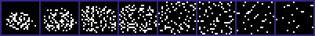
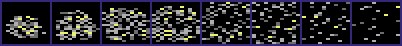
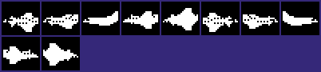
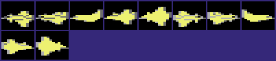
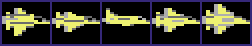
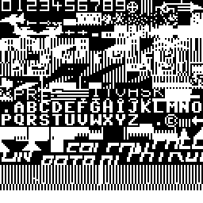

<!-- Generated by c64-docs from knowledge revision 20261024T103119.179-vx1fei and .c64-re-tools/local/generated/src/source-map.json. Do not edit: change the knowledge, generate the source again, then run docs.ts generate. -->
# Graphics

Each sprite, bitmap, charset and screen region of the knowledge. The knowledge gives no display mode and no colours, so a sprite, bitmap or charset shows in hires and in multicolour, in pattern colours: black is pixel value 0, white is 1 in hires; in multicolour light grey is 1, grey is 2 and yellow is 3. Index: [the reference](index.md).

<a id="jet_sprites"></a>
## [`jet_sprites` `$2000`](../../src/data/sprites.asm#L6) `$2000-$21BF`

*sprite*

Jet sprites, pointers $80-$86: $80 flies left, $83 faces the viewer, $86 flies right. $5600 steps the pointer with jet_speed_x.


<a id="explosion_sprites"></a>
## [`explosion_sprites` `$2200`](../../src/data/sprites_2200.asm#L6) `$2200-$23FF`

*sprite*

Explosion sprites, pointers $88-$8f. The crash of the jet uses $88-$8f, an exploding enemy $88-$8b.





<a id="smoke_sprites"></a>
## [`smoke_sprites` `$2400`](../../src/data/sprites_2200.asm#L179) `$2400-$24FF`

*sprite*

Pointers $90-$93. $90 is empty: the end of the jet explosion. Sprite 7 cycles $90-$93 as the smoke of the falling jet.


<a id="enemy_sprites"></a>
## [`enemy_sprites` `$2500`](../../src/data/sprites_2200.asm#L267) `$2500-$277F`

*sprite*

Enemy jet sprites, pointers $94-$98 and $99-$9d (one set for each wave_dir). $96 and $9b are the level frames.





<a id="bomb_sprite"></a>
## [`bomb_sprite` `$2780`](../../src/data/sprites_2200.asm#L483) `$2780-$27BF`

*sprite*

Bomb sprite, pointer $9e, for sprites 5 and 6.


<a id="jet_pitch_left"></a>
## [`jet_pitch_left` `$2B00`](../../src/data/jet_pitch_sprites.asm#L6) `$2B00-$2C3F`

*sprite*

Pitch frames of the jet that flies left (5 sprites). $5ad0 copies one to jet_sprites ($2000).


<a id="jet_pitch_right"></a>
## [`jet_pitch_right` `$2C40`](../../src/data/jet_pitch_sprites.asm#L116) `$2C40-$2D7F`

*sprite*

Pitch frames of the jet that flies right (5 sprites). $5ac4 copies one to jet_frame_right ($2180).




<a id="credit_text"></a>
## [`credit_text` `$2F80`](../../src/data/texts.asm#L6) `$2F80-$2FA7`

*screen*

Title credit line, 40 screen codes + $80: (c)VIRGIN GAMES 1983  WRITTEN BY STEVE LEE. $9d is the (c) sign, $00-$09 are digits.

```text
]VIRGIN GAMES AIHC  WRITTEN BY STEVE LEE
```

<a id="game_charset"></a>
## [`game_charset` `$3000`](../../src/data/charset.asm#L6) `$3000-$37FF`

*charset*

Game character set (multicolour landscape, digits $00-$09, letters $81-$9a, panel and logo $a0-$cf, radar $d0-$ff).




<a id="press_fire_text"></a>
## [`press_fire_text` `$53D0`](../../src/game/wait_fire.asm#L6) `$53D0-$53E2`

*screen*

PRESS FIRE TO START, 19 screen codes + $80 with plain spaces $20. The title screen ($46ec) and $53e3 read it.

```text
PRESS FIRE TO START
```

<a id="title_logo_upper"></a>
## [`title_logo_upper` `$5B80`](../../src/title/title_logo_rows.asm#L6) `$5B80-$5B8F`

*screen*

Upper row of the title logo: 16 character codes. $44c0 copies them to the title screen at $080c (row 0, column 12).

```text
56789:; ....... 
```

<a id="title_logo_lower"></a>
## [`title_logo_lower` `$5B90`](../../src/title/title_logo_rows.asm#L12) `$5B90-$5B9F`

*screen*

Lower row of the title logo: 16 character codes. $44c0 copies them to the title screen at $0834 (row 1, column 12).

```text
<=>?... ....... 
```
