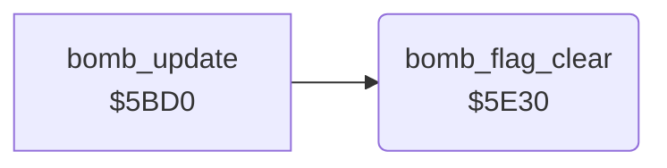

<!-- Generated by c64-docs from knowledge revision 20261025T214607.441-00m56k and .c64-re-tools/local/generated/src/source-map.json. Do not edit: change the knowledge, generate the source again, then run docs.ts generate. -->
# enemy/bomb_flag.asm: Bomb active flag

Range `$5E30-$5E44`. Source: [enemy/bomb_flag.asm](../../../../src/enemy/bomb_flag.asm). Index: [the reference](../../index.md).

## Routines

| Routine | Address | Reached from | Summary |
|---|---|---|---|
| [`bomb_flag_clear`](bomb_flag.md#bomb_flag_clear) | `$5E30` | [`bomb_update`](enemy_bombs.md#bomb_update) | Clears $61 bit 1 when the bomb slots $a8 and $a9 are both inactive. |

## Call graph

A solid arrow is a call, a thick arrow a table entry. Rounded nodes are in this file.

## Details

### [`bomb_flag_clear`](../../../../src/enemy/bomb_flag.asm#L6) `$5E30`

*routine*

Clears $61 bit 1 when the bomb slots $a8 and $a9 are both inactive.

- **Called from:** [`bomb_update`](enemy_bombs.md#bomb_update)
- **Reads:** [`wave_flags`](../../memory-map.md#wave_flags), [`bomb_active`](../../memory-map.md#bomb_active)
- **Writes:** [`wave_flags`](../../memory-map.md#wave_flags)

| Label | Address | Comment |
|---|---|---|
| [`bomb_flag_done`](../../../../src/enemy/bomb_flag.asm#L17) | `$5E44` |  |
