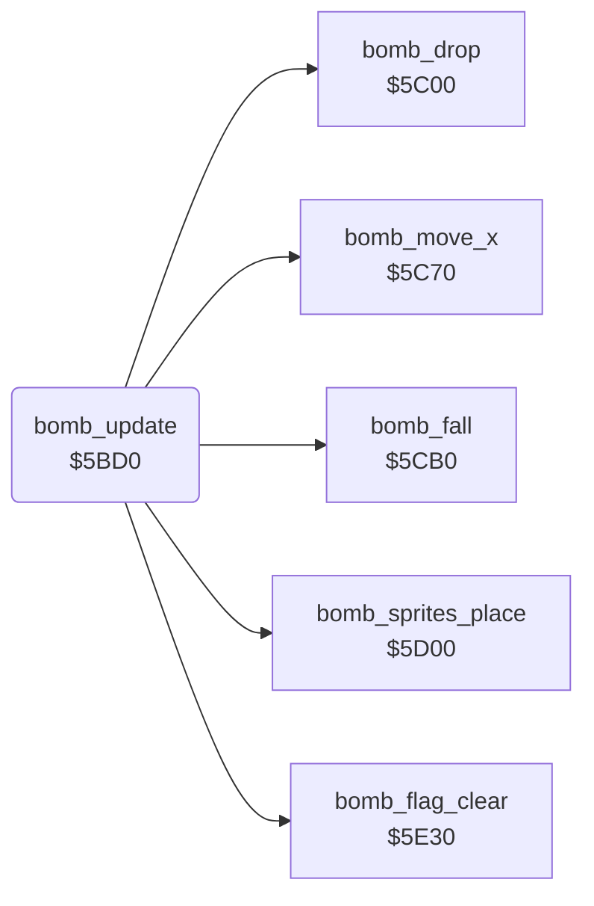

<!-- Generated by c64-docs from knowledge revision 20261024T103119.179-vx1fei and .c64-re-tools/local/generated/src/source-map.json. Do not edit: change the knowledge, generate the source again, then run docs.ts generate. -->
# enemy/enemy_bombs.asm: Enemy bombs: drop, move and sprites 5-6

Range `$5BD0-$5BDF`. Source: [enemy/enemy_bombs.asm](../../../../src/enemy/enemy_bombs.asm). Index: [the reference](../../index.md).

## Call graph

A solid arrow is a call, a thick arrow a table entry, a dotted arrow a jump. Rounded nodes are in this file.

## Names

### [`bomb_update`](../../../../src/enemy/enemy_bombs.asm#L6) `$5BD0`

*routine*

Updates the enemy bombs: drop ($5c00), horizontal move ($5c70), fall ($5cb0), sprites ($5d00) and the active flag ($5e30).

- **Called from:** [`$41B7`](../../../../src/game/main_loop.asm#L73)
- **Calls:** [`bomb_drop`](enemy_bombs_5c00.md#bomb_drop), [`bomb_move_x`](enemy_bombs_5c00.md#bomb_move_x), [`bomb_fall`](enemy_bombs_5c00.md#bomb_fall), [`bomb_sprites_place`](enemy_bombs_5d00.md#bomb_sprites_place), [`bomb_flag_clear`](bomb_flag.md#bomb_flag_clear)
