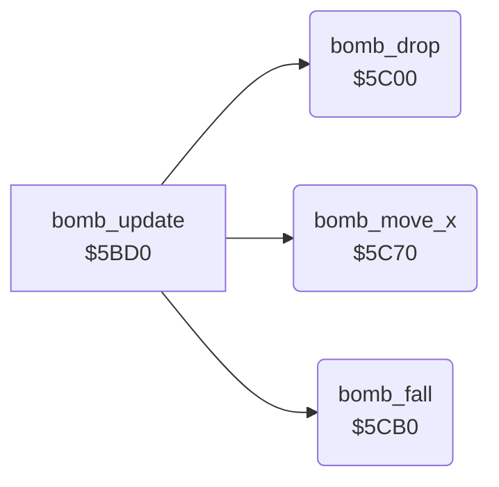

<!-- Generated by c64-docs from knowledge revision 20261025T214607.441-00m56k and .c64-re-tools/local/generated/src/source-map.json. Do not edit: change the knowledge, generate the source again, then run docs.ts generate. -->
# enemy/enemy_bombs_5c00.asm

Range `$5C00-$5CEF`. Source: [enemy/enemy_bombs_5c00.asm](../../../../src/enemy/enemy_bombs_5c00.asm). Index: [the reference](../../index.md).

## Routines

| Routine | Address | Reached from | Summary |
|---|---|---|---|
| [`bomb_drop`](enemy_bombs_5c00.md#bomb_drop) | `$5C00` | [`bomb_update`](enemy_bombs.md#bomb_update) | Every 64th tick, the lowest active enemy drops a bomb into a free slot X = 2-1. |
| [`bomb_move_x`](enemy_bombs_5c00.md#bomb_move_x) | `$5C70` | [`bomb_update`](enemy_bombs.md#bomb_update) | Moves each active bomb 2 pixels in the direction of $60: positive to the left, negative to the right. |
| [`bomb_fall`](enemy_bombs_5c00.md#bomb_fall) | `$5CB0` | [`bomb_update`](enemy_bombs.md#bomb_update) | Moves each active bomb down 2 pixels (two passes). |

## Call graph

A solid arrow is a call, a thick arrow a table entry. Rounded nodes are in this file.

## Details

### [`bomb_drop`](../../../../src/enemy/enemy_bombs_5c00.asm#L6) `$5C00`

*routine*

Every 64th tick, the lowest active enemy drops a bomb into a free slot X = 2-1. The bomb takes its row + 1, its map column and its fine positions. Sets $61 bit 1. Bomb slots: row $9f+x, column $a1+x, fine Y $a3+x, fine X $a5+x, active $a7+x.

- **Called from:** [`bomb_update`](enemy_bombs.md#bomb_update)
- **Reads:** [`wave_flags`](../../memory-map.md#wave_flags), [`SPENA`](../../memory-map.md#SPENA), [`tick`](../../memory-map.md#tick), [`enemy_state`](../../memory-map.md#enemy_state), [`enemy_row`](../../memory-map.md#enemy_row), [`calc_x`](../../memory-map.md#calc_x), [`bomb_active`](../../memory-map.md#bomb_active), [`temp`](../../memory-map.md#temp), [`enemy_col`](../../memory-map.md#enemy_col), [`enemy_y_fine`](../../memory-map.md#enemy_y_fine), [`enemy_x_fine`](../../memory-map.md#enemy_x_fine), [`calc_y`](../../memory-map.md#calc_y) and 1 more
- **Writes:** [`calc_x`](../../memory-map.md#calc_x), [`temp`](../../memory-map.md#temp), [`calc_y`](../../memory-map.md#calc_y), [`char_col`](../../memory-map.md#char_col), [`enemy_row`](../../memory-map.md#enemy_row), [`bomb_row`](../../memory-map.md#bomb_row), [`bomb_col`](../../memory-map.md#bomb_col), [`bomb_y_fine`](../../memory-map.md#bomb_y_fine), [`bomb_x_fine`](../../memory-map.md#bomb_x_fine), [`bomb_active`](../../memory-map.md#bomb_active), [`wave_flags`](../../memory-map.md#wave_flags)

| Label | Address | Comment |
|---|---|---|
| [`bomb_drop_find_lowest`](../../../../src/enemy/enemy_bombs_5c00.asm#L19) | `$5C19` |  |
| [`bomb_drop_next_enemy`](../../../../src/enemy/enemy_bombs_5c00.asm#L29) | `$5C2B` |  |
| [`bomb_drop_find_slot`](../../../../src/enemy/enemy_bombs_5c00.asm#L35) | `$5C34` |  |
| [`bomb_drop_fill_slot`](../../../../src/enemy/enemy_bombs_5c00.asm#L42) | `$5C3D` |  |
| [`bomb_drop_done`](../../../../src/enemy/enemy_bombs_5c00.asm#L71) | `$5C6F` |  |

### [`bomb_move_x`](../../../../src/enemy/enemy_bombs_5c00.asm#L74) `$5C70`

*routine*

Moves each active bomb 2 pixels in the direction of $60: positive to the left, negative to the right. The fine X $a5+x carries into the column $a1+x.

- **Called from:** [`bomb_update`](enemy_bombs.md#bomb_update)
- **Reads:** [`wave_flags`](../../memory-map.md#wave_flags), [`bomb_active`](../../memory-map.md#bomb_active), [`wave_dir`](../../memory-map.md#wave_dir), [`bomb_x_fine`](../../memory-map.md#bomb_x_fine), [`bomb_col`](../../memory-map.md#bomb_col)
- **Writes:** [`bomb_x_fine`](../../memory-map.md#bomb_x_fine), [`bomb_col`](../../memory-map.md#bomb_col)

| Label | Address | Comment |
|---|---|---|
| [`bomb_move_x_pass`](../../../../src/enemy/enemy_bombs_5c00.asm#L79) | `$5C78` |  |
| [`bomb_move_x_loop`](../../../../src/enemy/enemy_bombs_5c00.asm#L81) | `$5C7A` |  |
| [`bomb_move_x_right`](../../../../src/enemy/enemy_bombs_5c00.asm#L94) | `$5C92` |  |
| [`bomb_move_x_next`](../../../../src/enemy/enemy_bombs_5c00.asm#L103) | `$5CA2` |  |
| [`bomb_move_x_done`](../../../../src/enemy/enemy_bombs_5c00.asm#L115) | `$5CAF` |  |

### [`bomb_fall`](../../../../src/enemy/enemy_bombs_5c00.asm#L118) `$5CB0`

*routine*

Moves each active bomb down 2 pixels (two passes). The fine Y $a3+x carries into the row $9f+x. At row 19 it clears the slot.

- **Called from:** [`bomb_update`](enemy_bombs.md#bomb_update)
- **Reads:** [`wave_flags`](../../memory-map.md#wave_flags), [`bomb_active`](../../memory-map.md#bomb_active), [`bomb_y_fine`](../../memory-map.md#bomb_y_fine), [`bomb_row`](../../memory-map.md#bomb_row)
- **Writes:** [`bomb_y_fine`](../../memory-map.md#bomb_y_fine), [`bomb_row`](../../memory-map.md#bomb_row), [`bomb_col`](../../memory-map.md#bomb_col), [`bomb_x_fine`](../../memory-map.md#bomb_x_fine), [`bomb_active`](../../memory-map.md#bomb_active)

| Label | Address | Comment |
|---|---|---|
| [`bomb_fall_pass`](../../../../src/enemy/enemy_bombs_5c00.asm#L123) | `$5CB8` |  |
| [`bomb_fall_loop`](../../../../src/enemy/enemy_bombs_5c00.asm#L125) | `$5CBA` |  |
| [`bomb_fall_next`](../../../../src/enemy/enemy_bombs_5c00.asm#L152) | `$5CE6` |  |
| [`bomb_fall_done`](../../../../src/enemy/enemy_bombs_5c00.asm#L160) | `$5CEF` |  |
