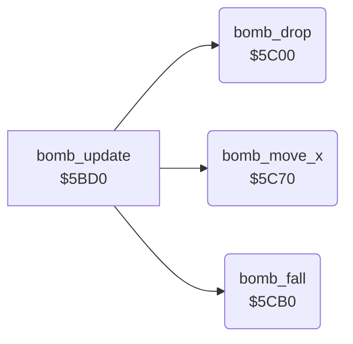

<!-- Generated by c64-docs from knowledge revision 20261024T103119.179-vx1fei and .c64-re-tools/local/generated/src/source-map.json. Do not edit: change the knowledge, generate the source again, then run docs.ts generate. -->
# enemy/enemy_bombs_5c00.asm

Range `$5C00-$5CEF`. Source: [enemy/enemy_bombs_5c00.asm](../../../../src/enemy/enemy_bombs_5c00.asm). Index: [the reference](../../index.md).

## Call graph

A solid arrow is a call, a thick arrow a table entry, a dotted arrow a jump. Rounded nodes are in this file.

## Names

### [`bomb_drop`](../../../../src/enemy/enemy_bombs_5c00.asm#L6) `$5C00`

*routine*

Every 64th tick, the lowest active enemy drops a bomb into a free slot X = 2-1. The bomb takes its row + 1, its map column and its fine positions. Sets $61 bit 1. Bomb slots: row $9f+x, column $a1+x, fine Y $a3+x, fine X $a5+x, active $a7+x.

- **Called from:** [`bomb_update`](enemy_bombs.md#bomb_update) [`$5BD0`](../../../../src/enemy/enemy_bombs.asm#L7)
- **Reads:** [`wave_flags`](../../memory-map.md#wave_flags), [`SPENA`](../../memory-map.md#SPENA), [`tick`](../../memory-map.md#tick), [`enemy_state`](../../memory-map.md#enemy_state), [`enemy_row`](../../memory-map.md#enemy_row), [`calc_x`](../../memory-map.md#calc_x), [`bomb_active`](../../memory-map.md#bomb_active), [`temp`](../../memory-map.md#temp), [`enemy_col`](../../memory-map.md#enemy_col), [`enemy_y_fine`](../../memory-map.md#enemy_y_fine), [`enemy_x_fine`](../../memory-map.md#enemy_x_fine), [`calc_y`](../../memory-map.md#calc_y), [`char_col`](../../memory-map.md#char_col)
- **Writes:** [`calc_x`](../../memory-map.md#calc_x), [`temp`](../../memory-map.md#temp), [`calc_y`](../../memory-map.md#calc_y), [`char_col`](../../memory-map.md#char_col), [`enemy_row`](../../memory-map.md#enemy_row), [`bomb_row`](../../memory-map.md#bomb_row), [`bomb_col`](../../memory-map.md#bomb_col), [`bomb_y_fine`](../../memory-map.md#bomb_y_fine), [`bomb_x_fine`](../../memory-map.md#bomb_x_fine), [`bomb_active`](../../memory-map.md#bomb_active), [`wave_flags`](../../memory-map.md#wave_flags)

### [`bomb_drop_find_lowest`](../../../../src/enemy/enemy_bombs_5c00.asm#L19) `$5C19`

*label*

- **Jumped to from:** [`bomb_drop`](enemy_bombs_5c00.md#bomb_drop) [`$5C2C`](../../../../src/enemy/enemy_bombs_5c00.asm#L31)

### [`bomb_drop_next_enemy`](../../../../src/enemy/enemy_bombs_5c00.asm#L29) `$5C2B`

*label*

- **Jumped to from:** [`bomb_drop`](enemy_bombs_5c00.md#bomb_drop) [`$5C1B`](../../../../src/enemy/enemy_bombs_5c00.asm#L21), [`bomb_drop`](enemy_bombs_5c00.md#bomb_drop) [`$5C1F`](../../../../src/enemy/enemy_bombs_5c00.asm#L23), [`bomb_drop`](enemy_bombs_5c00.md#bomb_drop) [`$5C25`](../../../../src/enemy/enemy_bombs_5c00.asm#L26)

### [`bomb_drop_find_slot`](../../../../src/enemy/enemy_bombs_5c00.asm#L35) `$5C34`

*label*

- **Jumped to from:** [`bomb_drop`](enemy_bombs_5c00.md#bomb_drop) [`$5C39`](../../../../src/enemy/enemy_bombs_5c00.asm#L40)

### [`bomb_drop_fill_slot`](../../../../src/enemy/enemy_bombs_5c00.asm#L42) `$5C3D`

*label*

- **Jumped to from:** [`bomb_drop`](enemy_bombs_5c00.md#bomb_drop) [`$5C36`](../../../../src/enemy/enemy_bombs_5c00.asm#L37)

### [`bomb_drop_done`](../../../../src/enemy/enemy_bombs_5c00.asm#L71) `$5C6F`

*label*

- **Jumped to from:** [`bomb_drop`](enemy_bombs_5c00.md#bomb_drop) [`$5C04`](../../../../src/enemy/enemy_bombs_5c00.asm#L9), [`bomb_drop`](enemy_bombs_5c00.md#bomb_drop) [`$5C0B`](../../../../src/enemy/enemy_bombs_5c00.asm#L12), [`bomb_drop`](enemy_bombs_5c00.md#bomb_drop) [`$5C11`](../../../../src/enemy/enemy_bombs_5c00.asm#L15), [`bomb_drop`](enemy_bombs_5c00.md#bomb_drop) [`$5C30`](../../../../src/enemy/enemy_bombs_5c00.asm#L33), [`bomb_drop`](enemy_bombs_5c00.md#bomb_drop) [`$5C3B`](../../../../src/enemy/enemy_bombs_5c00.asm#L41)

### [`bomb_move_x`](../../../../src/enemy/enemy_bombs_5c00.asm#L74) `$5C70`

*routine*

Moves each active bomb 2 pixels in the direction of $60: positive to the left, negative to the right. The fine X $a5+x carries into the column $a1+x.

- **Called from:** [`bomb_update`](enemy_bombs.md#bomb_update) [`$5BD3`](../../../../src/enemy/enemy_bombs.asm#L8)
- **Reads:** [`wave_flags`](../../memory-map.md#wave_flags), [`bomb_active`](../../memory-map.md#bomb_active), [`wave_dir`](../../memory-map.md#wave_dir), [`bomb_x_fine`](../../memory-map.md#bomb_x_fine), [`bomb_col`](../../memory-map.md#bomb_col)
- **Writes:** [`bomb_x_fine`](../../memory-map.md#bomb_x_fine), [`bomb_col`](../../memory-map.md#bomb_col)

### [`bomb_move_x_pass`](../../../../src/enemy/enemy_bombs_5c00.asm#L79) `$5C78`

*label*

- **Jumped to from:** [`bomb_move_x`](enemy_bombs_5c00.md#bomb_move_x) [`$5CA6`](../../../../src/enemy/enemy_bombs_5c00.asm#L107)

### [`bomb_move_x_loop`](../../../../src/enemy/enemy_bombs_5c00.asm#L81) `$5C7A`

*label*

- **Jumped to from:** [`bomb_move_x`](enemy_bombs_5c00.md#bomb_move_x) [`$5CA3`](../../../../src/enemy/enemy_bombs_5c00.asm#L105)

### [`bomb_move_x_right`](../../../../src/enemy/enemy_bombs_5c00.asm#L94) `$5C92`

*label*

- **Jumped to from:** [`bomb_move_x`](enemy_bombs_5c00.md#bomb_move_x) [`$5C80`](../../../../src/enemy/enemy_bombs_5c00.asm#L85)

### [`bomb_move_x_next`](../../../../src/enemy/enemy_bombs_5c00.asm#L103) `$5CA2`

*label*

- **Jumped to from:** [`bomb_move_x`](enemy_bombs_5c00.md#bomb_move_x) [`$5C7C`](../../../../src/enemy/enemy_bombs_5c00.asm#L83), [`bomb_move_x`](enemy_bombs_5c00.md#bomb_move_x) [`$5C86`](../../../../src/enemy/enemy_bombs_5c00.asm#L88), [`bomb_move_x`](enemy_bombs_5c00.md#bomb_move_x) [`$5C8E`](../../../../src/enemy/enemy_bombs_5c00.asm#L92), [`bomb_move_x`](enemy_bombs_5c00.md#bomb_move_x) [`$5C90`](../../../../src/enemy/enemy_bombs_5c00.asm#L93), [`bomb_move_x`](enemy_bombs_5c00.md#bomb_move_x) [`$5C9A`](../../../../src/enemy/enemy_bombs_5c00.asm#L99)

### [`bomb_move_x_done`](../../../../src/enemy/enemy_bombs_5c00.asm#L115) `$5CAF`

*label*

- **Jumped to from:** [`bomb_move_x`](enemy_bombs_5c00.md#bomb_move_x) [`$5C74`](../../../../src/enemy/enemy_bombs_5c00.asm#L77)

### [`bomb_fall`](../../../../src/enemy/enemy_bombs_5c00.asm#L118) `$5CB0`

*routine*

Moves each active bomb down 2 pixels (two passes). The fine Y $a3+x carries into the row $9f+x. At row 19 it clears the slot.

- **Called from:** [`bomb_update`](enemy_bombs.md#bomb_update) [`$5BD6`](../../../../src/enemy/enemy_bombs.asm#L9)
- **Reads:** [`wave_flags`](../../memory-map.md#wave_flags), [`bomb_active`](../../memory-map.md#bomb_active), [`bomb_y_fine`](../../memory-map.md#bomb_y_fine), [`bomb_row`](../../memory-map.md#bomb_row)
- **Writes:** [`bomb_y_fine`](../../memory-map.md#bomb_y_fine), [`bomb_row`](../../memory-map.md#bomb_row), [`bomb_col`](../../memory-map.md#bomb_col), [`bomb_x_fine`](../../memory-map.md#bomb_x_fine), [`bomb_active`](../../memory-map.md#bomb_active)

### [`bomb_fall_pass`](../../../../src/enemy/enemy_bombs_5c00.asm#L123) `$5CB8`

*label*

- **Jumped to from:** [`bomb_fall`](enemy_bombs_5c00.md#bomb_fall) [`$5CEA`](../../../../src/enemy/enemy_bombs_5c00.asm#L156)

### [`bomb_fall_loop`](../../../../src/enemy/enemy_bombs_5c00.asm#L125) `$5CBA`

*label*

- **Jumped to from:** [`bomb_fall`](enemy_bombs_5c00.md#bomb_fall) [`$5CE7`](../../../../src/enemy/enemy_bombs_5c00.asm#L154)

### [`bomb_fall_next`](../../../../src/enemy/enemy_bombs_5c00.asm#L152) `$5CE6`

*label*

- **Jumped to from:** [`bomb_fall`](enemy_bombs_5c00.md#bomb_fall) [`$5CBC`](../../../../src/enemy/enemy_bombs_5c00.asm#L127), [`bomb_fall`](enemy_bombs_5c00.md#bomb_fall) [`$5CC6`](../../../../src/enemy/enemy_bombs_5c00.asm#L133), [`bomb_fall`](enemy_bombs_5c00.md#bomb_fall) [`$5CD2`](../../../../src/enemy/enemy_bombs_5c00.asm#L139)

### [`bomb_fall_done`](../../../../src/enemy/enemy_bombs_5c00.asm#L160) `$5CEF`

*label*

- **Jumped to from:** [`bomb_fall`](enemy_bombs_5c00.md#bomb_fall) [`$5CB4`](../../../../src/enemy/enemy_bombs_5c00.asm#L121)
