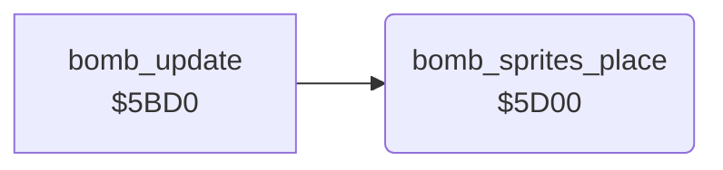

<!-- Generated by c64-docs from knowledge revision 20261025T214607.441-00m56k and .c64-re-tools/local/generated/src/source-map.json. Do not edit: change the knowledge, generate the source again, then run docs.ts generate. -->
# enemy/enemy_bombs_5d00.asm

Range `$5D00-$5D8F`. Source: [enemy/enemy_bombs_5d00.asm](../../../../src/enemy/enemy_bombs_5d00.asm). Index: [the reference](../../index.md).

## Routines

| Routine | Address | Reached from | Summary |
|---|---|---|---|
| [`bomb_sprites_place`](enemy_bombs_5d00.md#bomb_sprites_place) | `$5D00` | [`bomb_update`](enemy_bombs.md#bomb_update) | Sets sprites 6 and 5 from bomb slots 2 and 1. |

## Data

| Range | Type | Name | Read by | Written by |
|---|---|---|---|---|
| [`$5D29`](../../../../src/enemy/enemy_bombs_5d00.asm#L31)-`$5D2A` | dual-use |  |  |  |

## Call graph

A solid arrow is a call, a thick arrow a table entry. Rounded nodes are in this file.

## Details

### [`bomb_sprites_place`](../../../../src/enemy/enemy_bombs_5d00.asm#L6) `$5D00`

*routine*

Sets sprites 6 and 5 from bomb slots 2 and 1. X = (column - $0d + 3) * 8 + fine X, with the MSB in $d010. Y = row * 8 + $2a + fine Y. An inactive or far bomb turns its sprite off in $d015. Y holds the sprite bit ($40, $20).

- **Called from:** [`bomb_update`](enemy_bombs.md#bomb_update)
- **Reads:** [`bomb_active`](../../memory-map.md#bomb_active), [`SPENA`](../../memory-map.md#SPENA), [`temp`](../../memory-map.md#temp), [`map_column`](../../memory-map.md#map_column), [`bomb_col`](../../memory-map.md#bomb_col), [`MSIGX`](../../memory-map.md#MSIGX), [`temp2`](../../memory-map.md#temp2), [`bomb_x_fine`](../../memory-map.md#bomb_x_fine), [`bomb_row`](../../memory-map.md#bomb_row), [`bomb_y_fine`](../../memory-map.md#bomb_y_fine), [`calc_x`](../../memory-map.md#calc_x), [`calc_y`](../../memory-map.md#calc_y)
- **Writes:** [`temp`](../../memory-map.md#temp), [`SPENA`](../../memory-map.md#SPENA), [`temp2`](../../memory-map.md#temp2), [`MSIGX`](../../memory-map.md#MSIGX), [`calc_x`](../../memory-map.md#calc_x), [`calc_y`](../../memory-map.md#calc_y), [`SP4X`](../../memory-map.md#SP4X), [`SP4Y`](../../memory-map.md#SP4Y)

| Label | Address | Comment |
|---|---|---|
| [`bomb_sprites_loop`](../../../../src/enemy/enemy_bombs_5d00.asm#L9) | `$5D04` |  |
| [`bomb_sprite_off`](../../../../src/enemy/enemy_bombs_5d00.asm#L12) | `$5D08` |  |
| [`bomb_sprite_on`](../../../../src/enemy/enemy_bombs_5d00.asm#L21) | `$5D19` |  |
| [`bomb_sprite_msb_clear`](../../../../src/enemy/enemy_bombs_5d00.asm#L44) | `$5D44` |  |
| [`bomb_sprite_set_xy`](../../../../src/enemy/enemy_bombs_5d00.asm#L51) | `$5D51` |  |
| [`bomb_sprites_next`](../../../../src/enemy/enemy_bombs_5d00.asm#L82) | `$5D82` |  |
| [`bomb_sprites_done`](../../../../src/enemy/enemy_bombs_5d00.asm#L91) | `$5D8F` |  |
