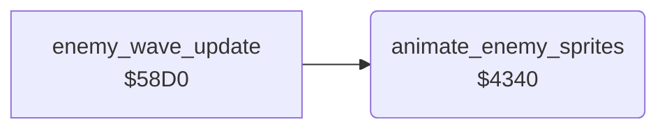

<!-- Generated by c64-docs from knowledge revision 20261024T103119.179-vx1fei and .c64-re-tools/local/generated/src/source-map.json. Do not edit: change the knowledge, generate the source again, then run docs.ts generate. -->
# enemy/enemy_frames.asm: Enemy sprite frames and colours

Range `$4340-$43D0`. Source: [enemy/enemy_frames.asm](../../../../src/enemy/enemy_frames.asm). Index: [the reference](../../index.md).

## Call graph

A solid arrow is a call, a thick arrow a table entry, a dotted arrow a jump. Rounded nodes are in this file.

## Names

### [`animate_enemy_sprites`](../../../../src/enemy/enemy_frames.asm#L6) `$4340`

*routine*

Sets the frame, the colour and the multicolour bit of the enemy sprites 1-4 from enemy_state, $5b+x and $60. Flying: a hires red frame every 8 ticks. Falling: frame $95 and the explosion frame on alternate ticks. State >= $e0: explosion frames $88-$8b.

- **Called from:** [`enemy_wave_update`](enemy_wave_update.md#enemy_wave_update) [`$58EB`](../../../../src/enemy/enemy_wave_update.asm#L17)
- **Reads:** [`enemy_state`](../../memory-map.md#enemy_state), [`tick`](../../memory-map.md#tick), [`SPMC`](../../memory-map.md#SPMC), [`SPRPTR`](../../memory-map.md#SPRPTR), [`enemy_climb`](../../memory-map.md#enemy_climb), [`wave_dir`](../../memory-map.md#wave_dir), [`RANDOM`](../../memory-map.md#RANDOM)
- **Writes:** [`SPMC`](../../memory-map.md#SPMC), [`SP0COL`](../../memory-map.md#SP0COL), [`SPRPTR`](../../memory-map.md#SPRPTR)

### [`animate_enemy_loop`](../../../../src/enemy/enemy_frames.asm#L8) `$4342`

*label*

- **Jumped to from:** [`animate_enemy_sprites`](enemy_frames.md#animate_enemy_sprites) [`$43CD`](../../../../src/enemy/enemy_frames.asm#L99)

### [`animate_enemy_flying`](../../../../src/enemy/enemy_frames.asm#L17) `$4352`

*label*

- **Jumped to from:** [`animate_enemy_sprites`](enemy_frames.md#animate_enemy_sprites) [`$43A7`](../../../../src/enemy/enemy_frames.asm#L74)

### [`animate_enemy_mask_loop`](../../../../src/enemy/enemy_frames.asm#L21) `$4356`

*label*

- **Jumped to from:** [`animate_enemy_sprites`](enemy_frames.md#animate_enemy_sprites) [`$4358`](../../../../src/enemy/enemy_frames.asm#L24)

### [`animate_enemy_steer`](../../../../src/enemy/enemy_frames.asm#L35) `$4371`

*label*

- **Jumped to from:** [`animate_enemy_sprites`](enemy_frames.md#animate_enemy_sprites) [`$436C`](../../../../src/enemy/enemy_frames.asm#L32)

### [`animate_enemy_frame_down`](../../../../src/enemy/enemy_frames.asm#L44) `$437F`

*label*

- **Jumped to from:** [`animate_enemy_sprites`](enemy_frames.md#animate_enemy_sprites) [`$437A`](../../../../src/enemy/enemy_frames.asm#L41)

### [`animate_enemy_not_level`](../../../../src/enemy/enemy_frames.asm#L47) `$4382`

*label*

- **Jumped to from:** [`animate_enemy_sprites`](enemy_frames.md#animate_enemy_sprites) [`$4374`](../../../../src/enemy/enemy_frames.asm#L38)

### [`animate_enemy_diving`](../../../../src/enemy/enemy_frames.asm#L54) `$438C`

*label*

$5b+x negative: one frame down, at least $94.

- **Jumped to from:** [`animate_enemy_sprites`](enemy_frames.md#animate_enemy_sprites) [`$4382`](../../../../src/enemy/enemy_frames.asm#L48)

### [`animate_enemy_direction`](../../../../src/enemy/enemy_frames.asm#L59) `$4392`

*label*

$60 negative: the wave flies to the right. Use the frames $99-$9d.

- **Jumped to from:** [`animate_enemy_sprites`](enemy_frames.md#animate_enemy_sprites) [`$4378`](../../../../src/enemy/enemy_frames.asm#L40), [`animate_enemy_sprites`](enemy_frames.md#animate_enemy_sprites) [`$437D`](../../../../src/enemy/enemy_frames.asm#L43), [`animate_enemy_sprites`](enemy_frames.md#animate_enemy_sprites) [`$4380`](../../../../src/enemy/enemy_frames.asm#L46), [`animate_enemy_sprites`](enemy_frames.md#animate_enemy_sprites) [`$4387`](../../../../src/enemy/enemy_frames.asm#L51), [`animate_enemy_sprites`](enemy_frames.md#animate_enemy_sprites) [`$438A`](../../../../src/enemy/enemy_frames.asm#L53), [`animate_enemy_sprites`](enemy_frames.md#animate_enemy_sprites) [`$438F`](../../../../src/enemy/enemy_frames.asm#L57)

### [`animate_enemy_set_frame`](../../../../src/enemy/enemy_frames.asm#L66) `$439B`

*label*

- **Jumped to from:** [`animate_enemy_sprites`](enemy_frames.md#animate_enemy_sprites) [`$4394`](../../../../src/enemy/enemy_frames.asm#L61)

### [`animate_enemy_falling`](../../../../src/enemy/enemy_frames.asm#L69) `$439E`

*label*

- **Jumped to from:** [`animate_enemy_sprites`](enemy_frames.md#animate_enemy_sprites) [`$434A`](../../../../src/enemy/enemy_frames.asm#L13)

### [`animate_enemy_explosion`](../../../../src/enemy/enemy_frames.asm#L75) `$43A9`

*label*

- **Jumped to from:** [`animate_enemy_sprites`](enemy_frames.md#animate_enemy_sprites) [`$4346`](../../../../src/enemy/enemy_frames.asm#L11)

### [`animate_enemy_mc_loop`](../../../../src/enemy/enemy_frames.asm#L79) `$43AD`

*label*

- **Jumped to from:** [`animate_enemy_sprites`](enemy_frames.md#animate_enemy_sprites) [`$43AF`](../../../../src/enemy/enemy_frames.asm#L82)

### [`animate_enemy_store_frame`](../../../../src/enemy/enemy_frames.asm#L94) `$43C7`

*label*

- **Jumped to from:** [`animate_enemy_sprites`](enemy_frames.md#animate_enemy_sprites) [`$439C`](../../../../src/enemy/enemy_frames.asm#L68)

### [`animate_enemy_next`](../../../../src/enemy/enemy_frames.asm#L96) `$43CA`

*label*

- **Jumped to from:** [`animate_enemy_sprites`](enemy_frames.md#animate_enemy_sprites) [`$4350`](../../../../src/enemy/enemy_frames.asm#L16)

### [`animate_enemy_done`](../../../../src/enemy/enemy_frames.asm#L100) `$43D0`

*label*

- **Jumped to from:** [`animate_enemy_sprites`](enemy_frames.md#animate_enemy_sprites) [`$43CB`](../../../../src/enemy/enemy_frames.asm#L98)
