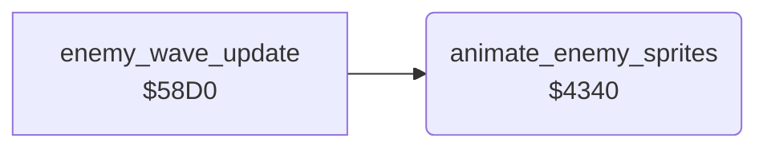

<!-- Generated by c64-docs from knowledge revision 20261025T214607.441-00m56k and .c64-re-tools/local/generated/src/source-map.json. Do not edit: change the knowledge, generate the source again, then run docs.ts generate. -->
# enemy/enemy_frames.asm: Enemy sprite frames and colours

Range `$4340-$43D0`. Source: [enemy/enemy_frames.asm](../../../../src/enemy/enemy_frames.asm). Index: [the reference](../../index.md).

## Routines

| Routine | Address | Reached from | Summary |
|---|---|---|---|
| [`animate_enemy_sprites`](enemy_frames.md#animate_enemy_sprites) | `$4340` | [`enemy_wave_update`](enemy_wave_update.md#enemy_wave_update) | Sets the frame, the colour and the multicolour bit of the enemy sprites 1-4 from enemy_state, $5b+x and $60. |

## Call graph

A solid arrow is a call, a thick arrow a table entry. Rounded nodes are in this file.

## Details

### [`animate_enemy_sprites`](../../../../src/enemy/enemy_frames.asm#L6) `$4340`

*routine*

Sets the frame, the colour and the multicolour bit of the enemy sprites 1-4 from enemy_state, $5b+x and $60. Flying: a hires red frame every 8 ticks. Falling: frame $95 and the explosion frame on alternate ticks. State >= $e0: explosion frames $88-$8b.

- **Called from:** [`enemy_wave_update`](enemy_wave_update.md#enemy_wave_update)
- **Reads:** [`enemy_state`](../../memory-map.md#enemy_state), [`tick`](../../memory-map.md#tick), [`SPMC`](../../memory-map.md#SPMC), [`SPRPTR`](../../memory-map.md#SPRPTR), [`enemy_climb`](../../memory-map.md#enemy_climb), [`wave_dir`](../../memory-map.md#wave_dir), [`RANDOM`](../../memory-map.md#RANDOM)
- **Writes:** [`SPMC`](../../memory-map.md#SPMC), [`SP0COL`](../../memory-map.md#SP0COL), [`SPRPTR`](../../memory-map.md#SPRPTR)

| Label | Address | Comment |
|---|---|---|
| [`animate_enemy_loop`](../../../../src/enemy/enemy_frames.asm#L8) | `$4342` |  |
| [`animate_enemy_flying`](../../../../src/enemy/enemy_frames.asm#L17) | `$4352` |  |
| [`animate_enemy_mask_loop`](../../../../src/enemy/enemy_frames.asm#L21) | `$4356` |  |
| [`animate_enemy_steer`](../../../../src/enemy/enemy_frames.asm#L35) | `$4371` |  |
| [`animate_enemy_frame_down`](../../../../src/enemy/enemy_frames.asm#L44) | `$437F` |  |
| [`animate_enemy_not_level`](../../../../src/enemy/enemy_frames.asm#L47) | `$4382` |  |
| [`animate_enemy_diving`](../../../../src/enemy/enemy_frames.asm#L54) | `$438C` | $5b+x negative: one frame down, at least $94. |
| [`animate_enemy_direction`](../../../../src/enemy/enemy_frames.asm#L59) | `$4392` | $60 negative: the wave flies to the right. Use the frames $99-$9d. |
| [`animate_enemy_set_frame`](../../../../src/enemy/enemy_frames.asm#L66) | `$439B` |  |
| [`animate_enemy_falling`](../../../../src/enemy/enemy_frames.asm#L69) | `$439E` |  |
| [`animate_enemy_explosion`](../../../../src/enemy/enemy_frames.asm#L75) | `$43A9` |  |
| [`animate_enemy_mc_loop`](../../../../src/enemy/enemy_frames.asm#L79) | `$43AD` |  |
| [`animate_enemy_store_frame`](../../../../src/enemy/enemy_frames.asm#L94) | `$43C7` |  |
| [`animate_enemy_next`](../../../../src/enemy/enemy_frames.asm#L96) | `$43CA` |  |
| [`animate_enemy_done`](../../../../src/enemy/enemy_frames.asm#L100) | `$43D0` |  |
