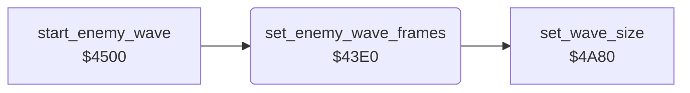

<!-- Generated by c64-docs from knowledge revision 20261024T103119.179-vx1fei and .c64-re-tools/local/generated/src/source-map.json. Do not edit: change the knowledge, generate the source again, then run docs.ts generate. -->
# enemy/enemy_frames_43e0.asm

Range `$43E0-$43F9`. Source: [enemy/enemy_frames_43e0.asm](../../../../src/enemy/enemy_frames_43e0.asm). Index: [the reference](../../index.md).

## Call graph

A solid arrow is a call, a thick arrow a table entry, a dotted arrow a jump. Rounded nodes are in this file.

## Names

### [`set_enemy_wave_frames`](../../../../src/enemy/enemy_frames_43e0.asm#L6) `$43E0`

*routine*

Sets the frame of the enemy sprites 1-4 to $96 (to the left, $60 positive) or $9b (to the right). Then $4a80 sets the wave size from the score.

- **Called from:** [`start_enemy_wave`](enemy_waves.md#start_enemy_wave) [`$453A`](../../../../src/enemy/enemy_waves.asm#L38)
- **Calls:** [`set_wave_size`](wave_size.md#set_wave_size)
- **Reads:** [`wave_dir`](../../memory-map.md#wave_dir)
- **Writes:** [`enemy_sprite_ptrs`](../../memory-map.md#enemy_sprite_ptrs), [`SPRPTR+2`](../../memory-map.md#SPRPTR), [`SPRPTR+3`](../../memory-map.md#SPRPTR), [`SPRPTR+4`](../../memory-map.md#SPRPTR)
- **Refers to:** [`enemy_sprites`](../data/sprites_2200.md#enemy_sprites)

### [`set_wave_frames_right`](../../../../src/enemy/enemy_frames_43e0.asm#L11) `$43E8`

*label*

- **Jumped to from:** [`set_enemy_wave_frames`](enemy_frames_43e0.md#set_enemy_wave_frames) [`$43E2`](../../../../src/enemy/enemy_frames_43e0.asm#L8)

### [`set_wave_frames_store`](../../../../src/enemy/enemy_frames_43e0.asm#L13) `$43EA`

*label*

- **Jumped to from:** [`set_enemy_wave_frames`](enemy_frames_43e0.md#set_enemy_wave_frames) [`$43E6`](../../../../src/enemy/enemy_frames_43e0.asm#L10)
