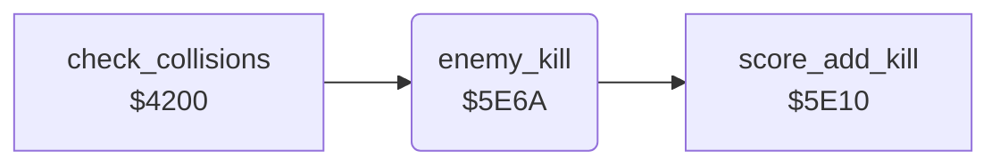

<!-- Generated by c64-docs from knowledge revision 20261024T103119.179-vx1fei and .c64-re-tools/local/generated/src/source-map.json. Do not edit: change the knowledge, generate the source again, then run docs.ts generate. -->
# enemy/enemy_kill.asm: Enemy kill by a missile

Range `$5E6A-$5E91`. Source: [enemy/enemy_kill.asm](../../../../src/enemy/enemy_kill.asm). Index: [the reference](../../index.md).

## Call graph

A solid arrow is a call, a thick arrow a table entry, a dotted arrow a jump. Rounded nodes are in this file.

## Names

### [`enemy_kill`](../../../../src/enemy/enemy_kill.asm#L6) `$5E6A`

*routine*

Kills enemy X (1-4) when its state is $01-$cf: sets the state $d0 (falling) and adds the score. Input from $4200 after the missile test. When the jet is not lost and $af is 0, it starts the noise of SID voice 1 and sets $af to 6 frames.

- **Called from:** [`check_collisions`](../game/collisions.md#check_collisions) [`$427E`](../../../../src/game/collisions.asm#L91)
- **Calls:** [`score_add_kill`](../game/score_add.md#score_add_kill)
- **Reads:** [`enemy_state`](../../memory-map.md#enemy_state), [`jet_state`](../../memory-map.md#jet_state), [`kill_sound_timer`](../../memory-map.md#kill_sound_timer)
- **Writes:** [`enemy_state`](../../memory-map.md#enemy_state), [`VCREG1`](../../memory-map.md#VCREG1), [`kill_sound_timer`](../../memory-map.md#kill_sound_timer)

### [`enemy_kill_done`](../../../../src/enemy/enemy_kill.asm#L26) `$5E91`

*label*

- **Jumped to from:** [`enemy_kill`](enemy_kill.md#enemy_kill) [`$5E6C`](../../../../src/enemy/enemy_kill.asm#L9), [`enemy_kill`](enemy_kill.md#enemy_kill) [`$5E70`](../../../../src/enemy/enemy_kill.asm#L11), [`enemy_kill`](enemy_kill.md#enemy_kill) [`$5E7D`](../../../../src/enemy/enemy_kill.asm#L17), [`enemy_kill`](enemy_kill.md#enemy_kill) [`$5E81`](../../../../src/enemy/enemy_kill.asm#L19)
