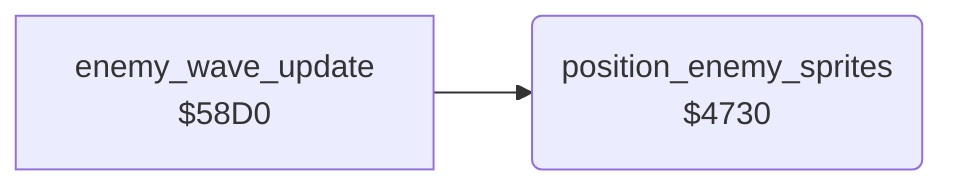

<!-- Generated by c64-docs from knowledge revision 20261025T214607.441-00m56k and .c64-re-tools/local/generated/src/source-map.json. Do not edit: change the knowledge, generate the source again, then run docs.ts generate. -->
# enemy/enemy_positions.asm: Enemy sprite positions

Range `$4730-$47BB`. Source: [enemy/enemy_positions.asm](../../../../src/enemy/enemy_positions.asm). Index: [the reference](../../index.md).

## Routines

| Routine | Address | Reached from | Summary |
|---|---|---|---|
| [`position_enemy_sprites`](enemy_positions.md#position_enemy_sprites) | `$4730` | [`enemy_wave_update`](enemy_wave_update.md#enemy_wave_update) | Places the enemy sprites 1-4. |

## Call graph

A solid arrow is a call, a thick arrow a table entry. Rounded nodes are in this file.

## Details

### [`position_enemy_sprites`](../../../../src/enemy/enemy_positions.asm#L6) `$4730`

*routine*

Places the enemy sprites 1-4. The screen column is $4b+x - $0d + 3. State 0 or a column >= $2c turns the sprite off. X = column * 8 + $53+x, with the bit in $d010 for columns >= $20. Y = $47+x * 8 + $4f+x + 42.

- **Called from:** [`enemy_wave_update`](enemy_wave_update.md#enemy_wave_update)
- **Reads:** [`enemy_state`](../../memory-map.md#enemy_state), [`SPENA`](../../memory-map.md#SPENA), [`temp`](../../memory-map.md#temp), [`map_column`](../../memory-map.md#map_column), [`enemy_col`](../../memory-map.md#enemy_col), [`MSIGX`](../../memory-map.md#MSIGX), [`temp2`](../../memory-map.md#temp2), [`enemy_x_fine`](../../memory-map.md#enemy_x_fine), [`enemy_row`](../../memory-map.md#enemy_row), [`enemy_y_fine`](../../memory-map.md#enemy_y_fine), [`calc_x`](../../memory-map.md#calc_x), [`calc_y`](../../memory-map.md#calc_y)
- **Writes:** [`temp`](../../memory-map.md#temp), [`SPENA`](../../memory-map.md#SPENA), [`temp2`](../../memory-map.md#temp2), [`MSIGX`](../../memory-map.md#MSIGX), [`calc_x`](../../memory-map.md#calc_x), [`calc_y`](../../memory-map.md#calc_y), [`SP0X`](../../memory-map.md#SP0X), [`SP0Y`](../../memory-map.md#SP0Y)

| Label | Address | Comment |
|---|---|---|
| [`position_enemy_loop`](../../../../src/enemy/enemy_positions.asm#L9) | `$4734` | Y = sprite bit $10, $08, $04, $02 for the enemies 4-1. |
| [`position_enemy_hide`](../../../../src/enemy/enemy_positions.asm#L12) | `$4738` |  |
| [`position_enemy_column`](../../../../src/enemy/enemy_positions.asm#L21) | `$4749` |  |
| [`position_enemy_msb_off`](../../../../src/enemy/enemy_positions.asm#L44) | `$4774` |  |
| [`position_enemy_set_xy`](../../../../src/enemy/enemy_positions.asm#L51) | `$4781` |  |
| [`position_enemy_next`](../../../../src/enemy/enemy_positions.asm#L82) | `$47B2` |  |
| [`position_enemy_done`](../../../../src/enemy/enemy_positions.asm#L89) | `$47BB` |  |
